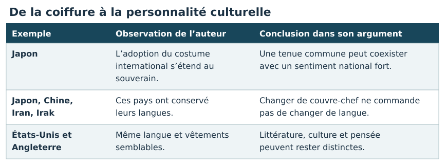

# ENS · MP-PC · Arabe (LE2) 2010 — Corrigé brut

*Corrigé rédigé par IA, non officiel. Signalez toute erreur.*

**Rédaction** · GPT-6.2 Astra Ultra · vitesse non renseignée

**Révision** · GPT-6.2 Astra Ultra · vitesse non renseignée

**Retouches** · GPT-6.2 Astra Ultra · vitesse non renseignée

Épreuve commune aux ENS de Paris et de Cachan. Durée totale de deux heures. Le dictionnaire est autorisé. La version porte sur un extrait de Tawfiq al-Hakim ; la question d’opinion appelle une réponse en arabe.

## I. Version française — L’Égypte et la tenue internationale

Je commencerai donc par dire qu’il n’y a pas lieu de s’inquiéter ni de craindre un affaiblissement du sentiment national si l’on ôte le tarbouche. Car ce sentiment réside dans l’ardeur du cœur, et non dans ce cornet rouge. Il y aurait peut-être matière à s’alarmer si nous étions le premier peuple au monde à envisager ce changement. Mais d’autres nations orientales l’ont fait avant nous, et leur sentiment national est aujourd’hui plus fort que le nôtre. Nous n’avons donc aucune raison d’hésiter ni de craindre quoi que ce soit. Qui pourrait prétendre que le Japon, si profondément attaché à ses traditions orientales, a perdu son âme nationale le jour où il a adopté la tenue internationale complète et où son souverain lui-même, pourtant revêtu d’un caractère religieux et sacré, l’a portée ? Qui pourrait prétendre que le Prophète arabe avait un costume qui lui fût propre ? Le vêtement ne distinguait ni le musulman, ni le chrétien, ni le juif…

Aujourd’hui, nous sentons le besoin de réaliser, à l’intérieur de nos frontières, l’unité et l’égalité en abolissant les distinctions qui divisent la population en deux catégories placées sur un pied d’inégalité. Aujourd’hui encore, alors que nous allons prendre part à la vie internationale en nous intégrant à la communauté des nations civilisées, quel intérêt avons-nous à maintenir entre nous et les autres peuples du monde cette différence si visible qui, à tout instant, proclame que nous seuls sommes restés en arrière, loin des autres nations orientales, musulmanes ou non, qui ont annoncé leur réveil au monde et sont venues siéger aux côtés des pays les plus avancés en civilisation ?…

À ceux qui disent que changer de couvre-chef pourrait entraîner aussi un changement de langue, il suffit de répondre en regardant d’autres pays dont la situation ressemble à la nôtre et en se posant cette question : le Japon, la Chine, l’Iran et l’Irak ont-ils changé de langue ? Et depuis quand l’uniformité du costume imposerait-elle l’uniformité de la pensée ? Ce que l’on observe dans la civilisation d’aujourd’hui, c’est qu’elle a uniformisé le vêtement parmi les peuples de la terre sans porter atteinte à la personnalité ni à la culture de chacun d’eux !…

Voyez l’Amérique : elle s’habille comme l’Angleterre et parle comme elle l’anglais. Pourtant, la littérature, la culture et la pensée des Américains diffèrent de celles des Anglais.

*D’après Tawfiq al-Hakim, Sous le soleil de la pensée, Maktabat Misr, Le Caire.*

## II. Réponse en arabe

أرى أن للزي التقليدي قيمة حين يختاره الناس بحرية. فقد يحمل الثوب ذكرى عائلية أو يدل على مهارة لا تزال تنتقل من جيل إلى جيل. كانت جدتي تحتفظ بثوب مطرز صنعته أمها. وحين كانت تلبسه في العيد، كنا نسألها عن أسماء الألوان وعن البلدة التي اشتهرت بذلك التطريز. في هذه الحال يصبح الثوب وسيلة لنقل المعرفة، ويكون الحفاظ عليه اختيارا له معنى.

لكن المشكلة تبدأ حين نجعل لباس الإنسان امتحانا لوطنيته. فالشاب الذي يلبس معطفا عمليا ليذهب إلى الجامعة قد يكون شديد التعلق بلغته وتاريخ بلاده. وقد تحب فتاة زيا ورثته عن أسرتها من غير أن ترغب في ارتدائه كل يوم. لذلك أتفق مع الكاتب في أن شكل القبعة لا يكشف ما في القلب. غير أن توحيد الملابس لن يزيل وحده الفوارق الاجتماعية، لأن ثمن الثوب وطريقة الحصول عليه قد يكشفان تلك الفوارق أيضا.

في رأيي يستطيع المجتمع أن يدعم الحرفيين، وأن يتيح للأطفال فرصة تعلم فنون النسيج والتطريز، مع احترام حق كل فرد في اختيار ما يلائم حياته. هكذا يبقى التقليد حيا لأن الناس يجدون فيه شيئا يحبونه.

[Cahier LE2, p. 4](https://www.ens.psl.eu/IMG/file/concours/2010/MPI/mp-sujet-le2.pdf#page=4)
