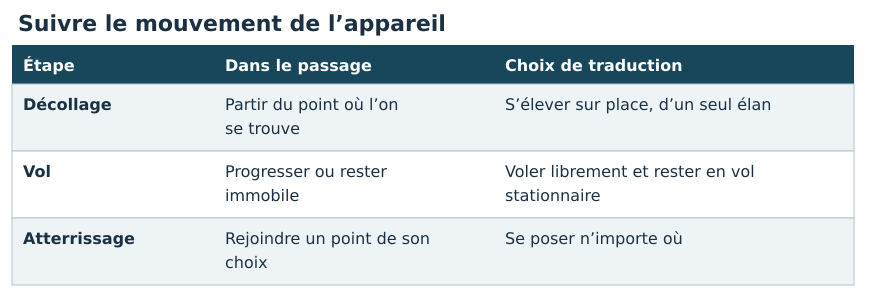

# ENS · MP-PC · Chinois (LE2) 2010 — Corrigé brut

*Corrigé rédigé par IA, non officiel. Signalez toute erreur.*

**Rédaction** · GPT-6.2 Astra Ultra · vitesse non renseignée

**Révision** · GPT-6.2 Astra Ultra · vitesse non renseignée

Épreuve commune aux ENS de Paris et de Cachan. Durée totale de deux heures. Le dictionnaire est autorisé. La seconde réponse est une composition personnelle d’environ 300 caractères.

## 1. Version française

Depuis des temps très anciens, les êtres humains rêvent de pouvoir voler librement. Quantité de mythes anciens racontent les rêves de vol des hommes d’autrefois. Dans ces rêves, on s’élevait d’un seul élan, sur place. Comme un hélicoptère moderne, on pouvait aussi bien voler librement que rester immobile dans les airs, puis se poser n’importe où.

Parmi toutes les tentatives des Anciens, les plus intéressantes et les plus représentatives sont un jouet de la Chine ancienne, la « libellule de bambou », et les dessins que l’Italien Léonard de Vinci a consacrés au vol. On lit dans le neuvième volume de l’*Encyclopédie britannique abrégée* : « L’hélicoptère compte parmi les premières formes de vol que l’humanité ait imaginées. Pendant bien des années, on a cru que Léonard de Vinci avait été le premier à en proposer l’idée. On sait aujourd’hui que les Chinois avaient fabriqué des jouets en forme d’hélicoptère avant les Européens du Moyen Âge. » Ce jouet parvint en Europe au XIVe siècle.

## 2. Rédaction en chinois

**你想上天吗？**

我想上天，不过我最想去的地方不是遥远的星球，而是家乡的上空。小时候，我沿着小河走去上学，总觉得河对岸的树林离我很远。要是有一天能坐在直升机里，从空中看那条熟悉的路，我大概会发现，原来河流、树林和学校都在同一片小小的土地上。

我还想带上一本画册。飞机停在空中时，我可以画下河道的转弯、桥上的人影和田里的水渠。回到地面以后，再沿着画中的路线走一次，看看从天上看不见的是哪些东西。一张地图能告诉我房子在哪里，却不能让我听见屋里人的笑声。

当然，飞行会消耗能源，也可能打扰附近的居民。如果只是为了拍一张漂亮的照片，我宁愿爬山。对我来说，上天最吸引人的地方，是换一个角度认识每天生活的世界。等我回到地上，那条走了很多年的小路，也许就不再和昨天完全一样了。

[Cahier LE2, p. 5](https://www.ens.psl.eu/IMG/file/concours/2010/MPI/mp-sujet-le2.pdf#page=5) · [Rapport du jury](https://www.ens.psl.eu/IMG/file/concours/2010/MPI/mp-ecrit-chinois-le2.pdf)
