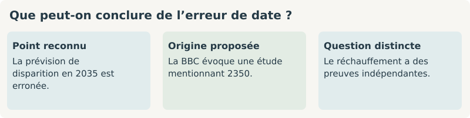

# ENS MP-PC — Espagnol (LE2) 2010 · Corrigé brut

*Corrigé rédigé par IA, non officiel. Signalez toute erreur.*

**Rédaction** · GPT-6.2 Astra Ultra · vitesse non renseignée

## 1. Version — 15 points

**Le GIEC reconnaît une « erreur » dans ses prévisions sur la fonte des glaciers de l’Himalaya**

Le vice-président du Groupe d’experts intergouvernemental sur l’évolution du climat (GIEC) de l’ONU, Jean-Pascal van Ypersele, a admis que l’indication figurant dans un rapport de 2007 de l’organisme sur les effets du réchauffement climatique, selon laquelle les glaciers de l’Himalaya disparaîtraient en 2035, était « erronée ». Van Ypersele a souligné toutefois que cette erreur n’invalidait pas les preuves scientifiques de l’existence d’un changement climatique dû à l’action humaine. Il a affirmé que beaucoup se serviraient de cette défaillance pour tenter une nouvelle fois de discréditer le GIEC et de mettre en cause le réchauffement climatique.

Début décembre, à la veille du sommet de Copenhague sur le climat, on a appris qu’à la suite d’une attaque informatique, la correspondance de chercheurs de l’université d’East Anglia, au Royaume-Uni, l’une des plus prestigieuses dans le domaine de l’étude du changement climatique, aurait révélé qu’une partie des travaux du centre était modifiée pour exagérer l’ampleur du réchauffement. Le GIEC avait alors dénoncé l’affaire comme une tentative de discréditer ses experts.

Selon la chaîne britannique BBC, l’affirmation selon laquelle les glaciers de l’Himalaya allaient disparaître en 2035 pourrait avoir pour origine, indique la BBC, une étude de 1996 qui situait la fonte des glaces en 2350.

*D’après elpais.com, 19 janvier 2010.*

## 2. Question — 5 points, 100 mots minimum

**¿Qué problema apunta este texto en cuanto a las consecuencias prácticas de las teorías científicas y su utilización?**

El texto plantea un problema de escala. Un error sobre la fecha de desaparición de determinados glaciares modifica la confianza que merece esa previsión concreta. Por ejemplo, si unas autoridades prevén cambios en la disponibilidad de agua, necesitan distinguir lo que se sabe del retroceso de un glaciar y lo que solo se estima acerca de su ritmo. Reconocer la equivocación, comprobar la fuente y precisar la incertidumbre tiene, pues, consecuencias prácticas. También protege la credibilidad de futuras decisiones.

El uso público de la corrección puede seguir otra lógica. Quien quiera desacreditar todas las investigaciones sobre el clima puede presentar una fecha errónea como si invalidara observaciones independientes. A la inversa, una institución que restara importancia al fallo para proteger una causa legítima dificultaría la crítica que hace posible el conocimiento científico. Incluso la explicación que recoge la BBC sigue siendo una hipótesis en el artículo. A mi juicio, comunicar bien una teoría exige indicar qué afirmación se corrige, qué pruebas siguen en pie y qué decisión concreta sería razonable revisar.

[Cahier de deux heures, p. 6](https://www.ens.psl.eu/IMG/file/concours/2010/MPI/mp-sujet-le2.pdf#page=6)
