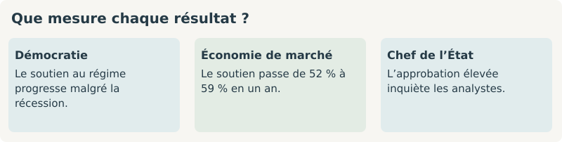

# ENS MP-PC — Espagnol (LV1) 2010 · Corrigé brut

*Corrigé rédigé par IA, non officiel. Signalez toute erreur.*

**Rédaction** · GPT-6.2 Astra Ultra · vitesse non renseignée

## 1. Version — 12 points

**La crise économique consolide la démocratie en Amérique latine**

La crise économique internationale a eu des effets inattendus en Amérique latine. C’est ce qui ressort de l’étude Latinobarómetro 2009, présentée vendredi. Elle montre une Amérique latine préoccupée par l’économie et la délinquance, mais aussi plus tolérante, plus heureuse et plus confiante en l’avenir.

Les analystes de Latinobarómetro eux-mêmes ne peuvent s’empêcher de parler de « paradoxe » lorsqu’ils expliquent les résultats de leurs travaux. Ils constatent que le soutien à la démocratie s’est renforcé au cours d’une année de recul économique où le produit intérieur brut de l’Amérique latine devrait se contracter d’environ 1,6 %.

Ce paradoxe tient peut-être au fait que le choc a été amorti par les « cinq années vertueuses » de 2003 à 2008. Durant cette période, l’économie a connu une croissance annuelle moyenne de 4,8 %, ce qui a permis l’essor des classes moyennes et un recul de la pauvreté de dix points. « Alors que la crise des années quatre-vingt a mis la région à terre, celle-ci semble endiguée par des politiques publiques dont les populations reconnaissent les effets », indique le rapport.

C’est peut-être pour cela que, même si les problèmes économiques — inflation, chômage, pauvreté — sont au premier rang des préoccupations de la moitié des personnes interrogées, le soutien à l’économie de marché est passé de 52 % en 2008 à 59 % en 2009. Il est majoritaire dans tous les pays, à l’exception de l’Équateur et de l’Argentine.

Cet optimisme se traduit par le degré d’approbation dont bénéficient les dirigeants. Le soutien exceptionnellement élevé accordé à la personne du président conduit les analystes de Latinobarómetro à mettre en garde contre un certain risque d’« hyperprésidentialisme » au détriment d’autres institutions.

*D’après elpais.com, 11 décembre 2009.*

## 2. Questions — 8 points

### 1. ¿Por qué resulta «paradójico» el aumento del apoyo a la democracia en un periodo de crisis económica?

Podría esperarse que una recesión debilitara la confianza de los ciudadanos en el régimen bajo el cual viven. Si peligra un empleo o resulta difícil mantener el nivel de vida, la frustración puede dirigirse contra los gobernantes y, en ciertos casos, contra las propias instituciones. La encuesta de 2009 sorprende porque el respaldo a la democracia aumenta precisamente cuando se prevé una contracción de la economía regional. Sin embargo, los ciudadanos también comparan su situación con experiencias anteriores. Los años de crecimiento habían ampliado las clases medias y reducido la pobreza. Además, según el informe, la intervención pública parece haber contenido parte del golpe, a diferencia de la experiencia de los años ochenta. Se puede, por tanto, temer una crisis y valorar al mismo tiempo la capacidad de las instituciones para afrontarla. El artículo propone esa explicación sin demostrar que cada encuestado haya razonado así.

### 2. ¿Cómo le parece el balance de las «preocupaciones» y del «optimismo» de los latinoamericanos en este texto?

Me parece un balance esperanzador, pero más frágil de lo que sugiere el título. Una persona puede preocuparse por la delincuencia o el desempleo y seguir confiando en que sus hijos vivirán mejor. La preocupación se refiere a problemas presentes; el optimismo incluye un juicio sobre el futuro y sobre la respuesta que la sociedad es capaz de dar. Conviene, además, distinguir el apoyo a la democracia del apoyo a la economía de mercado. El paso del 52 % al 59 % se refiere a esta última y admite diferencias nacionales. Finalmente, la aprobación de un presidente popular puede convivir con poco aprecio por instituciones que limitan su poder. Consideraría más sólida la confianza democrática si, junto con el respaldo al Ejecutivo, los ciudadanos defendieran la independencia de los tribunales y la capacidad del Parlamento para exigir cuentas.

[Cahier de deux heures, p. 4](https://www.ens.psl.eu/IMG/file/concours/2010/MPI/mp-sujet-lv1.pdf#page=4)
