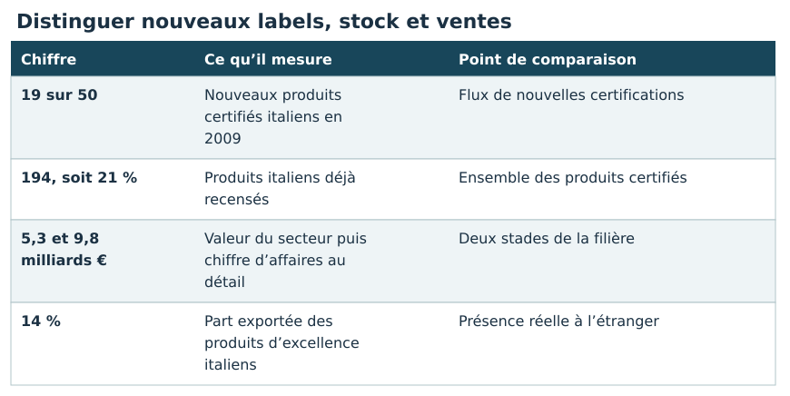

# ENS · MP-PC · Italien (LE2) 2010 — Corrigé guidé

*Corrigé rédigé par IA, non officiel. Signalez toute erreur.*

**Rédaction** · GPT-6.2 Astra Ultra · vitesse non renseignée

Épreuve commune aux ENS de Paris et de Cachan. Durée totale de deux heures. Version sur 15 points et question en italien sur 5 points. Le dictionnaire est interdit. Le rapport PC archivé sous ce libellé évoque la télévision et les technologies interactives. La page 7 du cahier porte sur les produits alimentaires. C’est cette page qui détermine la présente version et la question traitée.

## 1. Version française

L’Italie arrive en tête en Europe pour les produits alimentaires de qualité liés au terroir. Cette première place s’est consolidée en 2009 à la faveur d’une véritable accélération : sur cinquante nouveaux produits ayant obtenu un label, pas moins de dix-neuf sont italiens. Au classement général, nous occupons la première place avec 194 produits, soit 21 % du total, devant la France, qui en compte 167, et l’Espagne, qui en compte 129. Ces données figurent dans le *Rapport 2009 sur les productions agroalimentaires italiennes*, établi par l’Observatoire Qualivita.

« L’agroalimentaire de qualité parle italien », commente Mauro Rosati, directeur de l’Observatoire. « Et il ne faut pas lire ce résultat isolément : nous ne parlons pas de petits marchés, mais d’une part importante de la culture gastronomique du pays. Défendre ce type de production, c’est limiter les effets de l’agriculture sur l’environnement, préserver la diversité des paysages et créer les conditions d’une relance du tourisme. »

Les chiffres de la filière montrent, eux aussi, que l’agriculture de terroir est loin d’être négligeable : elle représente 5,3 milliards d’euros, montant qui atteint 9,8 milliards si l’on considère le chiffre d’affaires total des ventes au consommateur. Le point faible du système tient à sa difficulté à se concevoir comme un ensemble capable de faire équipe pour créer des débouchés.

Comme le fait observer Paolo De Castro, président de la Fondation Qualivita, le succès même du *made in Italy* risque de devenir un véritable problème si les entreprises abordent en ordre dispersé le défi de la mondialisation : « À l’étranger, on veut manger italien, on veut de la mozzarella et du parmesan. Mais si nous n’exportons que 14 % de nos meilleurs produits agroalimentaires, des marchandises pseudo-italiennes viennent combler le vide dans les magasins : ces imitations fabriquées ailleurs tirent parti de la sonorité d’un nom italien et finissent par réaliser quatre fois le chiffre d’affaires des produits authentiques. Il faut nous organiser pour acheminer nos produits là où les clients les demandent. »

> [!INDICATION]
> *Ben 19* insiste sur le nombre, d’où « pas moins de dix-neuf ». *Ci vede in testa* introduit la voix italienne du journal : conserver « nous » permet de la distinguer de la voix du traducteur. *Fare squadra* signifie ici agir ensemble pour développer des débouchés.

## 2. Qual è, secondo lei, l’immagine della cucina italiana all’estero?

All’estero la cucina italiana mi sembra associata prima di tutto alla convivialità. Una pizza divisa con gli amici o un piatto di pasta preparato in casa evocano un modo semplice e piacevole di stare insieme. Questa immagine rende la cucina italiana accessibile anche a chi non ha mai visitato l’Italia. Tuttavia può far dimenticare quanto siano diverse le tradizioni regionali. Chi conosce soltanto gli spaghetti al pomodoro potrebbe restare sorpreso davanti a un risotto lombardo o a un piatto di polenta.

Un altro aspetto riguarda il rapporto fra il nome e il prodotto. Una confezione dai colori della bandiera italiana può suggerire una provenienza che l’etichetta, letta con attenzione, non conferma. Per me la risposta migliore consiste nel raccontare al consumatore da dove vengono gli ingredienti e come si prepara un piatto. Un ristoratore che spiega perché usa un certo formaggio fa conoscere una cultura, oltre a vendere un pasto. L’immagine dell’Italia diventa così più precisa senza perdere il suo carattere accogliente.

> [!INDICATION]
> La question porte sur une *image*. La première scène, le partage d’une pizza, explique ce qu’un public peut associer à l’Italie. L’exemple régional puis celui de l’emballage permettent de distinguer représentation, diversité des pratiques et origine du produit.

[Cahier LE2, p. 7](https://www.ens.psl.eu/IMG/file/concours/2010/MPI/mp-sujet-le2.pdf#page=7) · [Rapport du jury](https://www.ens.psl.eu/IMG/file/concours/2010/PC/pc-ecrit-italien-le2.pdf)
