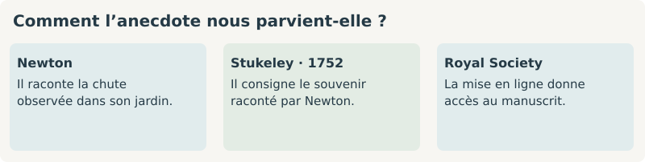

# ENS MP-PC — Italien (LV1) 2010 · Corrigé brut

*Corrigé rédigé par IA, non officiel. Signalez toute erreur.*

**Lecture du rapport du jury** · GPT-6.2 Astra Ultra · vitesse non renseignée

**Rédaction** · GPT-6.2 Astra Ultra · vitesse non renseignée

## 1. Version — 12 points

Vous souvenez-vous de cette histoire où le grand génie anglais du XVIIᵉ siècle, sir Isaac Newton, somnole sous un pommier et se réveille en sursaut lorsqu’un fruit mûr lui tombe sur la tête ? Le savant se demande quelle force a bien pu faire tomber la pomme et finit, quelque temps plus tard, par formuler sa célèbre loi de l’attraction universelle. Eh bien, cette anecdote passait autrefois pour authentique. Puis on nous a assuré qu’il s’agissait d’une légende. Voici que l’on rend public un manuscrit de l’époque pour montrer que les faits sont attestés.

C’est la Royal Society, la célèbre société savante anglaise dont Newton lui-même fut président, qui s’est chargée de tirer l’affaire au clair. Elle a mis en ligne pour la première fois la biographie de Newton écrite par son contemporain et ami William Stukeley, qui confirme en grande partie la véracité de la célèbre anecdote. Dans ce manuscrit de 1752, intitulé *Memoirs of Sir Isaac Newton’s Life*, Stukeley rapporte avoir recueilli de la bouche même de Newton le récit de la naissance de sa théorie de la gravitation universelle. « Cela se produisit alors qu’il était assis, plongé dans ses réflexions, à la suite de la chute d’une pomme. » Le fruit ne lui est assurément pas tombé sur la tête, comme les instituteurs le racontent aux enfants à l’école primaire. Mais le savant se trouvait bel et bien dans le jardin de sa maison de Woolsthorpe Manor quand il vit tomber le fruit et se demanda : « Pourquoi tombe-t-il toujours vers le centre de la Terre, et non de côté ou vers le haut ? »

Partant de cette question fondamentale, il élabora ensuite la théorie selon laquelle il doit exister une force d’attraction universelle, propre à tous les corps dotés d’une masse, que l’on a appelée force de gravité. C’est le même type de force qui attire les corps vers le centre de la Terre et qui gouverne les grands mouvements des corps célestes.

*Franco Foresta Martin, Corriere della Sera, 18 janvier 2010.*

## 2. Questions — 8 points

### a. Secondo lei, quanto conta l’osservazione della vita quotidiana nelle grandi scoperte scientifiche?

L’osservazione quotidiana conta soprattutto quando rende strano ciò che tutti considerano ovvio. Migliaia di persone avevano visto cadere un frutto prima di Newton. La domanda feconda consisteva nel chiedersi perché la caduta avesse una direzione precisa e se la spiegazione potesse valere anche lontano dalla superficie terrestre. Un fatto familiare offre quindi un problema accessibile, ma non contiene già la legge che lo spiegherà. Per passare dalla domanda a una teoria occorrono concetti, confronti e conseguenze controllabili.

Si può fare un esempio domestico. Un cucchiaio di metallo sembra più freddo di uno di legno lasciato nella stessa stanza. Se ci fidassimo soltanto della prima impressione, attribuiremmo loro temperature diverse. Un termometro e un ragionamento sul trasferimento di calore ci obbligano invece a precisare che cosa percepisce la mano. Il valore scientifico dell’esperienza quotidiana sta proprio in questa doppia funzione: suggerire una domanda e offrire un punto di partenza da cui il pensiero può anche allontanarsi. Raccontare soltanto l’istante dell’intuizione farebbe scomparire il lavoro necessario per verificarla.

### b. Oggi, esistono ricerche scientifiche puramente astratte, nelle quali non vale più nessun riferimento alle intuizioni fornite dai nostri cinque sensi?

Distinguerei il modo in cui nasce un’idea dal modo in cui la si giustifica. Un matematico può immaginare una figura disegnata sulla carta e ricavarne una congettura su spazi di molte dimensioni. Nessuno può vedere direttamente tutte quelle dimensioni. La validità del risultato dipende dalla dimostrazione condotta a partire dalle definizioni, anche quando l’immagine iniziale cessa di essere utile. In questo senso esiste una ricerca astratta che non deve chiedere ai cinque sensi di decidere se una proposizione sia vera.

La situazione è diversa quando una teoria pretende di descrivere il mondo fisico. Un’onda gravitazionale, per esempio, non deve essere percepibile a occhio nudo perché se ne possano cercare gli effetti con uno strumento. Il dato accessibile allo scienziato è già il risultato di una catena di misure e interpretazioni. L’astrazione permette allora di superare i limiti dell’intuizione ordinaria senza eliminare il confronto con l’esperienza. A mio parere l’errore sarebbe attribuire ai sensi un unico ruolo: possono ispirare un’immagine, segnalare un fenomeno oppure, tramite strumenti, mettere alla prova una previsione.

[Cahier de deux heures, p. 5](https://www.ens.psl.eu/IMG/file/concours/2010/MPI/mp-sujet-lv1.pdf#page=5) · [Rapport du jury](https://www.ens.psl.eu/IMG/file/concours/2010/MPI/mp-ecrit-italien-lv1.pdf)
