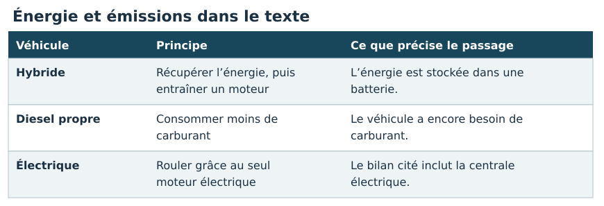

# ENS · MP-PC · Japonais (LE2) 2010 — Corrigé brut

*Corrigé rédigé par IA, non officiel. Signalez toute erreur.*

**Rédaction** · GPT-6.2 Astra Ultra · vitesse non renseignée

**Révision** · GPT-6.2 Astra Ultra · vitesse non renseignée

Épreuve commune aux ENS de Paris et de Cachan. Durée totale de deux heures. Le dictionnaire est autorisé. La seconde question demande un résumé en japonais sur les voitures écologiques.

## I. Version française

Au Japon, les émissions annuelles de CO₂ s’élèvent à environ 1,3 milliard de tonnes (exercice 2005). Les automobiles en rejettent quelque 17 %.

La plupart des voitures actuelles roulent grâce à un moteur qui brûle de l’essence produite à partir du pétrole. Réduire la quantité d’essence brûlée afin d’éviter de rejeter du CO₂, tel est le principe des différents types de voitures écologiques.

Les voitures hybrides transforment en électricité l’énergie disponible, notamment au freinage, et la stockent dans une batterie. Elles peuvent ensuite l’utiliser pour entraîner un moteur électrique et rouler. Au Japon, leur nombre a été multiplié par sept en six ans. Il existe aussi des voitures à moteur diesel propre qui consomment peu de carburant.

On met également au point des automobiles qui ne consomment pas du tout d’essence. La voiture électrique de Mitsubishi roule grâce au seul moteur électrique. Même en tenant compte du CO₂ émis lors de la production du courant à la centrale, les émissions seraient inférieures d’environ 70 % à celles d’une voiture à essence. Autre particularité, elle est silencieuse : on n’entend pas le vrombissement du moteur.

Pour que ces véhicules écologiques se répandent, il faudra sans doute que leur prix baisse et que les équipements se multiplient, notamment les stations où l’on peut faire le plein d’électricité ou d’hydrogène.

Aujourd’hui, le nombre de voitures augmente un peu partout dans le monde. Cette évolution est due en grande partie à l’accroissement du nombre d’automobilistes dans des pays très peuplés où le niveau de vie s’est élevé, comme la Chine, le Brésil, la Russie ou l’Inde. D’après certaines prévisions, il se vendrait dans le monde 84 millions de véhicules en 2015, soit 20 millions de plus qu’à l’époque de l’article. Si le parc automobile s’accroît trop, il est à craindre que la consommation d’essence et les émissions de CO₂ n’augmentent sans cesse.

À l’inverse de bien d’autres pays, le Japon voit ses ventes de voitures diminuer. Les raisons sont diverses : moins de jeunes consacrent leur argent à l’automobile, et les citadins qui prennent le train ou le bus sont plus nombreux, tout comme les personnes âgées.

Au Salon automobile de Tokyo, qui se tient jusqu’au 11 au centre d’exposition Makuhari Messe, dans la ville de Chiba, les constructeurs présentent des « voitures de demain » qu’ils se sont ingéniés à concevoir. Cela va des voitures de sport susceptibles de séduire les jeunes aux modèles conçus pour limiter les blessures en cas de collision avec une personne. Certaines voitures sont faciles à conduire, d’autres peuvent même vous tenir compagnie en conversant avec vous.

Les monoplaces présentées par Toyota et Suzuki sont nées de l’idée que le temps où chacun prend une grosse voiture, même pour aller à deux pas de chez soi, ne durera pas.

Beaucoup de ces innovations en sont encore au stade de l’idée. Pourtant, ces rapports entre l’homme et l’automobile que nous tenions pour acquis pourraient bien se transformer profondément dans les années qui viennent.

## II. Résumé en japonais

エコカーは、走行に必要な燃料を減らし、二酸化炭素の排出を抑えるために開発された車である。ハイブリッド車は、ブレーキをかけるときなどに得られるエネルギーを電気に変えて蓄え、モーターを動かす。少ない燃料で走るクリーンディーゼル車もある。また、電気自動車はガソリンを使わず、走行音も静かだ。記事で紹介された例では、発電時の排出を含めても、ガソリン車に比べて二酸化炭素を約七割減らせるという。こうした車を広めるには、価格を下げ、充電や水素の補給ができる施設を増やす必要がある。世界で車の数が増えるなか、短い移動に適した小型車を選ぶことも、車の使い方を見直す一つの方法だ。

[Cahier LE2, p. 8](https://www.ens.psl.eu/IMG/file/concours/2010/MPI/mp-sujet-le2.pdf#page=8)
