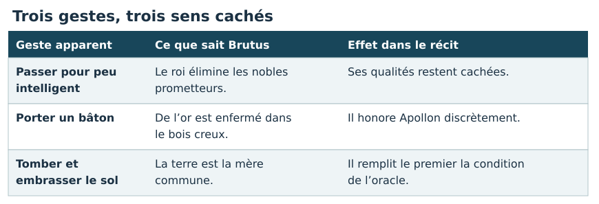

# ENS · MP-PC · Latin (LE2) 2010 — Corrigé guidé

*Corrigé rédigé par IA, non officiel. Signalez toute erreur.*

**Rédaction** · GPT-6.2 Astra Ultra · vitesse non renseignée

Épreuve commune aux ENS de Paris et de Cachan. Durée totale de deux heures. Le sujet est une version latine de Valère Maxime. Le dictionnaire est autorisé.

## Version française — Brutus et l’oracle de Delphes

Junius Brutus, voyant que le roi Tarquin, son oncle maternel, faisait disparaître tout ce que la noblesse comptait de talents prometteurs, feignit d’avoir l’esprit borné et dissimula sous cette ruse ses très grandes qualités. Il partit aussi pour Delphes avec les fils de Tarquin, que celui-ci avait envoyés honorer Apollon Pythien par des présents et des sacrifices. À titre d’offrande, il apporta au dieu de l’or qu’il avait secrètement enfermé dans un bâton creux : il craignait en effet de ne pouvoir sans danger honorer la divinité céleste par une générosité trop visible.

Après avoir exécuté les ordres de leur père, les jeunes gens demandèrent à Apollon lequel d’entre eux semblait destiné à régner à Rome. Le dieu répondit que le pouvoir suprême dans notre cité appartiendrait à celui qui, avant tous les autres, aurait donné un baiser à sa mère. Alors Brutus, comme s’il était tombé par hasard, se jeta délibérément à terre et, tenant la terre pour la mère commune de tous, l’embrassa. Ce baiser si habilement imprimé au sol valut à Rome la liberté et à Brutus la première place sur la liste des consuls.

**La pointe du récit.** L’oracle laisse à interpréter le mot « mère ». Le geste que les témoins peuvent prendre pour une chute réalise, selon Brutus, la condition formulée par le dieu. La dernière phrase répartit l’effet du même baiser entre la cité et le premier consul. « Notre cité » conserve le point de vue romain du narrateur.

> [!INDICATION]
> Encadrez la proposition ouverte par *cum* et fermée par *animaduerteret*. À l’intérieur, *a rege Tarquinio* est le complément d’agent d’*excerpi*. Ce dernier infinitif passif a pour sujet à l’accusatif *omnem nobilitatis indolem*. Revenez ensuite à *simulauit*, qui ouvre la proposition principale. Le parfait *texit* vient ici de *tego*, « cacher ».

> [!INDICATION]
> Dans *timebat ne … tutum non esset*, *ne* introduit le contenu de la crainte et *non* nie la sécurité. Brutus redoute qu’une offrande ostensible **ne soit pas sans danger**. *Aperta liberalitate* renvoie à la générosité montrée au grand jour, d’où le contraste avec *clam*.

> [!INDICATION]
> *Romae* est un locatif. Après *respondit*, rétablissez l’infinitif futur *futuram [esse]* auprès de *potestatem*. Dans le geste final, *existimans* introduit l’idée que la terre est la mère commune ; *osculatus est* est un parfait déponent de sens actif. Les datifs *Vrbi* et *Bruto* répondent aux deux bénéfices du baiser.

[Cahier LE2, p. 12](https://www.ens.psl.eu/IMG/file/concours/2010/MPI/mp-sujet-le2.pdf#page=12) · [Rapport du jury](https://www.ens.psl.eu/IMG/file/concours/2010/MPI/mp-ecrit-latin-le2.pdf)
