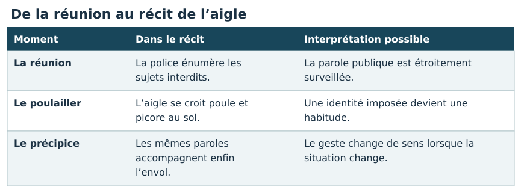

# ENS · MP-PC · Portugais (LE2) 2010 — Corrigé guidé

*Corrigé rédigé par IA, non officiel. Signalez toute erreur.*

**Rédaction** · GPT-6.2 Astra Ultra · vitesse non renseignée

Épreuve commune aux ENS de Paris et de Cachan. Durée totale de deux heures. La seconde partie demande une interprétation personnelle de la parabole en portugais. Le dictionnaire est interdit.

## Version française

Le soir où Mondlane arriva à Lourenço Marques, un rassemblement avait été convoqué à l’Association des Noirs du Mozambique. Des milliers de personnes s’y pressaient pour écouter la parole libératrice de celui qu’on attendait comme un messie. Mondlane devait parler depuis le balcon d’un vieil édifice donnant sur la place.

Alors qu’il se dirigeait vers le petit balcon, des policiers le prirent à part et lui dirent qu’il pouvait prendre la parole, mais qu’il ne pouvait parler de politique, qu’il ne pouvait parler de pauvreté, qu’il ne pouvait rien dire du peuple du Mozambique ni de ce qui se passait en Afrique. La liste des interdictions était si longue qu’il ne restait presque rien, voire rien du tout, à dire.

Mondlane s’avança vers le balcon. Alors, il raconta l’histoire suivante :

« Un jour, un voyageur fut accueilli par une famille de la campagne qui lui offrit l’hospitalité. En fin d’après-midi, son hôte le conduisit dans la cour et lui montra la volaille qu’il élevait dans son poulailler. » Parmi les poules, chose étrange, il y avait un aigle. Il avait perdu son allure royale ; il se blottissait dans un coin, piaillant comme une poule et picorant les grains à terre. Le voyageur fut frappé par le spectacle de cet oiseau si noble, qui semblait avoir perdu là jusqu’à son identité.

« Il se croit une poule », expliqua le maître de maison.

Cette nuit-là, le voyageur ne trouva pas le sommeil. Dès l’aube, le voilà qui entrait dans le poulailler. Il prit l’aigle et l’emporta en rase campagne. Il lança l’oiseau en l’air en l’encourageant :

« Vole, tu es un aigle. »

Et l’oiseau, maladroit, retombait lourdement à terre. Le voyageur recommença plusieurs fois. En vain. Il finit par arriver à une gorge. Alors, tenant l’oiseau sur un bras, il s’approcha du gouffre et lui répéta :

« Vole, tu es un aigle. »

Et il lança la bête dans le vide, au-dessus du précipice. Alors l’aigle prit un envol splendide et conquit les hauteurs, traversant l’horizon pour aller au-delà de lui-même.

*Mia Couto, E se Obama fosse africano e outras interinvenções, 2009, p. 188-190.*

> [!INDICATION]
> Le sujet portugais fait entendre plusieurs voix. Gardez la reprise de « il ne pouvait » dans les consignes de la police et la répétition exacte de l’appel au vol. Le prétérit portugais fait avancer l’action ; l’imparfait français convient à l’attitude habituelle de l’aigle dans le poulailler et à ses chutes répétées.

## Question — Como interpretar a parábola? Que relação existe entre liberdade, vontade e medo?

O primeiro gesto de liberdade é do próprio Mondlane. A polícia permite-lhe falar, mas proíbe quase tudo o que o público deseja ouvir. Ao contar uma história, ele deixa que os ouvintes estabeleçam a relação entre o galinheiro e a sua própria situação. A parábola devolve-lhes assim o direito de interpretar o mundo. A águia representa alguém que, de tanto viver segundo regras alheias, acaba por confundir uma condição imposta com a sua natureza.

A vontade tem um papel importante, mas o conto mostra os limites de uma simples ordem. O viajante repete as mesmas palavras várias vezes, e a ave continua a cair. Foi preciso sair do galinheiro e encontrar um espaço onde as asas pudessem sustentá-la. Também uma sociedade precisa de condições concretas para exercer a liberdade, além da coragem de a desejar. Há, porém, uma tensão no gesto do viajante: ele decide pela águia quando a lança no vazio. Na vida coletiva, quem quer ajudar deve abrir possibilidades sem substituir a vontade dos outros.

A meu ver, vencer o medo não significa deixar de o sentir. Significa descobrir, por experiência própria e com o apoio de outros, que os limites aprendidos não são necessariamente os limites do possível.

> [!INDICATION]
> La consigne comporte deux mouvements : interpréter le récit puis discuter le rôle de la volonté et de la peur. La réponse utilise les tentatives infructueuses comme argument, au lieu de réduire l’aigle à un symbole fixe.

[Cahier LE2, p. 9](https://www.ens.psl.eu/IMG/file/concours/2010/MPI/mp-sujet-le2.pdf#page=9) · [Rapport du jury](https://www.ens.psl.eu/IMG/file/concours/2010/PC/pc-ecrit-portugais-le2.pdf)
