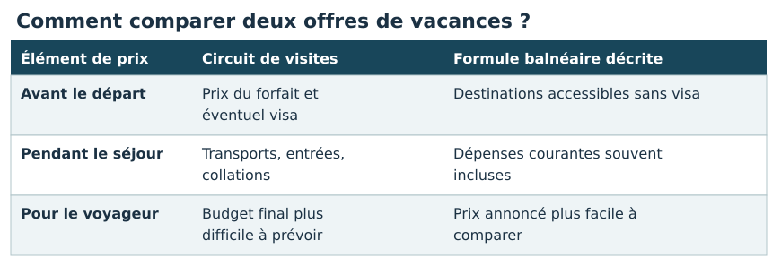

# ENS · MP-PC · Russe (LE2) 2010 — Corrigé guidé

*Corrigé rédigé par IA, non officiel. Signalez toute erreur.*

**Rédaction** · GPT-6.2 Astra Ultra · vitesse non renseignée

Épreuve commune aux ENS de Paris et de Cachan. Durée totale de deux heures. La page russe fixe la version à 12 points et les deux questions à 8 points. Le dictionnaire est interdit.

## 1. Version — Nous choisissons la mer

À cause de la crise économique, les Russes se sont mis à faire de sérieuses économies sur leurs vacances : ils partent moins souvent à l’étranger et choisissent des voyages bon marché. Selon l’Association des voyagistes de Russie (ATOR), la demande a reculé en moyenne de 18 à 20 % par rapport à 2008, toutes destinations confondues. Elle s’est dans le même temps reportée vers des séjours à la plage peu coûteux, dans des pays où le visa n’est pas obligatoire. Aux excursions, les Russes préfèrent désormais des vacances reposantes au bord de la mer ou des loisirs actifs.

Deux tendances ont marqué l’année 2009 : la recherche de destinations moins chères et accessibles sans visa, ainsi que de formules de vacances plus économiques. Les pays qui proposent des circuits de visites ont été moins demandés. Ainsi, la République tchèque a nettement perdu de son attrait, alors qu’il y a deux ans à peine sa position semblait inébranlable. Les Tchèques eux-mêmes expliquent cette désaffection par l’insuffisance de la publicité et la baisse des revenus de nombreux Russes, qui préfèrent désormais des pays accessibles sans visa à Prague ou à Karlovy Vary.

Mais là ne sont pas les seules raisons du recul des circuits de visites en République tchèque, en France, en Italie, en Grande-Bretagne et dans d’autres pays européens. Voyages à forfait coûteux, difficultés à obtenir un visa, politique tarifaire plus souple des pays qui proposent toute l’année des séjours à la mer : tout cela, conjugué à la crise, a contribué à la baisse de la demande. Les séjours de découverte entraînent inévitablement des frais supplémentaires pour les visites de musées, les sorties au théâtre, les déplacements et les collations. En revanche, dans les hôtels de Turquie, d’Égypte, de Bulgarie et d’autres pays, la formule « tout compris » n’occasionne généralement aucune dépense supplémentaire.

*D’après Natalia Timachova, Novyé Izvestia, 1er février 2010.*

> [!INDICATION]
> Dans *экскурсиям … предпочитают*, le datif indique ce à quoi les vacanciers préfèrent les activités citées ensuite. On lit donc « aux excursions, ils préfèrent… ». Dans *сместившись*, c’est la demande qui change d’orientation. Le recul global et la progression relative de certaines destinations peuvent coexister.

## 2.A. Считаете ли Вы, что человеку необходимо отдыхать?

Да, я считаю, что отдых необходим каждому человеку. После нескольких часов занятий я иногда перечитываю одну и ту же страницу и уже не замечаю, что перестал понимать текст. Стоит ненадолго выйти на улицу, и, вернувшись, я быстрее нахожу решение. Отдых помогает не только восстановить силы, но и увидеть задачу по-другому. Конечно, для этого не обязательно ехать за границу. Иногда достаточно спокойно пообедать с близкими или выспаться перед трудным днём. Важно, чтобы у человека было время, которым он распоряжается сам.

## 2.B. Какой Ваш любимый вид отдыха?

Больше всего я люблю пешие прогулки у моря. Мне нравится выйти рано утром, когда на берегу мало людей, и дойти до соседней деревни. В дороге можно остановиться, поговорить с местными жителями или просто послушать волны. Однажды из-за дождя нам с друзьями пришлось изменить маршрут. Мы зашли в маленькое кафе и провели там целый час за разговором. Именно этот час запомнился мне лучше, чем запланированная экскурсия. Поэтому в отпуске я предпочитаю оставлять хотя бы один день без расписания.

> [!INDICATION]
> La première réponse porte sur la nécessité du repos et peut prendre un exemple ordinaire ; la seconde doit préciser une préférence personnelle. Dans « я люблю пешие прогулки », le complément de люблю est à l’accusatif. « Я предпочитаю … » permet ensuite de motiver le choix.

[Cahier LE2, p. 10](https://www.ens.psl.eu/IMG/file/concours/2010/MPI/mp-sujet-le2.pdf#page=10)
