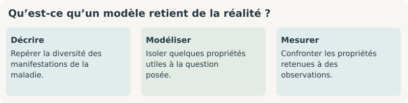

# ENS MP-PC — Russe (LV1) 2010 · Corrigé brut

*Corrigé rédigé par IA, non officiel. Signalez toute erreur.*

**Rédaction** · GPT-6.2 Astra Ultra · vitesse non renseignée

## 1. Version — 12 points

**Dans quel but des chercheurs russes ont-ils créé un modèle physico-mathématique du cancer ?**

La vaste offensive que mène la recherche mondiale contre le cancer porte ses fruits. D’année en année, la nature complexe de la maladie apparaît plus clairement et le nombre de personnes qui en guérissent augmente. Des chercheurs de disciplines très diverses se joignent aux efforts pour résoudre le problème, y compris des spécialistes de domaines très éloignés de la médecine. Des physiciens russes du célèbre FIAN, l’Institut de physique Lebedev de l’Académie des sciences de Russie, contribuent eux aussi à éclairer la nature du cancer.

À l’annonce de la création d’un modèle mathématique du cancer, une première question vient à l’esprit, tant la nouvelle étonne. Comment faire entrer dans des formules, si complexes soient-elles, une maladie aux visages si multiples, si difficile à cerner et à bien des égards imprévisible ?

— Cette question reflète tout à fait le point de vue d’un médecin, répond d’un signe de tête approbateur l’un des concepteurs du modèle, Andreï Polejaïev, docteur en sciences physiques et mathématiques. En réalité, on peut étudier le cancer de deux façons. Soit on le décrit avec le plus de précision possible, comme le fait la biologie, soit on en donne une représentation théorique sous la forme d’un modèle, ce que permettent les mathématiques. Mais, pour cela, il faut en dégager certaines propriétés essentielles ainsi que les principes qui président à son apparition et à son développement. […]

— Les principales caractéristiques d’une cellule cancéreuse, quelle que soit la tumeur dans laquelle elle se trouve, sont sa vitesse de division et sa capacité à se déplacer, poursuit le second auteur du modèle, Andreï Kolobov, titulaire du grade de candidat ès sciences physiques et mathématiques. Or ces caractéristiques sont mesurables avec précision.

*Tatiana Bateniova, Izvestia Naouka, 22 janvier 2010.*

## 2. Questions — 8 points

### A. Считаете ли Вы, что наука должна мочь ответить на все вопросы?

Мне кажется, что наука вправе задавать самые разные вопросы, но от неё нельзя требовать готового ответа на каждый из них. Иногда ответ пока неизвестен, потому что нет подходящего прибора или не хватает наблюдений. В таком случае признать своё незнание полезнее, чем выдать догадку за факт. Хорошая теория позволяет точно сказать, какие новые данные заставили бы нас пересмотреть объяснение.

Есть и вопросы другого рода. Например, исследователи могут оценить, сколько времени люди сэкономят благодаря новой железнодорожной линии и как строительство повлияет на окружающую среду. Однако решение о том, какой из двух районов следует обслужить в первую очередь, предполагает выбор между интересами разных людей. Из одних измерений нельзя вывести, что справедливо. Это не делает науку бесполезной для такого выбора: она помогает увидеть последствия каждого решения. Я бы хотел, чтобы от учёного требовали ясности относительно границ его вывода, а не обещания однажды решить за нас любой вопрос.

### B. Почему Вы хотите заниматься наукой?

Меня больше всего привлекает момент, когда простой вопрос вдруг обнаруживает слабость очевидного объяснения. Представим два стакана с горячей водой, один из которых закрыт крышкой. Легко предсказать, какой остынет быстрее, но значительно труднее объяснить, какую роль играют испарение, форма стакана и движение воздуха. Мне хотелось бы научиться превращать такие наблюдения в вопросы, на которые можно ответить: выбрать одну величину, заранее обосновать прогноз, провести измерение и понять причину расхождения.

Меня интересует и коллективная сторона исследования. Один человек умеет построить модель, другой замечает при измерении деталь, которую модель не учитывает. Их разговор может дать больше, чем две отдельные работы. При этом я не жду, что каждый опыт принесёт открытие. Иногда самый ценный результат состоит в том, что пришлось отказаться от красивого, но неверного предположения. Именно возможность исправить собственную ошибку и объяснить другим, почему новое решение лучше прежнего, делает для меня научную работу привлекательной.

[Cahier de deux heures, p. 6](https://www.ens.psl.eu/IMG/file/concours/2010/MPI/mp-sujet-lv1.pdf#page=6)
