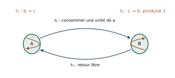
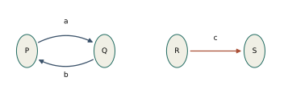
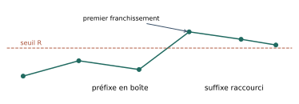

# ENS · MP · Informatique 2010 — corrigé brut

*Corrigé rédigé par IA, non officiel. Signalez toute erreur.*

**Rédaction** · GPT-6.2 Astra Ultra · vitesse non renseignée · 25 novembre 2026

**Programmes à compteurs.** Les composantes d’une configuration admissible sont des entiers naturels. La notation $x\prec y$ signifie $x\le y$ coordonnée par coordonnée, avec au moins une inégalité stricte. Une promenade comporte une configuration de plus que son chemin ne comporte de transitions.

## I. Systèmes d’addition de vecteurs

### Question 1 · Reconnaître un calcul

```text
si l'un des vecteurs contient une coordonnée négative : retourner faux
pour j de 0 à k-1 :
    si (s[j], x[j+1]-x[j], s[j+1]) n'appartient pas à T :
        retourner faux
retourner vrai
```

Les états et dimensions sont déjà ceux de configurations par hypothèse. Les deux tests expriment exactement l’admissibilité et la relation de transition à chaque pas. Avec $p=|T|$ transitions en liste et des opérations entières unitaires, le coût maximal est $O((k+1)n(1+p))$.

### Question 2 · Les douze configurations en A

Depuis $(A,2,1,0,0)$, la somme des compteurs 2 et 3 vaut toujours 1. Pour chaque valeur $a'=2,1,0$ du premier compteur, les résultats en A sont exactement

$$
(a',b',1-b',d'),\qquad b'\in\{0,1\},\quad 0\le d'\le2-a'.
$$

En effet, chaque passage en B consomme une unité du premier compteur et produit au plus une unité du dernier. Avant le passage, la boucle $t_1$ peut transférer l’unité de 2 vers 3. En B on peut, au choix, la retransférer par $t_4$ en augmentant le dernier compteur, ou ne rien produire. Pour obtenir exactement $d'$ unités, faire d’abord les $d'$ passages productifs, puis les passages vides, et ajuster $b'$ en A à la fin. On compte $2+4+6=12$ quadruplets.

### Question 3 · Multiplication faible

Partant de $(a,b,0,0)$, $t_1$ déplace une unité du deuxième compteur vers le troisième. $t_2$ entre en B en décrémentant le premier. En B, $t_4$ rend une unité du troisième au deuxième et incrémente le quatrième. $t_3$ revient en A sans modifier les compteurs. La réserve des deux compteurs centraux vaut $b$. Il y a au plus $a$ entrées en B et chacune produit au plus $b$ unités. Toute sortie a donc $0\le d\le ab$.

Inversement, toute valeur $d$ de cet intervalle est somme de $a$ entiers $k_j\in[0,b]$ (si $b=0$, prendre tous nuls). Pour chaque $j$, jouer $t_1^{k_j}t_2t_4^{k_j}t_3$. La réserve initiale est restaurée après chaque bloc et le dernier compteur gagne $k_j$. Le chemin vide convient pour $a=0$. Les deux inclusions sont démontrées.



### Question 4 · Lire le second programme

La boucle $t_5$ soustrait 1 au premier compteur et ajoute 1 aux deux suivants. Si elle est parcourue $j$ fois, $0\le j\le a$. Après $t_6$, les cinq valeurs sont $(a-j,j,b+j,0,0)$. Le premier compteur est ensuite figé et les quatre autres exécutent le multiplicateur de 3. Les valeurs du dernier compteur forment donc l’intervalle entier $[0,j(b+j)]$. Ces intervalles sont emboîtés pour $0\le j\le a$ et le plus grand est effectivement réalisable en prenant $j=a$. Ainsi $f(a,b)=a(a+b)$.

### Question 5 · Finitude pour tout départ

Notons $s=b+c$ pour le départ $(A,a,b,c,d)$. Les deux compteurs intermédiaires sont compris entre 0 et $s$ et leur somme reste $s$. Le premier décroît de $a$ à 0 au plus. Chaque visite en B peut accroître le quatrième compteur d’au plus $s$. Il reste donc entre $d$ et $d+as$. Tous les états accessibles appartiennent à une boîte finie et aucun départ de la forme demandée ne donne un ensemble infini.

### Question 6 · Énumérer les quadruplets

```text
vus ← {configuration initiale} ; file ← [configuration initiale] ; E ← vide
tant que la file contient une configuration :
    retirer (s,x) en tête
    si s = A : ajouter x à E
    pour chaque transition (s,u,s') issue de s :
        si x+u est naturel et (s',x+u) absent de vus :
            marquer (s',x+u) dans vus et l'ajouter à la file
retourner E
```

Chaque configuration ajoutée est accessible. Réciproquement tout chemin est suivi par induction sur sa longueur. Pour $s=b+c$, au plus $K=2(a+1)(s+1)(as+1)$ configurations sont possibles, puisque connaître le deuxième compteur fixe le troisième. Une table booléenne indexée par l’état, le premier et le deuxième compteurs et le quatrième moins $d$ assure $O(K)$ temps et espace, initialisation comprise, sur des entiers de coût unitaire. C’est $O((1+a+b+c+d)^4)$.

### Question 7 · Supprimer les auto-transitions

Pour chaque boucle $(s,u,s)$, introduire un nouvel état $h$ et les deux arcs $(s,u,h)$ et $(h,0,s)$. Conserver les autres arcs. Un pas ancien se développe en deux pas et les passages de $s$ à $h$ puis à $s$ se contractent. L’état $h$ n’a aucune autre entrée ni sortie. L’atteignabilité des anciens états est donc préservée. Une configuration intermédiaire accessible $(h,z)$ a pour successeur immédiat $(s,z)$, accessible dans le système d’origine. Comme il n’y a qu’un nombre fini d’états intermédiaires, l’infinité de l’ensemble accessible est également préservée. La construction est linéaire dans la description explicite du système.

### Question 8 · Remplacer l’état de contrôle par des compteurs

Après 7, toute transition joint deux états distincts. Ajouter $|S|$ composantes et coder $(s,x)$ par $(x,e_s)$, où $e_s$ est le vecteur unitaire d’indice $s$. À $(s,u,t)$ associer le vecteur $(u,e_t-e_s)$. La somme des nouvelles composantes reste 1. Leur positivité impose la présence du jeton en $s$ et le déplace en $t$. Les calculs admissibles correspondent donc exactement, par induction. Une ancienne boucle non éliminée aurait effacé le contrôle de son état source, d’où l’utilité de 7.

Pour P1, la cible à couvrir est $(0,e_{\rm acc})$, ce qui impose exactement l’état acceptant et aucune valeur supplémentaire aux anciens compteurs. Pour P2, le codage est injectif et son image contient tous les points accessibles depuis le départ codé. Les infinités coïncident. La transformation crée un vecteur de dimension $n+|S|$ par transition.

## II. Atteignabilité d’un état acceptant

### Question 9 · Un témoin nécessairement long

Prendre $T=\{e_1,\ldots,e_n\}$, $x=0$ et $y=(m,\ldots,m)$ avec $m\ge1$. Toute configuration couvrant $y$ a une somme de coordonnées au moins $nm$ et chaque transition augmente cette somme de 1. Il faut au moins $nm=n\max(y)$ transitions, et donc au moins autant de configurations. En jouant chaque transition $m$ fois on atteint $y$.

### Question 10 · Translater et effacer une boucle projetée

(1) Ajouter le même $\Delta$ à toutes les configurations conserve les transitions. Sur $I$, les composantes augmentent ou restent égales, ce qui conserve l’admissibilité et la couverture finale.

(2) Si $(x_\alpha)_I=(x_\beta)_I$, prendre $\Delta=x_\alpha-x_\beta$. Alors $x_\beta+\Delta=x_\alpha$ et $\Delta_I=0$. Garder le préfixe jusqu’à $x_\alpha$, puis les transitions après $x_\beta$. Le suffixe translaté a les mêmes projections sur $I$ que le suffixe original, de sorte que les contraintes restent satisfaites. Le raccord reste valable si $\alpha=0$ ou $\beta=k$.

### Question 11 · Raccourcir dans une boîte

Il n’y a que $r^{|I|}$ valeurs possibles de la projection. Tant qu’une projection se répète, enlever le tronçon compris entre ses deux occurrences selon 10. La projection finale et les projections conservées sont inchangées. La longueur diminue et les transitions restantes forment une sous-suite du chemin initial. À l’arrêt, le nombre de configurations est au plus $r^{|I|}$, donc le chemin a strictement moins de $r^{|I|}$ transitions. Si la projection finale couvrait $y_I$, elle le couvre encore.

### Question 12 · Couverture à profondeur bornée

```text
chercher(z,h) :
    si z domine y : retourner z
    si h = 0 : retourner échec
    pour u dans T :
        si z+u est naturel :
            v ← chercher(z+u,h-1)
            si v est un vecteur : retourner v
    retourner échec
```

Appeler `chercher(x,k)` et tester si le résultat est un vecteur. La récurrence sur $h$ considère le chemin vide puis tous les premiers pas possibles. Avec $p=|T|$, le temps est au plus $O(n(1+p)\sum_{j=0}^k p^j)$ opérations élémentaires et la profondeur est $k$ au plus. La version qui renvoie le vecteur servira en 18.

### Question 13 · Aucune coordonnée contrainte

Pour $I=\varnothing$, le chemin vide engendre la promenade de longueur 1 réduite à sa configuration initiale. Elle satisfait les deux contraintes vides. Ainsi $M(\varnothing,x)=1$ pour tout $x$ et $F(0)=1$.

### Question 14 · Un des deux facteurs est nul

Si $\max(y)=0$, le point initial admissible couvre déjà $y$. Sinon $\operatorname{pic}(T)=0$ impose que chaque transition soit composante par composante positive ou nulle. Pour chaque $i$ tel que $x_i<y_i$, chercher une transition avec $u_i\ge1$. Si elle manque, retourner faux. Si toutes existent, les répéter chacune au plus $y_i-x_i$ fois suffit, car les autres coordonnées ne diminuent jamais. Le test coûte $O(n(1+|T|))$ opérations.

Le même argument sur tout sous-ensemble $I$ et tout départ $I$-admissible donne une promenade d’au plus $1+n\max(y)$ configurations. Un départ qui n’est pas $I$-admissible ne contribue que zéro au maximum. Donc $F(n)\le1+n\max(y)$.

### Question 15 · Premier franchissement et réserve

Posons $d=|I|$, $p=\operatorname{pic}(T)$, $m=\max(y)$, $h=f(I')$ et $r=ph+m$. Ici $p,m,h\ge1$. Si une configuration du préfixe strict $x_0,\ldots,x_{\ell-1}$ est déjà couvrante, appliquer 11 à ce préfixe tronqué. On obtient au plus $r^d-1$ transitions, ce qui suffit.

Sinon aucune projection de ce préfixe n’est le coin $(r-1,\ldots,r-1)$, qui couvre $y_I$ puisque $r-1\ge m$. Après suppression des répétitions par 10, il reste au plus $r^d-1$ configurations dans ce préfixe. Conserver le pas qui mène à $x_\ell$ donne **au plus $r^d-1$ transitions** jusqu’au premier franchissement, avec la même projection au raccord. Pour $\ell=0$, le préfixe est vide et ce coût est nul.

Sur le suffixe, la propriété $(\star)$ de $I'$ fournit une sous-suite d’au plus $h-1$ transitions couvrante et admissible sur $I'$. Chaque autre composante de $I$ part d’au moins $r$ et perd au plus $p$ par transition. Elle reste donc au moins $r-p(h-1)\ge m$ pendant ce suffixe. La concaténation conserve l’ordre des transitions, est admissible et couvrante sur $I$, et sa longueur est au plus $r^d+h-2$.

### Question 16 · Réduction en dimension inférieure

Soit $h=f_{\subset}(I)=\max_{J\subsetneq I} f(J)$ et $R=ph+m$. Si la promenade reste dans la boîte de côté $R$, 11 donne un chemin d’au plus $R^{|I|}-1$ transitions. Sinon, considérer son premier point de sortie et appeler $J$ l’ensemble des coordonnées de $I$ encore strictement au-dessous de $R$. Il est propre. L’argument de 15 s’applique avec ce seuil commun, car il utilise seulement $R\ge p f(J)+m$ et la propriété $(\star)$ de $J$. On obtient au plus $R^{|I|}+h-2$ transitions. Si la sortie est le dernier point, on peut prendre le suffixe vide. Dans les deux cas la longueur est strictement inférieure à $R^{|I|}+h-1$.

### Question 17 · Borne uniforme sur les témoins

Posons $H_0=1$ et $H_{j+1}=(pH_j+m)^{j+1}+H_j$. Par récurrence, toute promenade réussie sur au plus $j$ coordonnées contient une sous-suite réussie de longueur au plus $H_j-1$ transitions. C’est vrai pour l’ensemble vide. Le raisonnement de 15–16 avec seuil $pH_j+m$ utilise cette borne sur le suffixe en dimension inférieure, et garantit la borne suivante. En particulier, en comptant les configurations, $F(n)\le H_n$.

Écrivons $B=(p+2)m$, où $p,m\ge1$. Pour $H\ge1$ et $j\ge0$, $(pH+m)^{j+1}+H\le((p+1)H+m)^{j+1}\le(BH)^{j+1}$. Partant de $H_0\le B^{1!}$, l’induction donne $H_{j+1}\le B^{(j+1)(1+(j+1)!)}\le B^{(j+2)!}$. D’où $F(n)\le((p+2)m)^{(n+1)!}$.

### Question 18 · Décider et produire la couverture

Dans le cas dégénéré, utiliser 14 en construisant le témoin par les additions indiquées. Dans le cas général, calculer l’entier $K=((p+2)m)^{(n+1)!}$ de 17, puis renvoyer le résultat de `chercher(x,K-1)` de 12, en traduisant l’échec en faux. Tout vecteur renvoyé est atteint positivement et domine $y$. Toute instance positive admet un témoin d’au plus $K$ configurations, donc il est visité avant la coupure.

Avec $b=|T|$ et $D=\max_{u\in T}\|u\|_\infty$, chaque entier manipulé dans l’arbre demande $O(1+\log(1+\|x\|_\infty+KD)+\log(1+\|y\|_\infty))$ bits. Multiplier ce coût par $O(n(1+b)\sum_{j=0}^{K-1}b^j)$ donne une borne de recherche en opérations sur bits pour des additions et comparaisons. La construction de $K$ par produits et puissances entiers est finie et peut être ajoutée à ce coût.

## III. Chemins et systèmes d’inéquations

### Question 19 · Images qui ne se composent pas librement

Prendre les arcs $a:P\to Q$, $b:Q\to P$ et $c:R\to S$ sur quatre sommets distincts. Notons $e_a,e_b,e_c$ les images des chemins à un arc.

1. $e_a$ et $e_c$ sont des images, mais $e_a+e_c$ a deux composantes disjointes et n’est pas une image.
2. $2e_a$ et $2e_b$ ne sont pas des images, car ni $a$ ni $b$ ne peut être immédiatement répété. Leur somme est l’image du chemin $abab$.
3. Les chemins distincts $ab$ et $ba$ ont tous deux pour image $e_a+e_b$. En particulier l’image ne garde ni le point de départ d’un cycle, ni l’ordre de parcours.



### Question 20 · Insérer un circuit

Choisir un sommet $v$ commun. Écrire $c_1=de$ en coupant en $v$. Si le circuit $c_2=fg$ passe en $v$ entre $f$ et $g$, sa permutation circulaire $gf$ est un circuit de $v$ à $v$. Le chemin $d(gf)e$ a les mêmes extrémités que $c_1$ et son image est la somme voulue. Les parties vides sont permises.

### Question 21 · Connexité et bilans de flux

Le support non vide d’un chemin est connexe dans le graphe non orienté sous-jacent, puisque deux sommets rencontrés sont reliés par un tronçon du parcours éventuellement parcouru à l’envers. Au sommet $v$, le nombre d’entrées moins le nombre de sorties vaut

$$
\sum_{\operatorname{ex}(a)=v}\mathcal I_c(a)-
\sum_{\operatorname{or}(a)=v}\mathcal I_c(a)
=\mathbf 1_{v=s'}-\mathbf 1_{v=s}.
$$

C’est une somme télescopique sur les pas. Elle est nulle partout pour un circuit. Pour un chemin ouvert, elle vaut $-1$ au départ, $+1$ à l’arrivée et zéro ailleurs. Un chemin vide a image nulle et satisfait tous les bilans.

### Question 22 · Caractériser les images par un parcours eulérien

La nécessité vient de 21. Pour la réciproque, si l’image est nulle, choisir le chemin vide en un sommet. Sinon garder le support connexe et former le multigraphe orienté avec $\mathcal I(a)$ copies de chaque arc. Si $s\ne s'$, adjoindre un arc marqué $s'\to s$. Tous les degrés entrants et sortants sont désormais égaux.

Partir d’un sommet du support et suivre des arcs inutilisés jusqu’au blocage. On se bloque au point de départ, car un sommet autre que celui-ci dans lequel on est arrivé possède encore une sortie tant que l’on n’en est pas reparti. S’il reste des arcs inutilisés, la connexité assure qu’une composante restante rencontre le circuit déjà construit. Insérer un circuit supplémentaire en ce sommet comme en 20. On finit avec un circuit utilisant chaque copie une fois. Dans le cas ouvert, couper juste après l’arc marqué et le supprimer. Le chemin obtenu possède l’image prescrite.

### Question 23 · Encoder une inégalité stricte vectorielle

Sur les entiers, $B_1z\succ b_1$ équivaut à l’existence d’un indice $i$ tel que $B_1z\ge b_1+e_i$. Pour chaque $i=1,\ldots,N$, empiler les lignes de $B_0,B_1,B_2,-B_2$ et les seconds membres $b_0,b_1+e_i,b_2,-b_2$. Appeler $\mathrm{SOL}^+$ sur ce système. Une réponse positive pour l’un des indices équivaut exactement aux trois contraintes de l’énoncé. Il y a au plus $N$ appels sur $4N$ lignes, avec les mêmes inconnues. Si $N=0$, une stricte domination est impossible.

### Question 24 · Ajouter une contrainte sur l’image

Introduire une inconnue entière $z_a$ pour chaque arc de $A'$, avec $z_a\ge1$. Fixer à zéro les multiplicités des autres arcs. Pour chaque paire ordonnée $(s,t)\in S'^2$, imposer les bilans de 21 et les inégalités $Bz\ge b$ dans l’ordre des colonnes prescrit par $\rho$. Chacune des égalités de bilan se traduit par deux inégalités larges. Accepter si l’un des appels à $\mathrm{SOL}^+$ trouve une solution. Le support fixé est connexe par hypothèse, donc 22 réalise toute solution par un chemin. Inversement l’image d’un chemin admissible satisfait le système de ses extrémités. Au plus $|S'|^2$ appels sont nécessaires.

## IV. Problème de finitude

### Question 25 · Translation d’une auto-couverture

Si $x_\ell\prec x_k$, alors $x_\ell+\Delta\prec x_k+\Delta$. Les différences successives sont conservées par translation, donc les mêmes transitions engendrent la nouvelle promenade. L’auto-couverture ne requiert ici aucune hypothèse supplémentaire sur $\Delta$.

### Question 26 · Borner la partie de gain strict

Posons $L=\operatorname{taille}(T)$, $V=r^n$, $W=2^L$ et $U=\max(2,V^2W)$. Sur le pseudo-calcul témoin, collecter les triplets effectivement utilisés $(s,u,t)$ et les paires $(s,t)$ correspondantes. Leur graphe de support est connexe et contient $s_0,s_k$. Il y a au plus $V$ sommets, $V^2$ paires et $V^2|T|\le U$ triplets. Pour chaque triplet introduire sa multiplicité entière $z_{s,u,t}\ge0$. Imposer les contraintes suivantes.

* Pour chaque paire du support, la somme de ses multiplicités est au moins 1.
* Pour chaque sommet, le bilan entrée moins sortie vaut $\mathbf1_{s_k}-\mathbf1_{s_0}$, composante par composante, codé en deux inégalités.
* Pour une coordonnée $j$ où le témoin a un gain strict, imposer $\sum z_{s,u,t}u\ge e_j$.

Le décompte du témoin est une solution. Il y a au plus $N=V^2+2V+n$ inégalités, à coefficients et seconds membres de valeur absolue au plus $U$, avec au plus $U$ inconnues. Le théorème admis donne une solution dont chaque coordonnée est inférieure à $U^{CN}$. Sa longueur totale est au plus

$$
\mathcal F(n,r,L)=U^{1+CN},\qquad U=\max(2,r^{2n}2^L),\quad N=r^{2n}+2r^n+n.
$$

Les bilans et le support donnent par 22 un parcours des paires de $s_0$ à $s_k$. Distribuer aux passages de chaque paire les étiquettes $u$ avec leurs multiplicités. On obtient un pseudo-calcul depuis $x_0$. Ses projections suivent exactement les états car $t=s+u_I$. Son gain est non négatif dans toutes les coordonnées et strictement positif dans la coordonnée $j$. Cette borne élémentaire suffit à la question.

### Question 27 · Raccourcir une auto-couverture dans la boîte

Choisir $\ell<k$ avec $x_\ell\prec x_k$. Par 11, garder depuis $x_0$ un préfixe de moins de $r^{|I|}$ transitions aboutissant à la même projection que $x_\ell$. Rejouer le suffixe depuis ce nouveau point en le translatant. Le gain reste strict par 25 et les coordonnées projetées restent identiques. Prendre comme états les projections rencontrées dans ce suffixe et comme transitions toutes les mises à jour compatibles entre ces états. Le témoin visite tous ces sommets et son support est connexe. Par 26, un nouveau suffixe de même départ, toujours en boîte et à gain strict, a au plus $\mathcal F(n,r,L)$ transitions. Après concaténation, le nombre de **configurations** est au plus $r^{|I|}+\mathcal F(n,r,L)$.

### Question 28 · Aucune composante protégée

Une auto-couverture existe exactement lorsqu’il existe des multiplicités $z_u\in\mathbb N$ et une coordonnée $j$ avec $\sum_{u\in T}z_u u\ge e_j$. La nécessité vient du tronçon de gain strict. Pour la suffisance, effectuer ces transitions dans n’importe quel ordre depuis le départ. Pour $L=\operatorname{taille}(T)$, posons $U=\max(2,2^L)$. Le système a $n$ lignes, au plus $U$ inconnues et des coefficients bornés par $U$. Le théorème admis fournit une solution de taille inférieure à $U^{Cn}$ par inconnue. Donc $G(0)\le 1+U^{1+Cn}$ en comptant aussi la configuration initiale.

### Question 29 · Une grande composante peut servir de réserve

Posons $d=|I|$, $H=\max(1,g_{\subset}(I))$, $p=\operatorname{pic}(T)$ et $R=\max(2,pH)$. Cette convention traite aussi $p=0$. Si une promenade auto-couvrante reste dans la boîte, 27 la remplace par une promenade d’au plus $R^d+\mathcal F(n,R,L)$ configurations.

Sinon prendre le premier point tel qu’au moins une coordonnée de $I$ atteigne $R$. Compresser les points qui le précèdent à projections identiques, puis garder le pas de franchissement. Il faut au plus $R^d$ transitions jusqu’au raccord, dont la projection est inchangée. Soit $J$ l’ensemble propre des coordonnées de $I$ encore inférieures à $R$ au raccord. Depuis le raccord original, une continuation $J$-admissible auto-couvrante existe : continuer jusqu’à la fin du témoin et rejouer son tronçon de gain strict. Cette répétition est admissible car son point de départ domine l’ancien. Translater cette continuation au raccord comprimé conserve sa projection sur $I$ et l’ordre strict entre les points témoins.

Par définition de $g(J)$, choisir depuis ce raccord une continuation $J$-admissible auto-couvrante d’au plus $H$ configurations. Sur chaque coordonnée de $I\setminus J$ le crédit initial est au moins $R\ge pH$, donc toutes les étapes de cette continuation restent admissibles sur $I$. En réunissant les deux cas,

$$
g(I)\le R^d+\max\bigl(H,\mathcal F(n,R,L)\bigr).
$$

La majoration demandée est ainsi effective, y compris lorsque la boîte suggérée dans le sujet aurait un rayon nul ou unitaire.



### Question 30 · Décider l’infinité par recherche finie

Former $H_0=1+U^{1+Cn}$ comme en 28. Pour $d=1,\ldots,n$, poser $R_d=\max(2,pH_{d-1})$ et $H_d=R_d^d+\max(H_{d-1},\mathcal F(n,R_d,L))$. Les bornes précédentes et leur monotonie donnent $G(n)\le H_n$. Arrondir les bornes vers le haut si nécessaire. Depuis $x$, parcourir en profondeur tous les préfixes admissibles d’au plus $H_n-1$ transitions. Conserver les vecteurs de la branche. À chaque nouvelle configuration $z$, retourner « infini » si un ancien vecteur $z'$ sur la même branche vérifie $z'\le z$ et $z'\ne z$. Si la recherche s’achève sans succès, retourner « fini ».

Un succès donne par le critère admis de Karp–Miller une infinité de configurations. Inversement, une infinité donne une auto-couverture admissible, que 28–29 permettent de trouver dans la profondeur explorée. Avec $b=|T|$ et $K=H_n$, une borne simple est $O(n(K+b+1)\sum_{j=0}^{K}b^j)$ opérations arithmétiques, en comparant à tous les ancêtres. La mémoire de la branche est $O(nK)$ coordonnées, dont la taille binaire est bornée par $O(1+\log(1+\|x\|_\infty+K\|T\|_{\max}))$.
