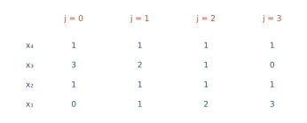
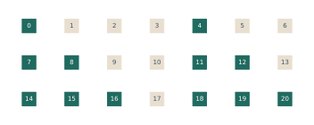
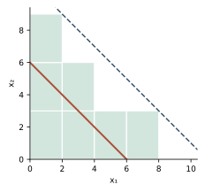

# ENS · MP · Mathématiques-informatique 2010 — corrigé guidé

*Corrigé rédigé par IA, non officiel. Signalez toute erreur.*

**Rédaction** · GPT-6.2 Astra Ultra · vitesse non renseignée · 25 novembre 2026

**Révision** · GPT-6.2 Astra Ultra · vitesse non renseignée · 26 novembre 2026

**Équations diophantiennes, bases minimales et nombre de Frobenius.** Les combinaisons positives du sujet ont des coefficients entiers positifs ou nuls. Le nombre de Frobenius désigne le plus grand entier manquant lorsque les valeurs des pièces sont globalement premières entre elles.

## Repères

Pour le calcul d’une base, la terminaison de l’arbre et la conservation des ensembles de solutions sont deux preuves différentes. Pour le problème de Frobenius, choisir un représentant de poids minimal dans chaque classe de résidus avant de passer du réseau entier à l’espace réel.

## I. Une équation linéaire dans les entiers relatifs

### Question 1.1 · Euclide et identité de Bézout

**Indication.** Prouver deux invariants distincts, l’ensemble des diviseurs communs et l’appartenance à $a\mathbb Z+b\mathbb Z$.

#### Solution

**(a)** Si $u=qv+r$, les diviseurs communs de $u,v$ sont exactement ceux de $v,r$. Les restes positifs diminuent strictement jusqu’au premier reste nul. À l’arrêt, les diviseurs de $u_N$ sont donc les diviseurs communs de $a,b$. Comme $u_N>0$, il est leur PGCD.

**(b)** Les valeurs initiales $a,b$ sont des combinaisons entières d’elles-mêmes. Si deux termes le sont, leur reste $u-qv$ l’est aussi. Par récurrence, $u_N=pa+qb$ avec $p,q\in\mathbb Z$. Les coefficients se calculent en effectuant sur deux couples initiaux $(1,0),(0,1)$ les mêmes soustractions que sur les restes.

### Question 1.2 · Réduire le nombre de coefficients

**Indication.** Décrire exactement l’ensemble des valeurs possibles de $a_1x_1+a_2x_2$.

#### Solution

Soit $d=\gcd(a_1,a_2)$. Tout $a_1x_1+a_2x_2$ est multiple de $d$. Inversement, si $d=pa_1+qa_2$, alors $dz=a_1(pz)+a_2(qz)$ pour tout $z\in\mathbb Z$. Les deux premières variables peuvent donc être remplacées par une variable de coefficient $d$ sans changer les valeurs atteignables. Une récurrence sur le nombre de coefficients réduit l’équation à $Dx=b$ pour $D=\gcd(a_1,\ldots,a_n)$. Elle est soluble exactement si $D$ divise $b$. Les coefficients nuls peuvent être écartés au départ. Si tous sont nuls, l’équation est soluble exactement pour $b=0$.

### Question 1.3 · Algorithme constructif pour des signes quelconques

**Indication.** Conserver un vecteur de coefficients qui représente le PGCD du préfixe déjà traité.

#### Solution

Écarter les termes de coefficient nul en mémorisant leurs positions. Si le reste est vide, renvoyer le vecteur nul pour $b=0$ et « pas de solution » sinon. Pour le premier coefficient restant, initialiser $d=|a_1|$ et $w_1=\operatorname{sgn}(a_1)$. À la lecture de $a_j$, appeler le PGCD étendu sur $d,|a_j|$. S’il rend $d'=p d+q|a_j|$, multiplier les anciens $w_i$ par $p$ et ajouter $w_j=q\operatorname{sgn}(a_j)$. L’invariant devient $d'=\sum_{i\le j}a_iw_i$. Remplacer $d$ par $d'$.

En fin de parcours, si $d$ ne divise pas $b$, renvoyer « pas de solution ». Sinon renvoyer les $(b/d)w_i$ avec des zéros aux positions écartées. L’invariant et 1.2 prouvent que l’algorithme décide l’existence et fournit une solution.

### Question 1.4 · Une solution numérique

**Indication.** Rechercher un petit multiple de 7 qui ramène le problème à un multiple de 5.

#### Solution

Le triplet $(1,0,-1)$ convient, car $10\times1-15\times0+7\times(-1)=3$.

## II. Base des solutions naturelles

### Question 2.1 · Ordre produit

**Indication.** Vérifier les propriétés sur chaque coordonnée puis les réunir.

#### Solution

$u\le u$ par réflexivité dans $\mathbb N$. Si $u\le v$ et $v\le w$, alors $u_i\le w_i$ pour chaque $i$, d’où $u\le w$. Si $u\le v$ et $v\le u$, chaque paire de coordonnées est égale, donc $u=v$. C’est un ordre partiel.

### Question 2.2 · Finitude des minimaux

**Indication.** Dans une suite infinie d’entiers naturels, extraire une sous-suite non décroissante.

#### Solution

Une suite infinie dans $\mathbb N$ a une sous-suite infinie constante si une valeur revient infiniment. Sinon, chaque intervalle fini ne contient qu’un nombre fini de termes et l’on peut extraire une sous-suite strictement croissante. À partir d’une suite infinie de vecteurs, appliquer cet argument à la première coordonnée, puis à la deuxième sur la sous-suite obtenue et ainsi de suite jusqu’à la $k$-ième. On obtient deux vecteurs dans l’ordre de la suite dont le premier est inférieur ou égal au second. Une suite de minimaux distincts ne peut satisfaire cette propriété. L’ensemble $H(A)$ est donc fini.

### Question 2.3 · Génération par soustraction

**Indication.** Choisir une mesure entière qui diminue strictement quand on enlève une solution non nulle.

#### Solution

Raisonnons sur $\sum_i x_i$. Le vecteur nul est la somme vide et un minimal non nul s’écrit lui-même. Sinon il existe une solution non nulle $y\le x$, distincte de $x$. Alors $x-y$ est également naturelle, non nulle et annulée par $A$. Les deux sommes de coordonnées de $y$ et de $x-y$ sont strictement plus petites. En appliquant l’induction à chacune puis en additionnant, on exprime $x$ au moyen de $H(A)$.

### Question 2.4 · Nécessité des minimaux

**Indication.** Dans la décomposition d’un minimal, comparer chacun des termes non nuls au total.

#### Solution

Soit une base de solutions et $h\in H(A)$. Dans toute expression de $h$ comme somme de générateurs, il existe au moins un terme non nul $b$. Il est solution et vérifie $b\le h$. Par minimalité, $b=h$. Toute base de solutions contient donc $H(A)$. Le mot « base de $S(A)$ » impose que ses éléments appartiennent eux-mêmes à $S(A)$. Si l’on autorisait à prendre des vecteurs extérieurs, les vecteurs unités engendreraient tout $\mathbb N^k$ et la conclusion pourrait être fausse, par exemple pour l’équation $x_1=x_2$.

### Question 2.5 · Terminaison de Transf

**Indication.** Le produit le plus négatif associe la plus grande valeur positive à la valeur négative de plus grand module. D’autres paires peuvent être ex æquo.

#### Solution

Sur une branche et pour une première ligne de signes mixtes, notons $P$ le plus grand coefficient positif actif et $-N$ le plus petit négatif actif. Les deux termes choisis valent $P$ et $-N$. Dans chacun des deux enfants, le terme remplacé devient $P-N$, strictement entre $-N$ et $P$. Ni $P$ ni $N$ ne peut augmenter. Si $P+N$ reste constant, le nombre total d’occurrences **des deux extrêmes** diminue d’au moins une unité. Cette deuxième mesure traite les ex æquo pour lesquels le produit minimal seul ne change pas.

La branche ne peut donc pas effectuer une infinité de coupures sur la même première ligne, par décroissance lexicographique de $(P+N,\text{nombre d’extrêmes})$. Dès que la ligne n’a plus les deux signes, elle est supprimée. Le nombre de lignes diminue alors. Toute branche est finie et chaque nœud a au plus deux enfants. Un arbre binaire infini aurait une branche infinie en choisissant successivement un sous-arbre infini. Partant d’un nombre fini de contraintes, la procédure entière termine.

### Question 2.6 · Conservation des solutions

**Indication.** Pour une coupure, comparer les deux coordonnées $u_i,u_j$ du témoin.

#### Solution

Si $u_i\ge u_j$, poser $u'=u-u_je_i$. Il est naturel et $u=L_{i,j}u'$. Les coordonnées imposées nulles par $I$ restent nulles puisque $i,j\notin I$. Ainsi $Mu=ML_{i,j}u'$ et $AL_{i,j}u'=0$. Pour $u_j\ge u_i$, échanger $i,j$. Réciproquement $L_{i,j}u'$ est un vecteur naturel admissible pour la contrainte de départ dès que $u'$ est admissible pour la branche correspondante. La réunion des deux branches conserve donc les solutions.

Dans le cas d’une ligne de même signe sur les coordonnées libres, sa somme est nulle exactement quand toutes les coordonnées libres portant un coefficient non nul sont nulles. Les joindre à $I$ permet de supprimer la ligne en conservant les solutions. Les autres contraintes de l’ensemble n’ont pas changé. L’égalité des ensembles de solutions suit par itération.

### Question 2.7 · Extraire la base des feuilles

**Indication.** Dans une contrainte résolue, écrire $Mu$ comme somme des colonnes libres.

#### Solution

Appliquer Transf à $C(I_k,A,\varnothing)$. Dans chaque feuille $C(M,\varepsilon,I)$ recueillir les colonnes $Me_j$ avec $j\notin I$. Elles sont toutes des solutions. Chaque solution de la feuille est une somme à coefficients naturels de ces colonnes. Comme 2.6 donne la réunion de toutes les solutions, chaque minimal non nul apparaît dans la liste. Éliminer les zéros, les doublons et les vecteurs qui dominent strictement un autre vecteur non nul de la liste. Les vecteurs conservés sont exactement $H(A)$, car toute solution strictement plus petite fournirait elle-même une colonne non nulle encore plus petite ou égale.

### Question 2.8 · Calculer la base de la matrice imprimée

**Indication.** Suivre simultanément les colonnes de $A$ et de $M$, puis vérifier les vecteurs obtenus dans les deux équations.

#### Solution

Les lignes donnent $x_2=x_4=d$ et $x_1+x_3=3d$. Pour $d=1$, les solutions sont

$$
(0,1,3,1),\quad(1,1,2,1),\quad(2,1,1,1),\quad(3,1,0,1).
$$

Voici comment appliquer 2.7 en stockant seulement les colonnes actives de la matrice empilée $(A;M)$. Au départ, les premières coordonnées de contrôle sont $(0,-1,0,1)$ et $M=I_4$. La première coupure additionne les colonnes 2 et 4, remplaçant l’une puis l’autre dans les deux branches. Dans chaque branche, de la même façon, choisir une paire active de produit négatif minimal, départager par ordre croissant de l’indice positif puis de l’indice négatif. Lors de la suppression d’une ligne, écarter les colonnes dont le coefficient était non nul, puis enlever la ligne de contrôle restante en tête des autres colonnes lorsque son tour arrive. Ce parcours donne 25 coupures binaires et 26 feuilles, et leurs colonnes génératrices distinctes sont les quatre vecteurs affichés.

La première coupure se lit sans construire les 26 feuilles. La colonne fusionnée de $M$ devient $e_2+e_4$, dont l’image par $A$ vaut $(0,-3)$. Dans la branche qui remplace la colonne 4, la première ligne a pour seul coefficient non nul $-1$ en colonne 2. Dans l’autre branche, le seul coefficient non nul est $1$ en colonne 4. La règle de suppression écarte donc l’ancienne colonne 2 ou 4 respectivement. Dans les deux cas, la seconde ligne travaille sur $e_1,e_3,e_2+e_4$, de coefficients respectifs $1,1,-3$. Les feuilles distribuent ainsi les trois unités entre $e_1$ et $e_3$.

Une vérification indépendante tient dans les équations. Écrire $x_1$ comme somme de $d$ entiers compris entre 0 et 3 est possible puisque $0\le x_1\le3d$. En complétant chacun de ces entiers $j$ par $3-j$, on décompose la solution en $d$ vecteurs de la liste. Pour $d=1$, une solution non nulle plus petite devrait aussi avoir $d=1$, donc la même somme $x_1+x_3=3$, ce qui force l’égalité. Les quatre générateurs sont minimaux.

## III. Nombre de Frobenius

### Question 3.1 · Divisibilité et représentabilité

**Indication.** Tester un petit entier strictement positif inférieur aux deux coefficients.

#### Solution

Toute combinaison naturelle est divisible par le PGCD. La réciproque échoue : $\gcd(2,3)=1$ divise 1, mais $2x+3y=1$ n’a pas de solution naturelle.

### Question 3.2 · Tous les entiers assez grands sont représentables

**Indication.** Construire un représentant naturel de chaque classe de résidus, puis ajouter des pièces de valeur $a_n$.

#### Solution

Par Bézout chaque classe modulo $a_n$ s’écrit comme somme entière des $a_1,\ldots,a_{n-1}$ modulo $a_n$. Remplacer chaque coefficient par son reste entre 0 et $a_n-1$ conserve la classe et donne une réalisation non négative $w_r$. Soit $N=\max_r w_r$. Pour $b\ge N$ de classe $r$, $b-w_r$ est un multiple non négatif de $a_n$. En l’ajoutant on obtient la représentation voulue.

### Question 3.3 · Formule de Sylvester à deux coefficients

**Indication.** Choisir le coefficient de $b$ dans un système complet de résidus modulo $a$.

#### Solution

**(a)** Si $ab-a-b=ax+by$ avec $x,y\ge0$, alors $ab=a(x+1)+b(y+1)$. Modulo $a$, $a$ divise $y+1$ ; il faut donc $y+1\ge a$ et le membre droit est strictement supérieur à $ab$, contradiction.

**(b)** Comme $a,b$ sont premiers entre eux, les $a$ résidus $0,b,\ldots,(a-1)b$ sont distincts modulo $a$. Pour tout $k$, choisir $0\le v_2<a$ de sorte que $k\equiv v_2 b\pmod a$, et poser $v_1=(k-bv_2)/a\in\mathbb Z$.

**(c)** Si $k=ab-a-b+i$ avec $i\ge1$, alors $av_1=k-bv_2\ge -a+i>-a$. Comme $v_1$ est entier, il est non négatif. La représentation est donc naturelle.

**(d)** Le nombre $ab-a-b$ manque et tous les entiers suivants sont représentables. Ainsi $g(a,b)=ab-a-b$.

### Question 3.4 · Plus petit représentant par classe

**Indication.** Dans une classe donnée, retrouver toutes les représentations en ajoutant la dernière pièce.

#### Solution

Pour $0\le r<a_n$, notons $t_r$ le moindre montant naturel de classe $r$ formé des $n-1$ premiers coefficients. Il existe par 3.2 et $t_0=0$. Dans cette classe, tous les montants représentables avec les $n$ pièces sont exactement les $t_r+ja_n$ pour $j\ge0$. En effet, retirer de toute représentation ses pièces $a_n$ laisse un montant de même classe au moins égal à $t_r$. Le dernier entier manquant par classe est donc $t_r-a_n$, éventuellement négatif pour certaines classes. Ainsi $g+a_n=\max_{0\le r<a_n}t_r$.

### Question 3.5 · Couvrir les points entiers par le simplexe

**Indication.** Choisir la classe résiduelle du poids de la position et réaliser son représentant minimal.

#### Solution

Écrivons $a'=(a_1,\ldots,a_{n-1})$. Pour $z\in\mathbb Z^{n-1}$, prendre $r\equiv a'\cdot z\pmod{a_n}$. Il existe $u\in\mathbb N^{n-1}$ de poids $a'\cdot u=t_r\le g+a_n$. Alors $u\in(g+a_n)S$ et $z-u\in L$. Ceci prouve l’inclusion.

### Question 3.6 · Passer de la grille aux points réels

**Indication.** Arrondir chaque coordonnée vers le bas afin que l’erreur d’arrondi soit positive.

#### Solution

Soit $x=z+v$ avec $z=\lfloor x\rfloor\in\mathbb Z^{n-1}$ et $v\in[0,1[^{n-1}$. Par 3.5, écrire $z=u+\ell$, $u\ge0$, $a'\cdot u\le g+a_n$ et $\ell\in L$. Alors $u+v\ge0$ et $a'\cdot(u+v)\le g+a_n+\sum_{i<n}a_i$. Le dilaté correspondant recouvre tout l’espace avec $L$. L’ensemble des rayons admissibles est non vide, minoré par 0, et son infimum $\mu(S,L)$ est au plus $g+\sum_i a_i$.

### Question 3.7 · Optimalité du rayon pour la grille

**Indication.** Prendre la classe qui réalise le maximum de 3.4.

#### Solution

Choisir $r$ avec $t_r=g+a_n$ et un vecteur entier $z$ de poids de classe $r$, par exemple un représentant de poids $t_r$. Si $z=u+\ell$ avec $u\in tS$, $\ell\in L$, alors $u=z-\ell$ est entier non négatif et son poids est dans cette même classe. Par minimalité $t\ge a'\cdot u\ge t_r$. Combiné à 3.5, cela montre que $g+a_n$ est le plus petit rayon couvrant toute la grille.

### Question 3.8 · Rayon couvrant réel exact

**Indication.** Approcher le coin supérieur de la maille située au-dessus d’un point entier de la classe la plus difficile.

#### Solution

Garder le point $z$ de 3.7 et poser $x=z+(1-\delta)\mathbf1$ avec $0<\delta<1$. Si $x-\ell\ge0$ avec $\ell\in L$, alors $z-\ell\ge0$ car ces deux derniers vecteurs sont entiers. Son poids est donc au moins $g+a_n$. Ainsi tout rayon couvrant $x$ est au moins $g+a_n+(1-\delta)\sum_{i<n}a_i$. Faire tendre $\delta$ vers 0 impose $\mu(S,L)\ge g+\sum_i a_i$. L’inégalité inverse est 3.6, d’où l’égalité.

## IV. Dénumérants et borne inférieure

### Question 4.1 · Série génératrice des dénumérants

**Indication.** Développer chaque facteur en série géométrique et regrouper les monômes de même degré.

#### Solution

Pour $|x|<1$, $(1-x^{a_i})^{-1}=\sum_{j\ge0}x^{ja_i}$ absolument. Leur produit fini peut être regroupé par puissances. Le coefficient de $x^m$ compte exactement les $(j_1,\ldots,j_n)\in\mathbb N^n$ tels que $\sum_i a_i j_i=m$. On a donc $f(x)=\sum_{m\ge0}d(m,a_1,\ldots,a_n)x^m$, avec terme constant 1.

### Question 4.2 · Deux pièces de 1 et 2

**Indication.** Fixer le nombre de pièces de valeur 2.

#### Solution

Dans $x+2y=m$, tout $y\in\{0,\ldots,\lfloor m/2\rfloor\}$ impose une seule valeur $x=m-2y\ge0$. Ainsi $d(m,1,2)=\lfloor m/2\rfloor+1$.

### Question 4.3 · Boîtes rectangulaires et pyramide

**Indication.** Identifier la boîte d’un point par division entière de chaque coordonnée.

#### Solution

Pour $x\in P(m)$, poser $b_i=\lfloor x_i/a_i\rfloor$. Alors $b_i a_i\le x_i<(b_i+1)a_i$ et $\sum_i b_i a_i\le\sum_i x_i\le m$. La boîte correspondante figure dans l’union demandée et contient $x$.

### Question 4.4 · Convertir l’inclusion en bornes numériques

**Indication.** Les boîtes sont disjointes avec la convention semi-ouverte et elles ont toutes le même volume.

#### Solution

Il existe exactement $d'(m)$ boîtes considérées, de volume commun $p_n=\prod_i a_i$. Leur union contient $P(m)$. Elle est à son tour incluse dans $P(m+s_n)$ où $s_n=\sum_i a_i$, puisque $\sum_i x_i<\sum_i(b_i+1)a_i\le m+s_n$. Le simplexe positif de rayon $r$ a volume $r^n/n!$ (intégration par tranches ou dilatation du simplexe unité). Les boîtes semi-ouvertes sont disjointes. Pour calculer le volume du simplexe, intégrer sa section de dernière coordonnée $t$ de $0$ à $r$. Si le volume en dimension $n-1$ vaut $(r-t)^{n-1}/(n-1)!$, l’intégrale vaut $r^n/n!$. La récurrence part du segment de longueur $r$. Il vient donc

$$
\frac{m^n}{n!p_n}\le d'(m)\le\frac{(m+s_n)^n}{n!p_n}.
$$

### Question 4.5 · Une inégalité pour tout réel positif

**Indication.** Compter au moins une représentation de chacun des premiers entiers après le nombre de Frobenius.

#### Solution

Écrivons $g=g_n$ et $y>0$. Les $\lfloor y\rfloor$ entiers $g+1,\ldots,g+\lfloor y\rfloor$ sont représentables et leurs représentants sont distincts. Le vecteur nul est un représentant supplémentaire car $g\ge1$ sous les hypothèses de Frobenius. Donc $d'(g+\lfloor y\rfloor)\ge\lfloor y\rfloor+1>y$. La majoration de 4.4 donne

$$
y<\frac{(g+\lfloor y\rfloor+s_n)^n}{n!p_n}\le\frac{(g+y+s_n)^n}{n!p_n}.
$$

D’où $f(y)=(y+g+s_n)^n/y>n!p_n$.

Pour les coefficients éventuellement égaux à 1 admis au début de la partie 4, la convention usuelle donne $g=-1$ si une pièce vaut 1. Dans ce cas $B=s_n-1$ est la somme des $n-1$ autres pièces, donc $B\ge(n-1)p_n^{1/(n-1)}$. Le minimum calculé en 4.6 est alors au moins $n^n p_n>n!p_n$ pour $n\ge2$. Les dernières questions supposent que le nombre de Frobenius existe, ce qui requiert un PGCD global égal à 1.

### Question 4.6 · Minimiser la majoration

**Indication.** Dériver le logarithme de $f$ pour isoler un unique point critique.

#### Solution

Posons $B=g+s_n>0$. La dérivée logarithmique de $(y+B)^n/y$ est $n/(y+B)-1/y$, de signe $((n-1)y-B)$. Le minimum est atteint en $y=B/(n-1)$ et vaut $n^nB^{n-1}/(n-1)^{n-1}$. Par 4.5, ce nombre est supérieur à $n!p_n$. Extraire la racine positive d’ordre $n-1$ donne en particulier

$$
g(a_1,\ldots,a_n)\ge \frac{n-1}{n}\bigl((n-1)!\,p_n\bigr)^{1/(n-1)}-s_n .
$$
