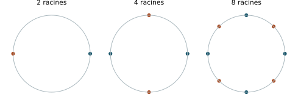
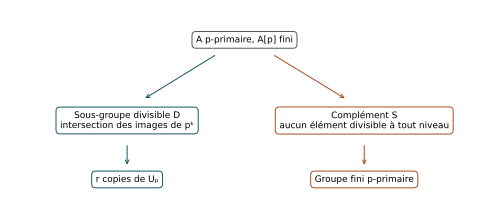

# ENS Paris, Lyon et Cachan — Mathématiques MPI 1, MP 2010 · Corrigé brut

*Corrigé rédigé par IA, non officiel. Signalez toute erreur.*

**Rédaction** · GPT-6.2 Astra Ultra · vitesse non renseignée

**Révision** · GPT-6.2 Astra Ultra · vitesse non renseignée

**Groupes abéliens de torsion $p$-primaire de type cofini.** On fixe un nombre premier $p$. On note $A[m]=\{x\in A:mx=0\}$ et $U_p$ le groupe des racines complexes de l’unité dont l’ordre est une puissance de $p$.

## I. Morphismes continus du cercle et de son sous-groupe dense

### Question I.1.a

Pour $t,s\in\mathbb R$, $g(t+s)=f(e^{it}e^{is})=g(t)g(s)$ et $g(0)=f(1)=1$. C’est bien un morphisme de $(\mathbb R,+)$ vers $(S^1,\times)$, continu par composition.

### Question I.1.b

Posons $H(x)=\int_0^x g(t)dt$. Par continuité de $g$, $H'=g$. En particulier $H'(0)=1$, donc $H(a)\ne0$ pour un $a>0$ assez petit. La fonction $F(x)=H(x+a)-H(x)$ est dérivable. Par le changement $t=x+s$, $F(x)=\int_0^ag(x+s)ds=g(x)H(a)$. Par division par cette constante non nulle, $g$ est dérivable.

### Question I.1.c

Pour $a$ fixé, dériver $g(a+t)=g(a)g(t)$ en $t=0$ donne $g'(a)=g(a)g'(0)$.

### Question I.1.d

Écrivons $c=g'(0)$. La dérivée de $e^{-ct}g(t)$ est nulle et $g(0)=1$, donc $g(t)=e^{ct}$. Comme $|g(1)|=e^{\operatorname{Re}c}=1$, $c=i\lambda$ avec $\lambda\in\mathbb R$. Ainsi $g(t)=e^{i\lambda t}$.

### Question I.1.e

$g(2\pi)=f(1)=1$, donc $e^{2\pi i\lambda}=1$ et $\lambda=k\in\mathbb Z$. Pour tout $z=e^{it}\in S^1$, $f(z)=e^{ikt}=z^k$.

### Question I.2.a

Pour $n\ge1$, notons $C_n=\{z\in\mathbb C:z^{p^n}=1\}$. C’est un groupe cyclique d’ordre $p^n$, inclus dans $C_{n+1}$. Ainsi $U_p=\bigcup_{n\ge1}C_n$ contient 1 et est stable par quotient, en prenant un niveau commun à deux éléments. Tous les éléments ont module 1 et les ordres des $C_n$ sont non bornés. C’est donc un sous-groupe infini du cercle.

### Question I.2.b

Pour $z=e^{2\pi it}$, choisissons $j_n=\lfloor p^nt\rfloor$. La racine $u_n=e^{2\pi i j_n/p^n}$ appartient à $C_n$ et $|u_n-z|\le2\pi|j_n/p^n-t|\le2\pi/p^n\to0$. Chaque point du cercle est donc limite d’éléments de $U_p$.

### Question I.3.a

Pour $z,w\in U_p$, $|f(z)-f(w)|=|f(z/w)-1|$ et $|z/w-1|=|z-w|$. Par continuité en 1, à chaque $\varepsilon>0$ correspond un $\delta>0$ tel que la seconde distance inférieure à $\delta$ implique la première inférieure à $\varepsilon$, indépendamment de $z,w$. Ceci prouve l’uniforme continuité.

### Question I.3.b

La suite convergente $(x_n)$ est de Cauchy. Par uniforme continuité, $(f(x_n))$ est de Cauchy, donc converge dans $\mathbb C$, complet. Tous ses termes ont module 1, donc sa limite aussi.

### Question I.3.c

Pour $x\in S^1$, choisissons $x_n\in U_p$ tel que $x_n\to x$ et posons $\bar f(x)=\lim f(x_n)$. Si $y_n\to x$ aussi, $|x_n-y_n|\to0$ et l’uniforme continuité donne $|f(x_n)-f(y_n)|\to0$. Le choix est donc indifférent. La suite constante prouve le prolongement. Pour $\varepsilon>0$, choisissons $\delta$ associé à $\varepsilon/2$ en I.3.a. Si $|x-y|<\delta/2$, des approximations $x_n,y_n$ dans $U_p$ vérifient finalement $|x_n-y_n|<\delta$. En passant à la limite, $|\bar f(x)-\bar f(y)|\le\varepsilon/2<\varepsilon$. Le prolongement est continu ; la densité en assure l’unicité. Enfin $x_ny_n\to xy$ et $f(x_ny_n)=f(x_n)f(y_n)$, donc $\bar f$ est un morphisme. Par I.1.e il existe $k\in\mathbb Z$ tel que $f(z)=z^k$ sur $U_p$ ; réciproquement toutes ces puissances conviennent.

L’exposant obtenu est aussi unique. Si $z^k=z^\ell$ pour toute racine du sous-groupe, prendre $z=e^{2\pi i/p^n}$ impose $p^n\mid(k-\ell)$ pour tout $n$. Le seul entier divisible par toutes ces puissances est zéro. Cela justifie que les restrictions à $U_p$ des différentes puissances du cercle restent distinctes.

## II. Prolongement vers un groupe divisible

### Question II.1.a

Si $b+ka=b'+k'a$, alors $(k-k')a\in B$. L’absence de multiple strictement positif de $a$ dans $B$ implique $k=k'$ (changer le signe au besoin), puis $b=b'$. L’unicité permet de poser $g(b+ka)=f(b)$ ; l’addition des écritures montre que c’est un morphisme, et $k=0$ donne la restriction voulue.

### Question II.1.b

Le sous-groupe $\{n\in\mathbb Z:na\in B\}$ est l’image réciproque de $B$ par $n\mapsto na$. Son plus petit entier strictement positif est $m$, donc c’est $m\mathbb Z$. Si $b+ka=b'+k'a$, alors $k-k'=mh$ et $b'-b=hma=hb_0$. Il en résulte $f(b')-f(b)=h f(b_0)=hmd=(k-k')d$. Les valeurs $f(b)+kd$ et $f(b')+k'd$ coïncident. La formule proposée est donc bien définie, additive, et prolonge $f$ en prenant $k=0$.

### Question II.1.c

Pour tout sous-groupe propre $B'$ et tout morphisme $B'\to D$, choisissons $a\notin B'$. Le groupe $B'+\mathbb Za$ est strictement plus grand. S’il n’y a aucune relation, II.1.a prolonge le morphisme ; sinon la divisibilité de $D$ fournit le $d$ demandé par II.1.b. L’hypothèse du résultat admis A est donc vérifiée pour tout $B'$. On obtient un morphisme $h:A\to D$ prolongeant le $f$ de départ.

### Question II.2.a

Appliquons II.1.c à $B=D$ et $f=\operatorname{Id}_D$. Il existe $\pi:A\to D$ avec $\pi(d)=d$ pour tout $d\in D$.

### Question II.2.b

Posons $S=\ker\pi$. Pour $x\in A$, $x=\pi(x)+(x-\pi(x))$ et $\pi(x-\pi(x))=0$. De plus $S\cap D=\{0\}$ car $\pi$ fixe $D$. Deux décompositions auraient une différence dans cette intersection ; elles sont donc égales. Ainsi $(d,s)\mapsto d+s$ est un morphisme bijectif de $D\times S$ sur $A$.

## III. Groupes p-primaires et sous-groupes de torsion

### Question III.1

Tout $z\in U_p$ vérifie $z^{p^k}=1$ pour un $k\ge1$ : le groupe est $p$-primaire. Une racine $p$-ième $w$ de $z$ dans $\mathbb C$ vérifie $w^{p^{k+1}}=1$, donc appartient à $U_p$. Ainsi $U_p$ est aussi $p$-divisible.

### Question III.2

Le générateur $\bar1$ est tué par $p^k$ exactement lorsque $m\mid p^k$. Le groupe est donc $p$-primaire exactement pour $m=p^s$, $s\ge0$. La multiplication par $p$ sur $\mathbb Z/m\mathbb Z$ est surjective exactement lorsque $pu\equiv1\pmod m$ admet une solution, soit $\gcd(p,m)=1$ par Bézout. Cela inclut le groupe trivial $m=1$ dans les deux cas.

### Question III.3

Pour $M\in G$, un polynôme $X^{p^k}-1$ annule $M$ ; il est scindé à racines simples sur $\mathbb C$. Ainsi tous ces éléments sont diagonalisables. Ils commutent, donc admettent une base diagonalisante commune par B, même si la famille est infinie. L’application prenant les $n$ coefficients diagonaux dans cette base est un morphisme injectif pour la multiplication coordonnée et chaque coefficient appartient à $U_p$. Elle identifie $G$ à un sous-groupe de $U_p^n$.

### Question III.4.a

Pour $x\in A$ choisissons $k$ tel que $p^kx=0$, puis $u,v\in\mathbb Z$ tels que $um+vp^k=1$. Alors $x=m(ux)$, d’où la surjectivité. Si $mx=0$, la même identité donne $x=u(mx)+v(p^kx)=0$, donc l’injectivité. C’est un automorphisme.

### Question III.4.b

Pour $n=p^sm$ avec $p\nmid m$, la multiplication par $n$ est la composée de $s$ multiplications par $p$, surjectives par hypothèse, et de la multiplication par $m$, bijective par III.4.a. Elle est donc surjective pour tout $n\ge1$. C’est la divisibilité.

### Question III.5

Si $\lambda-\mu=hp$, alors $(\lambda-\mu)x=h(px)=0$ pour $x\in A[p]$. La règle $\bar\lambda x=\lambda x$ est donc bien définie et reste dans $A[p]$. Les deux distributivités, l’associativité de la multiplication scalaire et l’action de $\bar1$ découlent de celles des multiples entiers. Comme $\mathbb F_p=\mathbb Z/p\mathbb Z$ est un corps, c’est un espace vectoriel.

### Question III.6.a

Comme $A[p]$ est fini, il est de dimension finie $r$ sur $\mathbb F_p$. Une base l’identifie comme espace vectoriel, donc comme groupe additif, à $(\mathbb Z/p\mathbb Z)^r$. Son cardinal est $p^r$.

### Question III.6.b

Pour $u_k:A[p^{k+1}]\to A[p^k]$, $x\mapsto px$, le noyau est $A[p]$. Si $A[p^k]$ est fini d’ordre une puissance de $p$, son sous-groupe $\operatorname{Im}u_k$ a encore un tel ordre par Lagrange. Le résultat C entraîne $|A[p^{k+1}]|=|A[p]|\,|\operatorname{Im}u_k|$, donc l’assertion par récurrence. Dans un groupe fini $p$-primaire on peut prendre le maximum des exposants qui tuent chacun des éléments ; alors $A=A[p^k]$ pour un $k$. Inversement, si $|A|=p^s$, l’ordre de tout élément divise $p^s$ par Lagrange, d’où la propriété $p$-primaire.

### Question III.6.c

Posons $H=\bigcap_{k\ge1}p^kA$. Pour $x_0\in H$, la fibre $E=\{x:px=x_0\}$ est non vide, puisque $x_0\in pA$, et c’est une classe modulo $A[p]$, donc un ensemble fini. Les ensembles de solutions se rencontrent à tout niveau : $E\cap p^kA$ contient $p^ky$ dès que $x_0=p^{k+1}y$. Ces intersections finies non vides décroissent, donc leur intersection est non vide. Une solution appartient ainsi à $H$. Le sous-groupe $H$ est $p$-divisible.

## IV. Cas sans élément infiniment divisible

### Question IV.1

Les sous-groupes $H_k=p^kA\cap A[p]$ forment une suite décroissante de sous-ensembles du groupe fini $A[p]$. Elle est donc stationnaire et sa valeur finale est son intersection, égale à $A[p]\cap\bigcap_kp^kA=\{0\}$. Un indice $m\ge1$ de stationnarité convient.

### Question IV.2

Soit $x\ne0$ d’ordre $p^s$, ce qui existe par $p$-primarité. Si $s>m$, alors $p^{s-1}x$ est non nul, tué par $p$, et appartient à $p^mA$, en contradiction avec IV.1. Ainsi tout élément est tué par $p^m$, donc $A=A[p^m]$ est fini par III.6.b.

## V. Décomposition de la partie divisible

### Question V.1

Tout $x\in A[p^k]$ s’écrit $x=py$ avec $y\in A$. Alors $p^{k+1}y=p^kx=0$ et $y\in A[p^{k+1}]$. L’application $u_k$ de III.6.b est ici surjective, de noyau $A[p]$ de cardinal $p^r$. Donc $|A[p^{k+1}]|=p^r|A[p^k]|$. Partant de $|A[p]|=p^r$, on obtient $|A[p^k]|=p^{kr}$.

### Question V.2.a

Prenons $x_1=a\ne0$ dans $A[p]$, puis choisissons récursivement $x_{n+1}$ tel que $px_{n+1}=x_n$ par $p$-divisibilité. Alors $p^{n-1}x_n=a\ne0$ et $p^nx_n=0$. L’ordre de $x_n$ est exactement $p^n$, qui est le cardinal de $A[p^n]$ lorsque $r=1$. Il engendre donc ce groupe.

### Question V.2.b

Notons $\zeta_n=e^{2\pi i/p^n}$. Au niveau $n$, $h_n(jx_n)=\zeta_n^j$ est bien défini et bijectif car les deux générateurs ont le même ordre $p^n$. De plus $x_n=px_{n+1}$ et $\zeta_n=\zeta_{n+1}^p$. Par suite $h_{n+1}$ coïncide avec $h_n$ sur $A[p^n]$. Les $h_n$ définissent une application sur $A=\bigcup_n A[p^n]$ ; prendre un niveau commun à deux éléments établit l’additivité vers la loi multiplicative et l’injectivité. Son image contient chaque groupe $C_n$, donc elle est surjective sur $U_p$.

### Question V.3.a

Une base $a_1,\dots,a_r$ de $A[p]$ sur $\mathbb F_p$ existe par III.6.a. Si $\sum_i k_ia_i=0$, les scalaires $\bar k_i$ donnent une relation entre ces vecteurs indépendants, donc $\bar k_i=0$ pour tout $i$, c’est-à-dire $p\mid k_i$.

### Question V.3.b

Par $p$-divisibilité, relevons chaque $a_i=x_{i,1}$ en une chaîne $px_{i,n+1}=x_{i,n}$. On a $p^{n-1}x_{i,n}=a_i$ et $p^nx_{i,n}=0$. La somme $L_n(\bar\lambda)=\sum_i\lambda_i x_{i,n}$ est donc un morphisme bien défini de $(\mathbb Z/p^n\mathbb Z)^r$ vers $A[p^n]$.

Montrons son injectivité par récurrence. Au rang 1, elle découle de la liberté des $a_i$. Au rang $n\ge2$, si la somme est nulle, multiplier par $p^{n-1}$ donne $\sum_i\lambda_i a_i=0$. Donc $\lambda_i=p\mu_i$ pour tout $i$. La relation devient $\sum_i\mu_i x_{i,n-1}=0$, et la récurrence donne $p^{n-1}\mid\mu_i$. Tous les $\lambda_i$ sont multiples de $p^n$, d’où l’injectivité. Les deux groupes ont le même cardinal $p^{nr}$ par V.1 ; le morphisme est un isomorphisme.

### Question V.3.c

Les groupes cycliques $\langle x_{i,n}\rangle$ sont emboîtés car $x_{i,n}=px_{i,n+1}$ ; leur réunion $A_i$ est un sous-groupe. La somme $\prod_i A_i\to A$ est additive. Chaque $x\in A$ appartient à un niveau $A[p^n]$ et s’écrit $\sum_i\lambda_i x_{i,n}$ par V.3.b, ce qui donne la surjectivité. Si $\sum_i y_i=0$, prenons un même niveau $n$ assez grand pour représenter tous les $y_i=\lambda_i x_{i,n}$. L’injectivité de $L_n$ entraîne $p^n\mid\lambda_i$, donc $y_i=0$ pour tout $i$.

### Question V.3.d

Pour chaque $i$, les $x_{i,n}$ ont ordre $p^n$ et vérifient $px_{i,n+1}=x_{i,n}$. Le recollement de V.2.b, $jx_{i,n}\mapsto\zeta_n^j$, identifie donc $A_i$ à $U_p$. Par V.3.c, $A\simeq U_p^r$. Si $r=0$, les niveaux sont triviaux par V.1, et leur réunion aussi.

## VI. Théorème de structure et changement de corps

### Question VI.1

La somme nulle et les opposés appartiennent à $D$. Pour additionner deux sommes finies, on regroupe les termes venant du même $D_i$ ; ils restent dans ce sous-groupe. Ainsi $D$ est un sous-groupe. Pour $x=\sum_{i\in J}x_i$ avec $J$ fini et $x_i\in D_i$, prenons $y_i\in D_i$ tel que $py_i=x_i$. On a $x=p\sum_{i\in J}y_i$ et la somme appartient à $D$. Donc $D$ est $p$-divisible. Il est $p$-primaire comme sous-groupe de $A$, donc divisible par III.4.b. Chaque sous-groupe $p$-divisible apparaît dans la famille et se plonge dans $D$ par les sommes à un terme.

### Question VI.2.a

La divisibilité donne $D=p^kD\subset p^kA$ pour tout $k$. Inversement $H=\bigcap_k p^kA$ est $p$-divisible par III.6.c, donc inclus dans $D$ par VI.1. Ainsi $H=D$. Pour le complément $S$, $\bigcap_kp^kS\subset S\cap H=S\cap D=\{0\}$. De plus $S$ est $p$-primaire et $S[p]\subset A[p]$ est fini. Par IV.2, $S$ est fini.

### Question VI.2.b

Par II.2.b, $A\simeq S\times D$. Le premier facteur est fini et $p$-primaire. Le second est $p$-primaire et $p$-divisible avec $D[p]\subset A[p]$ fini, donc $D\simeq U_p^r$ par V.3.d, où $r=\dim_{\mathbb F_p}D[p]$. En posant $F=S$, on obtient $A\simeq F\times U_p^r$.

La décomposition permet de lire ses deux paramètres dans $A$. Le sous-groupe $D=\bigcap_{k\ge1}p^kA$ est défini sans choisir de complément, et $F$ est isomorphe au quotient $A/D$. Si $p^sF=0$, alors pour $n\ge s$ on a $|A[p^n]|=|F|p^{nr}$ grâce à V.1. Le quotient de deux cardinaux successifs vaut dès lors $p^r$. Par exemple $A=(\mathbb Z/p^2\mathbb Z)\times U_p$ a $p^2$ éléments tués par $p$, mais ce quotient vaut $p$ dès $n=2$ : un seul facteur est divisible.

### Question VI.3

Dans $K^*$, $\mu_{p^\infty}=\bigcup_n\{z:z^{p^n}=1\}$ est une réunion croissante de sous-groupes, donc un sous-groupe $p$-primaire. Pour $x$ dans cette réunion, le polynôme $T^p-x$ a une racine $y\in K$ par clôture algébrique. Elle est non nulle et, si $x^{p^k}=1$, alors $y^{p^{k+1}}=1$ : le groupe est $p$-divisible. Enfin $T^p-1$ est scindé et sa dérivée $pT^{p-1}$ ne s’annule en aucune de ses racines, car la caractéristique est nulle. Son groupe de $p$-torsion a donc exactement $p$ éléments. Le cas $r=1$ de V.2.b fournit l’isomorphisme avec $U_p$.
