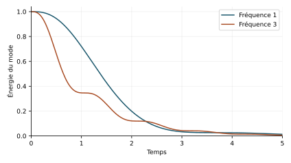

# ENS Paris, Lyon et Cachan — Mathématiques MPI 2, MP 2010 · Corrigé brut

*Corrigé rédigé par IA, non officiel. Signalez toute erreur.*

**Rédaction** · GPT-6.2 Astra Ultra · vitesse non renseignée

**Révision** · GPT-6.2 Astra Ultra · vitesse non renseignée

**Système hyperbolique périodique et condition de Kalman.** Le produit hermitien du sujet est linéaire en son premier argument. On note $D=B^*B$ et les normes matricielles sont subordonnées à la norme euclidienne complexe.

Les questions occupent les pages imprimées 2 à 7. Le jury insiste sur le passage de la convergence de chaque trajectoire à celle de la norme d’opérateur, puis sur la dépendance éventuelle en fréquence des constantes de décroissance. [Sujet officiel](https://www.ens.psl.eu/IMG/file/concours/2010/MPI/mp-sujet-maths2.pdf) · [Rapport du jury](https://www.ens.psl.eu/IMG/file/concours/2010/MPI/mp-ecrit-maths2.pdf)

## I. Déterminant de Vandermonde et exponentielles indépendantes

### Question I.1.a

Numérotons les lignes de 1 à $n$. Dans l’ordre $j=n,n-1,\ldots,2$, faisons $L_j\leftarrow L_j-\lambda_1 L_{j-1}$. Ces opérations préservent le déterminant et utilisent à chaque fois l’ancienne ligne $j-1$. La première ligne reste composée de 1. Pour $j\ge2$, l’entrée de colonne $h$ devient $(\lambda_h-\lambda_1)\lambda_h^{j-2}$ ; elle est donc nulle dans la première colonne, comme dans la matrice annoncée.

### Question I.1.b

Le développement suivant la première colonne se réduit au mineur inférieur droit, de signe positif. Mettre $\lambda_h-\lambda_1$ en facteur dans chacune des colonnes $h=2,\ldots,n$ donne $V(\lambda_1,\ldots,\lambda_n)=\prod_{h=2}^n(\lambda_h-\lambda_1)V(\lambda_2,\ldots,\lambda_n)$. Le déterminant à un paramètre vaut 1. Par récurrence, $V=\prod_{1\le j<h\le n}(\lambda_h-\lambda_j)$.

### Question I.2

Supposons $\sum_j a_je^{\lambda_jt}=0$ sur $[0,T]$ avec $T>0$. Au point $t_0=T/2$, en dérivant aux ordres $r=0,\ldots,n-1$, on a $\sum_j\lambda_j^r a_je^{\lambda_jt_0}=0$. Le déterminant de ce système pour les inconnues $a_je^{\lambda_jt_0}$ est le Vandermonde non nul de I.1.b car les paramètres sont distincts. Toutes ces inconnues, donc tous les $a_j$, sont nuls.

## II. Propriétés équivalentes de la paire de matrices

### Question II.1

Pour la matrice $K$ obtenue en empilant $B,BA,\ldots,BA^{N-1}$, $Ky=0$ équivaut à $BA^jy=0$ pour tout $0\le j<N$. La propriété [c] dit exactement que ce noyau est nul. Le théorème du rang dans le domaine de dimension $N$ donne $\operatorname{rg}K=N$, soit [d].

### Question II.2

Supposons $Ay=\lambda y$, $y\ne0$, et $By=0$. Alors $BA^jy=\lambda^jBy=0$ pour $j=0,\ldots,N-1$. On aurait $Ky=0$, alors que [d] impose $\ker K=0$. Aucun tel vecteur propre n’existe, ce qui est [a].

### Question II.3.a

La division euclidienne de $X^k$ par $\chi_A(X)$ de degré $N$ donne $X^k=Q_k\chi_A+P_k$ avec $\deg P_k\le N-1$ ou $P_k=0$. En évaluant en $A$, Cayley–Hamilton fournit $A^k=P_k(A)$.

### Question II.3.b

Si [c] est fausse, il existe $y\ne0$ tel que $BA^jy=0$ pour $j<N$. Il en va de même pour tout $j\ge N$ par II.3.a et linéarité. Ainsi toutes les sommes partielles $B\sum_{j=0}^m t^jA^j y/j!$ sont nulles. La série d’exponentielle converge en norme matricielle et la multiplication par $B$ ainsi que l’évaluation en $y$ sont continues. Donc $Be^{At}y=0$ pour tout $t$, contredisant [b].

### Question II.4

Si $A$ est diagonalisable, écrivons $y=\sum_j y_j$ où les $y_j$ appartiennent aux espaces propres pour les valeurs distinctes $\lambda_j$. Alors $Be^{At}y=\sum_j e^{\lambda_jt}By_j$. Si cette expression est identiquement nulle, I.2 appliquée à chaque coordonnée impose $By_j=0$ pour tout $j$ (le cas d’une seule valeur propre est immédiat). Un $y_j$ non nul serait un vecteur propre dans $\ker B$, exclu par [a]. Donc $y=0$, ce qui donne [b].

### Question II.5

On a [b] $\Rightarrow$ [c] $\Rightarrow$ [d] $\Rightarrow$ [a]. Sous l’hypothèse de diagonalisabilité de $A$, II.4 ajoute [a] $\Rightarrow$ [b], ce qui établit l’équivalence des quatre énoncés.

## III. Dissipation pour une équation différentielle matricielle

### Question III.1

Si $A^*=-A$, $\overline{\langle AX,X\rangle}=\langle X,AX\rangle=\langle A^*X,X\rangle=-\langle AX,X\rangle$. La partie réelle est nulle. Pour un vecteur propre $AX=\lambda X$ non nul, cela donne $\operatorname{Re}\lambda\,\|X\|^2=0$, donc $\lambda\in i\mathbb R$.

### Question III.2

Posons $M=A-B^*B$. L’exponentielle matricielle est dérivable et $\frac d{dt}e^{Mt}=Me^{Mt}=e^{Mt}M$. Alors $X(t)=e^{Mt}X_0$ satisfait l’équation et la condition initiale sur tout $[0,\infty[$. Pour toute autre solution, $\frac d{dt}(e^{-Mt}X(t))=0$, donc elle coïncide avec cette expression.

### Question III.3

On obtient
$$\frac d{dt}\|X\|^2=2\operatorname{Re}\langle AX-B^*BX,X\rangle=-2\|BX\|^2,$$
par III.1 et la relation d’adjonction. Ainsi l’énergie décroît, et pour tout $X_0$, $\|e^{Mt}X_0\|\le\|X_0\|$ à tout $t\ge0$. Prendre le supremum sur la boule unité donne $\|e^{Mt}\|\le1$.

### Question III.4

La norme $\|X(t)\|$ est décroissante comme racine d’une fonction positive décroissante. Elle admet donc une limite $L=\inf_{t\ge0}\|X(t)\|$ avec $0\le L\le\|X_0\|$.

### Question III.5.a

Sous cette hypothèse, la dérivée de $\|X\|^2$ est nulle à chaque instant. Par III.3, $\|BX(t)\|^2=0$, donc $BX(t)=0$ pour tout $t\ge0$.

### Question III.5.b

Si $BX(t)=0$ pour tout $t$, l’équation se réduit à $X'=AX$, donc $X(t)=e^{At}X_0$. Par suite $Be^{At}X_0=0$ pour tout $t$. La matrice $A$ antihermitienne est diagonalisable et [a] implique [b] : on doit avoir $X_0=0$. Toute la trajectoire, et donc $L$, est nulle.

### Question III.6.a

La suite $X(t_k)$ reste dans la boule fermée de rayon $\|X_0\|$ de $\mathbb C^N$. Par Bolzano–Weierstrass, il existe une extraction strictement croissante $\varphi$ telle que $X(t_{\varphi(k)})\to\xi_0$ pour un certain $\xi_0$.

### Question III.6.b

Pour $t$ fixé, $X(t_{\varphi(k)}+t)=e^{Mt}X(t_{\varphi(k)})$, car les multiples de $M$ commutent. L’application linéaire $e^{Mt}$ est continue, donc la limite est $e^{Mt}\xi_0=\xi(t)$, solution de l’équation avec donnée $\xi_0$.

### Question III.6.c

Par continuité de la norme et comme $t_{\varphi(k)}+t\to\infty$, on a $\|\xi(t)\|=L$ pour tout $t\ge0$. Cette trajectoire a une norme constante et satisfait les hypothèses de III.5. Ainsi $\xi_0=0$ et $L=0$ pour la trajectoire initiale quelconque.

### Question III.7.a

Pour une base orthonormée $(e_j)$, III.6 donne $\|e^{Mt}e_j\|\to0$ pour chaque $j$. Pour $x=\sum_j x_je_j$, Cauchy–Schwarz donne $\|e^{Mt}x\|\le\|x\|(\sum_j\|e^{Mt}e_j\|^2)^{1/2}$. La somme est finie ; en prenant le supremum unitaire on obtient $\|e^{Mt}\|\to0$.

### Question III.7.b

Si $Mv=\lambda v$ avec $\|v\|=1$, alors $e^{Mt}v=e^{\lambda t}v$ et $e^{t\operatorname{Re}\lambda}\le\|e^{Mt}\|\to0$. Nécessairement $\operatorname{Re}\lambda<0$ pour chaque valeur propre.

### Question III.7.c

Sur l’espace caractéristique associé à $\lambda_j$, écrivons $M=\lambda_j I+N_j$ avec $N_j^{m_j}=0$. Pour $Y$ dans cet espace,
$$e^{Mt}Y=e^{\lambda_jt}\left(\sum_{h=0}^{m_j-1}\frac{t^h}{h!}(M-\lambda_jI)^h\right)Y.$$
Le polynôme matriciel entre parenthèses est indépendant de $Y$. Fixons $c=-\frac12\max_j\operatorname{Re}\lambda_j>0$. Chaque $e^{(\operatorname{Re}\lambda_j+c)t}t^h$ est borné sur $[0,\infty[$. Les normes de $e^{Mt}$ restreint à ces espaces sont donc majorées par $K_j e^{-ct}$. En sommant les majorations après application des projections fixes associées à la décomposition directe, on trouve $\|e^{Mt}\|\le K e^{-ct}$.

### Question III.8

Si [a] échoue, il existe un vecteur unitaire $v$ avec $Av=i\omega v$ et $Bv=0$. Alors $Mv=i\omega v$ et $\|e^{Mt}v\|=1$ en tout temps. Avec III.3, cela donne même $\|e^{Mt}\|=1$ pour tout $t\ge0$ : la convergence (2) échoue.

## IV. Série de Fourier de la solution périodique

### Question IV.1

Comme $A^*=A$, on a $(iA)^*=\bar i A^*=-iA$. La matrice $iA$ est antihermitienne, et $ikA$ l’est aussi pour tout $k\in\mathbb Z$.

### Question IV.2

La périodicité de $w_0$ et $w_0'$ annule les termes de bord dans deux intégrations par parties, composante par composante. Ainsi $c_k(w_0'')=(ik)^2c_k(w_0)$, soit $c_k(w_0)=-c_k(w_0'')/k^2$ pour $k\ne0$. La fonction $w_0''$ est continue, donc de carré intégrable sur une période. Bessel donne $\sum_k\|c_k(w_0'')\|^2<\infty$. Par Cauchy–Schwarz,
$$\sum_{k\ne0}|k|\,\|c_k(w_0)\|\le\left(\sum_{k\ne0}k^{-2}\right)^{1/2}\left(\sum_{k\ne0}\|c_k(w_0'')\|^2\right)^{1/2}<\infty.$$

### Question IV.3

Notons $D=B^*B$, $M_k=ikA-D$, $c_k=c_k(w_0)$, $X_k(t)=e^{M_kt}c_k$. Par III.3 appliquée à $ikA$, $\|X_k(t)\|\le\|c_k\|$ pour tous $t\ge0$. Le terme $k=0$ est nul. Par IV.2, $\sum_{k\ne0}\|c_k\|$ converge ; la série $\sum_kX_k(t)e^{ikx}$ converge normalement sur toute la demi-bande, tout comme ses dérivées terme à terme, majorées respectivement par $|k|\|c_k\|$ en $x$ et $(|k|\|A\|+\|D\|)\|c_k\|$ en $t$. On peut donc dériver, avec dérivée à droite en $t=0$, et on trouve $w_t=Aw_x-Dw$. La périodicité en $x$ se lit terme à terme. L’intégration sur une période est permise par convergence uniforme et donne $2\pi X_0(t)=0$ (indice de Fourier nul). À $t=0$, la série est la série de Fourier de la fonction périodique $C^2$ $w_0$, qui converge vers $w_0$ en tout point par le théorème de Dirichlet appliqué aux composantes.

### Question IV.4

Pour $k\ne0$, $ikA$ a les mêmes espaces propres que $A$, donc satisfait [a] avec $B$. Par III.7.a, $X_k(t)\to0$. Pour $k=0$ le coefficient est déjà nul. Par Parseval,
$$\int_0^{2\pi}\|w(t,x)\|^2dx=2\pi\sum_k\|X_k(t)\|^2.$$
Les termes sont majorés par $\|c_k\|^2$, série sommable par Parseval pour $w_0$. La convergence dominée de la somme donne la limite nulle, sans hypothèse d’un taux uniforme entre fréquences.

On peut détailler le passage à la limite sans choisir de taux de décroissance. Étant donné $\delta>0$, choisissons $m$ assez grand pour que $\sum_{|k|>m}\|c_k\|^2<\delta$. La queue des énergies est alors majorée par $\delta$ à tout instant, tandis que les $2m+1$ premiers termes tendent tous vers zéro. Le supremum limite de la somme totale est donc au plus $\delta$, ce qui suffit.

## V. Décroissance exponentielle uniforme en dimension deux

### Question V.1

Pour $N=2$, II.5 donne $\ker B\cap\ker BA=\{0\}$. La fonction continue $Y\mapsto\|BY\|^2+\|BAY\|^2$ est donc strictement positive sur la sphère unité compacte. Ses minimum et maximum $0<C_1\le C_2$ satisfont, par homogénéité, $C_1\|Y\|^2\le\|BY\|^2+\|BAY\|^2\le C_2\|Y\|^2$ pour tout $Y$.

### Question V.2.a

Chaque $X_k$ résout $X_k'=(ikA-D)X_k$, $X_k(0)=c_k(w_0)$, avec $D=B^*B$. C’est l’unique solution par III.2.

### Question V.2.b

Comme $|k|\ge1$, la valeur absolue de $(\varepsilon/k)\operatorname{Im}\langle BAY,BY\rangle$ est au plus $\varepsilon\|BA\|\|B\|\|Y\|^2$. Par exemple $\varepsilon_0=1/[2(1+\|BA\|\|B\|)]$ convient, y compris si ce produit est nul. Pour $0<\varepsilon<\varepsilon_0$, on obtient $\frac12\|Y\|^2\le\mathcal L_{\varepsilon,k}[Y]\le\frac32\|Y\|^2$.

### Question V.2.c

Posons $X=X_k(t)$, $U=BX$, $V=BAX$. La trajectoire est lisse et l’énergie modifiée dérivable. On a $U'=ikV-BDX$, $V'=ikBA^2X-BADX$. Comme le produit scalaire est linéaire au premier facteur,
$$\begin{aligned}
\mathcal L'_{\varepsilon,k}
={}&-2\|U\|^2-\varepsilon\|V\|^2+\varepsilon\operatorname{Re}\langle BA^2X,U\rangle\\
&-\frac{\varepsilon}{k}\operatorname{Im}\left(\langle BADX,U\rangle+\langle V,BDX\rangle\right).
\end{aligned}$$
Le terme négatif en $\|V\|^2$ vient de $\langle V,ikV\rangle=-ik\|V\|^2$.

### Question V.2.d

Les deux premiers produits d’erreur de V.2.c se majorent par $\|BA^2\|\|X\|\|U\|$ et $\|BAD\|\|X\|\|U\|$. Pour le dernier, $BDX=BB^*U$ et $BB^*$ est hermitienne ; ainsi $\langle V,BDX\rangle=\langle BB^*V,U\rangle$, de module au plus $\|BB^*BA\|\|X\|\|U\|$. Comme $1/|k|\le1$, en posant $C_3=\|BA^2\|+\|BAB^*B\|+\|BB^*BA\|$, on trouve
$$\mathcal L'_{\varepsilon,k}\le-2\|BX\|^2-\varepsilon\|BAX\|^2+\varepsilon C_3\|X\|\|BX\|.$$

### Question V.2.e

L’inégalité de Young donne $\varepsilon C_3\|X\|\|BX\|\le\|BX\|^2+\varepsilon^2 C_3^2\|X\|^2/4$. Avec $\varepsilon\le1$, il reste donc
$$\mathcal L'\le-\varepsilon(\|BX\|^2+\|BAX\|^2)+\varepsilon^2 C_3^2\|X\|^2/4.$$
Prenons $\varepsilon_1=\min(\varepsilon_0/2,1,C_1/(1+C_3^2))>0$. Pour $0<\varepsilon<\varepsilon_1$, la borne de V.1 donne $\mathcal L'\le-\varepsilon C_1\|X\|^2/2$. Par V.2.b, $\|X\|^2\ge2\mathcal L/3$. Ainsi $\mathcal L'\le-\varepsilon C_4\mathcal L$ avec $C_4=C_1/3$ indépendant de $k$.

### Question V.2.f

La dérivée de $e^{\varepsilon C_4t}\mathcal L_{\varepsilon,k}[X_k(t)]$ est négative ou nulle, donc ce produit est majoré par sa valeur en 0. On obtient $\mathcal L_{\varepsilon,k}[X_k(t)]\le e^{-\varepsilon C_4t}\mathcal L_{\varepsilon,k}[X_k(0)]$.

### Question V.3

Les paramètres peuvent être choisis indépendamment de la fréquence. Fixons $\varepsilon=\varepsilon_1/2$. Les bornes de V.2.b aux deux extrémités et V.2.f donnent $\|X_k(t)\|^2\le3e^{-\varepsilon C_4t}\|c_k(w_0)\|^2$. Il suffit de prendre $K=\sqrt3$ et $c=\varepsilon C_4/2>0$ pour la majoration des normes.

### Question V.4

Par Parseval et la nullité du mode zéro,
$$\int_0^{2\pi}\|w(t,x)\|^2dx=2\pi\sum_{k\ne0}\|X_k(t)\|^2\le K^2 e^{-2ct}2\pi\sum_{k\ne0}\|c_k(w_0)\|^2.$$
La dernière somme multipliée par $2\pi$ vaut $\|w_0\|_{L^2}^2$. D’où $\|w(t,\cdot)\|_{L^2}\le K e^{-ct}\|w_0\|_{L^2}$. La figure illustre le mécanisme pour $A=\left(\begin{smallmatrix}0&1\\1&0\end{smallmatrix}\right)$, $B=\operatorname{diag}(1,0)$ et $X_k(0)=(0,1)^t$. Ici $BX_k(0)=0$ mais $BAX_k(0)\ne0$ : l’énergie usuelle a une dérivée initiale nulle, alors que l’estimation exponentielle s’applique.

Dans l’exemple de la figure, si $X_k=(u,v)^t$, on a $v''+v'+k^2v=0$, $v(0)=1$ et $v'(0)=0$. Avec $\omega_k=\sqrt{k^2-1/4}$, on trouve
$$v=e^{-t/2}\!\left(\cos(\omega_kt)+\frac{\sin(\omega_kt)}{2\omega_k}\right),\qquad
u=\frac{ik}{\omega_k}\,e^{-t/2}\sin(\omega_kt).$$
Les deux tracés représentent $|u|^2+|v|^2$ pour $k=1$ et $k=3$. Au départ, $U=0$ et $\|V\|=1$ dans les notations de V.2.c. La pente de l’énergie usuelle est donc nulle, tandis que celle de l’énergie modifiée vaut $-\varepsilon$ dans les deux cas. Cette différence explique l’intérêt du terme croisé.
