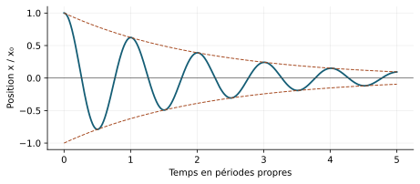
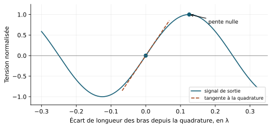
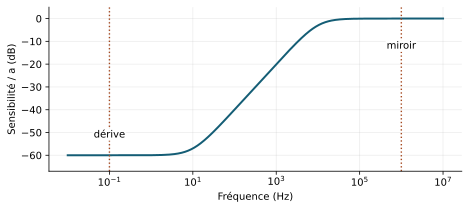
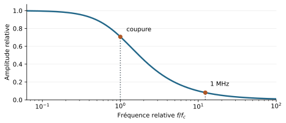
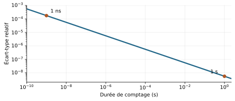
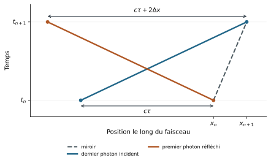

# ENS MP 2010 — Physique MPI · Corrigé guidé

*Corrigé rédigé par IA, non officiel. Signalez toute erreur.*

**Rédaction** · GPT-6.2 Astra Ultra · vitesse non renseignée

## Mesure des déplacements et fluctuations d’un microrésonateur optomécanique

## I — Refroidissement d’un résonateur mécanique

### Question 1 — Raideur et pulsation propre

**Indication.** Écrire la force de rappel pour un déplacement positif, puis comparer avec l’équation d’un oscillateur harmonique.

Le poids et la réaction du support se compensent verticalement. Sur l’axe horizontal, la loi de Hooke donne $m\ddot x=-Kx$. L’équation s’écrit donc $\ddot x+\omega_0^2x=0$, avec $\omega_0=\sqrt{K/m}=2\pi f_0$. Avec les données du miroir, $\omega_0\simeq6{,}3\times10^6\ \mathrm{rad\,s^{-1}}$.

### Question 2 — Pulsation du mouvement amorti

**Indication.** Partir du régime libre décrit juste avant la question. Distinguer la fréquence lue sur une oscillation amortie de celle que donnerait un balayage en fréquence.

Le mouvement libre obéit à $\ddot x+\gamma\dot x+\omega_0^2x=0$. Pour $\gamma<2\omega_0$, les racines caractéristiques sont $-\gamma/2\pm i\omega$, avec $\omega=\sqrt{\omega_0^2-\gamma^2/4}$. Ainsi $\omega/\omega_0=1-\gamma^2/(8\omega_0^2)+O((\gamma/\omega_0)^4)$. La première correction est quadratique en $\gamma/\omega_0$, le petit paramètre sans dimension. Le sujet emploie ici le terme « résonance ». Si l’on cherchait le maximum d’amplitude d’un oscillateur forcé, on minimiserait $(\omega_0^2-\Omega^2)^2+\gamma^2\Omega^2$ et on trouverait $\Omega_{\mathrm r}=\sqrt{\omega_0^2-\gamma^2/2}$, également égal à $\omega_0$ au premier ordre.

### Question 3 — Relâchement sans vitesse

**Indication.** Écrire la combinaison d’un cosinus et d’un sinus sous un même facteur exponentiel. La condition de vitesse fixe aussi le coefficient du sinus.

La solution qui réalise $x(0)=x_0$ et $\dot x(0)=0$ est
$$
x(t)=x_0 e^{-\gamma t/2}\left(\cos\omega t+\frac{\gamma}{2\omega}\sin\omega t\right).
$$
La tangente initiale est horizontale et $\ddot x(0)=-\omega_0^2x_0$. Les extrema, atteints pour $\omega t=n\pi$, alternent de signe et décroissent en valeur absolue comme $|x_0|e^{-\gamma t/2}$. Deux maxima de même signe sont séparés de $2\pi/\omega$.

### Question 4 — Énergie stockée et énergie dissipée

**Indication.** Dériver l’énergie totale avant toute approximation donne un contrôle direct du signe de la puissance de frottement.

À chaque instant, $E_c=m\dot x^2/2$, $E_p=Kx^2/2$ avec origine d’énergie en $x=0$, et $E_m=E_c+E_p$. Pour expliciter ces expressions, posons $u=\omega t$, $a=\gamma/(2\omega)$ et $E_0=Kx_0^2/2$. En dérivant la solution précédente, on obtient $\dot x=-x_0(\omega_0^2/\omega)e^{-\gamma t/2}\sin u$. Ainsi
$$
E_c=E_0e^{-\gamma t}\frac{\omega_0^2}{\omega^2}\sin^2 u,\qquad
E_p=E_0e^{-\gamma t}(\cos u+a\sin u)^2.
$$
La dérivée de leur somme est $\dot E_m=\dot x(m\ddot x+Kx)=-m\gamma\dot x^2\leq0$. En faible amortissement, les termes oscillants s’échangent l’énergie et leur somme est, à l’ordre dominant, $E_0e^{-\gamma t}$.

### Question 5 — Moyenne de la force fluctuante

**Indication.** Séparer une force moyenne de sa fluctuation. Une moyenne nulle de la force laisse possible un apport moyen d’énergie.

Le gaz au repos est à l’équilibre. Les chocs ont des directions aléatoires et la composante moyenne de leur action dépendant de la vitesse est déjà comprise dans le terme visqueux. Une éventuelle force statique de pression est absorbée dans la définition de la position d’équilibre. La partie fluctuante qui subsiste est centrée, $\langle F_T\rangle=0$ en moyenne statistique, ou temporelle sur un grand nombre de collisions. Une réalisation sur une durée finie présente des fluctuations autour de zéro.

### Question 6 — Amplitude équivalente de l’agitation thermique

**Indication.** La moyenne d’un carré de cosinus sur une période vaut un demi. Ce facteur distingue l’amplitude demandée de la valeur efficace.

Dans le modèle sinusoïdal, $\langle x^2\rangle=x_T^2/2$ et $\langle\dot x^2\rangle=\omega_0^2x_T^2/2$. L’équipartition appliquée à l’énergie potentielle donne $Kx_T^2/4=k_BT/2$, d’où
$$
x_T=\sqrt{\frac{2k_BT}{K}}=\sqrt{\frac{2k_BT}{m\omega_0^2}}.
$$
L’écart quadratique moyen en position vaut $x_T/\sqrt2$.

### Question 7 — Ordre de grandeur à température ambiante

**Indication.** Évaluer la raideur en utilisant la pulsation en radians par seconde puis prendre la racine carrée du quotient énergie sur raideur.

Convertissons la masse, $100\ \mu\mathrm{g}=10^{-7}\ \mathrm{kg}$. À $T=300\ \mathrm K$, $K=m(2\pi f_0)^2\simeq3{,}95\times10^6\ \mathrm{N\,m^{-1}}$ et $2k_BT\simeq8{,}4\times10^{-21}\ \mathrm J$. Le quotient vaut $2{,}1\times10^{-27}\ \mathrm{m^2}$, donc $x_T\simeq4{,}6\times10^{-14}\ \mathrm m$, soit environ $46\ \mathrm{fm}$. Une telle amplitude représente moins d’un dix-millionième de la longueur d’onde du laser.

### Question 8 — Puissance fournie par le gaz

**Indication.** Faire le bilan de puissance, puis remplacer la moyenne de la vitesse au carré par l’énergie cinétique moyenne obtenue à l’équilibre.

Multiplions l’équation du mouvement par $\dot x$. On trouve $\dot E_m=-m\gamma\dot x^2+F_T\dot x$. En régime stationnaire l’énergie moyenne est constante. La force de Langevin doit donc fournir $P_{F_T}=\langle F_T\dot x\rangle=m\gamma\langle\dot x^2\rangle=2\gamma\langle E_c\rangle=\gamma k_BT$. L’unité est le watt. La corrélation de la force et de la vitesse explique le signe positif de cette puissance, malgré la moyenne nulle de $F_T$.

### Question 9 — Amplitude avec contre-réaction

**Indication.** Conserver la puissance injectée et ajouter les deux puissances dissipées. L’amplitude intervient au carré dans ce bilan.

Les deux forces proportionnelles à la vitesse dissipent ensemble $m\gamma(1+g)\langle\dot x^2\rangle$. Par hypothèse, le gaz fournit encore $\gamma k_BT$. Leur égalité en régime permanent fixe $\langle\dot x^2\rangle=k_BT/[m(1+g)]$. Dans la limite de faible amortissement, $\langle\dot x^2\rangle=\omega_0^2x_{\mathrm{cr}}^2/2$, donc $x_{\mathrm{cr}}=x_T/\sqrt{1+g}$. À gain nul, on retrouve l’amplitude de la question 6.

### Question 10 — Énergie et température effective du mode

**Indication.** Comparer les énergies mécaniques à même raideur en présence et en l’absence de contre-réaction.

En mouvement quasi harmonique, $E_m=Kx_{\mathrm{cr}}^2/2=k_BT/(1+g)$ à l’approximation de l’énoncé. Les moyennes cinétique et potentielle en représentent chacune la moitié. Identifier $E_m$ à l’énergie moyenne $k_BT'$ d’un mode harmonique donne $T'=T/(1+g)$. Cette température effective caractérise les fluctuations du mode mécanique. Le gaz reste à $T$.

### Question 11 — Effet d’une augmentation de pression

**Indication.** Reprendre le bilan de la question 8 en examinant les deux termes qui changent lorsque les collisions deviennent plus nombreuses.

À température fixée, davantage de collisions rendent à la fois la traînée plus forte et les impulsions aléatoires plus fréquentes. Dans le bilan stationnaire, l’injection $\gamma k_BT$ et la dissipation $m\gamma\langle\dot x^2\rangle$ portent le même facteur $\gamma$. Il se simplifie. On retrouve $\langle x^2\rangle=k_BT/K$ pour le miroir à l’équilibre. La pression peut donc changer le temps de relaxation. La contre-réaction idéale de la question 9, elle, ajoute de la dissipation sans accroître le bruit du gaz.

## II — Mesure interférométrique de petits déplacements

### Question 12 — Intensités aux deux sorties du Michelson

**Indication.** Suivre successivement les deux chemins vers chaque photorécepteur. Additionner les amplitudes complexes avant de prendre leur module au carré.

Écrivons $\phi_j=2k\,OM_j$, avec $k=2\pi/\lambda$. La différence de phase est $\phi_2-\phi_1=4\pi(\Delta L_0+x)/\lambda$. La figure 5 place $Ph_1$ sous la séparatrice et $Ph_2$ sur le trajet de retour, après le circulateur. À un facteur de phase commun près, les amplitudes arrivant sur $Ph_1$ et $Ph_2$ sont $E_0rt(e^{i\phi_1}-e^{i\phi_2})$ et $E_0(r^2 e^{i\phi_1}+t^2e^{i\phi_2})$. Le signe moins vient de la réflexion sur la deuxième face de la séparatrice. Comme $r=t=1/\sqrt2$, on trouve, en posant $\Phi=4\pi(\Delta L_0+x)/\lambda$,
$$
I_1=\tfrac12 I_0(1-\cos\Phi),\qquad I_2=\tfrac12 I_0(1+\cos\Phi).
$$
La somme $I_1+I_2=I_0$ vérifie la conservation du flux, et pour deux bras égaux toute la lumière regagne le circulateur.

### Question 13 — Tension et sensibilité au premier ordre

**Indication.** Écrire d’abord le signal exact en différence. Sa valeur et sa dérivée en $x=0$ donnent directement les deux coefficients.

Posons $q=4\pi/\lambda$ et $\Phi_0=q\Delta L_0$. La différence des sorties donne exactement $s=\eta I_0\cos(\Phi_0+qx)$. Lorsque $|qx|\ll1$, son développement fournit $s=s_0+\alpha x+O(\eta I_0(qx)^2)$ avec
$$
s_0=\eta I_0\cos\Phi_0,\qquad \alpha=-q\eta I_0\sin\Phi_0.
$$
Le premier terme est une tension et $\alpha$ s’exprime en volts par mètre.

### Question 14 — Point de fonctionnement à pente positive maximale

**Indication.** Il existe deux quadratures par frange. Vérifier le signe de la pente pour retenir celle demandée.

Il faut $\sin\Phi_0=-1$, soit $\Phi_0=-\pi/2+2p\pi$ pour $p$ entier. On règle donc $\Delta L_0=-\lambda/8+p\lambda/2$ (par exemple $3\lambda/8$). Les deux détecteurs reçoivent alors la même intensité $I_0/2$, de sorte que $s_0=0$, et $\alpha_{\max}=4\pi\eta I_0/\lambda$. À cette quadrature, l’excursion positive de $M_2$ augmente la tension de sortie.

### Question 15 — Déplacement du point de fonctionnement

**Indication.** Reporter le déplacement optique sur une frange et distinguer la hauteur du signal de sa pente.

À dérive fixée $D$, la sensibilité locale vaut $-q\eta I_0\sin(\Phi_0+qD)=\alpha_{\max}\cos(qD)$. Une dérive de $\lambda/8$ ajoute $\pi/2$ au déphasage. Le point de fonctionnement atteint un extremum du signal, la sensibilité linéaire s’annule. Une dérive d’ordre comparable suffit à modifier fortement la pente, qui peut ensuite changer de signe.

### Question 16 — Durée pendant laquelle la pente varie peu

**Indication.** La dérive peut couvrir une frange entière. Garder sa phase exacte et ne développer que le petit déplacement rapide.

Au départ à quadrature de pente positive, on a $s=\eta I_0\sin(qD+qx)$. Au premier ordre en $x$ seulement, pour $D=\lambda t/t_d$,
$$
s'_0(t)=\eta I_0\sin(4\pi t/t_d),\qquad
\alpha'(t)=\alpha_{\max}\cos(4\pi t/t_d).
$$
Sans tolérance chiffrée, seule une échelle de temps est définie. Pour une perte relative admissible $\varepsilon$, la première limite est $t_{\rm exp}=t_d\arccos(1-\varepsilon)/(4\pi)$. Une pente presque constante demande $4\pi t/t_d\ll1$. À $t=t_d/8$, ici environ $1{,}25\ \mathrm s$, la pente s’annule entièrement.

### Question 17 — Comparaison avec la période mécanique

**Indication.** Comparer des durées, en distinguant l’enregistrement d’une oscillation et la stabilité requise pour répéter une mesure.

À $1\ \mathrm{MHz}$, une oscillation dure $1\ \mu\mathrm s$. Par exemple, une variation de pente de $1\,\%$ est atteinte après environ $0{,}11\ \mathrm s$ si $t_d=10\ \mathrm s$. La fenêtre contient déjà quelque $10^5$ périodes. Elle suffit pour observer les oscillations pendant une acquisition courte. En revanche, la calibration dépendra de la dérive lors de moyennages répétés sur plusieurs secondes ou minutes.

### Question 18 — Boucle proportionnelle

**Indication.** Fermer la boucle en remplaçant le déplacement de la platine par sa valeur en fonction de la sortie que l’on cherche.

Notons $a=\alpha_{\max}>0$. Le signal linéarisé vaut $s=a(D-l_C+x)$ avec $l_C=\beta s$. En reportant cette relation puis en regroupant les termes en $s$, on obtient
$$
s=\frac{a}{1+a\beta}(D+x).
$$
Le produit $a\beta$ est le gain de boucle sans dimension. Le signe de $-l_C$ signifie que l’avancée commandée de $M_1$ compense une augmentation de $OM_2-OM_1$.

### Question 19 — Durée de maintien dans le domaine linéaire

**Indication.** Appliquer le critère sur l’écart de longueur qui subsiste dans l’interféromètre après action de la platine.

L’écart résiduel entre les bras est $D-l_C+x=(D+x)/(1+a\beta)$. Pour la dérive seule il atteint $\lambda/8$ lorsque $t_{\mathrm{max}}\simeq(1+a\beta)t_d/8$. Les mesures en régime strictement linéaire doivent rester en deçà de cette échelle, suivant la tolérance choisie. Pour $a\beta\simeq1000$ et $t_d\simeq10\ \mathrm s$, on trouve environ $1{,}25\times10^3\ \mathrm s$, soit une vingtaine de minutes. À tolérance identique, le temps utile est multiplié par $1+a\beta$ dans le modèle linéarisé.

### Question 20 — Coût en sensibilité

**Indication.** Lire le coefficient de $x$ dans la réponse en boucle fermée et le comparer à sa valeur à gain de retour nul.

À dérive donnée, $\partial s/\partial x=a/(1+a\beta)$. La sensibilité est donc divisée par $1+a\beta$, sensiblement $10^3$ ici. Le miroir de référence suit à la fois le mouvement que l’on souhaite détecter et la perturbation lente.

### Question 21 — Séparer les deux échelles de temps

**Indication.** Examiner le signal envoyé à la platine. Une variation lente doit la faire bouger, une oscillation mécanique rapide doit rester visible dans le signal mesuré.

Le module $|H|=[1+(\omega/\omega_c)^2]^{-1/2}$ tend vers un à basse fréquence et décroît à haute fréquence. Il s’agit d’un passe-bas du premier ordre, à $-3\ \mathrm{dB}$ en $\omega_c$. On veut transmettre au positionneur la dérive lente et rejeter le mouvement à $\omega_0$. Il faut donc $\omega_{\rm dérive}\ll\omega_c\ll\omega_0$. Par exemple $f_c=10\ \mathrm{Hz}$ convient pour une dérive à l’échelle de dix secondes et un mode à un mégahertz, même en tenant compte du gain de boucle suivant.

### Question 22 — Réponse de l’asservissement filtré

**Indication.** Identifier le gain de boucle complet, puis l’évaluer séparément aux fréquences caractéristiques de la dérive et du signal.

En régime harmonique, $l_C(\omega)=\beta H(\omega)s(\omega)$. En remplaçant dans la sortie interférométrique on obtient
$$
s(\omega)=\frac{a}{1+a\beta H(\omega)}[D(\omega)+x(\omega)].
$$
Aux fréquences de dérive $H\simeq1$, donc le rejet reste de l’ordre de $1+a\beta$ et la durée de maintien reste de l’ordre de $t_{\mathrm{max}}$. À $\omega_0$, il faut plus précisément $a\beta|H(\omega_0)|\ll1$ pour retrouver $s(\omega_0)\simeq a x(\omega_0)$. À grand gain, cela demande $a\beta\omega_c\ll\omega_0$. Avec $a\beta=1000$, $f_c=10\ \mathrm{Hz}$ et $f_0=1\ \mathrm{MHz}$, le module du gain de retour à la fréquence du miroir vaut environ $0{,}01$. La sortie conserve alors pratiquement la pente de quadrature.

## III — Le photodétecteur

### Question 23 — Flux de photons reçus

**Indication.** Relier la puissance à l’énergie d’un seul photon et au nombre reçu par seconde.

Pendant $dt$, le détecteur reçoit l’énergie $P\,dt$. Un photon monochromatique transporte $E_{\rm ph}=h\nu=hc/\lambda$. Le nombre de photons reçus dans cet intervalle vaut donc $P\,dt/E_{\rm ph}$ et le flux incident est $\Phi=P\lambda/(hc)$, en $\mathrm{s^{-1}}$.

### Question 24 — Photosensibilité idéale

**Indication.** Compter la charge qui circule pendant le même intervalle que celui utilisé à la question 23.

Chaque photon apporte une charge élémentaire $e$ au courant de conduction, dans le sens positif choisi pour $i_D$. Ainsi $i_D=e\Phi=eP\lambda/(hc)$. La photosensibilité $\kappa=i_D/P=e\lambda/(hc)$ s’exprime en $\mathrm{A/W}$.

### Question 25 — Valeur à 630 nm

**Indication.** Convertir la longueur d’onde en mètres. On peut calculer d’abord l’énergie du photon.

Avec les constantes du sujet, $E_{\rm ph}=6{,}6\times10^{-34}\times3{,}0\times10^8/(630\times10^{-9})\simeq3{,}14\times10^{-19}\ \mathrm J$. Il vient $\kappa=e/E_{\rm ph}\simeq0{,}51\ \mathrm{A/W}$. Par exemple, une puissance de $1\ \mathrm{mW}$ correspond dans ce modèle à un courant de $0{,}51\ \mathrm{mA}$.

### Question 26 — Signe de la réponse différentielle

**Indication.** Suivre le courant inverse de chaque diode en tenant compte de la position de $P_2$ en haut de la figure 10.

L’amplificateur idéal est monté en suiveur. Sa sortie $s$ recopie le potentiel du nœud commun aux deux diodes et à $R$, sans prélever de courant. Le photocourant $\kappa P_2$ arrive au nœud depuis la branche supérieure et $\kappa P_1$ le quitte par la branche inférieure. La loi des nœuds donne $s/R=\kappa(P_2-P_1)$, soit $s=R\kappa(P_2-P_1)$. Deux éclairements égaux donnent une sortie nulle.

### Question 27 — Résistance assurant la polarisation requise

**Indication.** Examiner séparément les deux tensions de polarisation au moment où l’écart de puissance a son module maximal.

Les tensions inverses sont $u_{D1}=V_{cc}+s$ en bas et $u_{D2}=V_{cc}-s$ en haut. Les deux conditions $u_{Di}\ge10\ \mathrm V$ imposent $|s|\le5\ \mathrm V$. L’écart de puissance maximal vaut $10\ \mathrm{mW}$ lorsque l’une des diodes reçoit le maximum et l’autre zéro. La sensibilité $|\partial s/\partial(P_2-P_1)|=R\kappa$ croît avec $R$. On choisit donc la valeur limite
$$
R_{\max}=\frac{5\ \mathrm V}{\kappa\,10\ \mathrm{mW}}\simeq9{,}82\times10^2\ \Omega .
$$
Une valeur arrondie par défaut de $980\ \Omega$ satisfait les deux contraintes sur tout le domaine.

### Question 28 — Réponse à une modulation harmonique

**Indication.** Les deux autres armatures des condensateurs sont à des potentiels fixes. Écrire le courant de chaque condensateur depuis le nœud commun.

Les potentiels d’alimentation étant constants, chaque capacité prélève au nœud un courant $C\,ds/dt$. Avec les deux capacités, la loi des nœuds s’écrit
$$
2RC\,\frac{ds}{dt}+s=R\kappa(P_2-P_1)=2R\kappa P_0\xi\cos(\omega t).
$$
En régime permanent, le gain complexe entre le second membre et $s$ est $1/(1+2i\omega RC)$. Le signal réel a donc pour expression
$$
s(t)=\frac{2R\kappa P_0\xi}{\sqrt{1+(2\omega RC)^2}}\,
\cos\!\big[\omega t-\arctan(2\omega RC)\big].
$$
La composante commune $P_0$ disparaît de la différence continue.

### Question 29 — Fréquence de coupure

**Indication.** Identifier la constante de temps de l’équation différentielle avant de passer des radians par seconde aux hertz.

À la coupure, le gain en amplitude vaut $1/\sqrt 2$ de sa valeur à fréquence nulle. D’après la question 28, cette condition s’écrit $2RC\omega_c=1$. Ainsi $\omega_c=1/(2RC)$ et $f_c=1/(4\pi RC)$. À cette fréquence, le déphasage de la tension par rapport à $P_2-P_1$ vaut $-\pi/4$.

### Question 30 — Réponse à un mégahertz

**Indication.** Comparer $f$ à $f_c$, puis quantifier l’effet à l’aide du gain complexe.

Pour $R=980\ \Omega$ et $C=1\ \mathrm{nF}$, $f_c\simeq81\ \mathrm{kHz}$. À $1\ \mathrm{MHz}$, $f/f_c\simeq12{,}3$. Le facteur d’amplitude vaut environ $0{,}081$ et le retard de phase avoisine $85^\circ$. Avec $P_0=5\ \mathrm{mW}$, l’amplitude passe ainsi d’environ $5{,}0\,\xi\ \mathrm V$ en basse fréquence à $0{,}40\,\xi\ \mathrm V$. Le montage de sensibilité choisie à la question 27 atténue et déphase fortement la modulation à mesurer.

### Question 31 — Tensions fixes aux bornes des capacités

**Indication.** L’effet d’une capacité dépend de la variation de sa tension. Trouver le potentiel de chacune de ses bornes.

Dans chacun des deux premiers étages, la contre-réaction impose à l’entrée inverseuse le potentiel de l’entrée non inverseuse, soit zéro. L’autre borne de la diode est à $-V_{cc}$. Sa tension inverse, $V_{cc}$, est donc constante même si $P_i(t)$ varie. Le courant $C\,du_D/dt$ est nul et tout le photocourant est compensé par le courant dans $R'$. Ce résultat utilise le modèle d’amplificateur idéal en régime linéaire.

### Question 32 — Sortie du montage à trois étages

**Indication.** Déterminer d’abord le signe des deux tensions intermédiaires. Examiner ensuite l’entrée non inverseuse du dernier amplificateur.

Notons $s_1,s_2$ les sorties des deux premiers amplificateurs. À chaque entrée inverseuse, le courant $\kappa P_i$ part dans la diode vers $-V_{cc}$. La résistance $R'$ l’alimente depuis la sortie, donc $s_i/R'=\kappa P_i$. À l’étage 3, le pont de deux résistances égales fixe $v_+=s_2/2$ et la contre-réaction donne $v_-=v_+$. La loi des nœuds à cette entrée impose $(s_1-v_-)/R+(s-v_-)/R=0$. Par conséquent
$$
s=2v_--s_1=s_2-s_1=\kappa R'(P_2-P_1).
$$
Les quatre résistances égales de valeur $R$ donnent une soustraction à gain unité.

## IV.1 — Le laser

### Question 33 — Origine du sigle LASER

**Indication.** Identifier le processus d’émission qui assure l’amplification.

LASER signifie *Light Amplification by Stimulated Emission of Radiation*, soit « amplification de la lumière par émission stimulée de rayonnement ». Un photon incident peut stimuler l’émission d’un autre photon dans le même mode du champ.

### Question 34 — Première réalisation expérimentale

**Indication.** Situer le premier laser à rubis au début des années 1960.

Theodore H. Maiman a fait fonctionner le premier laser en **1960**. Le milieu amplificateur était un cristal de rubis et l’émission était pulsée.

### Question 35 — Cohérence, spectre et directivité

**Indication.** Comparer la répartition en direction, la largeur du spectre et la corrélation de phase.

Dans un laser de laboratoire tel que l’hélium-néon du sujet, la cavité sélectionne des modes et l’émission stimulée les amplifie. La lumière sort dans un faisceau peu divergent, de spectre étroit et de grande cohérence spatiale et temporelle. Un filament incandescent est une source thermique étendue. Ses régions émettent de façon largement indépendante, dans de nombreuses directions et sur un large spectre. Sa cohérence spatiale et sa durée de cohérence sont donc généralement plus faibles.

### Question 36 — Puissance émise et exposition rétinienne

**Indication.** Distinguer puissance électrique consommée, puissance optique entrant dans l’œil et surface de l’image que l’œil forme.

La puissance utile pour cette comparaison est celle reçue **par unité de surface de rétine**. Dans un faisceau visible étroit, une fraction importante des $10\ \mathrm{mW}$ peut entrer par la pupille. L’œil forme alors une tache dont la dimension peut être de l’ordre de quelques dizaines de micromètres. Répartir $10^{-2}\ \mathrm W$ sur une surface de l’ordre de $10^{-9}\ \mathrm{m^2}$ correspond à un éclairement énergétique de l’ordre de $10^7\ \mathrm{W/m^2}$, dangereux pour la rétine.
Les $100\ \mathrm W$ de l’ampoule désignent sa puissance électrique. Une grande part du rayonnement est infrarouge et la lumière visible se répartit dans un vaste angle solide. À une distance usuelle de l’ordre du mètre, une pupille d’aire de l’ordre de $10^{-5}\ \mathrm{m^2}$ ne recueille qu’une fraction de l’ordre de $10^{-6}$ d’une émission à peu près isotrope. De plus, l’image du filament est étendue. Ces deux effets réduisent l’éclairement rétinien en usage ordinaire. Une comparaison de sécurité ne nécessite aucune observation directe du faisceau.

### Question 37 — Temps de séjour dans la cavité

**Indication.** Compter les essais de transmission d’un même photon. Ils sont espacés d’un aller-retour, et non d’un aller simple.

Un aller-retour dure $t_a=2L/c$. La probabilité qu’un photon soit encore présent après $j$ rencontres avec le miroir avant vaut $(1-T)^j$. Le nombre moyen de rencontres jusqu’à la sortie est donc $\sum_{j\ge0}(1-T)^j=1/T$. Pour $T\ll1$, le temps jusqu’à la première rencontre, au plus un aller-retour, importe peu devant le séjour total. Le temps de vie vaut alors $\tau_{\rm vie}\simeq 2L/(cT)$.

### Question 38 — Puissance intracavité et durée de vie

**Indication.** La puissance donnée à l’extérieur correspond à la seule fraction transmise par le miroir.

Le miroir avant transmet la fraction $T$ de la puissance incidente interne, donc $P_{\rm in}=P/T=10\ \mathrm{mW}/0{,}05=0{,}20\ \mathrm W$. Avec $L=0{,}20\ \mathrm m$, l’aller-retour dure $1{,}33\ \mathrm{ns}$. Le photon sort après environ $1/T=20$ rencontres en moyenne, soit $\tau_{\rm vie}\simeq2{,}7\times10^{-8}\ \mathrm s$ ou $27\ \mathrm{ns}$.

## IV.2 — Statistique d’émission

### Question 39 — Nombre de photons incidents sur le miroir avant

**Indication.** Diviser l’énergie incidente sur le miroir semi-transparent par l’énergie d’un photon.

La puissance intracavité dirigée sur le miroir vaut $P/T$. Pendant $\tau$, le miroir reçoit l’énergie $P\tau/T$ sous forme de photons d’énergie $hc/\lambda$. Le nombre d’incidences est
$$
N=\frac{P\tau\lambda}{Thc}.
$$
Cette grandeur compte les rencontres avec le miroir pendant la fenêtre d’observation.

### Question 40 — Loi du nombre de photons transmis

**Indication.** Distinguer la probabilité d’une suite fixée et le nombre de suites correspondant au même $k$.

Pour une suite donnée de $k$ transmissions et $N-k$ réflexions indépendantes, la probabilité vaut $T^k(1-T)^{N-k}$. Il existe $\binom Nk$ choix des incidences transmises. Le nombre aléatoire suit donc la loi binomiale
$$
p_k=\binom Nk T^k(1-T)^{N-k},\qquad 0\le k\le N.
$$
La somme des probabilités vaut bien $[T+(1-T)]^N=1$.

### Question 41 — Limite de Poisson

**Indication.** Garder $k$ fixé et écrire $N!/(N-k)!$ comme un produit de $k$ facteurs consécutifs.

En posant $T=\mu/N$ à $k$ fixé, on peut isoler une puissance de $N$ dans le coefficient binomial. On obtient
$$
p_k=\frac{\mu^k}{k!}\prod_{j=0}^{k-1}\left(1-\frac{j}{N}\right)
\left(1-\frac{\mu}{N}\right)^{N-k}.
$$
Le produit fini tend vers 1. Le logarithme du dernier facteur vaut $(N-k)\ln(1-\mu/N)\to-\mu$. Il vient $p_k\to e^{-\mu}\mu^k/k!$, également pour $k=0$ avec un produit vide égal à 1.

### Question 42 — Moyenne de la loi d’émission

**Indication.** Simplifier $k/k!$ puis ramener la somme restante à l’exponentielle.

Le terme $k=0$ ne contribue pas. En décalant l’indice de la série exponentielle,
$$
\overline k=e^{-\mu}\sum_{k\ge1}\frac{k\mu^k}{k!}
=\mu e^{-\mu}\sum_{j\ge0}\frac{\mu^j}{j!}=\mu=NT.
$$
En moyenne, une fraction $T$ des photons incidents est émise. Leur énergie moyenne totale, $\overline k\,hc/\lambda=P\tau$, redonne la puissance mesurée à l’extérieur.

### Question 43 — Écart-type et incertitude sur la puissance

**Indication.** Calculer d’abord la moyenne de $k(k-1)$, puis passer aux fluctuations relatives de la grandeur mesurée.

Le même décalage de deux indices donne $\overline{k(k-1)}=\mu^2$. Comme $k^2=k(k-1)+k$, la variance est $\overline{k^2}-\overline k^{\,2}=\mu$. Sur la fenêtre de durée $\tau$, la puissance mesurée $\widehat P=k hc/(\lambda\tau)$ est proportionnelle au comptage. Il en résulte
$$
\sigma(k)=\sqrt{\mu},\qquad
\frac{\sigma(\widehat P)}{P}=\frac{\sigma(k)}{\overline k}
=\frac{1}{\sqrt{\mu}}=\sqrt{\frac{hc}{P\tau\lambda}}.
$$
Le nombre absolu fluctue davantage quand la fenêtre s’allonge, tandis que la précision relative s’améliore en $\tau^{-1/2}$.

### Question 44 — Effet de la durée de mesure

**Indication.** Repartir de l’énergie d’un photon calculée à la question 25 et conserver la durée en secondes.

À $630\ \mathrm{nm}$, une puissance moyenne de $10\ \mathrm{mW}$ correspond à environ $3{,}2\times10^{16}$ photons par seconde. Sur une seconde, l’écart-type relatif vaut $1/\sqrt{3{,}2\times10^{16}}\simeq5{,}6\times10^{-9}$. Sur une nanoseconde, le comptage moyen tombe à $3{,}2\times10^7$ et l’écart-type relatif atteint $1{,}8\times10^{-4}$. Une durée divisée par $10^9$ multiplie l’incertitude relative par $\sqrt{10^9}$.

## IV.3 — Réduction des fluctuations d’intensité

### Question 45 — Recul moyen sous la pression de radiation

**Indication.** Dresser le bilan de quantité de mouvement d’un photon sur l’axe, puis multiplier par le flux moyen.

Orientons $Ox$ dans le sens incident. Un photon réfléchi normalement passe de $+h/\lambda$ à $-h/\lambda$ et cède donc $2h/\lambda$ au miroir. Le nombre moyen de photons réfléchis en $dt$ est $P\,dt/(hc/\lambda)$. L’impulsion reçue vaut $2P\,dt/c$, d’où une force moyenne $2P/c$ dirigée vers $+x$. Le rappel moyen vaut $-K\overline x$. L’équilibre donne ainsi $\overline x=2P/(Kc)$.

### Question 46 — Densité linéique incidente

**Indication.** La densité demandée compte les photons par unité de longueur le long du faisceau.

Le paquet $n$ contient $k_n$ photons répartis uniformément sur la longueur $c\tau$. Sa densité linéique vaut $d_n=k_n/(c\tau)$ en $\mathrm{m^{-1}}$. La densité moyenne incidente est donc $\overline d=\overline k/(c\tau)$.

### Question 47 — Durée d’interaction avec le paquet

**Indication.** Repérer le dernier photon au même instant que le premier, avant de suivre son mouvement.

À $t_n$, le premier photon atteint $x_n$ et le dernier se trouve à $x_n-c\tau$. Ce dernier se propage vers la droite jusqu’à $x_{n+1}$, atteint à $t_{n+1}$. En posant $\Delta x=x_{n+1}-x_n$ et $\Delta t=t_{n+1}-t_n$, son trajet vaut $c\Delta t=c\tau+\Delta x$. Ainsi $\Delta t=\tau+\Delta x/c$. La durée augmente si le miroir recule dans le sens de la lumière incidente.

### Question 48 — Longueur et densité réfléchies

**Indication.** Situer les deux extrémités du paquet à $t_{n+1}$, une fois le premier photon reparti vers la gauche.

À l’instant où le dernier photon est réfléchi en $x_{n+1}$, le premier photon réfléchi est déjà revenu à l’abscisse $x_n-c\Delta t$. La séparation entre ces deux photons au même instant est
$$
\ell'_n=x_{n+1}-(x_n-c\Delta t)=c\tau+2\Delta x .
$$
Le nombre $k_n$ est conservé. La densité moyenne dans le paquet réfléchi vaut donc $d'_n=k_n/[c\tau+2(x_{n+1}-x_n)]$. L’un des deux termes $\Delta x$ provient de la position de la dernière réflexion, l’autre du temps de propagation supplémentaire du premier photon réfléchi.

### Question 49 — Sens du lissage

**Indication.** Relier successivement l’écart de densité, le déplacement du miroir, puis la longueur du paquet réfléchi.

Partons d’un miroir placé à sa position moyenne par le paquet précédent, comme dans la suite de l’énoncé. Un paquet plus dense apporte davantage de quantité de mouvement. La pression augmente, le ressort se comprime davantage et le miroir recule ($\Delta x>0$). Le paquet réfléchi est plus long et sa densité diminue. Pour un paquet moins dense, le ressort ramène le miroir vers la source ($\Delta x<0$), le paquet raccourcit et sa densité augmente. À énergie par photon constante, la puissance locale est proportionnelle à la densité. Le mécanisme atténue donc les excursions de puissance. Pour deux paquets successifs arbitraires, le signe précis dépend aussi de la position laissée par le premier.

### Question 50 — Impulsion et force exercées par un paquet

**Indication.** L’impulsion transférée est indépendante de la durée du choc global, tandis que la force du paquet en dépend.

Sans effet Doppler, chaque réflexion cède au miroir une impulsion $2h/\lambda$ suivant $+x$. L’impulsion totale vaut donc $\Delta p=2k_n h/\lambda$. Puisque le paquet précédent a laissé $x_n=\overline x$, l’interaction dure $\Delta t=\tau+(x_{n+1}-\overline x)/c$. La force moyenne du paquet est
$$
F_n=\frac{\Delta p}{\Delta t}
=\frac{2hc\,k_n}{\lambda(c\tau+x_{n+1}-\overline x)} .
$$
À miroir immobile, on retrouve $2P_n/c$ avec $P_n=k_n hc/(\lambda\tau)$.

### Question 51 — Équilibre du miroir au dernier instant

**Indication.** Écrire la force de rappel à la position finale et utiliser la convention du sujet pour passer de la force moyenne à la force finale.

Dans le modèle du sujet, la force à $t_{n+1}$ est assimilée à $F_n$. La masse étant négligée, l’équilibre des forces impose $Kx_{n+1}=F_n$. Multiplier par le dénominateur de $F_n$ donne
$$
x_{n+1}^2+(c\tau-\overline x)x_{n+1}-\frac{2hc}{\lambda K}k_n=0 .
$$
Chaque terme a la dimension d’une longueur au carré. Pour $k_n>0$, les deux racines sont de signes opposés et la force dirigée vers $+x$ sélectionne la racine positive.

### Question 52 — Équation réduite aux échelles du problème

**Indication.** Former le rapport de la longueur au carré $\overline x\,c\tau$ au nombre moyen de photons.

En combinant $\overline k=P\tau\lambda/(hc)$ et $\overline x=2P/(Kc)$, on trouve $\overline x\,c\tau/\overline k=2hc/(\lambda K)$. L’équilibre s’écrit alors
$$
x_{n+1}(c\tau+x_{n+1}-\overline x)
=\overline x\,c\tau\,\frac{k_n}{\overline k}.
$$
Si $k_n=\overline k$, la solution physique est $x_{n+1}=\overline x$, comme pour le paquet précédent.

### Question 53 — Déplacement pour des paquets longs

**Indication.** Comparer le terme correctif au 1 dans la forme factorisée avant de simplifier.

En divisant l’équation précédente par $c\tau$, on obtient $x_{n+1}[1+(x_{n+1}-\overline x)/(c\tau)]=\overline x\,k_n/\overline k$. Comme les déplacements sont très petits devant $c\tau$, le facteur entre crochets est proche de l’unité. Au premier ordre en déplacement,
$$
x_{n+1}\simeq\overline x\,\frac{k_n}{\overline k}.
$$
Un excès relatif de photons produit ainsi, à cette précision, le même excès relatif de compression du ressort.

### Question 54 — Coefficient de rétroaction sur la densité

**Indication.** Isoler $c\tau$ au dénominateur de la densité réfléchie et remplacer le rapport des comptages par celui des densités.

Les paquets incidents ayant même longueur, $k_n/\overline k=d_n/\overline d$. L’approximation précédente donne $x_{n+1}-\overline x\simeq\overline x(d_n-\overline d)/\overline d$. En divisant le numérateur et le dénominateur de l’expression de la question 48 par $c\tau$, on trouve, à la précision de la question 53,
$$
d'_n\simeq\frac{d_n}{1+A(d_n-\overline d)/\overline d},
\qquad A=\frac{2\overline x}{c\tau}.
$$
Le paramètre $A$ est positif, sans dimension et petit devant 1.

### Question 55 — Conservation de la densité moyenne du faisceau

**Indication.** Exprimer la puissance moyenne à partir du flux de photons en une section. Tenir compte de la durée si les paquets réfléchis sont de longueurs différentes.

Sur une section fixe, un faisceau de densité linéique moyenne $\overline d$ transporte $c\,\overline d$ photons par seconde. La puissance moyenne correspondante vaut $c\,\overline d\,hc/\lambda$. En régime stationnaire, la réflexion conserve les photons et l’effet Doppler est négligé. La même puissance moyenne ressort donc avec la même énergie par photon et la même vitesse. On obtient $\overline{d'}=\overline d$.
Cette moyenne physique pondère chaque paquet par sa durée de passage, proportionnelle à sa longueur. On peut le voir sur une succession de paquets. Les longueurs réfléchies s’additionnent en donnant $\sum_{n=1}^M\ell'_n=Mc\tau+2(x_{M+1}-x_1)$. Pour un mouvement borné, le terme de bord devient négligeable devant $Mc\tau$. Une moyenne arithmétique sur les numéros de paquets retrouve la même valeur à l’ordre linéaire en fluctuations utilisé à la question suivante.

### Question 56 — Écart-type réfléchi à l’ordre dominant

**Indication.** Développer d’abord en l’écart relatif de densité, en gardant sa correction multiplicative d’ordre $A$. C’est elle qui modifie l’écart-type.

Posons $\varepsilon_n=(d_n-\overline d)/\overline d$. Son écart-type vaut $1/\sqrt{\overline k}$ pour le comptage de Poisson. Comme $A\ll1$ et $|\varepsilon_n|\ll1$ pour les fluctuations typiques, on développe la réponse réfléchie en conservant le premier terme qui modifie ces fluctuations,
$$
\frac{d'_n}{\overline d}\simeq\frac{1+\varepsilon_n}{1+A\varepsilon_n}
=1+(1-A)\varepsilon_n+O(A\varepsilon_n^2).
$$
Il s’ensuit $d'_n-\overline d\simeq(1-A)(d_n-\overline d)$. En prenant l’écart-type et en utilisant $0<A\ll1$, on trouve
$$
\sigma(d'_n)\simeq(1-A)\,\sigma(d_n),
\qquad \sigma(d_n)=\frac{\sqrt{\overline k}}{c\tau}.
$$
La réduction relative prédite par ce modèle est $A=2\overline x/(c\tau)$. Elle disparaît dans la limite du miroir immobile.
