# ENS PC — Chimie 2010 · Corrigé guidé

*Corrigé rédigé par IA, non officiel. Signalez toute erreur.*

**Rédaction** · modèle exact non renseigné (famille Claude) · effort non renseigné · vitesse non renseignée

**Révision (tour 2)** · modèle exact non renseigné (famille Claude) · effort non renseigné · vitesse non renseignée · 28 novembre 2026

## Présentation du sujet

Épreuve commune aux ENS de Paris, Lyon et Cachan, filière PC, d'une durée de cinq heures, **sans calculatrice**. Le sujet comporte deux parties indépendantes et 80 questions.

- **Première partie, physico-chimie des polymères** (sous-parties 1 à 5, 39 questions). On suit l'histoire des modèles d'une chaîne en solution : bâton de Staudinger, chaîne idéale de Kuhn, marche aléatoire et loi gaussienne, entropie de configuration et élasticité entropique, champ moyen de Flory, puis osmométrie et qualité du solvant sur l'exemple du polyméthacrylate de méthyle. Les outils sont ceux du cours (potentiel chimique, mélange idéal, van der Waals, polymères) et un peu de dénombrement ; les formules utiles sont fournies.
- **Deuxième partie, synthèse totale de la sténine** (sous-parties 6 à 10, 41 questions). Synthèse linéaire d'un alcaloïde tétracyclique : Diels-Alder intramoléculaire, hydroboration, mésylation et cyclisation, iodolactonisation et élimination, réduction, protection silylée, alkylation d'énolate interprétée par les orbitales frontières, Swern, Wittig, réduction conjuguée, lactamisation, coupure oxydante, dithioacétal.

Les atomes sont repérés par la numérotation de la sténine donnée par le sujet ; le carbone du cycle A lié à l'azote, non numéroté par le sujet, est noté ici C9a. Les structures demandées sont décrites dans le texte et dessinées sur les figures 5, 8 et 11.

> [!JURY]
> 551 candidats, moyenne 8,36, écart-type 3,67 ; 159 notes supérieures à 10. Le rapport explique que la bonne connaissance du cours et une technique correcte assuraient environ 9/20, qu'une réflexion sur les problèmes propres à chaque partie menait vers 14/20, et que le reste récompensait les interprétations plus poussées. La physico-chimie pèse en moyenne plus d'un tiers de la note. Le nombre réduit de questions signifiait que chaque réponse devait être construite et justifiée avec rigueur ; en chimie organique, l'exploitation des données spectroscopiques est jugée très satisfaisante, mais les justifications demandées sont trop rarement apportées.

Documents officiels : [sujet](https://www.ens.psl.eu/IMG/file/concours/2010/PC/pc-sujet-chimie.pdf) · [rapport du jury](https://www.ens.psl.eu/IMG/file/concours/2010/PC/pc-ecrit-chimie.pdf).

## Première partie · 1. Description d'une chaîne de polymère en solution

### Question 1.1 — Pelote statistique

> [!INDICATION]
> Partir de la libre rotation autour des liaisons simples du squelette : combien de conformations, et que fait l'agitation thermique ?

#### Solution

Une macromolécule linéaire flexible possède un très grand nombre de conformations, car chaque liaison simple du squelette peut tourner. En solution ou à l'état fondu, l'agitation thermique lui fait explorer ces conformations : la chaîne n'est pas étirée mais repliée au hasard sur elle-même. On appelle **pelote statistique** cet objet désordonné, sans forme fixe, dont la taille (distance entre extrémités, rayon) n'est définie qu'en moyenne sur les conformations ; en moyenne la pelote est sphérique et très peu dense, le solvant occupant l'essentiel de son volume. Sa représentation est une ligne brisée aléatoire inscrite dans une sphère (panneau central de la figure 1).

> [!JURY]
> Le rapport regrette que très peu de copies donnent ici des définitions et des exemples satisfaisants. Conseil du corrigé : une définition, un dessin, un exemple par question.

### Question 1.2 — Bon solvant

> [!INDICATION]
> Comparer les interactions motif–solvant et motif–motif.

> [!INDICATION]
> Le terme attendu décrit la variation de taille de la pelote.

#### Solution

Un **bon solvant** est un solvant pour lequel les interactions motif–solvant sont plus favorables que les interactions motif–motif et solvant–solvant : chaque motif cherche à s'entourer de molécules de solvant. La chaîne se **gonfle** : la pelote s'expanse (on parle de gonflement, ou de pelote gonflée), son rayon est plus grand que celui de la pelote idéale. Exemples : polystyrène dans le toluène ou le benzène, polyméthacrylate de méthyle dans l'acétone, polyoxyéthylène dans l'eau.

### Question 1.3 — Mauvais solvant

> [!INDICATION]
> Chercher un liquide dans lequel le polymère précipite.

#### Solution

Dans un mauvais solvant, les contacts motif–motif sont préférés aux contacts motif–solvant : la chaîne expulse le solvant et s'effondre en un **globule** compact (collapse) ; à concentration finie les chaînes s'agrègent et le polymère précipite. Exemples : polystyrène dans le méthanol ou dans l'eau, polyéthylène dans l'eau, polyméthacrylate de méthyle dans le méthanol ou l'hexane.

### Question 1.4 — Représentations

> [!INDICATION]
> Deux dessins : une ligne brisée étalée et pénétrée de solvant, un amas compact.

#### Solution

En bon solvant la chaîne est une pelote étendue, largement pénétrée par le solvant ; en mauvais solvant c'est un globule dense dont le solvant est exclu. La figure 1 compare ces deux situations à la pelote idéale intermédiaire, pour une même chaîne.

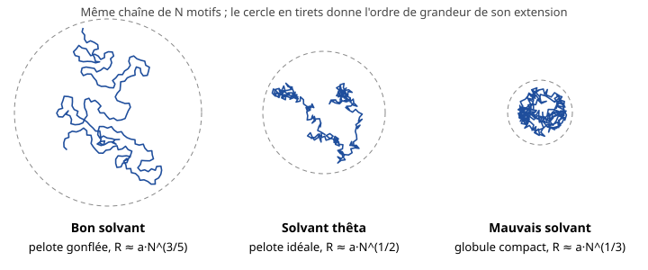

## Première partie · 2. Géométrie d'une chaîne isolée en solution

### Question 2.1.1 — Modèle du bâton

> [!INDICATION]
> Aligner N sphères de diamètre a.

> [!INDICATION]
> Quelle conformation autour d'une liaison C–C minimise la gêne stérique ?

#### Solution

Les $N$ motifs, sphères de diamètre $a$, sont alignés au contact les uns des autres le long d'un axe : la chaîne est un bâtonnet rigide de diamètre $a$ et de longueur

$$\boxed{L = N a}$$

La figure 2 représente ce bâton.

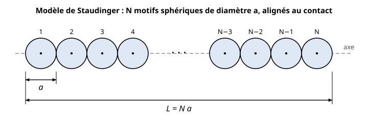

Argument en faveur de cette image : pour chaque liaison du squelette, la conformation décalée anti est la plus stable (elle minimise les répulsions stériques entre groupes voisins). Si toutes les liaisons adoptent cette conformation, la chaîne est un zigzag plan entièrement étiré, assimilable à un bâton. Les répulsions entre motifs non liés (stériques, ou électrostatiques pour une chaîne chargée) vont dans le même sens. Le modèle ignore l'agitation thermique, qui peuple aussi les conformations gauches, et donc l'entropie de conformation.

### Question 2.1.2 — Longueur d'une chaîne de polyéthylène

> [!INDICATION]
> Dessiner le zigzag plan et projeter une liaison sur l'axe du bâton.

> [!INDICATION]
> L'angle entre une liaison et l'axe vaut 30° ; compter les liaisons, pas les carbones.

#### Solution

Dans le zigzag plan, deux liaisons successives font un angle de $120^\circ$ et l'axe du bâton passe par les milieux des liaisons : chaque liaison est inclinée de $30^\circ$ sur l'axe. Un motif (un carbone) avance donc le long de l'axe de

$$a = l_1 \cos 30^\circ = \frac{\sqrt 3}{2}\, l_1 = \frac{\sqrt 3}{2}\times\frac{2\sqrt 3}{3}\ \text{Å} = 1\ \text{Å}$$

Dix mille et un carbones enchaînés correspondent à $N = 10^4$ liaisons, donc

$$\boxed{L = N a = 10^{4}\ \text{Å} = 1\ \mathrm{\mu m}}$$

Une longueur micrométrique pour une chaîne aussi modeste (masse molaire $\approx 1{,}4\times10^{5}\ \mathrm{g\,mol^{-1}}$) est irréaliste : de tels objets seraient visibles au microscope optique et les solutions n'auraient pas les propriétés observées (viscosité, diffusion). Le modèle surestime grossièrement la taille.

> [!METHODE]
> Faire le dessin avant tout calcul : zigzag, axe passant par les milieux des liaisons, angle de 30° entre liaison et axe. La projection donne a, le nombre de liaisons donne N.

> [!JURY]
> Le rapport note que les candidats ayant fait un dessin ont réussi, mais que la longueur micrométrique trouvée n'a suscité aucune remarque : un résultat numérique se commente.

## Première partie · 2.2. Modèle de Kuhn

### Question 2.2.1 — Moyenne du vecteur extension

> [!INDICATION]
> Linéarité de la moyenne, puis isotropie pour chaque motif.

#### Solution

La moyenne est linéaire :

$$\langle \vec R\rangle = \sum_{i=1}^{N}\langle \vec a_i\rangle$$

Les directions étant **isotropes**, $\vec a_i$ et $-\vec a_i$ sont équiprobables et $\langle \vec a_i\rangle = \vec 0$ pour tout $i$. Donc

$$\boxed{\langle \vec R\rangle = \vec 0}$$

### Question 2.2.2 — Extension quadratique moyenne

> [!INDICATION]
> Développer le carré de la somme en termes carrés et termes croisés.

> [!INDICATION]
> Que vaut la moyenne d'un produit scalaire de deux vecteurs indépendants et isotropes ?

#### Solution

$$\langle \vec R^{2}\rangle = \sum_{i}\langle \vec a_i^{\,2}\rangle + \sum_{i\neq j}\langle \vec a_i\cdot\vec a_j\rangle$$

Chaque terme carré vaut $a^{2}$. Les orientations étant **non corrélées**, $\langle \vec a_i\cdot\vec a_j\rangle = \langle \vec a_i\rangle\cdot\langle \vec a_j\rangle = 0$ pour $i\neq j$ (indépendance, puis isotropie). Il reste

$$\boxed{\langle \vec R^{2}\rangle = N a^{2}}$$

> [!PIEGE]
> Les deux hypothèses ne servent pas au même endroit : l'isotropie annule la moyenne de chaque vecteur, l'absence de corrélation permet de factoriser la moyenne des produits croisés.

> [!JURY]
> Le rapport signale que les mots « isotropes » et « non corrélés » sont rarement employés à bon escient pour justifier ces deux résultats.

### Question 2.2.3 — Rayon de Kuhn

> [!INDICATION]
> Application numérique : la racine de dix mille.

> [!INDICATION]
> Comparer à la longueur du bâton et à une taille réaliste.

#### Solution

$$\boxed{R_K = a\sqrt N}$$

Pour le polyéthylène précédent, $N = 10^{4}$ et $a = 1$ Å :

$$R_K = 1\ \text{Å}\times 10^{2} = 100\ \text{Å} = 10\ \mathrm{nm}$$

La pelote est cent fois plus petite que le bâton ($R_K/L = 1/\sqrt N$). Une dizaine de nanomètres est l'ordre de grandeur réellement mesuré pour une macromolécule de cette masse ; la taille croît comme $\sqrt N$ et non comme $N$ : la chaîne est très repliée.

### Question 2.2.4 — Hypothèses et limites en termes d'interactions

> [!INDICATION]
> Le système contient deux constituants : faire la liste des interactions de paires.

> [!INDICATION]
> Penser au gaz parfait, mais aussi au mélange idéal et aux deux termes correctifs de van der Waals.

#### Solution

Le système comporte **deux constituants**, les motifs et le solvant, donc trois types d'interactions de paires : motif–motif, motif–solvant, solvant–solvant. Le modèle de Kuhn n'en retient aucune.

- Comme dans le gaz parfait, où les particules sont ponctuelles et sans interaction, les motifs n'ont ni volume propre (la chaîne peut repasser au même endroit : pas de volume exclu, l'analogue du covolume $b$ de van der Waals est nul) ni attraction mutuelle à distance (l'analogue du terme de pression interne $a/V_m^{2}$ est nul).
- Comme dans un mélange idéal (de gaz parfaits ou en solution), le solvant ne joue aucun rôle énergétique : remplacer un contact motif–solvant par un contact motif–motif ne coûte ni ne rapporte rien. L'énergie est la même pour toutes les conformations, seule l'entropie compte.

Limites. Une chaîne réelle ne peut pas se recouper : le volume exclu fait gonfler la pelote (cas du bon solvant). Les attractions effectives entre motifs, qui dépendent du solvant et de la température, la contractent (mauvais solvant). Enfin les orientations de motifs voisins sont corrélées (angles de valence fixés, barrières de rotation) ; cette corrélation locale se corrige en regroupant plusieurs liaisons en un segment effectif plus long, sans changer la loi en $\sqrt N$. Comme un gaz réel se comporte en gaz parfait à sa température de Boyle (Mariotte), où répulsion et attraction se compensent dans le second coefficient du viriel, le modèle n'est exact que dans des conditions particulières de solvant et de température.

> [!JURY]
> Selon le rapport, l'immense majorité des copies a voulu bâtir l'analogie sur le seul gaz parfait en oubliant qu'il y a deux constituants (polymère et solvant), ce qui a conduit à des réponses hors sujet.

### Question 2.2.5 — Chaîne idéale

> [!INDICATION]
> Que signifie « idéal » pour un gaz ou un mélange, en termes d'énergie d'interaction ?

#### Solution

L'appellation renvoie au gaz parfait et au mélange idéal : il n'y a aucune interaction nette entre les motifs en dehors de leur enchaînement, soit parce qu'on les néglige, soit parce que répulsion de volume exclu et attraction effective se compensent exactement. Toutes les conformations ont alors la même énergie et sont équiprobables ; les propriétés de la chaîne sont purement statistiques (entropiques) et universelles, indépendantes de la nature chimique des motifs autrement que par $a$. Le solvant qui réalise cette compensation est le solvant thêta, analogue de la température de Boyle d'un gaz réel.

## Première partie · 3.1. Marche aléatoire à une dimension

### Question 3.1.1 — Nombres de pas à droite et à gauche

> [!INDICATION]
> Deux équations : nombre total de pas et déplacement algébrique.

#### Solution

$$N^{+}+N^{-}=N$$

$$N^{+}-N^{-}=u$$

$$\boxed{N^{+}=\frac{N+u}{2}\qquad N^{-}=\frac{N-u}{2}}$$

L'entier $u$ a donc la parité de $N$ et $-N\le u\le N$.

### Question 3.1.2 — Probabilité discrète

> [!INDICATION]
> Dénombrer les suites de N pas comportant exactement N⁺ pas à droite, parmi 2^N suites équiprobables.

#### Solution

Il y a $2^{N}$ suites de pas équiprobables. Celles qui aboutissent en $u$ sont celles qui comptent exactement $N^{+}$ pas à droite, au nombre de $\mathrm C_N^{N^{+}}$ :

$$\boxed{P(N,u)=\frac{1}{2^{N}}\,\frac{N!}{\left(\dfrac{N+u}{2}\right)!\,\left(\dfrac{N-u}{2}\right)!}}$$

### Question 3.1.3 — Formule de Stirling

> [!INDICATION]
> Prendre le logarithme de la loi binomiale et appliquer Stirling aux trois factorielles ; les termes linéaires se compensent.

#### Solution

On applique la formule aux trois factorielles ; les termes linéaires se simplifient car $N^{+}+N^{-}=N$ :

$$\ln P = \ln N! - \ln N^{+}! - \ln N^{-}! - N\ln 2$$

$$\boxed{\ln P(N,u) = -\tfrac12\ln(2\pi) + \left(N+\tfrac12\right)\ln N - \frac{N+u+1}{2}\ln\frac{N+u}{2} - \frac{N-u+1}{2}\ln\frac{N-u}{2} - N\ln 2}$$

### Question 3.1.4 — Limite gaussienne

> [!INDICATION]
> Poser ε = u/N et factoriser N/2 dans chaque logarithme.

> [!INDICATION]
> Regrouper la somme et la différence de ln(1+ε) et ln(1−ε) ; aller jusqu'à l'ordre deux.

#### Solution

On pose $\varepsilon = u/N$, avec $|\varepsilon|\ll1$, et on écrit $\ln\dfrac{N\pm u}{2}=\ln\dfrac N2+\ln(1\pm\varepsilon)$. Les deux derniers logarithmes de la question 3.1.3 donnent

$$-(N+1)\ln\frac N2-\frac{N+1}{2}\left[\ln(1+\varepsilon)+\ln(1-\varepsilon)\right]-\frac u2\left[\ln(1+\varepsilon)-\ln(1-\varepsilon)\right]$$

Au second ordre, $\ln(1+\varepsilon)+\ln(1-\varepsilon)\simeq-\varepsilon^{2}$ et $\ln(1+\varepsilon)-\ln(1-\varepsilon)\simeq2\varepsilon$, d'où

$$\ln P \simeq -\tfrac12\ln(2\pi)+\left(N+\tfrac12\right)\ln N-(N+1)\ln N+(N+1)\ln 2-N\ln2+\frac{(N+1)u^{2}}{2N^{2}}-\frac{u^{2}}{N}$$

$$\ln P \simeq \ln\frac{2}{\sqrt{2\pi N}}-\frac{u^{2}}{2N}\left(1-\frac1N\right)$$

Pour $N\gg1$ :

$$\boxed{P(N,u)\simeq\sqrt{\frac{2}{\pi N}}\,\exp\left(-\frac{u^{2}}{2N}\right)}$$

$$\boxed{Q(N,x)=\sqrt{\frac{2}{\pi N}}\,\exp\left(-\frac{x^{2}}{2Na^{2}}\right)=\sqrt{\frac{2}{\pi N}}\;\mathcal G_\lambda(x)\quad\text{avec}\quad\lambda=\frac{1}{a\sqrt{2N}}}$$

C'est bien une gaussienne, centrée en $0$, de variance $\langle x^{2}\rangle=Na^{2}$ : on retrouve à une dimension le résultat de la question 2.2.2.

Remarque de normalisation. $P(N,u)$ n'est défini que pour les $u$ de même parité que $N$, espacés de 2 : la somme sur ces valeurs vaut 1, alors que $\int P\,\mathrm du = 2$. La densité continue exactement normalisée est donc $P/2$ ; le préfacteur trouvé avec la convention de l'encadré du sujet ($\mathrm df = P\,\mathrm du$) est le double de celui d'une densité de probabilité.

> [!METHODE]
> Développement limité propre : écrire d'abord l'expression exacte, isoler le petit paramètre, développer chaque logarithme au même ordre, puis seulement négliger 1/N devant 1. Vérifier le résultat : variance égale à N, cohérente avec la question 2.2.2.

> [!PIEGE]
> L'entier u ne prend qu'une valeur sur deux : la gaussienne obtenue, intégrée sur u, donne 2 et non 1. Ce facteur 2 se retrouve dans les préfacteurs de la partie 3.2.

## Première partie · 3.2. Marche aléatoire à trois dimensions

### Question 3.2.1 — Probabilité selon un axe

> [!INDICATION]
> Combien de pas la particule fait-elle le long de l'axe x ?

#### Solution

La particule ne fait que $N/3$ pas le long de l'axe $x$ ; il suffit de remplacer $N$ par $N/3$ dans la loi à une dimension :

$$\boxed{\mathrm df_x^{[3D]}(N,x)=\frac1a\,Q\!\left(\frac N3,x\right)\mathrm dx}$$

### Question 3.2.2 — Forme gaussienne et rayon $R_0$

> [!INDICATION]
> Remplacer N par N/3 dans Q et identifier l'argument de l'exponentielle.

#### Solution

$$\mathrm df_x^{[3D]}=\frac1a\sqrt{\frac{6}{\pi N}}\,\exp\left(-\frac{3x^{2}}{2Na^{2}}\right)\mathrm dx$$

On identifie l'exposant à $-x^{2}/R_0^{2}$ :

$$\boxed{R_0=a\sqrt{\frac{2N}{3}}}$$

Avec $a\sqrt N=R_0\sqrt{3/2}$, le préfacteur s'écrit $\dfrac1a\sqrt{\dfrac{6}{\pi N}}=\dfrac{2}{\sqrt\pi}\,\dfrac1{R_0}$ :

$$\boxed{\mathrm df_x^{[3D]}(N,x)=\frac{2}{\sqrt\pi}\,\frac1{R_0}\exp\left(-\frac{x^{2}}{R_0^{2}}\right)\mathrm dx}$$

Le préfacteur vaut $2/\sqrt\pi$ avec la convention de l'encadré du sujet. Compte tenu de la remarque de la question 3.1.4, la densité normalisée ($\int_{-\infty}^{+\infty}\mathrm df_x=1$) a pour préfacteur $1/\sqrt\pi$ ; c'est elle que l'on utilise dans la suite, car elle seule redonne une probabilité totale égale à 1.

### Question 3.2.3 — Densité tridimensionnelle

> [!INDICATION]
> Les trois directions sont indépendantes : multiplier les probabilités.

> [!INDICATION]
> Regrouper les trois exponentielles.

#### Solution

Les déplacements selon les trois axes sont indépendants : la probabilité cherchée est le produit des trois probabilités axiales.

$$\Psi_{R_0}(x,y,z)\,\mathrm dx\,\mathrm dy\,\mathrm dz=\mathrm df_x^{[3D]}\,\mathrm df_y^{[3D]}\,\mathrm df_z^{[3D]}$$

$$\boxed{\Psi_{R_0}(x,y,z)=\frac{1}{\pi^{3/2}R_0^{3}}\exp\left(-\frac{x^{2}+y^{2}+z^{2}}{R_0^{2}}\right)}$$

(avec le préfacteur non normalisé de l'encadré, on aurait $8/\pi^{3/2}$ au lieu de $1/\pi^{3/2}$). La fonction ne dépend que de $r^{2}=x^{2}+y^{2}+z^{2}$, donc de la seule distance à l'origine : elle est isotrope. C'est la propriété du produit de trois gaussiennes de même largeur.

### Question 3.2.4 — Distribution radiale

> [!INDICATION]
> Multiplier la densité par le volume de la coquille sphérique.

#### Solution

$$\mathrm df_r(N,r)=\Psi_{R_0}(r)\,4\pi r^{2}\,\mathrm dr$$

$$\boxed{\mathrm df_r(N,r)=f_r(N,r)\,\mathrm dr=\frac{4}{\sqrt\pi\,R_0^{3}}\;r^{2}\exp\left(-\frac{r^{2}}{R_0^{2}}\right)\mathrm dr}$$

Vérification : avec $\lambda=1/R_0$, $\int_0^{\infty}r^{2}e^{-r^{2}/R_0^{2}}\mathrm dr=\sqrt\pi R_0^{3}/4$, donc $\int_0^\infty f_r\,\mathrm dr=1$. La densité s'annule en $r=0$ et passe par un maximum en $r=R_0$ : $R_0$ est le rayon le plus probable.

> [!PIEGE]
> La densité radiale est nulle en r = 0 à cause du facteur r², alors que la densité par unité de volume y est maximale : l'extension nulle est le vecteur le plus probable, pas la distance la plus probable.

### Question 3.2.5 — Extension quadratique moyenne

> [!INDICATION]
> Utiliser la troisième intégrale fournie, avec λ = 1/R₀.

> [!INDICATION]
> Exprimer R₀ en fonction de N et a pour comparer au rayon de Kuhn.

#### Solution

$$\overline{R^{2}}=\frac{4}{\sqrt\pi R_0^{3}}\int_0^{+\infty}r^{4}e^{-r^{2}/R_0^{2}}\,\mathrm dr=\frac{4}{\sqrt\pi R_0^{3}}\times\frac{3\sqrt\pi}{8}R_0^{5}$$

$$\boxed{\overline{R^{2}}=\frac32R_0^{2}=Na^{2}=R_K^{2}}$$

On retrouve exactement le rayon de Kuhn. La trajectoire de la particule brownienne sur le réseau est une réalisation de la chaîne : chaque pas est un motif, le nombre de pas est le nombre de motifs, la position finale est le vecteur extension. La loi de diffusion (distance quadratique proportionnelle au nombre de pas, donc au temps) est la loi $R\propto\sqrt N$ de la chaîne idéale ; le modèle statistique redonne Kuhn et fournit en plus toute la distribution des extensions. (Avec le préfacteur non normalisé de l'encadré du sujet, $\int_0^\infty f_r\,\mathrm dr$ vaudrait 8 et l'on trouverait $\overline{R^{2}}=12R_0^{2}=8R_K^{2}$ : le rayon de Kuhn ne se retrouve qu'avec la densité normalisée, ce qui confirme le choix fait à la question 3.2.2.)

## Première partie · 4.1. Entropie de la chaîne fantôme

### Question 4.1.1 — Expression de l'entropie

> [!INDICATION]
> Le nombre de configurations à une dimension est 2^N.

> [!INDICATION]
> Prendre le logarithme de Ω et identifier le terme constant et le terme en R².

#### Solution

À une dimension, les $N$ pas ont chacun deux orientations : $\Lambda_N=2^{N}$. Avec la densité normalisée de la question 3.2.3,

$$\Omega(R)=R_0^{3}\,\Psi_{R_0}(R)\,\Lambda_N=\frac{2^{N}}{\pi^{3/2}}\exp\left(-\frac{R^{2}}{R_0^{2}}\right)$$

$$S(R)=k\left(N\ln2-\tfrac32\ln\pi\right)-\frac{k}{R_0^{2}}R^{2}$$

Comme $R_0^{2}=\tfrac23R_K^{2}$ :

$$\boxed{S(R)=S_0+\beta R^{2}\qquad S_0=k\ln2\,(N-2{,}5)\qquad\beta=-\frac{3k}{2R_K^{2}}=-\frac{3k}{2Na^{2}}}$$

Commentaire. $S_0$ est l'entropie de la chaîne à extension nulle, la plus grande possible. Pour $N\gg1$, $S_0\simeq Nk\ln2$ : l'entropie est extensive, chaque motif apporte $k\ln2$, c'est-à-dire l'entropie d'un système à deux états équiprobables. La correction $-2{,}5\,k\ln2$, indépendante de $N$, traduit le fait qu'imposer la position de l'extrémité ne sélectionne qu'une fraction $\pi^{-3/2}$ des configurations ; elle est négligeable pour une vraie chaîne. La formule n'a pas de sens pour $N$ de l'ordre de quelques unités ($S_0<0$ pour $N\le2$), ce qui rappelle que la loi gaussienne suppose $N\gg1$. (Avec le préfacteur non normalisé, on obtiendrait $N+0{,}5$ au lieu de $N-2{,}5$ ; la conclusion $S_0\simeq Nk\ln 2$ est la même.)

> [!JURY]
> Le rapport rappelle que l'entropie de configuration découle directement des configurations dénombrées en partie 3 : il suffit d'appliquer la relation de Boltzmann.

### Question 4.1.2 — Variation de l'entropie avec l'extension

> [!INDICATION]
> Signe de β ; que devient le nombre de conformations quand on étire la chaîne ?

#### Solution

$\beta<0$ : l'entropie décroît quadratiquement quand $R$ augmente. Étirer la chaîne réduit le nombre de conformations compatibles avec l'extension imposée (à la limite $R=Na$, il n'en reste qu'une, le bâton). L'état le plus désordonné, donc le plus probable pour le vecteur $\vec R$, est $\vec R=\vec0$ ; l'échelle de décroissance est $R_K$ : $S_0-S\sim k$ dès que $R\sim R_K$.

### Question 4.1.3 — Force et élasticité entropique

> [!INDICATION]
> À température constante, dU = 0 pour la chaîne fantôme.

> [!INDICATION]
> Dériver S par rapport à R.

#### Solution

À température constante, $U$ ne dépend pas de $R$ pour la chaîne fantôme, donc $\mathrm dU=0=T\,\mathrm dS+F\,\mathrm dR$ :

$$F=-T\left(\frac{\partial S}{\partial R}\right)_T=-2\beta TR$$

$$\boxed{F=\frac{3kT}{Na^{2}}\,R=\frac{3kT}{R_K^{2}}\,R}$$

C'est une loi de Hooke : la chaîne se comporte comme un ressort de longueur à vide nulle et de raideur $K=3kT/(Na^{2})$. Cette raideur ne vient d'aucune énergie de liaison : le travail fourni en étirant la chaîne est intégralement cédé sous forme de chaleur ($\delta Q=T\,\mathrm dS<0$), et la force de rappel traduit seulement la tendance à retrouver l'état d'entropie maximale. D'où le nom d'**élastomère entropique**. Signature expérimentale : la raideur est proportionnelle à $T$ ; un caoutchouc tendu sous charge constante se rétracte quand on le chauffe, à l'inverse d'un ressort métallique.

> [!METHODE]
> Pour une force d'origine entropique : écrire l'identité thermodynamique, annuler la variation d'énergie interne, puis F = −T ∂S/∂R. La proportionnalité à T est la signature à commenter.

## Première partie · 4.2. Modèle de champ moyen

### Question 4.2.1 — Origine physique de $\nu$

> [!INDICATION]
> Quelle est la dimension de U/kT ? En déduire celle de ν.

> [!INDICATION]
> Chercher, dans l'équation de van der Waals ou dans le développement du viriel, un paramètre de même dimension. Pour N², compter les paires de motifs.

#### Solution

$U/kT$ et $N$ sont sans dimension, donc $\nu$ a la dimension de $R^{3}$ : c'est un **volume**, le volume exclu par motif (unité : $\mathrm{m^{3}}$). Il mesure l'interaction effective entre deux motifs, solvant compris.

Analogie : le covolume $b$ de l'équation de van der Waals et, plus précisément, le second coefficient du viriel d'un gaz réel, $B(T)=b-a/(RT)$, qui a lui aussi la dimension d'un volume. Pour $n$ moles dans un volume $V$, la correction au gaz parfait est d'ordre $nRT\times nB/V$, de la forme $kT\times\text{volume}\times(\text{nombre})^{2}/V$. Ici, la pelote de volume $\sim R^{3}$ joue le rôle de l'enceinte et les $N$ motifs celui des particules ; $\nu>0$ correspond à une répulsion nette (cœur dur dominant, bon solvant), $\nu$ diminue quand l'attraction effective entre motifs augmente et s'annule dans les conditions thêta (analogue de la température de Boyle).

Terme en $N^{2}$ : l'interaction est une interaction de **paires**. Un motif donné voit une concentration moyenne $N/R^{3}$ d'autres motifs (hypothèse de champ moyen : densité uniforme dans la pelote) ; la probabilité qu'il en rencontre un est la fraction de volume $\nu N/R^{3}$, chaque rencontre coûtant de l'ordre de $kT$. En sommant sur les $N$ motifs, $U\sim kT\,\nu N^{2}/R^{3}$ : c'est, au facteur 2 près, le nombre de paires $N(N-1)/2\simeq N^{2}/2$ multiplié par la probabilité de contact $\nu/R^{3}$.

> [!JURY]
> D'après le rapport, trop de candidats n'ont pas trouvé l'unité de ν et trop peu ont su justifier le terme en N².

### Question 4.2.2 — Valeur de $\nu$ sur le réseau cubique

> [!INDICATION]
> Quel volume un motif interdit-il aux autres sur le réseau ?

#### Solution

Sur le réseau, un motif occupe une maille de côté $a$ et l'interdit aux autres :

$$\boxed{\nu\simeq a^{3}}$$

### Question 4.2.3 — Rayon de Flory

> [!INDICATION]
> Quelle fonction thermodynamique est minimale à l'équilibre à température fixée ?

> [!INDICATION]
> Écrire F = U − TS avec l'entropie de la question 4.1.1 et dériver par rapport à R.

#### Solution

À température fixée, l'état d'équilibre de la chaîne minimise son énergie libre $F=U-TS$, avec $S$ donné par la question 4.1.1 :

$$F(R)=kT\,\frac{\nu N^{2}}{R^{3}}+\frac{3kT}{2Na^{2}}R^{2}-TS_0$$

Le premier terme (répulsion) pousse au gonflement, le second (élasticité entropique) à la contraction.

$$\frac{\mathrm dF}{\mathrm dR}=kT\left(-\frac{3\nu N^{2}}{R^{4}}+\frac{3R}{Na^{2}}\right)=0$$

$$R_F^{5}=\nu a^{2}N^{3}$$

$$\boxed{R_F=\left(\nu a^{2}\right)^{1/5}N^{3/5}\simeq a\,N^{3/5}}$$

C'est bien un minimum ($F\to+\infty$ quand $R\to0$ et quand $R\to\infty$). L'exposant $3/5$ est supérieur à $1/2$ : la chaîne à volume exclu est gonflée par rapport à la chaîne idéale. Pour $N=10^{4}$ et $a=1$ Å, $R_F=10^{2{,}4}\ \text{Å}\approx 25$ nm, contre $R_K=10$ nm.

> [!METHODE]
> Raisonnement de Flory : une énergie de répulsion qui décroît avec R, une entropie qui pénalise l'étirement, et la minimisation de l'énergie libre. Les préfacteurs numériques importent peu, seul l'exposant compte.

> [!JURY]
> Le rapport indique que seules de rares copies ont écrit une énergie libre pour le polymère, étape indispensable au calcul du rayon de Flory.

### Question 4.2.4 — Exposant 0,58 de de Gennes

> [!INDICATION]
> Quelles approximations ont été faites sur l'énergie (champ moyen) et sur l'entropie (chaîne gaussienne) ?

#### Solution

L'écart ($0{,}58$ au lieu de $0{,}60$) vient des deux approximations du modèle, dont les erreurs se compensent presque.

- Le champ moyen suppose les motifs répartis uniformément et sans corrélation dans la pelote. Or les motifs s'évitent : le nombre réel de contacts est inférieur à $N^{2}\nu/R^{3}$, l'énergie de répulsion est surestimée. Il faut tenir compte des corrélations et des fluctuations de concentration à toutes les échelles (c'est ce que font les méthodes de lois d'échelle et de groupe de renormalisation, par analogie avec les transitions de phase).
- L'entropie utilisée est celle de la chaîne fantôme gaussienne, qui n'est plus exacte pour une chaîne gonflée ; l'élasticité est elle aussi surestimée.

On peut en outre raffiner l'énergie : dépendance de $\nu$ avec la température et le solvant, interactions à trois corps en $N^{3}/R^{6}$, utiles près des conditions thêta.

## Première partie · 5.1. Osmométrie différentielle

### Question 5.1.1 — Mesure de la pression osmotique

> [!INDICATION]
> Il faut une membrane qui ne laisse passer que le solvant et une mesure de différence de pression.

#### Solution

On utilise un osmomètre à membrane : deux compartiments thermostatés, l'un rempli de solvant pur, l'autre de la solution, séparés par une membrane **semi-perméable** (membrane de cellulose par exemple) qui laisse passer le solvant mais pas les macromolécules. Chaque compartiment est surmonté d'un tube capillaire vertical. Le solvant traverse la membrane vers la solution jusqu'à ce que la surpression côté solution arrête le flux. À l'équilibre, on mesure la dénivellation $h$ entre les deux ménisques :

$$\Pi=\rho g h$$

où $\rho$ est la masse volumique de la solution. Variante : on applique côté solution la contre-pression qui annule juste le flux de solvant ; elle est égale à $\Pi$. On répète la mesure pour plusieurs concentrations, à température constante.

### Question 5.1.2 — Équation de Van't Hoff

> [!INDICATION]
> Écrire l'égalité des potentiels chimiques du solvant de part et d'autre de la membrane.

> [!INDICATION]
> Dépendance du potentiel chimique avec la pression : le volume molaire. Puis ln(1 − x) ≈ −x.

#### Solution

À l'équilibre, le potentiel chimique du solvant est le même de part et d'autre de la membrane. Solvant pur sous $P$ d'un côté, solvant de fraction molaire $x_s$ sous $P+\Pi$ de l'autre (mélange idéal) :

$$\mu_s^{*}(T,P)=\mu_s^{*}(T,P+\Pi)+RT\ln x_s$$

Comme $\left(\partial\mu_s^{*}/\partial P\right)_T=V_m$, volume molaire du solvant, supposé indépendant de la pression :

$$V_m\,\Pi=-RT\ln x_s=-RT\ln(1-x_p)\simeq RT\,x_p$$

En solution diluée, $x_p\simeq n_p/n_s$ et le volume de la solution est $V\simeq n_sV_m$, donc

$$\boxed{\Pi=\frac{n_p}{V}RT=c\,RT}$$

> [!JURY]
> Le rapport y voit une application simple du rôle du volume molaire partiel sur le potentiel chimique, bien traitée par presque tous ceux qui l'ont abordée.

### Question 5.1.3 — Écart à la loi de Van't Hoff

> [!INDICATION]
> Quelle forme de courbe la loi de Van't Hoff prévoit-elle ? Comparer.

#### Solution

Non. La loi de Van't Hoff prévoit une droite passant par l'origine ; la courbe expérimentale passe par l'origine mais est convexe, au-dessus de sa tangente à l'origine : $\Pi$ croît plus vite que $c$. Seule la limite $c\to0$ suit la loi. La solution de polymère n'est pas idéale, même diluée : les pelotes sont des objets très volumineux par rapport aux molécules de solvant et elles interagissent (volume exclu entre pelotes, interactions motif–motif et motif–solvant). On en rend compte par un développement du viriel, comme pour un gaz réel : $\Pi/RT=c+A_2'c^{2}+\dots$, le terme en $c^{2}$ traduisant les interactions de paires.

## Première partie · 5.2. Solvatation du PMMA

### Question 5.2.1 — Enchaînement de trois motifs

> [!INDICATION]
> La polymérisation ouvre la double liaison C=C ; enchaîner trois motifs tête à queue.

#### Solution

La polymérisation ouvre la double liaison $\mathrm{C{=}C}$ ; l'enchaînement est régulier, tête à queue :

$$\mathrm{-CH_2-C(CH_3)(CO_2CH_3)-CH_2-C(CH_3)(CO_2CH_3)-CH_2-C(CH_3)(CO_2CH_3)-}$$

Chaque motif, de formule $\mathrm{C_5H_8O_2}$ ($M_0=100\ \mathrm{g\,mol^{-1}}$), porte sur un carbone quaternaire un groupe méthyle et un groupe ester méthylique (figure 3).

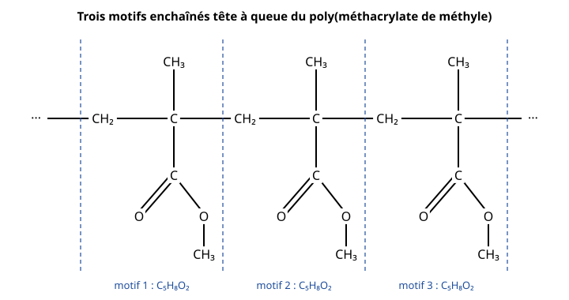

> [!JURY]
> Le rapport qualifie les réponses sur la formule du PMMA et sa synthèse de très imprécises, voire fantaisistes : écrire le motif exact, avec le carbone quaternaire.

### Question 5.2.2 — Synthèse et polymolécularité

> [!INDICATION]
> Polymérisation en chaîne : radicalaire ou anionique ; donner amorceur, avantages, inconvénients.

> [!INDICATION]
> Pour IP : les chaînes ont-elles toutes la même histoire ?

#### Solution

Choix : la **polymérisation radicalaire** en chaîne, amorcée par la décomposition thermique d'un amorceur (peroxyde de benzoyle ou AIBN). Amorçage : le radical formé s'additionne sur le $\mathrm{CH_2}$ du monomère et donne un radical tertiaire stabilisé par l'ester ; propagation par additions successives tête à queue ; terminaison par recombinaison ou dismutation de deux macroradicaux.

- Avantages : mise en œuvre simple et peu coûteuse (en masse, en solution ou en émulsion), tolérance à l'eau et aux impuretés protiques, masses molaires élevées obtenues rapidement.
- Inconvénients : terminaisons et transferts non maîtrisés, d'où une distribution large des longueurs de chaîne, des ramifications, aucun contrôle de la tacticité ; réaction exothermique qui s'emballe à forte conversion.

Autre possibilité : la polymérisation anionique (amorceur organométallique dans le THF à basse température), sans terminaison, qui donne des chaînes de longueurs voisines et fixées par le rapport monomère/amorceur ; elle exige un milieu rigoureusement anhydre et l'amorceur peut attaquer le groupe ester.

$IP>1$ : les chaînes ne naissent pas toutes au même instant et ne s'arrêtent pas au même degré d'avancement ; amorçage, propagation, transfert et terminaison sont des événements aléatoires, d'où une distribution de longueurs. Mathématiquement, $\bar M_w\bar M_n-\bar M_n^{2}$ est la variance de la distribution en nombre des masses molaires, positive, et nulle seulement si toutes les chaînes sont identiques : $IP\ge1$, avec égalité pour un échantillon isomoléculaire.

### Question 5.2.3 — Nature de la masse molaire moyenne

> [!INDICATION]
> La pression osmotique est une propriété colligative : que compte-t-elle ?

> [!INDICATION]
> Écrire Π/RT et la concentration massique comme des sommes sur les populations de chaînes.

#### Solution

La pression osmotique est une propriété colligative : à dilution infinie elle compte les chaînes, quelle que soit leur masse. Pour le mélange, $\Pi/RT\to\sum_i n_i/V$ alors que $\underline c=\sum_i n_iM_i/V$, donc

$$\lim_{\underline c\to0}\frac{\Pi}{RT\underline c}=\frac{\sum_i n_i}{\sum_i n_iM_i}=\frac{1}{\bar M_n}$$

Il s'agit de la **masse molaire moyenne en nombre** $\bar M_n$. La masse molaire moyenne en masse $\bar M_w$ s'obtient par diffusion de la lumière (l'intensité diffusée par une chaîne croît avec sa masse) ; la chromatographie d'exclusion stérique donne toute la distribution, donc les deux moyennes.

### Question 5.2.4 — Signification de $A_2$

> [!INDICATION]
> Comparer au développement du viriel d'un gaz réel et à la partie 4.

#### Solution

$A_2$ est le second coefficient du viriel de la pression osmotique. Il caractérise les interactions de paires entre segments de polymère en présence du solvant, c'est-à-dire la **qualité du solvant** : $A_2>0$ pour une répulsion effective entre chaînes (bon solvant, pelotes gonflées qui s'excluent), d'autant plus grand que le solvant est meilleur. C'est la traduction macroscopique du volume exclu $\nu$ de la partie 4.

## Première partie · 5.3. Exploitation des résultats expérimentaux

### Question 5.3.1 — Estimation de la masse molaire

> [!INDICATION]
> Que représente l'ordonnée à l'origine de chaque droite ? Dépend-elle du solvant ?

> [!INDICATION]
> Extrapoler les deux séries à concentration nulle et attention au facteur 10⁶ de l'axe.

#### Solution

La relation $\Pi/(RT\underline c)=1/\bar M+A_2\underline c$ est affine en $\underline c$ : l'ordonnée à l'origine vaut $1/\bar M$, la pente $A_2$. La masse molaire est une propriété du polymère, pas du solvant : les droites tracées dans le benzène et dans l'acétone doivent avoir la **même** ordonnée à l'origine ; seules les pentes diffèrent. On extrapole donc les deux séries à dilution nulle et on retient l'ordonnée commune.

Lecture du graphe du sujet (ordonnées en $10^{-6}\ \mathrm{mol\,g^{-1}}$) :

| $\underline c$ (g/L) | 5 | 10 | 20 | 30 |
|---|---|---|---|---|
| benzène | 8,9 | 10,2 | 12,3 | 14,6 |
| acétone | 11,0 | 13,3 | 19,0 | 25,0 |

Benzène : les quatre points sont alignés ; entre 5 et 30 g/L la pente est $(14{,}6-8{,}9)/25\approx0{,}23$, d'où une ordonnée à l'origine $8{,}9-5\times0{,}23\approx7{,}8$. Acétone : pente $(25{,}0-11{,}0)/25=0{,}56$, ordonnée à l'origine $11{,}0-5\times0{,}56\approx8{,}2$ ; les points sont moins bien alignés (selon les points retenus, l'extrapolation donne de 7,1 à 8,6 avec les valeurs non arrondies tirées du tableau du sujet). Prise seule, cette série serait peu précise ; jointe à celle du benzène, elle confirme la valeur. Les deux extrapolations concordent, aux incertitudes de mesure près, sur

$$\frac{1}{\bar M}\approx8\times10^{-6}\ \mathrm{mol\,g^{-1}}$$

$$\boxed{\bar M=\bar M_n\approx1{,}3\times10^{5}\ \mathrm{g\,mol^{-1}}}$$

soit environ 1 300 motifs par chaîne. (Un ajustement affine des valeurs du tableau donne 7,85 et 7,89 pour les deux ordonnées à l'origine.) Le facteur $10^{6}$ de l'axe ne doit pas être oublié : une masse molaire inférieure à celle du monomère n'aurait aucun sens.

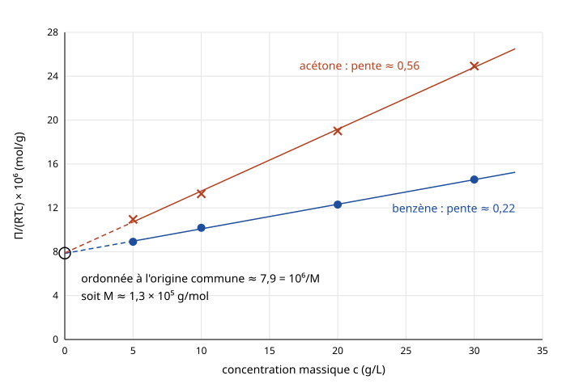

> [!METHODE]
> Extrapolation à dilution nulle : identifier ordonnée à l'origine et pente, exploiter toutes les séries disponibles, vérifier que la grandeur intrinsèque (ici la masse molaire) est la même pour toutes, puis convertir avec les unités de l'axe.

> [!PIEGE]
> Lire 8 au lieu de 8 × 10⁻⁶ mol/g conduit à une masse molaire inférieure à 1 g/mol, absurde pour un polymère.

> [!JURY]
> Le rapport relève que très peu de candidats ont utilisé les deux courbes, que les écarts expérimentaux ont surpris, et que la valeur numérique a rarement été correcte (« moins de 1 gramme par mole pour un composé chimique est un peu léger »).

### Question 5.3.2 — Meilleur solvant

> [!INDICATION]
> Relier la valeur de A₂ à la qualité du solvant.

#### Solution

Les pentes lues sont $A_2(\text{benzène})\approx0{,}23\times10^{-6}$ et $A_2(\text{acétone})\approx0{,}56\times10^{-6}\ \mathrm{mol\,L\,g^{-2}}$, de rapport voisin de 2,5, conforme à l'indication : $0{,}56/0{,}23\approx2{,}4$ avec ces lectures entre points extrêmes, 2,5 avec l'ajustement affine des quatre points de chaque série, qui donne les pentes 0,22 et 0,56 portées sur la figure 4. Les deux coefficients sont positifs : les deux liquides sont de bons solvants. Le plus grand $A_2$ correspond aux interactions polymère–solvant les plus favorables : **le PMMA est mieux solvaté, donc plus soluble, dans l'acétone**.

### Question 5.3.3 — Résultat attendu ?

> [!INDICATION]
> Comparer les groupes fonctionnels du polymère et ceux de chaque solvant : polarité, interactions de van der Waals.

#### Solution

Oui. Chaque motif du PMMA porte un groupe ester, polaire (dipôle du carbonyle). L'acétone, solvant polaire aprotique possédant elle-même un groupe carbonyle, établit avec ces groupes des interactions dipôle–dipôle (Keesom) en plus des interactions de dispersion : polymère et solvant se ressemblent. Le benzène, apolaire, n'interagit avec le polymère que par les interactions de London et de Debye (il est polarisable), ce qui suffit à solubiliser le squelette hydrocarboné mais solvate moins bien les groupes ester.

## Première partie · 5.4. Effet de solvant

### Question 5.4.1 — Cas $A_2<0$

> [!INDICATION]
> Signe de l'interaction effective entre chaînes ; que fait le polymère dans un tel liquide ?

#### Solution

$A_2<0$ traduit une attraction effective entre segments de polymère : les contacts polymère–polymère sont préférés aux contacts polymère–solvant. Le solvant est mauvais ; les pelotes se contractent et les chaînes tendent à s'associer, la pression osmotique est inférieure à celle de Van't Hoff. De tels liquides sont faciles à trouver pour le PMMA : eau, méthanol, alcanes (hexane, cyclohexane) sont des non-solvants, utilisés justement pour le faire précipiter. Mais c'est bien la difficulté : dans un franc mauvais solvant le polymère ne se dissout pas, de sorte qu'on ne peut mesurer un $A_2$ négatif que dans un domaine étroit, juste en dessous des conditions thêta, avant la démixtion.

### Question 5.4.2 — Cas $A_2=0$

> [!INDICATION]
> Revoir la conclusion encadrée de la partie 2.2 du sujet.

#### Solution

C'est le **solvant thêta** (conditions thêta, atteintes pour un couple polymère–solvant à une température $\theta$ donnée). Répulsion de volume exclu et attraction effective se compensent : la chaîne est idéale ($R\propto\sqrt N$), et la solution suit la loi de Van't Hoff sur un large domaine de concentration. C'est l'analogue de la température de Boyle d'un gaz réel.

## Deuxième partie · 6. Constitution des cycles A et B

### Question 6.1 — Ester 3

> [!INDICATION]
> Quel est le caractère de l'ion hydrure ? Quel gaz se forme ?

> [!INDICATION]
> Alcoolate sur chlorure d'acyle : mécanisme en deux étapes, et un sel insoluble dans le THF.

#### Solution

L'hydrure de sodium, base forte, déprotone quantitativement et irréversiblement l'alcool **1** :

$$\mathrm{RO{-}H+NaH\longrightarrow RO^-Na^+ +H_2(g)}$$

Le dégagement gazeux est du **dihydrogène**. L'alcoolate, bon nucléophile, réagit ensuite sur le chlorure d'acyle **2** par un mécanisme d'**addition–élimination** : attaque de l'oxygène sur le carbone du carbonyle (rupture de la liaison $\pi$, intermédiaire tétraédrique portant $\mathrm{O^-}$), puis reformation de $\mathrm{C{=}O}$ avec départ de l'ion chlorure, bon groupe partant. Le **chlorure de sodium**, insoluble dans le THF, précipite : c'est le solide blanc.

**3** est le (E)-penta-2,4-diénoate de (E)-hexa-3,5-diényle, $\mathrm{C_{11}H_{14}O_2}$ :

$$\mathrm{CH_2{=}CH{-}CH{=}CH{-}CO{-}O{-}CH_2{-}CH_2{-}CH{=}CH{-}CH{=}CH_2}$$

Passer par l'alcoolate et le chlorure d'acyle rend la réaction totale et rapide à 0 °C, sans acide qui ferait polymériser les diènes.

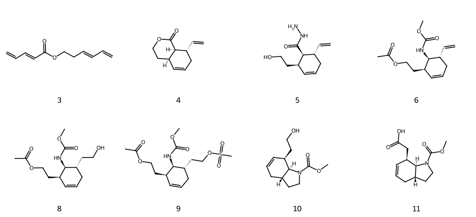

> [!JURY]
> Pour toute la partie organique, le rapport insiste : un composé a souvent plusieurs réactivités, et le choix de l'une d'elles doit être justifié par le contexte ; les justifications demandées sont trop rarement données.

### Question 6.2 — Composé 4 et réaction de Diels-Alder

> [!INDICATION]
> 3 et 4 sont isomères et 4 contient un cyclohexène : quelle réaction forme un cyclohexène à partir d'un diène ?

> [!INDICATION]
> Repérer dans 6 les carbones issus du diène et du diénophile. C₂₂H₂₈O₄ est le double de C₁₁H₁₄O₂.

#### Solution

**4** est un isomère de **3** ($\mathrm{C_{11}H_{14}O_2}$) contenant un cyclohexène : c'est le produit d'une **réaction de Diels-Alder intramoléculaire**, cycloaddition [4+2] concertée. Le diène est le motif buta-1,3-diénique de la partie alcool (C8=C9–C10=C11 dans la numérotation de la sténine), le diénophile est la double liaison $\alpha,\beta$ de l'ester, appauvrie en électrons. Les liaisons créées sont C8–C9a et C11–C12 ; la nouvelle double liaison est C9=C10. **4** est donc une lactone bicyclique : un cyclohexène accolé à une $\delta$-lactone (cycle à six chaînons C9a–CO–O–CH₂–CH₂–C8), le carbone C12 portant le groupe vinyle resté intact (figure 5). La structure de **6** confirme ce squelette : chaîne à deux carbones oxygénée sur C8, vinyle sur C12, carbone C9a porteur de l'ancien carbonyle.

Autre produit cyclique **4'** : celui d'une cycloaddition de régiochimie différente, où le diénophile serait la double liaison terminale $\gamma,\delta$ du diénoate (cyclohexène accolé à une lactone à huit chaînons), ou bien celui où les rôles sont échangés, le diénoate servant de diène et une double liaison de la partie alcool de diénophile. Ces voies sont défavorisées : cycle moyen tendu dans le premier cas, diénophile non activé dans le second. On peut aussi citer le diastéréo-isomère de **4** (jonction de cycles de configuration relative opposée, issu de l'autre approche endo/exo), que la RMN du brut ne montre pas.

Absence de produit en $\mathrm{C_{22}H_{28}O_4}$ : ce serait le dimère issu d'une cycloaddition **intermoléculaire** entre deux molécules de **3**. La réaction intramoléculaire est cinétiquement très favorisée (les deux partenaires sont maintenus à proximité, le coût entropique d'activation est bien moindre, et la formation de cycles à six chaînons est facile) ; la vitesse de la voie bimoléculaire, proportionnelle au carré de la concentration, est en outre réduite en travaillant en solution diluée.

> [!METHODE]
> Pour retrouver un adduit de Diels-Alder intramoléculaire : numéroter la chaîne, choisir le diène (quatre carbones conjugués) et le diénophile (double liaison appauvrie), relier les extrémités, placer la nouvelle double liaison au centre de l'ancien diène, puis contrôler avec la structure donnée plus loin (ici 6).

### Question 6.3 — Chlorure de diéthylaluminium

> [!INDICATION]
> Compter les électrons autour de l'aluminium.

> [!INDICATION]
> Quel est le site basique de Lewis de 3 ? Quel effet la complexation a-t-elle sur la BV du diénophile ?

#### Solution

Structure de Lewis : l'aluminium, trivalent, est lié par trois liaisons simples à deux groupes éthyle et à un chlore (qui porte trois doublets non liants) ; il n'est entouré que de six électrons et possède une **lacune électronique**. C'est un acide de Lewis, de géométrie trigonale plane (AX₃).

Adduit : un doublet de l'oxygène du carbonyle de l'ester **3**, site le plus basique, est donné à l'aluminium ; l'oxygène porte une charge formelle $+$, l'aluminium, tétracoordiné, une charge formelle $-$ :

$$\mathrm{R{-}C(OR'){=}\overset{+}{O}{-}\overset{-}{Al}Et_2Cl}$$

La figure 6 dessine les deux structures, doublets non liants et lacune compris ; R et R′ y désignent les deux chaînes diéniques de **3**.

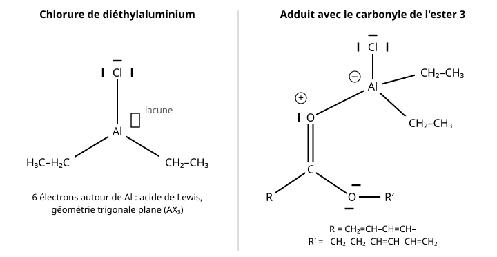

Rôle : **catalyseur** (acide de Lewis). La complexation rend le système conjugué au carbonyle beaucoup plus pauvre en électrons : elle abaisse l'énergie de la BV du diénophile, réduit l'écart HO(diène)–BV(diénophile) et accélère la cycloaddition, qui se fait à température modérée ; elle renforce aussi la sélectivité (un seul diastéréo-isomère observé).

### Question 6.4 — Hydrazide 5

> [!INDICATION]
> 4 est un ester cyclique : appliquer le schéma 1 et ne pas oublier ce que devient la partie alcool.

> [!INDICATION]
> Catalyse acide : protoner d'abord le carbonyle, puis addition, prototropie, élimination.

#### Solution

L'hydrazine ouvre la lactone **4** : l'ester cyclique est transformé en hydrazide et libère sa fonction alcool, qui reste attachée à la molécule. **5** ($\mathrm{C_{11}H_{18}N_2O_2}$) est le cyclohexène portant sur C9a le groupe $\mathrm{-CO{-}NH{-}NH_2}$, sur C8 la chaîne $\mathrm{-CH_2CH_2OH}$ et sur C12 le vinyle (figure 5).

Mécanisme en catalyse acide (addition–élimination) :

1. protonation de l'oxygène du carbonyle de la lactone, qui exalte l'électrophilie du carbone ;
2. addition nucléophile d'un azote de l'hydrazine sur ce carbone : intermédiaire tétraédrique ;
3. prototropie : l'azote perd un proton, l'oxygène intracyclique en gagne un et devient un bon groupe partant ;
4. élimination : reformation de $\mathrm{C{=}O}$ et rupture de la liaison C–O du cycle, qui libère la fonction alcool ;
5. déprotonation de l'oxygène du carbonyle, qui régénère le catalyseur.

Le milieu ne doit pas être trop acide : l'hydrazine protonée n'est plus nucléophile. La réaction est déplacée vers l'hydrazide, plus stabilisé par mésomérie que l'ester.

### Question 6.5 — Descripteurs stéréochimiques de 6

> [!INDICATION]
> Trois carbones asymétriques. Pour chacun, classer les quatre substituants puis regarder où se trouve le substituant de plus petite priorité.

> [!INDICATION]
> Pour le carbone lié à l'azote, deux branches carbonées sont à départager : explorer de proche en proche, en dupliquant les atomes des doubles liaisons.

#### Solution

**6** possède trois carbones asymétriques : C8, C9a et C12. Les doubles liaisons C9=C10 (intracyclique) et C1=C2 (terminale) ne sont pas stéréogènes.

- **C12.** Substituants classés par les règles de Cahn, Ingold et Prelog : C9a (N, C, H) > C1 vinylique (C, C, H, avec le carbone dupliqué) > C11 (C, H, H) > H. L'hydrogène est vers l'arrière ; sur le dessin, C9a (en bas) → C1 (en haut à droite) → C11 (en haut à gauche) tourne dans le sens anti-horaire : **12S**.
- **C9a.** N > {C8, C12} > H. C8 et C12 portent tous deux (C, C, H). Au rang suivant, C8 mène à C9 (C, C, H) et C7 (C, H, H), C12 à C1 (C, C, H) et C11 (C, H, H) : toujours égalité. On poursuit par les branches prioritaires : C9 mène à C10 (C, C, H), alors que C1 mène à C2 (C, H, H). Donc C8 > C12. L'hydrogène pointe vers l'avant ; N (à droite) → C8 (en bas à gauche) → C12 (en haut) tourne dans le sens horaire, qu'il faut inverser : **9aS**.
- **C8.** C9a (N, C, H) > C9 (C, C, H) > C7 (C, H, H) > H. La chaîne C7 est vers l'arrière, donc l'hydrogène vers l'avant ; C9a (à droite) → C9 (à gauche) → C7 (en bas) tourne dans le sens anti-horaire, qu'il faut inverser : **8R**.

$$\boxed{(8R,\ 9aS,\ 12S)}$$

> [!METHODE]
> Règles de Cahn, Ingold et Prelog : comparer les atomes de rang 1, puis les triplets de rang 2, et ainsi de suite en suivant d'abord les branches prioritaires. Si l'atome de plus petite priorité pointe vers l'avant, inverser le sens de rotation lu.

> [!PIEGE]
> Au carbone lié à l'azote, les deux voisins carbonés du cycle ne se départagent qu'au quatrième rang (après deux égalités successives) : s'arrêter trop tôt, ou conclure d'après la longueur des chaînes, donne le mauvais descripteur.

### Question 6.6 — Hydroboration

> [!INDICATION]
> Laquelle des deux doubles liaisons est la plus accessible ? Sur quel carbone le bore se fixe-t-il ?

> [!INDICATION]
> Le bore possède une lacune : avec quoi interagit-il dans le THF ?

#### Solution

**7** est l'alkylborane résultant de l'addition de B–H sur la double liaison terminale C1=C2 : le bore se fixe sur le carbone terminal C2, le moins encombré, l'hydrogène sur C1.

$$\mathrm{R{-}CH{=}CH_2+BH_3\longrightarrow R{-}CH_2{-}CH_2{-}BH_2}$$

(R désigne le reste de **6** lié par C12 ; les liaisons B–H restantes peuvent réagir à leur tour avec d'autres molécules d'alcène.) Mécanisme : addition **concertée, syn**, passant par un état de transition à quatre centres ; la double liaison donne ses électrons $\pi$ à la lacune du bore pendant qu'un hydrogène migre vers l'autre carbone. La régiosélectivité est d'origine stérique et électronique (charge partielle positive mieux supportée par le carbone le plus substitué). La double liaison intracyclique, disubstituée et plus encombrée, réagit beaucoup moins vite : la réaction est chimiosélective. Les centres stéréogènes existants ne sont pas touchés et aucun nouveau n'apparaît.

Nom : **hydroboration**. Dans le THF, le borane, acide de Lewis (lacune sur le bore), est complexé par un doublet de l'oxygène du solvant : il est présent sous la forme $\mathrm{H_3\overset{-}{B}{-}\overset{+}{O}C_4H_8}$, un **adduit de Lewis** (complexe acide–base de Lewis) ; sans base de Lewis, il existe sous forme de dimère $\mathrm{B_2H_6}$.

### Question 6.7 — Alcool 8 et isomère 8'

> [!INDICATION]
> L'oxydation remplace la liaison C–B par C–OH.

> [!INDICATION]
> Hydratation en milieu acide : règle de Markovnikov.

#### Solution

L'oxydation de l'alkylborane par l'eau oxygénée en milieu basique remplace la liaison C–B par une liaison C–OH, avec rétention. **8** est l'**alcool primaire** $\mathrm{R{-}CH_2{-}CH_2{-}OH}$ : le groupe vinyle de C12 est devenu une chaîne 2-hydroxyéthyle ; l'acétate, le carbamate, la double liaison C9=C10 et les configurations (8R, 9aS, 12S) sont conservés (figure 5). Le bilan est une hydratation anti-Markovnikov de la double liaison terminale.

Avec l'acide sulfurique dilué, l'hydratation passe par le carbocation le plus stable (secondaire, sur C1) et suit la règle de Markovnikov : **8'** est l'**alcool secondaire** $\mathrm{R{-}CH(OH){-}CH_3}$, isomère de position de **8** (obtenu en mélange de deux épimères en C1). Ces conditions seraient d'ailleurs peu sélectives : hydratation concurrente de C9=C10, hydrolyse de l'acétate.

### Question 6.8 — Mésylate 9

> [!INDICATION]
> Raisonner par analogie avec un chlorure d'acyle : le soufre est électrophile, le chlorure est un bon groupe partant.

> [!INDICATION]
> Quel acide est libéré, et que devient-il en présence d'une amine tertiaire ?

#### Solution

**9** est le méthanesulfonate (mésylate) de l'alcool primaire : $\mathrm{R{-}CH_2{-}CH_2{-}O{-}SO_2{-}CH_3}$, le reste de la molécule étant inchangé (figure 5).

Mécanisme, analogue à l'acylation d'un alcool par un chlorure d'acyle : l'oxygène de l'alcool attaque le soufre, très électrophile (lié à deux oxygènes et un chlore) ; l'ion chlorure est expulsé ; l'ion alkyloxonium formé est déprotoné par la triéthylamine. C'est un mécanisme d'**addition–élimination** (substitution nucléophile sur le soufre), la réponse attendue par analogie avec les chlorures d'acyle. En toute rigueur, avec le chlorure de mésyle et une amine tertiaire, la voie établie est une élimination–addition : la triéthylamine arrache un proton du méthyle, l'ion chlorure part et il se forme un sulfène $\mathrm{CH_2{=}SO_2}$, sur lequel l'alcool s'additionne ensuite. Le bilan et le rôle de base de la triéthylamine sont les mêmes.

$$\mathrm{R'OH+CH_3SO_2Cl+NEt_3\longrightarrow R'OSO_2CH_3+Et_3NH^+Cl^-}$$

Rôle de la triéthylamine : **base** (amine tertiaire, $pK_a\approx11$ pour l'ion triéthylammonium) qui capte le proton libéré et piège le chlorure d'hydrogène sous forme de chlorure de triéthylammonium. Elle évite ainsi l'acidification du milieu (addition de HCl sur la double liaison, dégradation des fonctions sensibles) et rend la réaction totale. Encombrée et dépourvue d'hydrogène sur l'azote, elle ne peut pas être sulfonylée de façon irréversible ; elle n'est pas assez basique pour déprotoner l'alcool ($pK_a\approx16$) avant l'attaque. Intérêt de l'étape : transformer $\mathrm{-OH}$, mauvais groupe partant, en mésylate, excellent nucléofuge.

> [!JURY]
> Le rapport cite le mécanisme d'addition–élimination et le rôle de la triéthylamine parmi les points que l'énoncé demandait de commenter ; il note plus loin que beaucoup de candidats connaissent mal cette amine, d'où des interprétations pénalisées.

### Question 6.9 — Composés 10 et 11

> [!INDICATION]
> Comparer les formules : 10 a perdu le groupe acétyle et le groupe mésylate ; quel atome a pu substituer le mésylate pour fermer un cycle à cinq ?

> [!INDICATION]
> Jones sur un alcool primaire ; le signal à 12 ppm.

#### Solution

Dans la soude, l'azote du carbamate, dont le proton est rendu acide par le carbonyle voisin, est déprotoné (équilibre déplacé par la cyclisation) et substitue le mésylate par une $\mathrm{S_N2}$ **intramoléculaire** : fermeture d'un cycle à cinq chaînons N–C2–C1–C12–C9a, le cycle B (pyrrolidine). Simultanément l'ester acétique est saponifié. **10** ($\mathrm{C_{12}H_{19}NO_3}$, formule vérifiée) est le bicycle cyclohexène–pyrrolidine dont l'azote porte $\mathrm{-CO_2CH_3}$ et dont C8 porte la chaîne $\mathrm{-CH_2CH_2OH}$.

Le réactif de Jones oxyde l'alcool primaire en **acide carboxylique** : **11** ($\mathrm{C_{12}H_{17}NO_4}$) porte sur C8 le groupe $\mathrm{-CH_2{-}CO_2H}$ ; le singulet vers 12 ppm est le proton très déblindé de $\mathrm{CO_2H}$. La double liaison C9=C10 et le carbamate résistent à ces conditions (figure 5).

## Deuxième partie · 7. Étape clé : la réaction d'iodolactonisation

### Question 7.1 — Ion ponté iodonium

> [!INDICATION]
> Même première étape que l'addition d'un dihalogène sur un alcène.

#### Solution

Le diiode, polarisable, se polarise à l'approche de la double liaison riche en électrons. Les électrons $\pi$ de l'alcène attaquent un atome d'iode pendant que la liaison I–I se rompt de façon hétérolytique (départ d'un ion iodure) et qu'un doublet de ce même iode se rabat sur le second carbone : il se forme en une étape un cycle à trois chaînons, l'**ion iodonium ponté**, dans lequel l'iode porte la charge formelle $+$.

Pour **12**, les deux carbones du pont sont le $\mathrm{CH}$ et le $\mathrm{CH_2}$ de l'ancien groupe vinyle, le premier portant le reste $\mathrm{-CH(CH_3){-}CH_2{-}CO_2H}$ ; l'ion iodure libéré est le contre-ion. L'étape est renversable ; l'intermédiaire est le même que dans la dihalogénation des alcènes. La figure 7 donne la structure de l'ion et les trois flèches du mécanisme.

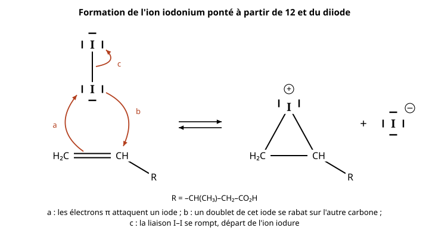

### Question 7.2 — Lactone 13 et produits concurrents

> [!INDICATION]
> Quel nucléophile interne peut ouvrir le pont ? Compter la taille du cycle formé selon le carbone attaqué.

> [!INDICATION]
> Quels nucléophiles externes sont présents dans le milieu ?

#### Solution

Un oxygène du groupe carboxyle (ou du carboxylate, en équilibre dans le milieu aqueux), nucléophile interne, attaque l'ion iodonium sur son carbone le plus substitué, en **anti** de l'iode, ce qui ouvre le pont : il se forme un cycle à cinq chaînons ($\gamma$-lactone) et la liaison C–I se retrouve sur le carbone terminal ($\mathrm{-CH_2I}$). La perte d'un proton (capté par l'eau ou l'iodure) donne **13**. Bilan :

$$\mathrm{acide\ \mathbf{12}+I_2\longrightarrow lactone\ \mathbf{13}+HI}$$

Isomère **13'** : la $\delta$-lactone à six chaînons, issue de l'attaque de l'oxygène sur le carbone terminal de l'iodonium (l'iode se trouve alors sur un carbone du cycle). On peut aussi envisager le diastéréo-isomère *trans* de **13**, que l'expérience ne montre pas.

Produit acyclique : l'ouverture de l'iodonium par un nucléophile externe, l'eau (iodhydrine $\mathrm{-CH(OH){-}CH_2I}$) ou l'ion iodure (diiodure vicinal).

Argument en faveur de **13** et **13'** : la cyclisation est **intramoléculaire**. Le nucléophile est attaché à la molécule, à proximité immédiate du site électrophile ; la formation d'un cycle à cinq ou six chaînons, peu tendu, se fait avec une entropie d'activation bien plus favorable qu'une attaque bimoléculaire, et l'emporte sur l'eau pourtant très abondante.

> [!JURY]
> Le rapport indique que l'iodolactonisation devait être décomposée en réactions analogues à celles du cours, et que les erreurs viennent surtout d'indications de l'énoncé mal prises en compte.

### Question 7.3 — Iodolactone 14

> [!INDICATION]
> Transposer à 11 : où sont l'acide et la double liaison ? Quel carbone attaquer pour fermer un cycle à cinq ?

> [!INDICATION]
> L'oxygène et l'iode s'additionnent en anti.

#### Solution

Dans **11**, le carboxyle est porté par le $\mathrm{CH_2}$ fixé sur C8 et la double liaison est C9=C10. L'oxygène attaque C9, ce qui ferme une $\gamma$-lactone à cinq chaînons (O–C9–C8–CH₂–CO), l'attaque sur C10 conduisant à un cycle ponté moins favorable ; l'iode reste sur C10. **14** ($\mathrm{C_{12}H_{16}INO_4}$) est donc l'iodolactone tricyclique : lactone accolée au cycle A par la liaison C8–C9, nécessairement en jonction *cis* (l'oxygène arrive sur la face qui porte la chaîne de C8), et iode sur C10 en **trans** de la liaison C9–O (addition anti). Le cycle B et le carbamate sont inchangés (figure 8).

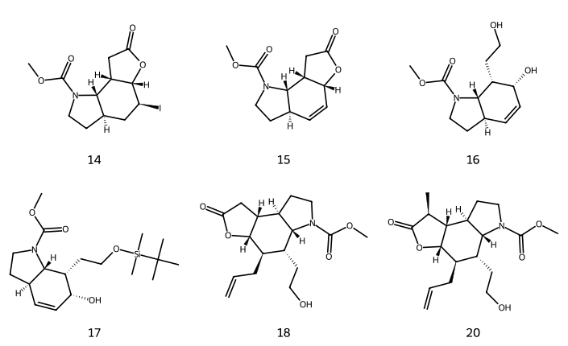

### Question 7.4 — Élimination par le DBU

> [!INDICATION]
> Base forte et encombrée sur un dérivé iodé secondaire : quel mécanisme ?

> [!INDICATION]
> L'élimination exige un hydrogène anti-périplanaire à l'iode : examiner les deux carbones voisins.

#### Solution

Le DBU, amidine encombrée, est une base forte et peu nucléophile (son acide conjugué, un ion amidinium, est stabilisé par mésomérie). Il provoque une **$\beta$-élimination E2** de HI : arrachement d'un proton en $\beta$ de l'iode, formation de la double liaison et départ de l'iodure, de façon concertée et **anti-périplanaire**. Deux positions $\beta$ existent. Sur C9, l'hydrogène est en *cis* de l'iode (puisque l'oxygène est en *trans*) : il ne peut pas se placer en anti. Sur C11, un des deux hydrogènes est en anti de l'iode : c'est lui qui part.

**15** ($\mathrm{C_{12}H_{15}NO_4}$) est la lactone insaturée possédant la double liaison **C10=C11** : l'oxygène de la lactone, sur C9, est en position allylique (figure 8). Bilan des deux étapes : la double liaison a été déplacée de C9=C10 à C10=C11 et un oxygène a été installé sur C9, sur la même face que la chaîne de C8.

Influence de l'halogène : l'étape exige un bon groupe partant. La liaison C–I est la plus longue, la plus faible et la plus polarisable des liaisons C–X, et l'ion iodure est le meilleur nucléofuge (base la plus faible) : la vitesse d'élimination décroît dans l'ordre I > Br > Cl. Avec le brome ou le chlore, il faudrait des conditions plus dures.

> [!PIEGE]
> Éliminer vers C9 (double liaison C9=C10) est tentant mais impossible : l'hydrogène de C9 est du même côté que l'iode. La double liaison se forme entre C10 et C11.

### Question 7.5 — Diol 16

> [!INDICATION]
> Une lactone est un ester cyclique : produit de réduction d'un ester par LiAlH₄ ?

> [!INDICATION]
> Vérifier avec la formule de 17, qui contient un seul silicium.

#### Solution

Le tétrahydruroaluminate de lithium réduit la lactone (ester cyclique) en **diol** : le carbone du carbonyle devient un alcool primaire, l'oxygène intracyclique un alcool secondaire. **16** ($\mathrm{C_{12}H_{19}NO_4}$) porte sur C8 la chaîne $\mathrm{-CH_2CH_2OH}$ et sur C9 un hydroxyle secondaire **allylique** (double liaison C10=C11), en *cis* de la chaîne ; le carbamate, moins électrophile, n'est pas touché à –78 °C (figure 8).

IR : la bande large et intense vers 3300 cm⁻¹ est la vibration d'élongation des liaisons O–H, élargie et abaissée par les liaisons hydrogène (alcools associés). La bande C=O de la lactone (vers 1770 cm⁻¹) a disparu, celle du carbamate (vers 1700 cm⁻¹) subsiste.

### Question 7.6 — Conditions de la réduction

> [!INDICATION]
> Que fait un hydrure au contact de l'eau ?

> [!INDICATION]
> Réduction d'un ester : deux additions d'hydrure séparées par une élimination. Puis : quelle fonction de 16 craint les acides ?

#### Solution

Solvant. L'ion hydrure de $\mathrm{AlH_4^-}$ est une base très forte : il réagit violemment avec l'eau et tout solvant protique en dégageant du dihydrogène, ce qui détruirait le réactif (et présente un danger). Il faut un solvant aprotique rigoureusement anhydre. Le THF, éther base de Lewis, solvate l'ion lithium et dissout le réactif, ne réagit pas avec lui et reste liquide à –78 °C.

Mécanisme :

1. addition nucléophile d'un hydrure sur le carbone du carbonyle de la lactone (activé par coordination de $\mathrm{Li^+}$ sur l'oxygène) : intermédiaire tétraédrique ;
2. élimination : reformation de $\mathrm{C{=}O}$ et ouverture du cycle, l'alcoolate secondaire (sur C9) étant le groupe partant ; il se forme un **aldéhyde** ;
3. l'aldéhyde, plus électrophile que la lactone, subit aussitôt une seconde addition d'hydrure : alcoolate primaire ;
4. hydrolyse : les deux alcoolates (liés à l'aluminium) sont protonés et donnent le diol.

pH = 4 : l'acidification sert à protoner les alcoolates et à redissoudre les hydroxydes d'aluminium, gélatineux, pour faciliter l'extraction. On s'arrête à un pH modéré parce que **16** est un alcool allylique, sensible aux acides.

En milieu très acide, l'hydroxyle secondaire protoné part sous forme d'eau en donnant un carbocation **allylique** stabilisé par mésomérie (charge partagée entre C9 et C11). Ce cation évolue par attaque intramoléculaire de l'hydroxyle primaire : **16'** est l'**éther cyclique** $\mathrm{C_{12}H_{17}NO_3}$ (tétrahydrofurane accolé au cycle A, l'oxygène de la chaîne étant relié à C9). La perte d'un proton par le cation, qui donne un diène conjugué de même formule brute, est l'autre évolution possible.

### Question 7.7 — Éther silylé 17

> [!INDICATION]
> La formule de 17 indique combien de groupes silylés ont été introduits ; lequel des deux hydroxyles est le plus dégagé ?

> [!INDICATION]
> Mécanisme analogue à la mésylation ; le signal qui disparaît avec D₂O est un proton échangeable.

#### Solution

La formule $\mathrm{C_{18}H_{33}NO_4Si}$ correspond à l'introduction d'un seul groupe *tert*-butyldiméthylsilyle ($\mathrm{C_{12}H_{19}NO_4}$ – H + $\mathrm{SiC_6H_{15}}$). La réaction étant très sensible à l'encombrement, c'est l'**alcool primaire**, le plus dégagé, qui réagit : **17** porte sur C8 la chaîne $\mathrm{-CH_2CH_2{-}O{-}Si(CH_3)_2C(CH_3)_3}$ et conserve l'hydroxyle secondaire allylique libre sur C9 (figure 8).

Mécanisme : substitution nucléophile sur le silicium. L'oxygène de l'alcool attaque le silicium, électrophile et capable de devenir pentacoordiné ; l'ion chlorure part ; la triéthylamine arrache le proton de l'ion oxonium (ou assiste l'alcool pendant l'attaque).

$$\mathrm{R'OH+ClSi(CH_3)_2{t}Bu+NEt_3\longrightarrow R'O{-}Si(CH_3)_2{t}Bu+Et_3NH^+Cl^-}$$

Rôle de la triéthylamine : base qui neutralise HCl au fur et à mesure. Sans elle, l'acide formé cliverait l'éther silylé (réaction renversable) et dégraderait l'alcool allylique (question 7.6). Elle ne déprotone pas l'alcool au préalable.

RMN : le signal élargi vers 3,5 ppm (1 H), qui disparaît par ajout de $\mathrm{D_2O}$, est celui d'un proton échangeable ($\mathrm{O{-}H+D_2O\rightleftharpoons O{-}D+HOD}$) : il reste **un seul** hydroxyle, ce qui confirme la monosilylation. L'élargissement vient de l'échange et des liaisons hydrogène. Le groupe silylé donne par ailleurs deux singulets à champ fort (9 H vers 0,9 ppm et 6 H vers 0 ppm).

## Deuxième partie · 8. Alkylation stéréochimiquement contrôlée

### Question 8.1 — Sel 19 et choix du LDA

> [!INDICATION]
> Repérer tous les hydrogènes acides de 18.

> [!INDICATION]
> Deux formes limites pour un énolate : charge sur le carbone ou sur l'oxygène.

#### Solution

**18** possède deux sites acides : l'hydroxyle de l'alcool primaire et les hydrogènes en $\alpha$ du carbonyle de la lactone, sur C13. Le sel **19** est le **dianion dilithié** : alcoolate de lithium sur la chaîne de C8 et **énolate de lithium** de la lactone.

Choix du LDA : c'est une base très forte ($pK_a$ du couple amine/amidure voisin de 35), qui déprotone quantitativement et irréversiblement en $\alpha$ d'un ester ($pK_a\approx25$) ; très encombrée, elle est non nucléophile et n'attaque ni le carbonyle de la lactone ni celui du carbamate ; elle est soluble dans le THF à –78 °C, température qui évite les réactions parasites (condensation de l'énolate sur la lactone non déprotonée).

Formes mésomères de l'énolate : l'une porte la charge négative sur le carbone C13 (carbanion, $\mathrm{C{=}O}$ conservé), l'autre sur l'oxygène, avec une double liaison C13=C entre C13 et le carbone de l'ancien carbonyle.

$$\mathrm{{}^{-}CH{-}C({=}O){-}O{-}\ \longleftrightarrow\ CH{=}C(O^{-}){-}O{-}}$$

C'est la seconde, la plus représentative (charge sur l'atome le plus électronégatif), que l'on retient : C13 y est trigonal plan.

> [!JURY]
> Le rapport rappelle que la basicité et la nucléophilie du LDA devraient être connues. À savoir : base très forte, encombrée, non nucléophile.

### Question 8.2 — Nombre d'équivalents de LDA

> [!INDICATION]
> Classer par acidité l'hydroxyle et la position en α de la lactone.

#### Solution

Il faut au moins **deux équivalents**. L'hydroxyle ($pK_a\approx16$) est beaucoup plus acide que la position $\alpha$ de la lactone ($pK_a\approx25$) : le premier équivalent est consommé par l'alcool et donne l'alcoolate ; seul le second forme l'énolate. Avec un seul équivalent, on n'obtiendrait que l'alcoolate et aucune alkylation sur le carbone. (Le carbamate, N,N-disubstitué, n'a pas de proton acide.) On emploie en pratique un léger excès.

### Question 8.3 — Composé 20

> [!INDICATION]
> Alkylation de l'énolate par son carbone.

> [!INDICATION]
> Un seul centre nouveau, les autres étant fixés : nature de l'isomérie ?

#### Solution

L'énolate réagit par son carbone C13 sur l'iodure de méthyle ($\mathrm{S_N2}$) ; l'hydrolyse reprotone l'alcoolate. **20** ($\mathrm{C_{18}H_{27}NO_5}$) est la lactone $\alpha$-méthylée : C13 porte un groupe méthyle et un hydrogène, la fonction alcool primaire est intacte (figure 8).

C13 devient un nouveau centre stéréogène alors que les six autres sont fixés : **deux** isomères sont possibles, qui diffèrent par la configuration du seul C13. Ce sont des **diastéréo-isomères** (épimères), a priori formés en proportions inégales.

### Question 8.4 — Remplissage du diagramme

> [!INDICATION]
> Compter les électrons π de l'énolate (penser à l'anion allyle) et les électrons de la liaison C–I.

#### Solution

Énolate de l'éthanal : le système $\pi$ est construit sur trois orbitales p (O, C, C), d'où trois OM, (1) liante sans nœud, (2) à un nœud, (3) antiliante à deux nœuds. Il contient **quatre électrons** : deux pour la liaison $\pi$ et deux pour le doublet de l'oxygène porteur de la charge négative, conjugué (c'est l'analogue de l'anion allyle). Les OM (1) et (2) sont doublement occupées, (3) est vide.

Iodure de méthyle : en ne considérant que la liaison C–I, on a deux OM, (4) liante $\sigma$ et (5) antiliante $\sigma^{*}$, pour les **deux électrons** de la liaison. (4) est doublement occupée, (5) est vide.

On remplit par énergie croissante en respectant le principe de Pauli (deux électrons de spins opposés par OM). La figure 9 reprend le diagramme du sujet ainsi rempli.

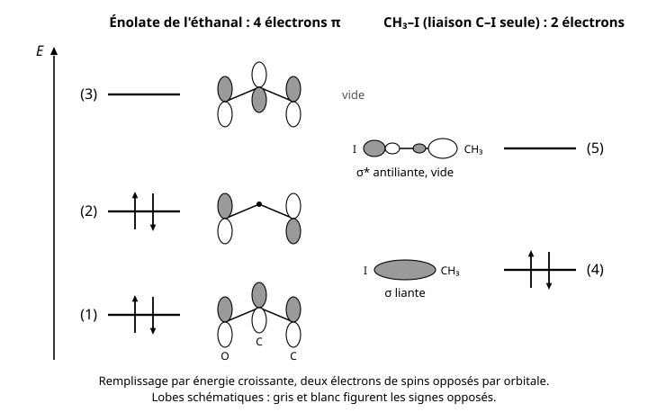

### Question 8.5 — Orbitales frontières

> [!INDICATION]
> HO : plus haute occupée ; BV : plus basse vacante. Comparer les deux écarts HO–BV croisés.

#### Solution

| | HO | BV |
|---|---|---|
| énolate | (2) | (3) |
| iodure de méthyle | (4), $\sigma_{\mathrm{C-I}}$ | (5), $\sigma^{*}_{\mathrm{C-I}}$ |

L'interaction la plus stabilisante est celle des deux orbitales frontières les plus proches en énergie. L'écart HO(énolate)–BV($\mathrm{CH_3I}$), c'est-à-dire (2)–(5), est bien plus petit que l'écart (4)–(3). **L'interaction principale est (2)–(5)** : l'énolate, riche en électrons et de HO haute, est le nucléophile ; l'iodure de méthyle, de BV basse, est l'électrophile.

### Question 8.6 — Géométrie d'approche

> [!INDICATION]
> Où sont les plus gros lobes de la HO de l'énolate et de la BV de l'iodure de méthyle ?

> [!INDICATION]
> Les lobes doivent pointer l'un vers l'autre, dans le même axe.

#### Solution

Dans la HO (2) de l'énolate, le coefficient le plus gros est sur le carbone terminal (avec un lobe de part et d'autre du plan de la molécule) : c'est lui qui réagit, d'où la C-alkylation. Dans la BV (5) de $\mathrm{CH_3I}$, le lobe le plus développé est sur le carbone, **à l'opposé de l'iode**. Le recouvrement est maximal lorsque ce lobe pointe vers un lobe de l'orbitale p du carbone de l'énolate, dans son axe : le carbone du méthyle arrive **perpendiculairement au plan de l'énolate**, à la verticale du carbone terminal, et les trois atomes C(énolate)···C–I sont **alignés**, l'iode du côté opposé. C'est la géométrie d'une $\mathrm{S_N2}$ avec attaque dorsale (figure 10, à gauche).

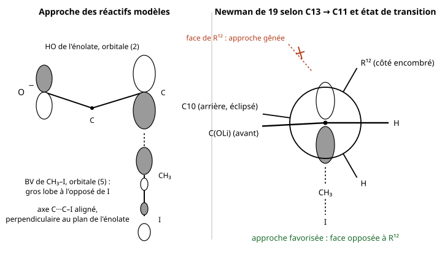

### Question 8.7 — Projection de Newman de 19

> [!INDICATION]
> C13 est trigonal dans la forme retenue : ses substituants et C11 sont coplanaires.

> [!INDICATION]
> Le plan du cycle C contient l'axe de visée : il apparaît comme une droite ; l'orbitale p lui est perpendiculaire.

#### Solution

On regarde de C13 (devant) vers C11 (derrière).

- C13, trigonal, est au centre : ses deux substituants, le carbone de l'énolate (lié à $\mathrm{O^-}$ et à l'oxygène du cycle) et l'hydrogène, sont dans le plan du cycle C, qui contient aussi l'axe de visée ; en projection ils sont donc diamétralement opposés, sur la trace horizontale de ce plan. L'orbitale p de C13 est perpendiculaire à ce plan : ses deux lobes sont verticaux.
- C11, tétragonal, est figuré par le cercle. C10 appartient au cycle plan : sa liaison est éclipsée avec celle du carbone de l'énolate. Les deux autres substituants sont à $\pm120^\circ$, de part et d'autre du plan du cycle : $\mathrm{R^{12}}$ d'un côté, l'hydrogène de l'autre.

Avec la configuration dessinée par le sujet (liaison C11–C13 vers l'arrière, $\mathrm{R^{12}}$ dans le plan du dessin), en plaçant le carbone de l'énolate à gauche, $\mathrm{R^{12}}$ est en haut à droite et H en bas à droite (figure 10, à droite ; vérifié sur un modèle tridimensionnel).

> [!METHODE]
> Newman avec un carbone trigonal en avant : ses deux substituants apparaissent opposés, sur la trace du plan ; l'orbitale p est tracée perpendiculairement. Placer ensuite les trois substituants du carbone arrière, dont celui qui appartient au cycle, éclipsé.

> [!JURY]
> Le rapport constate que cette projection de Newman particulière n'a été que très rarement correcte.

### Question 8.8 — Approches et état de transition

> [!INDICATION]
> L'électrophile arrive perpendiculairement au plan du cycle, par une face ou par l'autre.

> [!INDICATION]
> Quel substituant de C11 se trouve de chaque côté ?

#### Solution

D'après la question 8.6, l'iodure de méthyle aborde C13 perpendiculairement au plan du cycle C, par l'une ou l'autre face.

- Approche par la face qui porte $\mathrm{R^{12}}$ (par le haut de la figure 10) : le méthyle entrant rencontre le substituant volumineux $\mathrm{R^{12}}$ (le cycle A et le cycle B). Elle conduit à l'épimère où $\mathrm{CH_3}$ et $\mathrm{R^{12}}$ sont en *cis*.
- Approche par la face opposée (par le bas) : elle ne rencontre que l'hydrogène de C11. Elle conduit à l'épimère où $\mathrm{CH_3}$ est en **trans** de $\mathrm{R^{12}}$ (et en *cis* de H11).

Sous contrôle cinétique, l'approche la moins encombrée a l'état de transition le plus bas : c'est la seconde. L'état de transition se dessine sur la même projection : C13 au centre, ses liaisons vers le carbone de l'énolate (à gauche) et vers H (à droite) encore proches de l'horizontale ; sous C13, à la verticale, la liaison partielle C13···$\mathrm{CH_3}$, prolongée par la liaison partielle $\mathrm{CH_3}$···I, les trois atomes alignés ; $\mathrm{R^{12}}$ en haut à droite, loin du réactif. Le produit **20** a donc son méthyle en trans de C12 : c'est bien la configuration de C13 dans la sténine (méthyle représenté en coin plein sur la figure 1 du sujet, la liaison C11–C13 étant vers l'arrière).

> [!JURY]
> Le rapport souligne que l'énoncé demandait de n'utiliser que le recouvrement principal ; beaucoup de candidats ont invoqué des recouvrements secondaires, souvent en contradiction avec la gêne stérique.

### Question 8.9 — Validité du modèle

> [!INDICATION]
> Comparer la prédiction à l'observation, puis relire les hypothèses : cycle plan, réactifs modèles, contrôle cinétique.

#### Solution

Le modèle prévoit une nette préférence pour l'épimère à méthyle trans de $\mathrm{R^{12}}$ ; l'expérience donne un isomère unique, de la configuration voulue pour la sténine : le modèle, fondé sur le seul recouvrement frontalier principal et sur la gêne stérique du substituant voisin, est validé qualitativement. Il n'était pas nécessaire d'invoquer des recouvrements secondaires.

Hypothèses discutables : la **planéité du cycle C** (un cycle à cinq chaînons accolé adopte une conformation enveloppe, qui modifie l'orientation de $\mathrm{R^{12}}$ et de $\mathrm{R^{9}}$ par rapport aux deux faces) ; le remplacement de l'énolate de lactone par celui de l'éthanal (l'oxygène intracyclique modifie les coefficients) ; l'oubli du cation lithium, des agrégats et de l'alcoolate voisin ; enfin le **contrôle cinétique** lui-même : le produit garde un hydrogène acide sur C13 et pourrait s'épimériser en présence de base, auquel cas la sélectivité observée refléterait la stabilité relative des épimères.

## Deuxième partie · 9. Fermeture du dernier cycle et aménagement fonctionnel

### Question 9.1 — Aldéhyde 21

> [!INDICATION]
> L'oxydation de Swern s'arrête à quel stade pour un alcool primaire ?

> [!INDICATION]
> Quel type de proton résonne vers 10 ppm sans s'échanger ?

#### Solution

L'oxydation de Swern transforme l'alcool primaire en **aldéhyde** sans aller plus loin : **21** ($\mathrm{C_{18}H_{25}NO_5}$) porte sur C8 la chaîne $\mathrm{-CH_2{-}CHO}$ ; lactone méthylée, groupe allyle et carbamate sont inchangés (figure 11).

RMN : le signal vers 10 ppm intégrant pour 1 H est le proton aldéhydique, très déblindé par l'anisotropie et l'effet attracteur du carbonyle (son couplage avec le $\mathrm{CH_2}$ voisin est faible, d'où l'aspect de singulet). L'absence de modification par $\mathrm{D_2O}$ montre que ce n'est pas un proton échangeable : il n'y a plus d'hydroxyle (l'alcool a été entièrement oxydé) ni de $\mathrm{CO_2H}$.

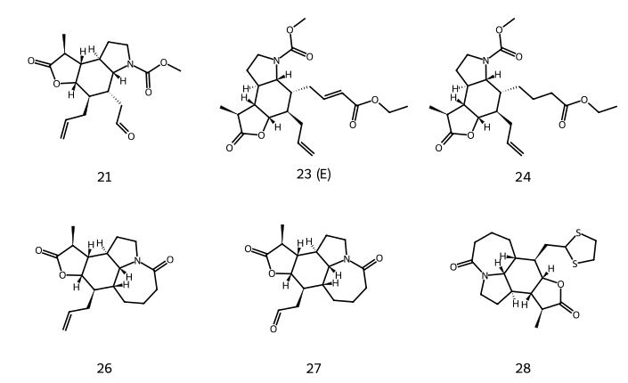

### Question 9.2 — Autre méthode d'oxydation

> [!INDICATION]
> Oxydants du chrome(VI) : lesquels s'emploient en milieu anhydre ?

#### Solution

On peut oxyder l'alcool primaire par un réactif du chrome(VI) en milieu **anhydre** : trioxyde de chrome dans la pyridine (réactif de Sarett ou de Collins) ou chlorochromate de pyridinium dans le dichlorométhane. Avec un oxydant du chrome(VI) en milieu aqueux acide (réactif de Jones, dichromate), le risque est la suroxydation : le sous-produit **21'** est l'**acide carboxylique** $\mathrm{-CH_2{-}CO_2H}$ sur C8.

### Question 9.3 — Rôle de l'eau

> [!INDICATION]
> Écrire l'addition d'eau sur le carbonyle : à quelle fonction le produit ressemble-t-il ?

#### Solution

En présence d'eau, l'aldéhyde est en équilibre avec son **hydrate**, un diol géminé :

$$\mathrm{R{-}CH_2{-}CHO+H_2O\rightleftharpoons R{-}CH_2{-}CH(OH)_2}$$

Cet hydrate possède, comme un alcool, un hydrogène sur le carbone porteur d'hydroxyle : l'oxydant l'oxyde par le même mécanisme qu'un alcool (formation d'un ester chromique, puis élimination) et le transforme en acide carboxylique **21'**. Bien que l'équilibre d'hydratation soit peu favorable, la consommation de l'hydrate le déplace continuellement : tout l'aldéhyde finit par être oxydé. En milieu anhydre, l'hydrate ne peut pas se former et l'oxydation s'arrête à l'aldéhyde.

> [!JURY]
> Le rapport note que l'action de l'eau sur les dérivés carbonylés a déstabilisé les candidats. À retenir (le rapport ne le détaille pas) : l'hydrate d'aldéhyde est un diol géminé, oxydable comme un alcool.

### Question 9.4 — Préparation du réactif 22

> [!INDICATION]
> Triphénylphosphine sur un dérivé chloré primaire : quelle substitution ?

> [!INDICATION]
> Quels hydrogènes du sel sont acides ?

#### Solution

Première étape : la triphénylphosphine, bon nucléophile (doublet sur le phosphore, polarisable), substitue l'ion chlorure du chloroacétate d'éthyle par une $\mathrm{S_N2}$ sur le carbone primaire, activé par le carbonyle voisin. **22'** est le sel de phosphonium :

$$\mathrm{Ph_3P+Cl{-}CH_2{-}CO_2Et\longrightarrow Ph_3\overset{+}{P}{-}CH_2{-}CO_2Et,\ Cl^-}$$

Seconde étape : les hydrogènes du $\mathrm{CH_2}$, placés entre le phosphore positif et le carbonyle, sont acides. Le LDA en arrache un (réaction acide–base) :

$$\mathrm{Ph_3\overset{+}{P}{-}CH_2{-}CO_2Et+LDA\longrightarrow Ph_3\overset{+}{P}{-}\overset{-}{C}H{-}CO_2Et+HN(iPr)_2+LiCl}$$

**22** est un **ylure de phosphore** (phosphorane), espèce globalement neutre portant deux charges formelles opposées sur des atomes adjacents ; on l'écrit aussi $\mathrm{Ph_3P{=}CH{-}CO_2Et}$. La charge négative est délocalisée sur le groupe ester : c'est un ylure **stabilisé**.

### Question 9.5 — Réaction de Wittig

> [!INDICATION]
> Ylure de phosphore sur aldéhyde.

> [!INDICATION]
> Deux configurations possibles de la double liaison créée ; penser à la constante de couplage.

#### Solution

L'ylure réagit sur l'aldéhyde **21** : c'est une **réaction de Wittig**, qui remplace $\mathrm{C{=}O}$ par $\mathrm{C{=}C}$ et libère l'oxyde de triphénylphosphine. On obtient l'ester $\alpha,\beta$-insaturé ($\mathrm{C_{22}H_{31}NO_6}$) :

$$\mathrm{R{-}CH_2{-}CHO+Ph_3P{=}CH{-}CO_2Et\longrightarrow R{-}CH_2{-}CH{=}CH{-}CO_2Et+Ph_3P{=}O}$$

**23**, majoritaire, est l'isomère **E** (un ylure stabilisé conduit préférentiellement à l'alcène E, le plus stable) ; **23'**, minoritaire, est l'isomère **Z** (figure 11 pour **23**). Ils sont **diastéréo-isomères** (stéréo-isomères de configuration Z/E autour de la double liaison). Aucun autre centre n'est modifié : les conditions sont neutres.

Distinction en RMN : la constante de couplage ${}^{3}J$ entre les deux protons éthyléniques vaut 15 à 16 Hz pour l'isomère E et 10 à 12 Hz pour l'isomère Z ; les déplacements chimiques diffèrent aussi (proton en $\beta$ vers 6,9 ppm pour E, vers 6,2 ppm pour Z). Le rapport 4:1 se lit sur les intégrations des signaux correspondants.

### Question 9.6 — Réduction conjuguée

> [!INDICATION]
> Comparer les formules de 23 et 24 et compter les protons vinyliques restants.

> [!INDICATION]
> Deux sites électrophiles dans un ester conjugué : le carbone du carbonyle et le carbone β.

#### Solution

La formule de **24**, $\mathrm{C_{22}H_{33}NO_6}$, compte deux hydrogènes de plus que **23**, et il ne reste que trois protons vinyliques, ceux du groupe allyle : la double liaison conjuguée à l'ester a été réduite, pas le carbonyle. **24** porte sur C8 la chaîne saturée $\mathrm{-CH_2{-}CH_2{-}CH_2{-}CO_2Et}$ (figure 11). Les deux isomères **23** et **23'** donnent le même produit, d'où la tache unique.

C'est une **addition 1,4** (addition conjuguée, de type Michael) de l'ion hydrure. Mécanisme : l'hydrure attaque le carbone en $\beta$ de l'ester ; les électrons $\pi$ se délocalisent jusqu'à l'oxygène et il se forme un **énolate** d'ester ; à l'hydrolyse, l'énolate est protoné sur le carbone $\alpha$ (ou sur l'oxygène, l'énol se tautomérisant ensuite) et donne l'ester saturé.

L'autre produit **24'** est celui de l'**addition 1,2** : l'hydrure attaque le carbone du carbonyle de l'ester, l'intermédiaire tétraédrique expulse l'ion éthanolate et donne un aldéhyde $\alpha,\beta$-insaturé, aussitôt réduit par un second hydrure. Après hydrolyse, **24'** est l'**alcool allylique** $\mathrm{R{-}CH_2{-}CH{=}CH{-}CH_2OH}$, double liaison conservée.

> [!JURY]
> Selon le rapport, l'action des hydrures sur un composé α,β-insaturé en présence de cuivre(I) n'a été correctement analysée que très rarement, alors que la réaction de Wittig l'a été en général très bien.

### Question 9.7 — Rôle du bromure de cuivre(I)

> [!INDICATION]
> Penser aux organocuprates : que change le cuivre à la régiosélectivité d'une addition sur une énone ?

#### Solution

Le cuivre(I) réagit avec le Red-Al pour former in situ un **hydrure de cuivre**, réactif covalent et « mou », analogue des organocuprates. Alors qu'un hydrure d'aluminium, dur, attaque sous contrôle de charge le carbone du carbonyle (addition 1,2), l'hydrure de cuivre réagit sous contrôle orbitalaire sur le carbone $\beta$, qui porte le plus gros coefficient de la BV du système conjugué : le cuivre **oriente la régiosélectivité vers l'addition 1,4** et rend la réduction chimiosélective (les esters isolés, la lactone et le carbamate ne sont pas touchés).

### Question 9.8 — LiAlH₄ à la place du Red-Al ?

> [!INDICATION]
> Quelles autres fonctions de la molécule LiAlH₄ réduirait-il ? Revoir la question 7.5.

#### Solution

Non. $\mathrm{LiAlH_4}$ est un donneur d'hydrure puissant et peu sélectif : il réduirait l'ester en 1,2 (alcool allylique **24'**), mais aussi la **lactone** en diol, comme à la question 7.5, et éventuellement le carbamate. Le Red-Al, dont l'aluminium porte deux groupes alcoolate, est un hydrure modéré, soluble et dosable avec précision, bien adapté à la formation de l'hydrure de cuivre à –78 °C.

### Question 9.9 — Composé 25

> [!INDICATION]
> Appliquer le schéma 4 au carbamate porté par l'azote du cycle B.

#### Solution

L'iodure de triméthylsilyle clive le carbamate de méthyle selon le schéma 4 : le silicium, oxophile, se fixe sur l'oxygène du carbonyle ; l'ion iodure attaque alors le méthyle par $\mathrm{S_N2}$ (départ d'iodométhane) ; le carbamate de silyle obtenu, $\mathrm{R_2N{-}CO{-}O{-}SiMe_3}$, est très fragile : la moindre source de protons (traces d'eau ou d'acide iodhydrique) le convertit en acide carbamique, qui perd aussitôt du dioxyde de carbone. Conformément au schéma 4, on écrit le produit sous la forme de l'amine libre. **25** ($\mathrm{C_{20}H_{31}NO_4}$) est l'**amine secondaire** correspondante : l'azote du cycle B porte un hydrogène à la place de $\mathrm{-CO_2CH_3}$ ; l'ester éthylique, la lactone et le groupe allyle sont conservés.

### Question 9.10 — Lactame 26

> [!INDICATION]
> Quel groupe de 25 peut réagir avec l'amine en libérant de l'éthanol ? Compter la taille du cycle.

> [!INDICATION]
> Milieu trop acide : que devient l'amine ?

#### Solution

À 90 °C, l'amine secondaire réagit sur l'ester éthylique placé au bout de la chaîne à quatre carbones de C8 : **amidification intramoléculaire** avec perte d'éthanol, qui ferme le cycle D à sept chaînons (N–CO–C5–C6–C7–C8–C9a). **26** ($\mathrm{C_{18}H_{25}NO_3}$) est le lactame tétracyclique : il possède les cycles A, B, C et D de la sténine, avec un carbonyle sur C4 et un groupe allyle sur C9 (figure 11).

Mécanisme (addition–élimination, catalyse acide) :

1. protonation de l'oxygène du carbonyle de l'ester ;
2. addition nucléophile de l'azote sur le carbone activé : intermédiaire tétraédrique, azote devenu ammonium ;
3. prototropie de l'azote vers l'oxygène du groupe éthoxy ;
4. élimination d'éthanol et reformation du carbonyle ;
5. déprotonation, qui régénère le catalyseur ; l'amide, stabilisé par mésomérie, est le produit thermodynamique, et le départ de l'éthanol à 90 °C déplace l'équilibre.

Inhibition en milieu trop acide : l'amine ($pK_a$ de l'ammonium voisin de 10 à 11) est alors entièrement protonée. L'ion ammonium n'a plus de doublet disponible et n'est plus nucléophile : l'étape d'addition devient impossible. Il faut assez d'acide pour activer l'électrophile, mais pas au point de supprimer le nucléophile ; la vitesse passe par un maximum, comme pour la formation des imines.

> [!METHODE]
> Catalyse acide d'une addition nucléophile par une amine : l'acide active l'électrophile mais protone aussi le nucléophile ; la vitesse est maximale à une acidité intermédiaire.

## Deuxième partie · 10. Fin de la synthèse

### Question 10.1 — Action du tétraoxyde d'osmium

> [!INDICATION]
> Quelle double liaison C=C reste-t-il dans 26 ? Que fait OsO₄ sur un alcène ?

#### Solution

Le tétraoxyde d'osmium réalise la **syn-dihydroxylation** de la double liaison terminale du groupe allyle (seule double liaison C=C de **26**) : cycloaddition concertée donnant un ester osmique cyclique, hydrolysé ensuite. **26'** ($\mathrm{C_{18}H_{27}NO_5}$) est le **diol vicinal** : C9 porte la chaîne $\mathrm{-CH_2{-}CH(OH){-}CH_2OH}$. Le carbone secondaire créé est stéréogène : **26'** est un mélange de deux épimères, sans conséquence pour la suite.

### Question 10.2 — Aldéhyde 27 et rôle du periodate

> [!INDICATION]
> Couper la liaison entre les deux carbones du diol : que devient chaque fragment ?

> [!INDICATION]
> Dans quel état d'oxydation se trouve l'osmium après la dihydroxylation ?

#### Solution

Le periodate coupe la liaison C–C du diol **26'** : le carbone secondaire devient un aldéhyde, le carbone terminal part sous forme de méthanal. **27** ($\mathrm{C_{17}H_{23}NO_4}$) porte sur C9 la chaîne $\mathrm{-CH_2{-}CHO}$ (figure 11).

$$\mathrm{R{-}CH_2{-}CH(OH){-}CH_2OH+IO_4^-\longrightarrow R{-}CH_2{-}CHO+HCHO+IO_3^-+H_2O}$$

Remarque sur le spectre : un proton d'aldéhyde est attendu vers 9,5 à 10 ppm (comme pour **21**) plutôt que vers 12 ppm, valeur habituelle d'un proton d'acide carboxylique (comme pour **11**). On retient néanmoins l'aldéhyde : c'est le produit de la coupure décrite par l'énoncé, le periodate n'oxyde pas les aldéhydes, et c'est l'aldéhyde qui explique l'étape suivante (question 10.4) ainsi que le groupe éthyle de la sténine.

Quantités : le periodate joue **deux rôles**. D'une part il réoxyde l'osmium(VI), formé après la dihydroxylation, en osmium(VIII) : $\mathrm{OsO_4}$ est régénéré à chaque cycle, c'est un catalyseur, ce qui permet d'en employer très peu (réactif coûteux, volatil et très toxique). D'autre part il coupe le diol. Il est donc consommé en quantité stœchiométrique, à raison d'au moins deux équivalents par double liaison, d'où l'excès.

> [!PIEGE]
> Le signal annoncé vers 12 ppm évoque un acide carboxylique. La suite de la synthèse (dithioacétal, puis groupe éthyle) impose pourtant un aldéhyde : il faut croiser les données spectroscopiques avec la cohérence chimique.

### Question 10.3 — Autre méthode

> [!INDICATION]
> Quelle réaction du cours coupe directement une double liaison C=C en deux composés carbonylés ?

#### Solution

L'**ozonolyse** : action de l'ozone à –78 °C dans le dichlorométhane, puis traitement **réducteur** de l'ozonide (diméthylsulfure, ou zinc dans l'acide acétique) pour s'arrêter à l'aldéhyde. Elle donne directement **27** et du méthanal ; un traitement oxydant (eau oxygénée) conduirait à l'acide carboxylique.

### Question 10.4 — Dithioacétal 28

> [!INDICATION]
> Transposer l'acétalisation d'un aldéhyde par un diol, en remplaçant l'oxygène par le soufre.

#### Solution

Par analogie avec l'acétalisation d'un aldéhyde par l'éthane-1,2-diol, l'aldéhyde **27** est transformé en **dithioacétal cyclique** (1,3-dithiolane) : dans **28** ($\mathrm{C_{19}H_{27}NO_3S_2}$), C9 porte $\mathrm{-CH_2{-}CH(S{-}CH_2{-}CH_2{-}S)}$, le carbone de l'ancien carbonyle étant inclus dans un cycle à cinq chaînons avec les deux soufres (figure 11). Le lactame et la lactone, bien moins électrophiles, ne réagissent pas.

Mécanisme (catalyse par l'APTS) :

1. protonation de l'oxygène du carbonyle ;
2. addition nucléophile d'un soufre du dithiol sur le carbone activé ;
3. déprotonation du soufre : hémithioacétal ;
4. protonation de l'hydroxyle, puis départ d'eau assisté par un doublet du soufre : ion thionium $\mathrm{R{-}CH{=}\overset{+}{S}{-}}$ ;
5. attaque intramoléculaire du second groupe thiol sur ce cation (fermeture du cycle à cinq) ;
6. déprotonation, qui régénère le catalyseur.

Toutes les étapes sont renversables ; le thiol étant très nucléophile et le dithiolane très stable, l'équilibre est favorable, et l'élimination de l'eau le déplace encore.

> [!JURY]
> Le rapport regrette que pratiquement aucun candidat n'ait précisé l'analogie utilisée pour justifier ses réponses dans cette partie : la nommer explicitement.

### Question 10.5 — Activité optique

> [!INDICATION]
> Les réactifs de départ sont-ils chiraux ? Y a-t-il un réactif chiral ou un dédoublement dans la synthèse ?

#### Solution

La molécule de sténine est chirale (sept carbones asymétriques, aucun élément de symétrie). Mais la synthèse part de réactifs **achiraux** (**1** et **2**), n'emploie que des réactifs, catalyseurs et solvants achiraux, et ne comporte aucune étape de dédoublement. L'étape de Diels-Alder crée les premiers centres stéréogènes : les deux faces du diénophile sont attaquées avec la même probabilité (états de transition énantiomères, de même énergie), et **4** est racémique. Toutes les étapes suivantes fixent la configuration **relative** des nouveaux centres par rapport aux précédents, de la même façon dans les deux séries énantiomères. La sténine obtenue est donc un **mélange racémique** des deux énantiomères, **sans activité optique** (pouvoir rotatoire nul par compensation), à la différence de la sténine naturelle, énantiomériquement pure.

> [!PIEGE]
> Molécule chirale ne signifie pas échantillon optiquement actif : à partir de réactifs achiraux et sans auxiliaire chiral, on obtient toujours le racémique, même si la configuration relative est parfaitement contrôlée.

### Question 10.6 — Rendement global

> [!INDICATION]
> Multiplier tous les rendements donnés par l'énoncé, y compris ceux des séquences non étudiées.

> [!INDICATION]
> Sans calculatrice : regrouper les facteurs et arrondir au fur et à mesure.

#### Solution

Le rendement global d'une synthèse linéaire est le produit des rendements successifs :

| Transformation | Rendement |
|---|---|
| **1** → **3** | 0,85 |
| **3** → **4** | 0,67 |
| **4** → **5** | 0,87 |
| **5** → **6** | 0,94 |
| **6** → **8** | 0,94 |
| **8** → **10** | 0,94 |
| **10** → **11** | 0,83 |
| **11** → **15** | 0,91 |
| **15** → **16** | 1,00 |
| **16** → **17** | 0,99 |
| **17** → **18** | 0,65 |
| **18** → **20** | 0,87 |
| **20** → **23** + **23'** | 0,91 |
| **23** + **23'** → **24** | 0,85 |
| **24** → **26** | 0,85 |
| **26** → **27** | 0,94 |
| **27** → **28** | 0,91 |
| **28** → sténine | 0,75 |

Calcul de proche en proche : 0,85 × 0,67 ≈ 0,57 ; × 0,87 ≈ 0,50 ; × 0,94³ ≈ 0,41 ; × 0,83 ≈ 0,34 ; × 0,91 ≈ 0,31 ; × 0,99 ≈ 0,31 ; × 0,65 ≈ 0,20 ; × 0,87 ≈ 0,17 ; × 0,91 ≈ 0,16 ; × 0,85² ≈ 0,11 ; × 0,94 ≈ 0,11 ; × 0,91 ≈ 0,098 ; × 0,75 ≈ 0,073.

$$\boxed{\rho_{\text{global}}\approx7\ \%}$$

Commentaire. Le rendement moyen par transformation est pourtant élevé (environ 86 % sur dix-huit transformations, qui regroupent plus de vingt-cinq étapes) : c'est le défaut des synthèses **linéaires**, où les pertes se multiplient. Les deux étapes qui pèsent le plus sont la cycloaddition de Diels-Alder (67 %) et la séquence **17** → **18** (65 %). Pour un alcaloïde tétracyclique à sept centres stéréogènes, tous contrôlés, 7 % reste un très bon résultat ; une stratégie convergente (assemblage tardif de fragments préparés séparément) limiterait la longueur de la plus longue séquence linéaire. La synthèse fournit le racémique : seule la moitié du produit a la configuration naturelle.

## Bilan

- **Polymères.** Le fil directeur est une suite de lois d'échelle : $L=Na$ (bâton), $R_K=a\sqrt N$ (chaîne idéale, isotropie et absence de corrélation), $R_F\simeq aN^{3/5}$ (volume exclu, minimisation de l'énergie libre). À retenir : la marche aléatoire donne une loi gaussienne de variance $Na^{2}$ ; l'entropie $S=S_0-3kR^{2}/(2Na^{2})$ conduit à une force de rappel proportionnelle à $T$ ; $\nu$ est un volume, analogue du covolume et du second coefficient du viriel.
- **Osmométrie.** Égalité des potentiels chimiques du solvant, loi de Van't Hoff à dilution infinie, puis développement du viriel : l'ordonnée à l'origine de $\Pi/(RT\underline c)$ donne $1/\bar M_n$, commune à tous les solvants ($\bar M_n\approx1{,}3\times10^{5}\ \mathrm{g\,mol^{-1}}$), la pente $A_2$ mesure la qualité du solvant (positive en bon solvant, nulle en solvant thêta, négative en mauvais solvant).
- **Synthèse.** Chaque étape se ramène à une réaction du cours appliquée dans un contexte polyfonctionnel : il faut dire pourquoi telle fonction réagit et pas telle autre (double liaison terminale contre intracyclique, lactone contre carbamate, alcool primaire contre secondaire, addition 1,4 contre 1,2). Les formules brutes données par l'énoncé servent de contrôle à chaque structure.
- **Stéréochimie.** Descripteurs (8R, 9aS, 12S) pour **6** ; additions anti (iodolactonisation), élimination anti-périplanaire, alkylation de l'énolate par la face opposée au substituant voisin, sous contrôle orbitalaire (HO de l'énolate, BV de l'iodure de méthyle) et stérique. La synthèse, menée sans source de chiralité, fournit la sténine racémique avec un rendement global voisin de 7 %.
- **Méthode générale.** Commenter chaque résultat numérique, nommer les analogies utilisées, justifier le rôle de chaque réactif (base, acide de Lewis, co-oxydant) : ce sont les points sur lesquels le rapport du jury revient le plus.
