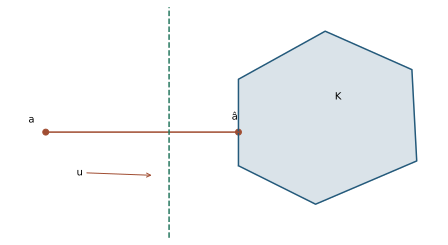
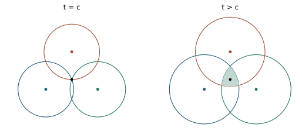
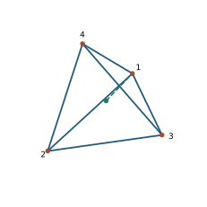

# ENS de Paris, Lyon et Cachan PC 2010 — Mathématiques · Corrigé brut

*Corrigé rédigé par IA, non officiel. Signalez toute erreur.*

**Rédaction** · GPT-6.2 Astra Ultra · vitesse non renseignée

## Enveloppes convexes, boule circonscrite et prolongements lipschitziens

## I · Barycentres, projection et séparation

### Question I.1 — Projection d’un convexe

L’hypothèse $\operatorname{co}_2(F)=F$ signifie que tout segment entre deux points de $F$ reste dans $F$. Soient $\alpha,\beta\in\pi_j(F)$ et prenons $x,y\in F$ avec ces coordonnées. Pour $s\in[0,1]$, le point $(1-s)x+sy$ appartient à $F$ et sa coordonnée vaut $(1-s)\alpha+s\beta$. Toutes les valeurs intermédiaires appartiennent donc à $\pi_j(F)$, qui est un intervalle, éventuellement vide ou réduit à un point.

### Question I.2 — Augmenter le nombre de points

Une combinaison convexe de $p$ points reste une combinaison de $q\ge p$ points en répétant l’un des points avec des coefficients supplémentaires nuls. Ainsi $\operatorname{co}_p(F)\subset\operatorname{co}_q(F)$. Si $F$ est vide, les deux ensembles sont vides. Les poids appartiennent à $\mathbb R^+$, qui contient bien zéro dans les notations du sujet.

### Question I.3 — Idempotence de l’enveloppe

Puisque tout point est barycentre de lui-même, $\operatorname{co}(F)\subset\operatorname{co}(\operatorname{co}(F))$. Réciproquement, écrivons $x=\sum_i t_i y_i$ avec $y_i=\sum_j s_{ij}x_{ij}$, $x_{ij}\in F$. Les produits $t_i s_{ij}$ sont positifs ou nuls et leur somme vaut $\sum_i t_i=1$. Les familles sont finies, donc $x=\sum_{i,j}t_is_{ij}x_{ij}\in\operatorname{co}(F)$.

### Question I.4.a — Annuler un poids sans rendre les autres négatifs

La famille $(\mu_j)$, non nulle et de somme nulle, contient au moins une valeur négative et une positive. Prenons $t=\min_{\mu_j<0}\lambda_j/(-\mu_j)$. Pour un indice négatif, le choix du minimum assure $\lambda_j+t\mu_j\ge0$, avec égalité pour un indice réalisant le minimum. Pour les autres, $\lambda_j+t\mu_j\ge\lambda_j\ge0$. La somme des poids est conservée. Les indices sont ceux des $p$ coefficients fournis.

### Question I.4.b — Réduire cinq points à quatre

Écrivons $x=\sum_{i=1}^5\lambda_i x^i$. La dépendance affine admise fournit $\sum\alpha_i=0$ et $\sum\alpha_i x^i=0$. La question précédente permet de choisir $t$ pour que les $\lambda_i+t\alpha_i$ soient positifs ou nuls avec au moins un zéro. Ils ont même somme et même barycentre. En supprimant le terme nul, $x\in\operatorname{co}_4(F)$. L’inclusion inverse vient de I.2.

### Question I.4.c — Quatre points suffisent dans l’espace

Considérons une combinaison de $p>4$ points. Choisissons cinq de ses termes et une dépendance affine entre ces cinq points. En modifiant seulement leurs poids comme en I.4.a, leur somme partielle et leur contribution vectorielle restent inchangées, et au moins un poids devient nul. En itérant on obtient au plus quatre termes, puis exactement quatre si nécessaire par répétition. On a prouvé $\operatorname{co}(F)=\operatorname{co}_4(F)$.

### Question I.5.a — Existence d’un point le plus proche

Pour $K$ compact non vide, la fonction continue $v\mapsto\|v-a\|$ atteint son minimum en $\widehat a\in K$. Ce minimum est strictement positif puisque $a\notin K$. Il faut comprendre ici la non-vacuité de $K$ comme une hypothèse nécessaire à l’existence demandée.

### Question I.5.b — Inégalité de projection

Pour $y\in K$, la convexité impose $\widehat a+t(y-\widehat a)\in K$ si $0\le t\le1$. La fonction $t\mapsto\|\widehat a-a+t(y-\widehat a)\|^2$ a donc un minimum en $0$ sur cette demi-droite. Sa dérivée à droite y est $2\langle y-\widehat a,\widehat a-a\rangle\ge0$. Ce raisonnement vaut aussi pour $y=\widehat a$.

### Question I.5.c — Séparation stricte d’un point et d’un compact convexe

Posons $u=(\widehat a-a)/\|\widehat a-a\|$. D’après I.5.b, $\langle u,y\rangle\ge\langle u,\widehat a\rangle$ pour tout $y\in K$. Or $\langle u,\widehat a\rangle-\langle u,a\rangle=\|\widehat a-a\|>0$. Ainsi $\langle u,a\rangle<\inf_{y\in K}\langle u,y\rangle$. Un hyperplan perpendiculaire à $u$ et placé entre ces deux valeurs réalise la séparation.

## II · Intersections de boules euclidiennes

### Question II.1 — Monotonie de l’intersection

Pour $0\le s\le t$ et chaque couple $(a,r)\in P$, $r>0$ impose $B(a,rs)\subset B(a,rt)$. Prendre les intersections sur la même famille conserve l’inclusion, donc $Y_s\subset Y_t$.

### Question II.2 — Compacité des centres admissibles

Une intersection quelconque de fermés est fermée. Comme $P$ est non vide, choisissons $(a_0,r_0)\in P$. Alors $Y_t\subset B(a_0,r_0t)$ est borné. Étant fermé borné de $\mathbb R^3$, $Y_t$ est compact. Ce résultat reste valable quand l’intersection est vide.

### Question II.3 — Convexité et projections

Une boule est convexe par l’inégalité triangulaire. Si $x,y$ satisfont simultanément toutes les contraintes de $Y_t$, le segment $[x,y]$ les satisfait aussi. Ainsi $\operatorname{co}_2(Y_t)=Y_t$. Par I.1 et continuité de $\pi_j$, chaque projection est un intervalle compact, éventuellement vide.

### Question II.4 — Une dilatation assez grande

La fonction $(a,r)\mapsto\|a\|/r$ est continue sur le compact $P$ car $r>0$ partout. Elle y atteint un maximum fini $T$. Pour chaque couple, $\|0-a\|\le rT$, donc $0\in Y_T$. Cela montre que le seuil de non-vacuité est fini.

### Question II.5 — Identité du parallélogramme

Pour $(a,r)\in P$ et $y,z\in Y_t$, les deux vecteurs $y-a$ et $z-a$ ont une norme au plus $rt$. Leur demi-somme et leur demi-différence vérifient
$$\left\|\frac{y+z}{2}-a\right\|^2+\left\|\frac{y-z}{2}\right\|^2=\frac{\|y-a\|^2+\|z-a\|^2}{2}\le r^2t^2.$$
L’écart entre les deux centres admissibles réduit donc la distance permise à leur milieu.

### Question II.6 — Contraction du diamètre au seuil

Pour $t>c$, la monotonie et la définition de l’infimum garantissent $Y_t\ne\varnothing$. Fixons $y,z\in Y_t$, posons $m=(y+z)/2$, $d=\|y-z\|/2$ et $r_+=\max_P r>0$. D’après II.5, $\|m-a\|^2/r^2\le t^2-d^2/r^2\le t^2-d^2/r_+^2$. Le membre droit est positif ou nul. En notant $s$ sa racine, $m\in Y_s$ donc $s\ge c$. On en déduit $d^2\le r_+^2(t^2-c^2)$ puis $\operatorname{diam}(Y_t)\le2r_+\sqrt{t^2-c^2}$.

### Question II.7 — Convergence des intervalles de coordonnées

Pour $t_n=c+1/n$, les intervalles non vides $\pi_j(Y_{t_n})$ forment une suite emboîtée de compacts. Leur intersection est non vide et, par II.6, leurs longueurs sont majorées par une quantité qui tend vers zéro. Cette intersection est un singleton $\{x_j\}$. Tout $t>c$ majore un $t_n$, donc le même singleton est l’intersection sur toute la famille $t>c$.

### Question II.8 — Unicité du centre critique

Pour $y_t\in Y_t$, les nombres $\pi_j(y_t)$ et $x_j$ appartiennent au même intervalle de longueur au plus $\operatorname{diam}(Y_t)$. Ainsi $\|y_t-x\|\le\sqrt3\,\operatorname{diam}(Y_t)\to0$ lorsque $t\downarrow c$. Pour tout $(a,r)$, passons à la limite dans $\|y_t-a\|\le rt$. Il vient $\|x-a\|\le rc$, donc $x\in Y_c$. Deux points de $Y_c$ appartiendraient à chaque $Y_t$ dont le diamètre tend vers zéro. Ils coïncident.

### Question II.9.a — Identifier une contrainte violée après déplacement

Notons $b$ l’unique élément de $Y_c$. Pour $\epsilon\ne0$ et $u$ unitaire, $b-\epsilon u$ est différent de $b$, donc extérieur à $Y_c$. Il existe une boule de la famille qui ne le contient pas. Ses paramètres $(a_\epsilon,r_\epsilon)$ vérifient $\|b-a_\epsilon\|\le r_\epsilon c<\|b-\epsilon u-a_\epsilon\|$, la première inégalité provenant de $b\in Y_c$.

### Question II.9.b — Normale d’une boule active

Prenons $\epsilon_n=1/n>0$. Si $P$ est fini, une sous-suite garde un même couple $(a,r)$. En passant à la limite dans les inégalités de II.9.a, $\|b-a\|=rc$. En développant la différence des deux normes carrées, $0<-2\epsilon_n\langle u,b-a\rangle+\epsilon_n^2$, donc $\langle u,b-a\rangle\le0$. Pour $P$ compact quelconque, on peut de même extraire un couple limite et passer à la limite dans $\langle u,b-a_{\epsilon_n}\rangle<\epsilon_n/2$.

### Question II.9.c — Le centre appartient à l’enveloppe des centres actifs

L’ensemble des couples actifs $\|b-a\|=rc$ est fermé dans $P$, donc compact. Sa projection $Q$ est compacte non vide par II.9.b et sa version compacte. L’enveloppe $\operatorname{co}(Q)=\operatorname{co}_4(Q)$ est l’image continue de $Q^4$ fois le simplexe compact des poids. Si $b$ en était extérieur, I.5.c fournirait $v$ unitaire tel que $\langle v,b\rangle<\langle v,a\rangle$ pour tout $a\in Q$. Appliquons II.9.b à $u=-v$. Elle donne un centre actif vérifiant $\langle-v,b-a\rangle\le0$, soit $\langle v,b\rangle\ge\langle v,a\rangle$, contradiction.

## III · La boule circonscrite

### Question III.1 — Boule circonscrite minimale

Pour $P=S\times\{1\}$, $Y_t$ est exactement l’ensemble des centres $y$ tels que $S\subset B(y,t)$. Le seuil $c$ est le rayon minimal possible, et II.8 garantit à la fois qu’il est atteint et que son centre $b$ est unique. Ainsi $B(b,c)$ est la seule boule de rayon minimal, y compris lorsque $S$ est un singleton et $c=0$.

### Question III.2 — Barycentre nul de quatre points d’une sphère

À $k$ fixé, $\sum_j\lambda_j\|x^k-x^j\|^2=\|x^k\|^2+\sum_j\lambda_j\|x^j\|^2-2\langle x^k,\sum_j\lambda_jx^j\rangle=2c^2$. Le terme $j=k$ est nul et tous les autres sont majorés par $\lambda_jR^2$. D’où $2c^2\le(1-\lambda_k)R^2$. L’un des quatre poids vaut au moins $1/4$ puisque leur somme vaut un. Choisissons-le et obtenons $c^2\le3R^2/8$.

### Question III.3 — Diamètre de la boule circonscrite

D’après II.9.c et I.4.c, le centre $b$ est barycentre d’au plus quatre points de contact $a^i\in S$. En répétant certains points si besoin, posons $x^i=a^i-b$. Ces quatre vecteurs ont norme $c$, leur barycentre est nul et leurs distances deux à deux sont au plus $R=\operatorname{diam}(S)$. III.2 donne $2c\le\sqrt{3/2}\operatorname{diam}(S)$. Le membre gauche est le diamètre de la boule.

### Question III.4 — Cas d’égalité du tétraèdre régulier

Prenons $(1,1,1)$, $(1,-1,-1)$, $(-1,1,-1)$ et $(-1,-1,1)$. Ils ont norme $\sqrt3$, barycentre nul et distance mutuelle $2\sqrt2$. Pour tout centre $y$, la moyenne des quatre distances carrées aux sommets vaut $\|y\|^2+3$. Leur maximum vaut donc au moins $3$ en carré, et le centre zéro atteint cette borne. Le diamètre minimal est $2\sqrt3=\sqrt{3/2}\,(2\sqrt2)$, comme annoncé.

## IV · Prolongement des applications lipschitziennes

### Question IV.1 — Ordre sur les prolongements

Chaque application coïncide avec sa propre restriction, donc la relation est réflexive. Si chacun de deux couples prolonge l’autre, leurs domaines sont égaux et leurs valeurs coïncident sur ce domaine, ce qui donne l’antisymétrie. Enfin les inclusions de domaines et les restrictions se composent, d’où la transitivité.

### Question IV.2 — Plus petit majorant d’une suite croissante

Posons $T=\bigcup_k S_k$ et définissons $g(x)=f_k(x)$ pour un $k$ tel que $x\in S_k$. La croissance des couples rend cette valeur indépendante de l’indice. Pour $x\in S_i$, $y\in S_j$, le domaine $S_{\max(i,j)}$ contient les deux et donne $\|g(x)-g(y)\|\le\|x-y\|$. Le couple $(g,T)$ majore tous les couples. Tout autre majorant contient leur union et coïncide avec $g$ dessus. Il s’agit même du plus petit majorant.

### Question IV.3.a — Quatre contraintes de contact pour le prolongement

Supposons $F$ fini non vide et $\xi\notin F$. Chaque rayon $\|x-\xi\|$ est positif et $P=\{(g(x),\|x-\xi\|):x\in F\}$ est compact. II.9.c place le centre critique $b$ dans l’enveloppe des centres actifs. I.4.c ramène le barycentre à quatre de ces centres, en répétant si nécessaire. Il existe donc $x^i\in F$ et $\lambda_i\ge0$ de somme un tels que $b=\sum_i\lambda_i g(x^i)$ et $\|b-g(x^i)\|=c\|x^i-\xi\|$ pour tout $i$. Le domaine vide se prolonge librement sans ce lemme.

### Question IV.3.b — Identité de variance dans l’espace d’arrivée

Posons $v_i=g(x^i)-b$. Les poids ont somme un et $\sum_i\lambda_iv_i=0$. En développant $\|v_i-v_j\|^2$, les deux termes de norme carrée donnent $2\sum_i\lambda_i\|v_i\|^2$, tandis que le produit croisé donne $-2\|\sum_i\lambda_iv_i\|^2=0$. On a donc $2\sum_i\lambda_i\|b-g(x^i)\|^2=\sum_{i,j}\lambda_i\lambda_j\|g(x^i)-g(x^j)\|^2$.

### Question IV.3.c — Transférer la contraction à l’espace de départ

Avec $w_i=x^i-\xi$, posons $D=\sum_{i,j}\lambda_i\lambda_j\|x^i-x^j\|^2$. La même identité développée donne $2\sum_i\lambda_i\|w_i\|^2=D+2\|\sum_i\lambda_iw_i\|^2$. Par IV.3.a–b, $2c^2\sum_i\lambda_i\|w_i\|^2$ est la somme pondérée des distances carrées entre images. Comme $g$ est 1-lipschitzienne, cette somme est au plus $D$. On obtient donc $2c^2\|\sum_i\lambda_i(x^i-\xi)\|^2+c^2D\le D$, exactement l’inégalité demandée.

### Question IV.3.d — Valeur admissible au nouveau point

Si $D>0$, l’inégalité précédente donne $c^2D\le D$ et donc $c\le1$. Si $D=0$, tous les $x^i$ de poids positif sont égaux à un même $x_*$ et $x_*\ne\xi$. L’autre terme de l’inégalité impose alors $c=0$. Dans les deux cas $Y_c\subset Y_1$, et $b\in\bigcap_{x\in F}B(g(x),\|x-\xi\|)$. Choisir cette image respecte toutes les nouvelles contraintes lipschitziennes.

### Question IV.4.a — Extension à un point

Choisissons $\xi\in\mathbb R^3\setminus S$. Si $S$ est non vide, IV.3.d appliquée à $f$ fournit $b$ dans l’intersection de toutes les boules de compatibilité. Posons $T=S\cup\{\xi\}$, $g|_S=f$ et $g(\xi)=b$. Pour chaque $x\in S$, $\|g(\xi)-g(x)\|\le\|\xi-x\|$ et les inégalités entre anciens points subsistent. Si $S$ est vide, toute valeur pour $g(\xi)$ convient.

### Question IV.4.b — Prolongement à tout l’espace

Énumérons les points de $\mathbb Q^3$. Ajoutons-les successivement au domaine fini initial, en gardant les valeurs déjà définies par IV.4.a. Chaque étape possède encore un domaine fini. IV.2 fournit une application 1-lipschitzienne $g$ sur le domaine dense $D=S\cup\mathbb Q^3$. Pour $x\in\mathbb R^3$, prenons $d_n\in D$ tendant vers $x$. La suite $g(d_n)$ est de Cauchy et converge dans $\mathbb R^3$. Sa limite est indépendante de l’approximation car $\|g(d_n)-g(e_n)\|\le\|d_n-e_n\|\to0$. Définissons $h(x)$ comme cette limite. En passant à la limite dans l’inégalité sur deux suites, $\|h(x)-h(y)\|\le\|x-y\|$. Les suites constantes montrent que $h$ prolonge $f$.
