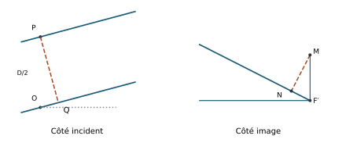
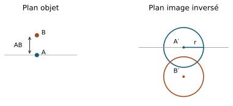
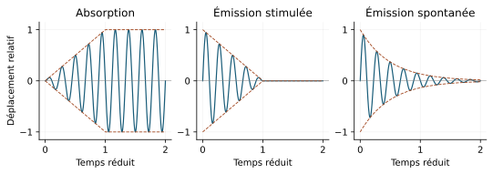
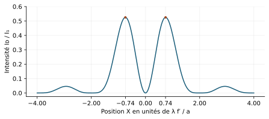
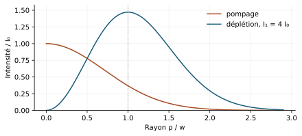
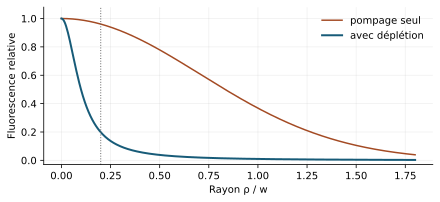
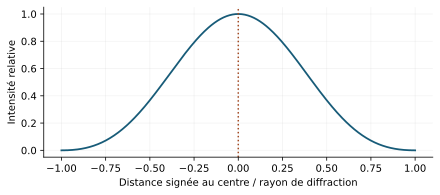

# ENS Lyon et Cachan PC 2010 — Physique PC2 · Corrigé guidé

*Corrigé rédigé par IA, non officiel. Signalez toute erreur.*

**Lecture du rapport du jury** · GPT-6.2 Astra Ultra · vitesse non renseignée

**Rédaction** · GPT-6.2 Astra Ultra · vitesse non renseignée

## Diffraction, fluorescence et microscopies STED et PALM

## A.1 — Focalisation et diffraction

### Question A.1.1.a — Diffraction par une pupille carrée

**Indication.** Écrire le déphasage comme une différence entre les directions d’observation et d’incidence pour chaque coordonnée transverse.

Au point de coordonnées $(X,Y)$ du plan focal image, les cosinus directeurs émergents valent approximativement $X/f'$ et $Y/f'$. Posons $u=\pi a(X/f'-\alpha_i)/\lambda$ et $v=\pi a(Y/f'-\beta_i)/\lambda$. L’intégrale de diffraction se sépare en un produit de deux intégrales sur $[-a/2,a/2]$. Par exemple $a^{-1}\int_{-a/2}^{a/2}\exp[-2iux/a]\,\mathrm dx=\sin u/u$. En notant $\operatorname{sinc}u=\sin u/u$ et $I_0$ la valeur au maximum, on obtient
$$
I(X,Y)=I_0\operatorname{sinc}^2u\operatorname{sinc}^2v.
$$
Le maximum est situé en $(f'\alpha_i,f'\beta_i)$, l’image géométrique de la direction incidente.

### Question A.1.1.b — Frontière du maximum central

**Indication.** Repérer les premiers zéros du sinus cardinal en considérant l’un des deux facteurs à la fois.

Le premier zéro de chaque facteur est atteint pour $u=\pm\pi$ ou $v=\pm\pi$. Les quatre droites sombres délimitent un carré centré sur l’image géométrique. La distance du centre à un côté vaut $\lambda f'/a$ et la largeur totale entre deux côtés opposés vaut $2\lambda f'/a$. La distance au coin est plus grande d’un facteur $\sqrt2$.

### Question A.1.1.c — Translation de l’ouverture

**Indication.** Distinguer l’amplitude, sensible à la position de la pupille, et son module carré.

Pour une translation transverse de vecteur $\boldsymbol d$, le changement de variable dans l’intégrale multiplie l’amplitude diffractée par $e^{i(\boldsymbol k_i-\boldsymbol k_s)\cdot\boldsymbol d}$, qui est de module un. Une translation longitudinale sous illumination plane introduit également une phase commune pour chaque direction du spectre angulaire lors de la propagation vers le plan focal. L’intensité, sa largeur et le centrage par rapport à la direction incidente sont donc conservés dans le montage de Fraunhofer, tant que l’ouverture reste éclairée et qu’aucune autre monture ne rogne le faisceau.

### Question A.1.1.d — Pupille circulaire sous faible ouverture

**Indication.** L’angle indiqué par le sujet est une demi-largeur. Il donne déjà le rayon après multiplication par la focale.

L’ouverture circulaire donne une tache centrale d’Airy. Le premier anneau noir fait un angle d’environ $1{,}2\lambda/D$ avec la direction du maximum. Dans les conditions de Gauss, l’angle se convertit en distance par $r=f'\tan\theta\simeq f'\theta$. Le rayon demandé vaut donc $r\simeq1{,}2\lambda f'/D$.

### Question A.1.2.a — Relation des sinus à forte ouverture

**Indication.** Comparer séparément les projections de phase du côté incident et du côté image. Le théorème de Malus s’applique aux rayons d’une même surface d’onde.

Considérons les chemins stationnaires d’un point fixé de la pupille, $O$ ou $P$, au point image de hauteur $y=F'M$. À incidence axiale, les deux points sont sur la même surface d’onde et leurs chemins optiques jusqu’à $F'$ sont égaux par stigmatisme. Une incidence d’angle $\beta$ ajoute à la phase entrante au bord, relativement au centre, le terme $k(D/2)\sin\beta$. C’est la projection $OQ$ de la figure 2.
Déplaçons aussi l’extrémité image de $F'$ à $M$. Au premier ordre, la variation du chemin stationnaire vaut la projection du déplacement final sur le rayon arrivant en $F'$ (même résultat en remontant les rayons par retour inverse). Les changements du trajet aux interfaces ne contribuent qu’au deuxième ordre par stationnarité. Le rayon axial donne zéro, le rayon du bord haut donne $-y\sin\theta_m$, soit l’opposé de la projection $F'N$. Pour que les deux rayons arrivent en phase en $M$, il faut donc
$$
\frac{D}{2}\sin\beta=y\sin\theta_m,\qquad F'M\simeq\frac{D\beta}{2\sin\theta_m}.
$$
On a linéarisé en $\beta$ et en $y$, en conservant exactement le sinus de la grande inclinaison du rayon marginal.

### Question A.1.2.b — Rayon limite dans l’air

**Indication.** Convertir l’angle de diffraction par la relation valable hors des conditions de Gauss.

Prenons pour petite inclinaison $\beta$ celle du premier zéro de diffraction de l’ouverture circulaire, $\beta\simeq1{,}2\lambda/D$. L’échelle trouvée juste avant transforme ce premier zéro angulaire en
$$
r\simeq\frac{0{,}6\lambda}{\sin\theta_m}.
$$
Une lentille stigmatique à forte ouverture collecte des rayons plus inclinés et diminue le rayon. Dans l’air $\sin\theta_m\leq1$, ce qui donne comme limite idéale $r_{\min}\simeq0{,}6\lambda$.

### Question A.1.2.c — Surface de sortie stigmatique

**Indication.** Écrire d’abord les longueurs optiques, en distinguant verre et air. Le profil méridien seul ne donne pas le nom de la surface tridimensionnelle.

Les points $H$ et $K$ sont sur le même front d’onde plan incident. Le faisceau inverse issu de $F'$ ressort sous forme d’une onde plane. Le théorème de Malus impose donc $(HF')=(KF')$. Posons $\phi=OF'$ et $I=(\rho,z)$ sur la face de sortie. En retranchant le trajet commun dans l’air avant la face d’entrée, le trajet axial vaut $ne+(\phi-e)$ tandis que le trajet marginal vaut $nz+\sqrt{\rho^2+(\phi-z)^2}$. On obtient
$$
\sqrt{\rho^2+(\phi-z)^2}=C-nz,\qquad C=\phi+(n-1)e.
$$
Élevons au carré en gardant la branche $C-nz\geq0$. Avec $z_c=(nC-\phi)/(n^2-1)$ et $a=z_c-e=(\phi-e)/(n+1)$, le résultat est $(z-z_c)^2/a^2-\rho^2/[(n^2-1)a^2]=1$. La face physique appartient à la nappe passant par le sommet axial $z=e$ d’un hyperboloïde de révolution à deux nappes.

## A.2 — Résolution d’un système d’imagerie

### Question A.2.1.a — Image d’un point sur l’axe

**Indication.** Le diamètre limitant est celui de l’ouverture entre les lentilles et la conversion angle-distance relève de la seconde lentille.

Le point source $A$, au foyer objet de $L_1$, donne un faisceau parallèle à l’axe. L’ouverture circulaire le diffracte et $L_2$ observe ce spectre angulaire dans son plan focal image. Il apparaît une tache d’Airy, maximum au point image axial entouré d’anneaux de moins en moins lumineux. Son premier anneau noir a pour rayon $r\simeq1{,}2\lambda f'_2/D$.

### Question A.2.1.b — Deux images et leurs taches

**Indication.** Faire correspondre à chaque point objet son propre faisceau parallèle et son propre centre de diffraction.

Choisissons $A$ sur l’axe et $B$ à la hauteur algébrique $y$ dans le plan focal objet de $L_1$. Le faisceau issu de $B$ sort sous l’angle $-y/f'_1$ et $L_2$ ramène cette direction à la hauteur $y'=-f'_2y/f'_1$. Le grandissement est donc $-f'_2/f'_1$ et la distance $A'B'=(f'_2/f'_1)AB$. Les deux taches ont le même rayon $r$, l’une centrée en $A'$ et l’autre en $B'$.

### Question A.2.1.c — Critère de séparation dans le plan objet

**Indication.** Ramener le rayon défini sur l’écran dans le plan où se trouvent les deux objets.

À la limite du critère donné, $A'B'=r$. En divisant par la valeur absolue du grandissement, on obtient $r_{\rm rés}=r f'_1/f'_2\simeq1{,}2\lambda f'_1/D$. La seconde lentille agrandit de la même façon la séparation des centres et la largeur des taches, d’où la disparition de $f'_2$.

### Question A.2.1.d — Lentille unique équivalente

**Indication.** Conserver le cône de rayons disponible à partir du point objet dans la comparaison des deux montages.

Entre deux plans conjugués, la lentille unique réalise aussi un grandissement transverse. En décomposant la formation d’image en une émission parallèle puis une reconvergence, on retrouve les deux effets du montage précédent. La résolution ramenée à l’objet dépend de la largeur angulaire du cône admissible issu de $A$. Dans le montage à deux lentilles sous faible ouverture, $\theta_m\simeq D/(2f'_1)$. Ainsi, pour le système unique de même ouverture objet, $r_{\rm rés}\simeq0{,}6\lambda/\theta_m$ (angles en radians). Agrandir l’ouverture côté objet ou diminuer la longueur d’onde améliore la résolution.

### Question A.2.2 — Limite de résolution à grande ouverture objet

**Indication.** Utiliser la réversibilité pour transposer dans l’espace objet la résolution trouvée dans l’espace image.

Par retour inverse, le changement de direction du faisceau collimaté produit par deux points objets proches est relié à leur écart par la relation de A.1.2.a, cette fois avec le demi-angle du cône objet de $L_1$. Au seuil où ces directions sont séparées d’environ $1{,}2\lambda/D$, on obtient $r_{\rm rés}\simeq0{,}6\lambda/\sin\theta_m$. Dans l’air et pour une ouverture maximale, la limite de ce critère est $0{,}6\lambda$.

### Question A.2.3 — Échelles de détails visibles

**Indication.** Un ordre de grandeur pour le second cas nécessite d’annoncer un angle compatible avec l’approximation de Gauss.

Pour $\lambda=500\ \mathrm{nm}$, l’idéal à forte ouverture dans l’air donne $0{,}6\lambda\simeq300\ \mathrm{nm}$. En régime de Gauss, $\theta_m\ll1$ et le seuil est plus grand d’un facteur $1/\theta_m$. Par exemple $\theta_m=0{,}1\ \mathrm{rad}$ donne environ $3\ \mu\mathrm m$. La focale et l’ouverture n’étant pas fixées, la valeur paraxiale dépend de l’exemple choisi.

## B.1 — Oscillateur dipolaire classique

### Question B.1.1 — Équation du dipôle classique

**Indication.** Porter le signe de la charge électronique dans la force, même si $e$ désigne une valeur positive.

Le nuage électronique subit le rappel $-m\omega_0^2z$ et la force électrique $-eE(t)$, l’ion positif restant fixe. En projetant le principe fondamental sur $Oz$, on obtient $\ddot z+\omega_0^2z=-eE(t)/m$. Le modèle du sujet omet toute dissipation à ce stade.

### Question B.1.2.a — Passage d’un train d’onde résonant

**Indication.** Pendant l’impulsion, vérifier les conditions initiales de la solution particulière. Après l’impulsion, prendre ses valeurs finales pour nouvelles données de Cauchy.

Posons $\alpha=eE_0/(2m\omega_0)$. Avant le train, $z=0$. Pour $0\leq t\leq\tau$, la solution $z=-\alpha t\sin(\omega_0t)$ vérifie l’équation et les deux conditions de repos initiales. Posons $s=\sin(\omega_0\tau)$ et $c=\cos(\omega_0\tau)$, d’où $z_\tau=-\alpha\tau s$ et $v_\tau=-\alpha(s+\omega_0\tau c)$. Après la coupure, la solution libre est
$$
z(t)=z_\tau\cos[\omega_0(t-\tau)]+\frac{v_\tau}{\omega_0}\sin[\omega_0(t-\tau)].
$$
La position et la vitesse sont continues car la force imposée est bornée au passage des deux bords temporels.

### Question B.1.2.b — Énergie après l’excitation

**Indication.** Calculer l’énergie au dernier instant du train tant que la position et la vitesse sont connues.

Après $\tau$, l’énergie $m(v_\tau^2+\omega_0^2z_\tau^2)/2$ est constante. Les valeurs de la question précédente donnent
$$
E=\frac{m\alpha^2}{2}\big[(\omega_0\tau)^2+2\omega_0\tau sc+s^2\big].
$$
Lorsque $\omega_0\tau\gg1$, $E\simeq m\alpha^2\omega_0^2\tau^2/2$. L’amplitude libre correspondante est voisine de $\alpha\tau$. L’accord de phase pendant la résonance explique la croissance quadratique de l’énergie avec la durée.

### Question B.1.3 — Échange d’énergie selon la phase initiale

**Indication.** Ajouter la solution oscillante initiale et la réponse au train de champ. Comparer l’enveloppe finale à sa valeur au début du train.

Par superposition, pendant le nouveau train le déplacement est $z=(Z_m-\alpha t)\sin(\omega_0t)$. Si $Z_m=+\alpha\tau$, l’enveloppe décroît vers zéro. Juste après la coupure, l’énergie résiduelle est $m\alpha^2\sin^2(\omega_0\tau)/2$, négligeable par rapport à l’énergie initiale dans la limite donnée. Elle s’annule exactement si $\sin(\omega_0\tau)=0$. Pour $Z_m=-\alpha\tau$, les amplitudes s’ajoutent en valeur absolue et l’énergie augmente. La phase relative décide du sens de l’échange avec le champ.

### Question B.1.4 — Perte d’énergie sans onde extérieure

**Indication.** Un dipôle oscillant peut lui-même être une source d’onde.

Le nuage est accéléré et constitue un dipôle oscillant. Ce dipôle émet un rayonnement électromagnétique même en l’absence de champ excitateur. Une description énergétique cohérente inclut le recul ou la réaction du rayonnement, qui amortit l’oscillation. L’énergie mécanique perdue est transportée au loin par le champ.

### Question B.1.5 — Trois modes d’échange avec le champ

**Indication.** Pour chaque faisceau et pour chaque atome, identifier lequel perd de l’énergie et si le champ extérieur est présent.

Partant du repos, l’atome acquiert de l’énergie au cours de l’oscillation forcée résonante, ce qui correspond à l’absorption. Partant de la phase de B.1.3 qui annule l’oscillation, il rend de l’énergie au champ en présence de l’onde appliquée, analogue classique de l’émission stimulée. Enfin, l’oscillation qui s’amortit seule alimente le rayonnement émis sans onde incidente, analogue classique de l’émission spontanée. Dans les deux premiers cas, l’enveloppe croît ou décroît approximativement de façon linéaire pendant le train. Dans le dernier, son amortissement traduit la perte d’énergie.

## B.2 — Populations et déplétion

### Question B.2.1 — Population d’un système à deux niveaux

**Indication.** Écrire une seule fois chaque transition, avec des signes opposés dans les deux bilans.

Le niveau bas perd $BI N_1$ atomes par unité de temps par absorption, et gagne $(A+BI)N_2$ par émissions spontanée et stimulée. Ainsi $\dot N_1=-BI N_1+(A+BI)N_2$ et $\dot N_2=-\dot N_1$. En stationnaire, $BI N_1=(A+BI)N_2$. Avec $N_1+N_2=N$,
$$
N_1=N\frac{A+BI}{A+2BI},\qquad N_2=N\frac{BI}{A+2BI}.
$$
À intensité nulle tout est au niveau bas, tandis qu’à forte intensité les populations s’égalent.

### Question B.2.2.a — Équation de la population fluorescente

**Indication.** Éliminer les niveaux à durée de vie négligeable en conservant les flux de population qui les traversent.

L’absorption $0\to4$ est suivie d’un transfert très rapide $4\to3$. Elle alimente donc le niveau 3 au taux $\beta_{04}I_P N_0$. Les pertes sont les émissions spontanées vers 1 et 2 et l’émission stimulée vers 2. L’absorption inverse depuis 2 est négligeable car $N_2\simeq0$. D’où
$$
\dot N_3=\beta_{04}I_P N_0-(A_{31}+A_{32}+\beta_{23}I_D)N_3.
$$
Les coefficients $\beta$ désignent ici ceux notés B ou bêta sur le schéma des transitions du sujet.

### Question B.2.2.b — Intensité de saturation et déplétion

**Indication.** La lumière sélectionnée est la fluorescence vers le niveau 1. Distinguer son taux d’émission du taux total de sortie du niveau 3.

Il reste $N=N_0+N_3$. Posons $W=\beta_{04}I_P$ et $S=W+A_{31}+A_{32}$. En annulant le bilan précédent, on trouve $N_3=NW/(S+\beta_{23}I_D)$. La raie $3\to1$ émet $A_{31}N_3$ photons par seconde d’énergie $h\nu_{13}$. Il vient
$$
\mathcal P=\mathcal P_0\frac{I_S}{I_S+I_D},\qquad
I_S=\frac{S}{\beta_{23}},\qquad \mathcal P_0=h\nu_{13}A_{31}\frac{NW}{S}.
$$
À pompage fixé, le second laser vide le niveau 3 vers le niveau 2 par émission stimulée. L’intensité de fluorescence à la fréquence sélectionnée décroît, elle est divisée par deux pour $I_D=I_S$.

## C.1 — Profils optiques en microscopie STED

### Question C.1.1.a — Signe du champ derrière une demi-lame

**Indication.** Un retard d’une demi-longueur d’onde correspond à une opposition de phase quel que soit le signe choisi pour l’exponentielle temporelle.

La lame remplace une épaisseur $e$ d’air par du verre et accroît le chemin optique de $(n-1)e=\lambda_D/2$. Elle apporte un déphasage de $\pi$ modulo $2\pi$, donc multiplie l’amplitude par $-1$. Dans le plan de la pupille, $s_1(x,t)=-s_0(t)$ pour $-a/2<x<0$ et $s_1(x,t)=s_0(t)$ pour $0<x<a/2$. La valeur au bord mathématique $x=0$ est sans influence sur l’intégrale.

### Question C.1.1.b — Diffraction des deux demi-fentes

**Indication.** Écrire les intégrales avec leurs signes respectifs, puis distinguer la valeur limite centrale des zéros ordinaires aux multiples de $\pi$.

Posons $K=2\pi X/(\lambda_D f'_1)$ et $u=Ka/4=\pi aX/(2\lambda_D f'_1)$. À un facteur près, l’amplitude focale est
$$
\int_0^{a/2}e^{-iKx}\,\mathrm dx-\int_{-a/2}^0e^{-iKx}\,\mathrm dx
=-\frac{4i}{K}\sin^2(Ka/4).
$$
On trouve donc $I_D(X)=I_1[\sin^2u/u]^2$. La courbe est paire. Ses zéros sont l’origine et $u=j\pi$, soit $X=2j\lambda_D f'_1/a$ pour $j$ entier non nul. Les premiers maxima de chaque côté vérifient $\tan u=2u$, soit $u\simeq\pm1{,}17$ et $X\simeq\pm0{,}74\lambda_Df'_1/a$. Leur hauteur est d’environ $0{,}53 I_1$. Au voisinage de l’origine, $I_D\simeq I_1[\pi a X/(2\lambda_D f'_1)]^2$. Les lobes éloignés décroissent.

### Question C.1.1.c — Nœud de déplétion au foyer

**Indication.** Associer à chaque point de la moitié droite son symétrique dans la moitié gauche.

Sur l’axe, la propagation jusqu’au foyer n’introduit aucune différence de marche entre deux éléments symétriques des demi-fentes. Leurs amplitudes incidentes ont même module et des phases opposées. Toutes les paires se compensent, l’amplitude totale s’annule et $I_D(0)=0$.

### Question C.1.2.a — Rayon du faisceau de pompage

**Indication.** Lire directement le rayon dans l’exponentielle et vérifier la définition adoptée pour le rayon en partie A.

Le profil $I_P(\rho)=I_0e^{-\rho^2/w_0^2}$ tombe à $I_0/e$ en $\rho=w_0$. Cette largeur radiale caractérise la tache du faisceau de pompage. La valeur $w_0=0{,}5\lambda_P$ est du même ordre que la taille $0{,}6\lambda_P$ du premier minimum d’Airy à forte ouverture. Les deux coefficients se rapportent à des profils et à des critères de largeur différents.

### Question C.1.2.b — Phase hélicoïdale

**Indication.** Relier la phase à l’épaisseur optique, puis apparier les points d’azimuts $\theta$ et $\theta+\pi$.

Une lame de phase en spirale peut imposer un retard qui progresse de zéro à $2\pi$ sur un tour. Par exemple, dans l’air, une épaisseur $e(\theta)=e_0+\lambda_D\theta/[2\pi(n-1)]$ sur une branche $0\leq\theta<2\pi$ donne ce comportement modulo $2\pi$. Sur l’axe, aux points opposés d’un même cercle correspondent des amplitudes égales et des phases séparées de $\pi$. Leurs contributions étant opposées, le centre du faisceau de déplétion est noir.

### Question C.1.2.c — Pompage central et couronne de déplétion

**Indication.** Factoriser l’exponentielle commune avant de chercher le croisement et différencier la seule courbe qui possède un maximum hors de l’origine.

Notons $u=\rho/w$ pour $w=w_0=w_1$. Le pompage $I_P=I_0e^{-u^2}$ est maximal au centre puis décroît. La déplétion $I_D=I_1u^2e^{-u^2}$ part de zéro, croît jusqu’à $u=1$ puis décroît, car sa dérivée est proportionnelle à $u(1-u^2)$. En $\rho=w$, les intensités sont $I_0/e$ et $I_1/e$. Leurs courbes se coupent en $\rho=w\sqrt{I_0/I_1}<w$ si $I_1>I_0$.

### Question C.1.2.d — Comparaison des deux profils de déplétion

**Indication.** Comparer le comportement central, la position et la hauteur du maximum, puis les ailes des deux courbes.

Les deux modèles prédisent une intensité nulle au centre et une remontée quadratique. Dans la fente, la première bosse se trouve à $0{,}74\lambda_D f'_1/a$, avec une hauteur proche de $0{,}53I_1$. Dans le modèle tridimensionnel, la couronne culmine à $w_1$, avec une hauteur $I_1/e\simeq0{,}37I_1$. Pour une grande ouverture, la largeur prévue en extrapolant la fente est d’ordre $\lambda_D$, compatible en ordre de grandeur avec $w_1=w_0\simeq0{,}5\lambda_P$ lorsque les longueurs d’onde sont voisines. Le modèle de la fente était établi en régime paraxial et présente en outre des zéros secondaires à $2\lambda_D f'_1/a$ et ses multiples. Le profil gaussien annulaire décroît sans ces zéros. Les coefficients exacts diffèrent donc pour des raisons physiques.

## C.2 — Taille de la zone fluorescente

### Question C.2.1 — Zone émettrice de fluorescence

**Indication.** Superposer la courbe de déplétion et son seuil, puis tenir compte également du pompage hors du centre.

Au centre le pompage est maximal et $I_D=0$, d’où une fluorescence égale à $\mathcal P_0$. Dès que la déplétion croît jusqu’à $I_D\gg I_S$, le facteur $1/(1+I_D/I_S)$ supprime la fluorescence. Puisque $I_1\gg I_S$, cette suppression intervient bien avant le rayon $w_1$, à l’intérieur de la tache de pompage. Plus loin, le faisceau de pompage devient lui-même faible. L’essentiel de la lumière détectée vient donc d’une petite zone centrale connue. Le balayage de cette zone forme l’image.

### Question C.2.2 — Rayon d’émission résiduelle

**Indication.** Développer l’intensité de déplétion autour de son zéro et ne garder que la première racine positive du seuil.

Pour $u=\rho/w_1\ll1$, $e^{-u^2}=1-u^2+O(u^4)$ et $I_D=I_1u^2+O(I_1u^4)$. La frontière centrale définie par $I_D=4I_S$ est donc donnée par
$$
r_F\simeq2w_1\sqrt{\frac{I_S}{I_1}} .
$$
Le développement est cohérent lorsque $4I_S/I_1\ll1$. Au seuil, la puissance fluorescente d’une molécule vaut le cinquième de sa valeur sans déplétion, si le pompage varie peu localement.

### Question C.2.3 — Application à un faisceau de 250 nm

**Indication.** Le facteur d’amélioration sur le rayon est proportionnel à la racine du rapport d’intensités.

Avec $w_1=0{,}25\ \mu\mathrm m$ et $I_1=100I_S$, on trouve $r_F\simeq0{,}050\ \mu\mathrm m=50\ \mathrm{nm}$. Le diamètre de la zone vaut donc environ $100\ \mathrm{nm}$. Deux molécules contiguës de dimension nanométrique ne sont pas individualisées à cette échelle, malgré le gain par rapport à la diffraction conventionnelle.

## D — Microscopie PALM

### Question D.1 — Écart typique des molécules

**Indication.** Passer de la densité surfacique à une longueur en prenant une racine carrée.

Chaque molécule occupe en moyenne une aire de l’ordre de $1/n$. Une distance typique vaut donc $n^{-1/2}=10^{-6}\ \mathrm{cm}=10\ \mathrm{nm}$ pour $n=10^{12}\ \mathrm{cm^{-2}}$. Cet écart est nettement inférieur aux quelques centaines de nanomètres de la résolution d’un microscope visible standard. Les images de deux voisines se superposent.

### Question D.2.1 — Comptage des photons d’activation

**Indication.** Diviser l’énergie totale par l’énergie d’un photon.

La surface $S_0$ orthogonale au faisceau reçoit l’énergie $I_{\rm UV}S_0T$. Chaque photon apporte $hc/\lambda_{\rm UV}$. Le nombre moyen qui traverse la surface pendant l’éclairement vaut donc $N=I_{\rm UV}S_0T\lambda_{\rm UV}/(hc)$.

### Question D.2.2 — Molécules photoactivées

**Indication.** Compter d’abord les cibles dans l’échantillon, puis la fraction de sa surface qu’elles représentent.

La surface contient $nS_0$ molécules. L’aire efficace cumulée est $S_1=nS_0\sigma$. Dans le modèle de cibles diluées sous un éclairement uniforme, la fraction de photons qui rencontrent une cible est $S_1/S_0=n\sigma$. Tant que la fraction convertie est très faible et que les doubles touches sont négligeables,
$$
N_B=N\frac{S_1}{S_0}=n\sigma I_{\rm UV}S_0T\frac{\lambda_{\rm UV}}{hc}.
$$
Il s’agit d’une espérance, et non d’un nombre imposé à chaque tirage.

### Question D.2.3 — Durée d’une phase d’activation

**Indication.** Diviser la densité souhaitée par la densité initiale pour obtenir la probabilité de conversion pendant l’impulsion.

Le taux de conversion par molécule vaut $\sigma I_{\rm UV}/E_{\rm ph}$. À $250\ \mathrm{nm}$, $E_{\rm ph}\simeq7{,}9\times10^{-19}\ \mathrm J$. En utilisant les aires en $\mathrm{cm^2}$, $\sigma I_{\rm UV}=10^{-16}\times10^{-3}=10^{-19}\ \mathrm W$ pour une molécule. Le taux vaut donc environ $0{,}13\ \mathrm{s^{-1}}$. La fraction voulue est $10^6/10^{12}=10^{-6}$, d’où $T\simeq7{,}9\times10^{-6}\ \mathrm s$, soit environ $8\ \mu\mathrm s$.

### Question D.2.4 — Distance au sein du sous-ensemble activé

**Indication.** Reprendre la relation surfacique de D.1 avec la seule population activée.

La nouvelle densité est $10^6\ \mathrm{cm^{-2}}$, d’où une distance caractéristique de $10^{-3}\ \mathrm{cm}=10\ \mu\mathrm m$. Cet écart dépasse largement le rayon de diffraction ramené à l’objet. En règle générale les taches individuelles de ce sous-ensemble peuvent être distinguées, même si une distribution aléatoire laisse possibles quelques voisines plus proches.

### Question D.3.1 — Centre d’une image de molécule unique

**Indication.** Une tache étendue peut posséder un centre de symétrie très précisément déterminé.

Le long de tout diamètre, l’intensité présente un pic central en $A'$, symétrique, qui tombe vers zéro au bord de la tache retenue. En échantillonnant suffisamment cette répartition, on peut en estimer le centre par son barycentre ou par ajustement d’un profil centré. Dans le modèle idéal on localise ainsi une molécule isolée avec une incertitude bien inférieure à la largeur du pic, puis on ramène les coordonnées au plan objet par le grandissement connu.

### Question D.3.2 — Information apportée par une détection

**Indication.** Échanger le rôle du point de détection connu et celui du centre inconnu dans la même inégalité de distance.

Par l’hypothèse de support retenue dans le sujet, le photon détecté en $A''$ est à une distance de $A'$ inférieure ou égale à $\rho_{\rm diff}=|\gamma|\lambda_F$. La distance étant symétrique, le centre inconnu $A'$ est donc quelque part dans le disque de centre $A''$ et de même rayon $|\gamma|\lambda_F$, dans le plan du détecteur. Un photon isolé laisse une large incertitude.

### Question D.3.3 — Accumulation de photons indépendants

**Indication.** Comparer une ou deux détections isolées avec un histogramme formé de nombreux événements.

La densité de probabilité d’une détection est proportionnelle à l’intensité locale. Si l’on collecte un grand nombre de photons indépendants issus de la même molécule fixe, les proportions enregistrées dans les pixels approchent cette répartition. Les fluctuations relatives de comptage diminuent avec le nombre de photons. Il faut assez de détections dans les zones utilisées pour localiser le centre.

### Question D.4 — Précision de localisation

**Indication.** Utiliser le nombre de photons recueillis, qui est ici pris égal au nombre total émis.

La relation fournie porte sur le plan objet. Pour $N=10^6$ photons effectivement détectés, $\sqrt{N}=10^3$ et $\rho_{\rm rés}=600\ \mathrm{nm}/10^3=0{,}60\ \mathrm{nm}$. Ce chiffre suppose la collecte de tous les photons émis dans le modèle et représente une incertitude statistique de localisation.

### Question D.5 — Acquisition par sous-populations successives

**Indication.** Les molécules d’une même séquence sont imagées en parallèle dans le champ. Compter les séquences, puis multiplier par leur durée.

Une fois les molécules de la première image localisées puis photoblanchies, on active une nouvelle petite fraction des molécules restées dans l’état A. On repère leurs centres et on les ajoute à l’image reconstruite. Idéalement, à $10^6$ molécules localisées par $\mathrm{cm^2}$ et par séquence, il faut de l’ordre de $10^{12}/10^6=10^6$ séquences. À environ une seconde par séquence, la durée est de l’ordre de $10^6\ \mathrm s$, soit une douzaine de jours. Cette estimation suppose une population activée comparable à chaque passe. La fin aléatoire de l’acquisition et les temps de commande peuvent l’allonger.

### Question D.6 — Séparation des localisations

**Indication.** Comparer l’incertitude finale dans le plan objet à l’espacement initial, après avoir vérifié l’isolement des émetteurs de chaque séquence.

Pour deux molécules typiquement espacées de $10\ \mathrm{nm}$, la précision d’environ $0{,}6\ \mathrm{nm}$ est suffisante pour séparer leurs positions estimées. Les molécules sont en général détectées dans des séquences différentes, ce qui évite de superposer leurs taches avant l’ajustement. Il s’agit d’une conclusion pour l’espacement typique, dans les conditions idéales de comptage du sujet.

### Question D.7 — Conditions sur l’échantillon

**Indication.** Relier chaque contrainte au principe de la méthode : activer peu de sources, localiser chacune, puis superposer des images prises à des instants différents.

Le marquage doit être photoactivable de façon suffisamment rare et fournir assez de photons de fluorescence avant photoblanchiment. L’échantillon doit garder les positions relatives de ses molécules pendant la reconstruction. Les déplacements ou la dérive de l’image pendant l’acquisition doivent être inférieurs à la précision visée, ou être corrigés à cette précision. La couche mince et la séparation spectrale de la fluorescence permettent d’associer chaque tache à un seul émetteur du plan et de limiter le fond. Avec la durée estimée, ces exigences sont particulièrement fortes pour un objet vivant en évolution.
