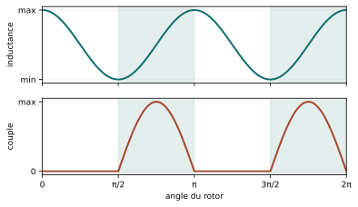
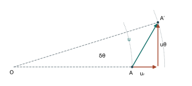
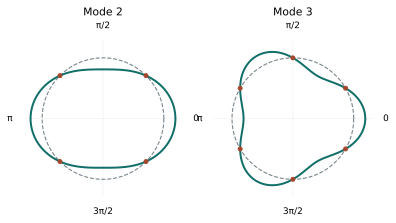
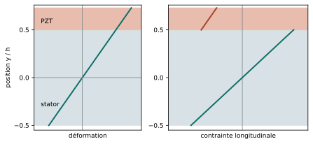
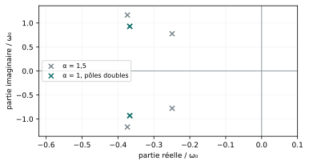

# X-ENS · PSI · Modélisation 2010 — corrigé guidé

*Corrigé rédigé par IA, non officiel. Signalez toute erreur.*

**Rédaction** · GPT-6.2 Astra Ultra · vitesse non renseignée · 25 novembre 2026

**Contrôle actif des vibrations dans les machines à réluctance variable.** Le cahier CX0612 suit la chaîne qui relie le courant dans une dent, la pression magnétique sur le stator et le bruit de la couronne. Le prototype emploie une paire de lames piézoélectriques pour amortir le mode de déformation dominant.

## Repères de résolution

À chaque changement de modèle, identifier ce que mesure la variable choisie. Le flux de la première partie traverse une spire. Les amplitudes de la deuxième partie mesurent une déformation répartie sur tout le stator. La grandeur d’identification de la dernière partie est une accélération, tandis que le retour positif agit sur la position.

## I. Circuit magnétique et pression sur le stator

### Question 1 · Rotor de la machine

**Indication.** Repérer les pièces qui conduisent le courant et celles qui tournent.

#### Solution

Le rotor denté est une pièce ferromagnétique passive. Le courant circule dans les enroulements du stator. Les contacts balais–collecteur d’un moteur à courant continu classique, soumis au frottement, aux étincelles et à l’usure, disparaissent. Le rotor, dépourvu de bobinage alimenté, supporte aussi plus facilement les grandes vitesses.

### Question 2 · Flux dans une spire

**Indication.** Conserver le flux entre les deux sections, puis sommer les deux chutes de potentiel magnétique.

#### Solution

Dans l’approximation magnétostatique, $\oint_{\mathcal C}\mathbf H\cdot d\boldsymbol\ell=nI$. Sur le tube fermé, $H_{\rm fer}l_m+H_{\rm air}e=nI$. L’absence de fuite impose $\Phi=B_{\rm fer}S_s=B_{\rm air}S_E$. Avec $B_{\rm fer}=\mu_0\mu_rH_{\rm fer}$ et $B_{\rm air}=\mu_0H_{\rm air}$,

$$
\Phi=\frac{\mu_0 S_s nI}{l_m/\mu_r+[S_s/S_E(\theta)]e(\theta)}.
$$

La longueur $e$ compte **les deux entrefers** de la figure 4.

### Question 3 · Réluctance et inductance

**Indication.** À l’alignement des dents, la surface en regard est maximale.

#### Solution

$\mathcal R=l_m/(\mu_0\mu_r S_s)+e/(\mu_0 S_E)$ dépend de l’angle. Comme $\mathcal R\Phi=nI$ et $LI=n\Phi$, $L=n^2/\mathcal R$. Entre $0,\pi/2,\pi,3\pi/2,2\pi$, l’entrefer total prend successivement les valeurs minimale, maximale, minimale, maximale, minimale. Il croît puis décroît sur chaque demi-tour. La surface $S_E$ et l’inductance suivent la variation inverse. Ainsi

$$
L_{\min}=\frac{n^2}{l_m/(\mu_0\mu_r S_s)+e_{\max}/(\mu_0 S_{E,\min})},\qquad
L_{\max}=\frac{n^2}{l_m/(\mu_0\mu_r S_s)+e_{\min}/(\mu_0 S_{E,\max})}.
$$

Une section minimale nulle se lit par passage à la limite dans ce modèle simplifié.

### Question 4 · Équation électrique

**Indication.** La tension induite et la chute de tension inductive ont des signes opposés.

#### Solution

La f.é.m. induite vaut $\mathcal E=-n\,d\Phi/dt$ (loi de Faraday–Lenz). En convention récepteur, $U=R I-\mathcal E=RI+n\dot\Phi$. Ici $n\Phi=L(\theta)I$, d’où $U=RI+L\dot I+I L'(\theta)\dot\theta$.

### Question 5 · Bilan de puissance

**Indication.** La variation de l’énergie magnétique s’ajoute au travail mécanique livré au rotor.

#### Solution

L’entrée vaut $P_{\rm élec}=UI$, la dissipation $P_J=RI^2$, la puissance mécanique $P_{\rm méc}=C\dot\theta$. L’énergie du champ est $W_m(\Phi,\theta)=\int_0^\Phi nI(\varphi,\theta)\,d\varphi$. La conservation de l’énergie donne $UI=RI^2+C\dot\theta+dW_m/dt$. Tous les termes sont des watts.

### Question 6 · Variables naturelles du champ

**Indication.** Développer la différentielle totale dans les variables flux et position.

#### Solution

En éliminant $UI-RI^2$ par la loi des mailles, $nI\,d\Phi=C\,d\theta+dW_m$. Les variations indépendantes de $\Phi$ et de $\theta$ donnent $I=(1/n)(\partial W_m/\partial\Phi)_\theta$ et $C=-(\partial W_m/\partial\theta)_\Phi$. Le signe du couple se lit à **flux fixé**.

### Question 7 · Couple d’alignement

**Indication.** Avant de dériver à flux fixé, remplacer le courant par sa valeur en fonction du flux.

#### Solution

Dans le matériau linéaire, $W_m=n^2\Phi^2/(2L)$. Sa dérivée à flux fixé donne $C=n^2\Phi^2 L'/(2L^2)=I^2L'/2$. À courant constant, $\langle C\rangle=I^2[L(2\pi)-L(0)]/(4\pi)=0$. Le signe du courant n’inverse pas cette force d’alignement.

### Question 8 · Intervalles alimentés

**Indication.** Intégrer la dérivée de l’inductance sur ses deux arcs croissants.

#### Solution

Pour le sens croissant de $\theta$ de la figure 4, injecter $I_{\max}$ sur $(\pi/2,\pi)$ et $(3\pi/2,2\pi)$, puis couper sur les deux autres quarts de tour. La valeur aux frontières n’affecte pas la moyenne. Sur chaque arc utile, $\int C\,d\theta=I_{\max}^2(L_{\max}-L_{\min})/2$. Ainsi $\langle C\rangle=I_{\max}^2(L_{\max}-L_{\min})/(2\pi)$.

### Question 9 · Force volumique

**Indication.** Transformer le produit vectoriel du rotationnel avec le champ.

#### Solution

Maxwell–Ampère s’écrit $\nabla\times\mathbf H=\mathbf j+\partial_t\mathbf D$. Dans l’ARQS du sujet, $\mathbf j\simeq\nabla\times\mathbf H$. Comme $\mathbf B=\mu\mathbf H$ et $(\nabla\times\mathbf H)\times\mathbf H=(\mathbf H\cdot\nabla)\mathbf H-\nabla(H^2/2)$, la force donnée devient

$$
\mathbf f=\mu(\mathbf H\cdot\nabla)\mathbf H-\nabla(\mu H^2/2).
$$

La dérivée de $\mu$ est indispensable au voisinage de l’interface.

### Question 10 · Divergence du flux

**Indication.** Appliquer la dérivation d’un produit à chaque composante cartésienne.

#### Solution

Maxwell–Thomson donne $\nabla\cdot\mathbf B=\nabla\cdot(\mu\mathbf H)=0$. Pour chaque $i=x,y,z$, $\nabla\cdot(\mu H_i\mathbf H)=\mu(\mathbf H\cdot\nabla)H_i+H_i\nabla\cdot(\mu\mathbf H)$. Le second terme s’annule. Les trois divergences sont donc les composantes de $\mu(\mathbf H\cdot\nabla)\mathbf H$.

### Question 11 · Traction sur une surface

**Indication.** Écrire le produit du tenseur magnétique par la normale locale.

#### Solution

Avec $\mathbf T=\mu(\mathbf H\otimes\mathbf H-H^2\mathbf I/2)$, le théorème de la divergence donne $d\mathbf F=\mathbf T\mathbf n\,dS=\mu[H_n\mathbf H-(H_n^2+H_t^2)\mathbf n/2]dS$. La composante suivant la binormale, orthogonale au plan de $\mathbf n$ et $\mathbf H$, est nulle. Ainsi $dF_n=\mu(H_n^2-H_t^2)dS/2$ et $dF_t=\mu H_n H_t\,dS$.

### Question 12 · Relations de passage

**Indication.** Choisir un pilulier pour le flux et un contour rectangulaire pour la circulation.

#### Solution

Le flux de $\mathbf B$ à travers un pilulier traversant l’interface est nul. Lorsque sa hauteur tend vers zéro, $B_{n,\rm air}=B_{n,\rm fer}=B_n$. Un rectangle de circulation de $\mathbf H$ franchissant l’interface donne $\mathbf n\times(\mathbf H_{\rm air}-\mathbf H_{\rm fer})=\mathbf j_{\rm surf}$. La nappe de courant étant négligée, $H_{t,\rm air}=H_{t,\rm fer}=H_t$.

### Question 13 · Pression à l’interface

**Indication.** Soustraire les deux tractions calculées avec une même normale allant du fer vers l’air.

#### Solution

Sur la fine couche, les contributions latérales s’annulent à la limite. La composante tangentielle de chaque traction vaut $B_nH_t$, donc son saut est nul. La composante normale est $(B_n^2/\mu-\mu H_t^2)/2$. Le résultat est $d\mathbf F=p_n\mathbf n\,dS$, avec

$$
p_n=\tfrac12\big[B_n^2(1/\mu_{\rm air}-1/\mu_{\rm fer})+H_t^2(\mu_{\rm fer}-\mu_{\rm air})\big].
$$

Comme $\mu_{\rm fer}>\mu_{\rm air}$, la pression est positive ou nulle et l’effort va du stator vers l’entrefer.

### Question 14 · Approximation de forte perméabilité

**Indication.** Comparer les deux termes de la pression en utilisant le champ tangent dans le fer.

#### Solution

Posons $m=\mu_{\rm fer}/\mu_{\rm air}\simeq500$, $B_{t,\rm fer}=\mu_{\rm fer}H_t$. Alors $p_n=(1-1/m)[B_n^2+B_{t,\rm fer}^2/m]/(2\mu_{\rm air})$. Dans le tube de flux de la dent, où $B_{t,\rm fer}^2\ll m B_n^2$, on obtient $p_n\simeq B_n^2/(2\mu_{\rm air})$. L’hypothèse sur l’orientation intervient si l’on veut employer cette formule près d’un point où $B_n$ devient très petit.

## II. Déformations de la couronne

### Question 15 · Inextensibilité de la ligne moyenne

**Indication.** Développer le produit du rayon et de l’élément d’angle déformés.

#### Solution

Au premier ordre, $ds'=(R+\delta R)(d\theta+d(\delta\theta))=R\,d\theta+\delta R\,d\theta+R\,d(\delta\theta)$. L’égalité $ds'=ds=R\,d\theta$ donne $\delta R+R\,\partial_\theta\delta\theta=0$. Un éventuel terme de pente radiale dans la longueur de l’arc est d’ordre deux.

### Question 16 · Déplacements radial et tangent

**Indication.** Projeter le segment allant du point initial au point déplacé sur la base locale.

#### Solution

Au premier ordre, $\mathbf u=\overrightarrow{AA'}=\delta R\,\mathbf e_R+R\delta\theta\,\mathbf e_\theta$. Ainsi $u_R=\delta R$ et $u_\theta=R\delta\theta$. La condition précédente s’écrit $u_R+\partial_\theta u_\theta=0$.

### Question 17 · Décomposition du déplacement

**Indication.** L’angle est périodique et l’intégration de chaque harmonique introduit un facteur inverse de son ordre.

#### Solution

À temps fixé, la couronne est fermée. Le déplacement régulier est $2\pi$-périodique et admet la série de Fourier indiquée. En intégrant $\partial_\theta u_\theta=-u_R$ avec constante nulle, on trouve

$$
u_\theta=\sum_{n\ge1}\frac{-A_n(t)\sin(n\theta)+B_n(t)\cos(n\theta)}{n}.
$$

La constante écartée représenterait une rotation globale infinitésimale.

### Question 18 · Efforts généralisés

**Indication.** Associer à chaque amplitude la projection de la force sur son champ de déplacement.

#### Solution

La puissance est $P_{\rm ext}=R\int_0^{2\pi}(f_R\dot u_R+f_\theta\dot u_\theta)d\theta=\sum_n(F_{A_n}\dot A_n+F_{B_n}\dot B_n)$. En posant $c_n=\cos n\theta$ et $s_n=\sin n\theta$,

$$
F_{A_n}=R\int_0^{2\pi}(f_R c_n-f_\theta s_n/n)\,d\theta,\qquad F_{B_n}=R\int_0^{2\pi}(f_Rs_n+f_\theta c_n/n)\,d\theta.
$$

### Question 19 · Énergie cinétique

**Indication.** Intégrer les deux composantes de la vitesse avant d’appliquer l’orthogonalité.

#### Solution

Pour une section de masse $dm=\rho R\,d\theta$, on garde $dE_c=(\dot u_R^2+\dot u_\theta^2)dm/2$. Les produits de modes différents et les produits sinus–cosinus s’intègrent à zéro. Chaque carré de sinus ou de cosinus s’intègre à $\pi$. Il reste $E_c=\tfrac12\sum_{n\ge1}m_n(\dot A_n^2+\dot B_n^2)$, où $m_n=\rho R\pi(1+n^{-2})$.

### Question 20 · Deux équations par ordre

**Indication.** Prendre les dérivées des énergies et identifier les coefficients de vitesses modales indépendantes.

#### Solution

Le théorème de l’énergie cinétique donne $\dot E_c=P_{\rm ext}+P_{\rm int}=P_{\rm ext}-\dot E_p$. L’énergie potentielle fournie est $E_p=\frac12\sum_n k_n(A_n^2+B_n^2)$ avec $k_n=R C_p\pi(n^2-1)^2$ (constante de raideur du sujet). En isolant chaque mode, $m_n\ddot A_n+k_n A_n=F_{A_n}$ et $m_n\ddot B_n+k_n B_n=F_{B_n}$. Les deux polarisations d’un même ordre ont les mêmes coefficients.

### Question 21 · Pulsation propre

**Indication.** Porter une solution harmonique dans l’équation libre.

#### Solution

Pour une amplitude non nulle, $k_n-m_n\omega_n^2=0$, soit $\omega_n=\sqrt{C_p/\rho}\,(n^2-1)/\sqrt{1+n^{-2}}$. La pulsation du premier ordre est nulle. Pour les grands ordres, la croissance de ce modèle de couronne mince est quadratique.

### Question 22 · Premier mode

**Indication.** Revenir à une base cartésienne fixe pour interpréter les composantes polaires.

#### Solution

Pour $n=1$, $u_R=A_1\cos\theta+B_1\sin\theta$ et $u_\theta=-A_1\sin\theta+B_1\cos\theta$. En recomposant, $\mathbf u=A_1\mathbf e_x+B_1\mathbf e_y$, indépendant du point. C’est une translation rigide de la ligne moyenne. La distance entre deux de ses points reste constante.

### Question 23 · Fréquences et modèle à dents

**Indication.** Appliquer le même coefficient de fréquence à chacun des quatre facteurs de forme.

#### Solution

Avec $\sqrt{C_p/\rho}/(2\pi)=1362$ Hz, les valeurs $f_n$ pour $n=2,3,4,5$ sont respectivement **3,65, 10,34, 19,82 et 32,05 kHz**. La figure 9 indique **3,6, 10,3, 16,4 et 22,3 kHz** pour le calcul par éléments finis avec dents. Les deux premiers écarts sont voisins de 1,5 % et 0,4 %. Les deux suivants atteignent environ 21 % et 44 %. La répartition réelle de la masse et de la raideur des dents devient importante quand la longueur d’onde diminue.

### Question 24 · Formes à deux et trois lobes

**Indication.** Chercher successivement les valeurs $1,-1,0$ du cosinus.

#### Solution

Pour $n=2,3$, $u_R=u_0\cos n\theta$ et le rayon tracé est $R+u_0\cos n\theta$. Les maximums sont en $\theta=2k\pi/n$, les minimums en $(2k+1)\pi/n$, les nœuds en $(2k+1)\pi/(2n)$, modulo $2\pi$. Ainsi le mode 2 a quatre nœuds séparés d’un quart de tour, le mode 3 six nœuds séparés d’un sixième de tour. Les directions d’expansion alternent avec les directions de contraction, comme sur la simulation avec dents.

### Question 25 · Réponse à une dent

**Indication.** La projection de la force au point zéro sélectionne le cosinus de chaque ordre.

#### Solution

$F_{A_n}=Rf_0\sin\omega t$ et $F_{B_n}=0$. La réponse harmonique forcée hors résonance est $A_n=Rf_0\sin\omega t/[m_n(\omega_n^2-\omega^2)]$, $B_n=0$. Pour $\omega_n>0$, si l’on impose **aussi** le départ au repos dans ce modèle sans amortissement, il faut remplacer le sinus du numérateur par $\sin\omega t-(\omega/\omega_n)\sin\omega_n t$. La composante libre persiste. À résonance la réponse contient $-[Rf_0/(2m_n\omega_n)]t\cos\omega_n t$. Le mode rigide $\omega_1=0$ vérifie directement $\ddot A_1=Rf_0\sin\omega t/m_1$.

### Question 26 · Deux dents opposées

**Indication.** Le déphasage spatial d’un demi-tour multiplie un mode par $(-1)^n$.

#### Solution

La seconde masse de Dirac ajoute $Rf_0\cos(n\pi)\sin\omega t$ au premier effort. Ainsi $F_{A_n}=Rf_0[1+(-1)^n]\sin\omega t$, et $F_{B_n}=0$. Pour $n$ impair, la réponse est nulle au repos. Pour $n$ pair, l’amplitude forcée est $2R|f_0|/[m_n|\omega_n^2-\omega^2|]$, double de celle d’une seule dent. La même addition vaut pour les termes libres imposés par les conditions initiales.

## III. Lames piézoélectriques

### Question 27 · Travaux reçus par l’échantillon

**Indication.** Associer la contrainte au déplacement des faces et la tension à la charge déplacée.

#### Solution

Notons $\mathcal V_0=l_0e\,dz$. Sous traction, la variation de distance des faces est $dl=l_0\,d\lambda$. Le travail reçu vaut $\delta W_m=(\sigma e\,dz)dl=\mathcal V_0\sigma\,d\lambda$. Le courant de déplacement traverse l’aire $l_0\,dz$, donc $dq=l_0\,dz\,dD$. Avec $V=Ee$, $\delta W_e=V\,dq=\mathcal V_0 E\,dD$. Ces expressions sont celles des petites déformations et des grandeurs électriques orientées conjointement.

### Question 28 · Énergie interne volumique

**Indication.** Exprimer la chaleur réversible à partir de l’entropie avant de diviser par le volume de référence.

#### Solution

Pour l’échantillon, $dU=\delta Q+\delta W_m+\delta W_e$ et $dS=\delta Q_{\rm rév}/T$. Avec $U=\mathcal V_0u$ et $S=\mathcal V_0s$, il vient $du=T\,ds+\sigma\,d\lambda+E\,dD$. Le volume de référence est constant.

### Question 29 · Potentiel thermodynamique

**Indication.** Développer chacune des deux différentielles de produit.

#### Solution

On utilise $g=u-Ts-DE$. Après soustraction de $T\,ds+s\,dT+D\,dE+E\,dD$, on obtient $dg=-s\,dT+\sigma\,d\lambda-D\,dE$. Les variables naturelles sont donc $T,\lambda,E$.

### Question 30 · Réciprocité piézoélectrique

**Indication.** Lire les coefficients de $d\lambda$ et de $dE$ comme dérivées d’un potentiel.

#### Solution

À température fixée, $\sigma=\partial_\lambda g$ et $-D=\partial_Eg$. L’égalité des dérivées croisées impose $(\partial_E\sigma)_\lambda=-(\partial_\lambda D)_E$. Les lois proposées $\sigma=Y(\lambda-\alpha E)$ et $D=\varepsilon_s E+\alpha Y\lambda$ donnent respectivement $-\alpha Y$ et $+\alpha Y$ avant le signe moins. À champ nul on retrouve la loi de Hooke, à déformation nulle la loi diélectrique.

### Question 31 · Tension de déformation libre

**Indication.** Convertir le pourcentage puis calculer le champ et la tension séparément.

#### Solution

La condition $\sigma=0$ donne $\lambda=\alpha E$. Pour $\lambda=0{,}01\,\%=10^{-4}$, $\alpha=2\,10^{-10}$ m/V et $e=0{,}5$ mm, $E=5\,10^5$ V/m et $V=Ee=250$ V. C’est une tension importante pour une déformation de cent microdéformations. Le champ de 500 V/mm dépasse d’ailleurs la limite de 300 V/mm indiquée plus loin pour les lames du prototype.

### Question 32 · Contraintes des deux matériaux

**Indication.** Prolonger dans les deux matériaux la droite passant par la ligne neutre et la jonction.

#### Solution

La droite $\lambda(y)$ vaut zéro à $y=0$ et $\lambda_i$ à $y=h/2$, donc $\lambda(y)=2\lambda_i y/h$. Dans le stator, $\sigma_s=2Y_s\lambda_i y/h$ pour $-h/2\le y\le h/2$. Dans la lame, $\sigma_p=Y_p(2\lambda_i y/h-\alpha V/e)$ pour $h/2\le y\le h/2+e$. Le champ électrique concerne uniquement la lame.

### Question 33 · Moments sur la coupe

**Indication.** Prendre le bras de levier par rapport au point de la ligne neutre avec son signe.

#### Solution

Pour la base de la figure 12, $(y\mathbf e_y)\times(\sigma\,dy\,\mathbf e_x)=-y\sigma\,dy\,\mathbf e_z$. En notant $a=h/2$, $b=a+e$ et $J=(b^3-a^3)/3$, l’intégration par unité de profondeur donne

$$
M_s=-Y_s\lambda_i h^2/6,\qquad
M_p=-2Y_p\lambda_i J/h+Y_p\alpha (V/e)(b^2-a^2)/2.
$$

On a $J=e(h^2/4+he/2+e^2/3)$ et $(b^2-a^2)/2=e(h+e)/2$.

### Question 34 · Équilibre des moments et jonction

**Indication.** Appliquer la nullité du moment total autour de la ligne neutre.

#### Solution

$M_s+M_p=0$. Posons $D_h=Y_s h^2/6+(2Y_p e/3h)(e^2+3he/2+3h^2/4)$. En substituant les moments, $\lambda_i=Y_p\alpha V(h+e)/(2D_h)$. La déformation est continue par collage. Les contraintes longitudinales $\sigma_s(h/2)=Y_s\lambda_i$ et $\sigma_p(h/2)=Y_p(\lambda_i-\alpha V/e)$ sont en général différentes. Une contrainte longitudinale parallèle à cette interface peut présenter un saut sans contredire la continuité de la traction sur l’interface.

### Question 35 · Moment produit par une lame

**Indication.** Remplacer la déformation d’interface par son expression puis faire apparaître le champ.

#### Solution

En conservant l’orientation de la figure 12, $M_s=f(e)V/e$ avec

$$
f(e)=-\frac{Y_s h^2 Y_p\alpha\, e(h+e)}{12D_h}.
$$

La lame et le stator portent des moments opposés. Les courbes de dimensionnement emploient la valeur absolue normalisée du moment. La proportionnalité à $V$ permet de changer le sens de l’action en changeant la polarité.

### Question 36 · Effort modal de la lame

**Indication.** Les deux masses de Dirac prélèvent les pentes aux extrémités de la corde.

#### Solution

La dérivée angulaire de $\dot u_R$ vaut $-2\dot A\sin2\theta$. Avec la densité de moment fournie, $F=(2M_s/R)[\sin(2\theta_2)-\sin(2\theta_1)]$. Posons $\beta=(\theta_2-\theta_1)/2$, $\theta_0=(\theta_2+\theta_1)/2$. Le crochet vaut $2\cos(2\theta_0)\sin(2\beta)$. La corde donne $l_p=2R\sin\beta$, d’où

$$
F=4\,\frac{M_s}{R^2}\cos(2\theta_0)\,l_p\sqrt{1-\bigl(l_p/(2R)\bigr)^2}.
$$

La puissance est $F\dot A$, ce qui fixe la nature d’effort généralisé de $F$.

### Question 37 · Positions et nombre de lames

**Indication.** Comparer les ventres, les nœuds et le coût d’une excitation symétrique.

#### Solution

Les ventres $\theta_0=k\pi/2$ maximisent $|\cos2\theta_0|$. Les nœuds $\pi/4+k\pi/2$ sont à éviter pour les actionneurs et les capteurs de ce mode. Un **couple de lames diamétralement opposées**, par exemple à $0$ et $\pi$, commandées en phase, est le minimum symétrique. Leurs contributions s’additionnent pour le mode 2 et se compensent pour les modes antisymétriques au demi-tour. Si l’on équipe les quatre ventres, la paire orthogonale se commande en opposition de polarité. Elle accroît l’action au prix de deux lames supplémentaires.

### Question 38 · Épaisseur admissible

**Indication.** Croiser les limites de dimensions, de champ, de fragilité et les courbes normalisées.

#### Solution

À champ donné, la figure 16 représente $|f(e)|$ et favorise une épaisseur voisine de 2 à 2,5 mm pour le maximum non contraint. Le cahier impose pourtant $e<h/10=0{,}4$ mm et signale la fragilité sous 0,1 mm. À moment requis, $|V|=e|M_s|/|f(e)|$ et la figure 17 montre que la tension augmente avec $e$. Dans la plage admissible, **0,3 mm** est un compromis concret, assez loin du seuil de fragilité, avec plus d’action à champ donné qu’une lame de 0,1 mm. Pour cette épaisseur, 300 V/mm correspond à 90 V. Le moment absolu exigé serait nécessaire pour fixer une tension nominale unique.

### Question 39 · Méplat et largeur

**Indication.** Relier la largeur de la corde à la perte de matière et à l’action de la lame.

#### Solution

Un méplat usiné sur le stator existant est réalisable localement. Il retire un peu de section magnétique et de raideur. Un ajout conserve cette section, mais apporte masse, rigidité et une liaison supplémentaire. Pour adapter **la machine déjà construite**, un usinage peu profond limité à la périphérie est un choix simple, à vérifier sur les lignes de champ de la figure 15. Si la section disponible est déjà saturée, l’ajout local mérite la préférence. Sur $0<l_p<R/10=4$ mm, le facteur $l_p\sqrt{1-(l_p/2R)^2}$ croît. Prendre une largeur proche de 4 mm par valeurs inférieures, par exemple 3,8 mm. Avec $R=40$ mm, la flèche d’usinage correspondante $R-\sqrt{R^2-l_p^2/4}$ vaut environ 0,045 mm.

## IV. Identification et commande des vibrations

### Question 40 · Identification sur l’accélération

**Indication.** Le plateau donne le gain, la phase médiane donne la fréquence et la hauteur de la résonance donne l’amortissement.

#### Solution

À conditions initiales nulles,

$$
\frac{A_{\rm cc}(p)}{V(p)}=\frac{Kp^2}{p^2+2\xi_0\omega_0p+\omega_0^2}.
$$

Le plateau de la figure 27 est vers $-3$ dB, donc $K\simeq10^{-3/20}\simeq0{,}71$. La phase traverse $90^\circ$ près de 6,5 à 6,6 kHz, soit $\omega_0\simeq4{,}1\,10^4$ rad/s. À cette fréquence $|H_{\rm acc}|=K/(2\xi_0)$. Le sommet voisin de $+30$ dB donne $\xi_0\simeq0{,}71/(2\,10^{30/20})\simeq0{,}011$. Ce sont des lectures du **premier ajustement**. Dans la figure 22, la réponse expérimentale s’écarte après la première résonance, particulièrement à l’approche des modes au-dessus de 10 kHz. Le modèle à plusieurs modes adopté ensuite réidentifie ses paramètres, dont $\xi_0=0{,}0272$.

### Question 41 · Boucle à retour positif

**Indication.** Écrire la somme à l’entrée de la structure avant d’isoler la sortie.

#### Solution

La figure 24 donne $V=V_c+H_f A$ et $A=H_s V$. Ainsi $H_{\rm bf}=A/V_c=H_s/(1-H_sH_f)$. Le signe du retour est celui du sommateur de la figure.

### Question 42 · Marge de gain

**Indication.** Pour un retour positif, repérer le point qui annule le dénominateur.

#### Solution

Le point critique de la boucle ouverte $L=H_sH_f$ est **$+1$**. À phase nulle modulo $2\pi$, le gain doit rester sous l’unité pour conserver la marge sur cette branche, et le tracé de Nyquist doit avoir l’enroulement requis autour de $+1$. Dans le modèle considéré, $H_s(0)=K(\omega_1/\omega_0)^2$ et $H_f(0)=K_f$. Avec $r_{zp}=\omega_1/\omega_0$ et $g=KK_f>0$, $L(0)=g r_{zp}^2$. La multiplication supplémentaire qui amènerait le point à $+1$ vaut $1/(g r_{zp}^2)$, d’où $M_g=20\log_{10}[1/(g r_{zp}^2)]$. La plage stable est $0<g<1/r_{zp}^2$ pour $\xi_f>0$, $r_{zp}>1$. À la borne supérieure un pôle atteint zéro.

### Question 43 · Polynôme caractéristique

**Indication.** Mettre les deux fonctions sur le même dénominateur avant de développer.

#### Solution

Avec $H_s=K(p^2+\omega_1^2)/(p^2+\omega_0^2)$ et $H_f=K_f\omega_f^2/(p^2+2\xi_f\omega_f p+\omega_f^2)$, le numérateur est $N=K(p^2+\omega_1^2)(p^2+2\xi_f\omega_f p+\omega_f^2)$. Le dénominateur $p^4+C_3p^3+C_2p^2+C_1p+C_0$ a pour coefficients

$$
C_3=2\xi_f\omega_f,\quad C_2=\omega_0^2+(1-g)\omega_f^2,\quad C_1=2\xi_f\omega_f\omega_0^2,\quad C_0=\omega_f^2(\omega_0^2-g\omega_1^2).
$$

Le terme constant retrouve la borne de gain de la question précédente.

### Question 44 · Placement des pôles

**Indication.** Exprimer leurs parties réelle et imaginaire en fonction d’un même amortissement.

#### Solution

Chaque paire a pour pôles $p=-\xi_{\rm bf}\omega_{{\rm bf}i}\pm j\omega_{{\rm bf}i}\sqrt{1-\xi_{\rm bf}^2}$. Les deux pôles supérieurs sont sur la même demi-droite du demi-plan gauche. Leurs distances à l’origine sont $\omega_{\rm bf1}$ et $\omega_{\rm bf2}$. Avec la numérotation de la figure 25, $\omega_{\rm bf2}=\alpha\omega_{\rm bf1}$ et $\alpha\ge1$. L’égalité correspond à la coïncidence des deux paires.

### Question 45 · Identification des deux quartiques

**Indication.** Diviser le coefficient linéaire par le coefficient cubique pour obtenir le produit des fréquences.

#### Solution

Notons $a=\omega_{\rm bf1}$, $b=\omega_{\rm bf2}$, $z=\xi_{\rm bf}$. Le produit $(p^2+2za p+a^2)(p^2+2zb p+b^2)$ donne pour coefficients $2z(a+b)$, $a^2+b^2+4z^2ab$, $2zab(a+b)$, $a^2b^2$. En les égalant dans cet ordre à $C_3,C_2,C_1,C_0$, il vient $ab=C_1/C_3=\omega_0^2$. Avec $b=\alpha a$, les quatre relations demandées deviennent

$$
a=\omega_0/\sqrt\alpha,\qquad z(\alpha^{-1/2}+\alpha^{1/2})=\xi_f\omega_f/\omega_0,
$$

$$
\omega_f^2(1-g r_{zp}^2)=\omega_0^2,\qquad
\alpha+\alpha^{-1}+4z^2=1+(1-g)\omega_f^2/\omega_0^2.
$$

### Question 46 · Amortissement maximal

**Indication.** Minimiser la somme d’un nombre positif et de son inverse.

#### Solution

La troisième relation fixe $\omega_f=\omega_0/\sqrt{1-g r_{zp}^2}$. La somme $\alpha+1/\alpha$ a pour minimum 2 en **$\alpha=1$**. C’est donc le placement commun qui maximise $z$ dans la dernière relation. Il donne

$$
\xi_{\rm bf}=\tfrac12\sqrt{\frac{1-g}{1-g r_{zp}^2}-1},\qquad
\xi_f=2\xi_{\rm bf}\frac{\omega_0}{\omega_f}.
$$

Si l’on exigeait deux pulsations strictement distinctes, le même amortissement serait une limite quand $\alpha$ décroît vers 1. La figure et la question 46 autorisent la coïncidence.

### Question 47 · Procédure de réglage

**Indication.** Passer de la marge à la boucle ouverte avant de régler la pulsation et l’amortissement.

#### Solution

Identifier le premier couple pôle–zéro $\omega_0,\omega_1$ et le gain $K$ dans le modèle simplifié. Fixer la marge $M_g>0$, calculer $r_{zp}=\omega_1/\omega_0$, puis $g=10^{-M_g/20}/r_{zp}^2$. Les trois coefficients du correcteur sont successivement $K_f=g/K$, $\omega_f=\omega_0/\sqrt{1-g r_{zp}^2}$ et $\xi_f=(\omega_0/\omega_f)\sqrt{(1-g)/(1-g r_{zp}^2)-1}$. Contrôler la courbe corrigée sur la bande des modes mesurés.

### Question 48 · Réglage et résultat expérimental

**Indication.** Former le rapport des fréquences en hertz, le facteur $2\pi$ s’élimine.

#### Solution

Avec $r_{zp}=11974/6604=1{,}8131$, $K=0{,}7$ et $M_g=7{,}2$ dB, $g r_{zp}^2=0{,}4365$, $g=0{,}1328$. On obtient **$K_f=0{,}190$, $\omega_f/\omega_0=1{,}332$, $\xi_f=0{,}551$**, soit $f_f\simeq8{,}80$ kHz et $\xi_{\rm bf}\simeq0{,}367$. Sur la figure 26, la première crête passe d’environ 22 dB à 8 dB, une réduction de l’ordre de 14 dB, soit un facteur voisin de cinq en amplitude. La seconde crête vers 14 kHz reste presque superposée à la mesure initiale. La commande atténue essentiellement le mode visé.
