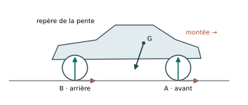
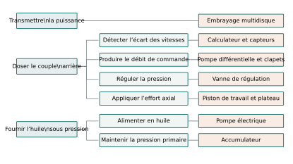
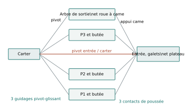
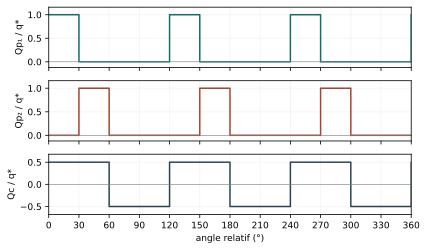
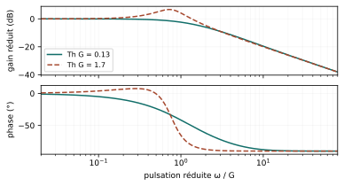
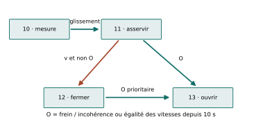

# X-ENS · PSI · Sciences industrielles 2010 — corrigé brut

*Corrigé rédigé par IA, non officiel. Signalez toute erreur.*

**Rédaction** · GPT-6.2 Astra Ultra · vitesse non renseignée · 25 novembre 2026

**Révision** · GPT-6.2 Astra Ultra · vitesse non renseignée · 26 novembre 2026

**Transmission automobile 4Motion.** Le cahier CX0614 étudie le départ en côte enneigée, puis la pompe différentielle, la vanne et les lois de commande du coupleur Haldex. Les calculs énergétiques distinguent le cycle théorique commun des mouvements que chaque transmission peut réellement fournir.

## I. Adhérence et énergie au démarrage en côte

### Question 1 · Sens du départ

L’avant du véhicule est du côté montant. En marche arrière il descend la pente. Le poids favorise ce mouvement, et l’accélération vers l’arrière charge l’essieu avant moteur. Le module de l’accélération est donc plus grand dans ce sens. La marche avant est le cas défavorable pour la prestation de démarrage **en montée**.

### Question 2 · Traction avant en marche arrière

Notons $A=\ddot\lambda$, $m_0=M-m=1430$ kg, $d=a+b$, $P=T_A+T_B$ et $J_\perp$ l’inertie totale des parties tournant autour de l’axe transversal. Pour la traction simple, $J_\perp=2J_{\rm roues}+J_{\rm essieu}$ en comptant le différentiel entraîné. Le roulement sans glissement donne $\dot\omega=-A/R$ dans le sens trigonométrique. Au centre de gravité, les trois équations du PFD sont

$$
P=m_0(A+g\sin\alpha),\quad N_A+N_B=m_0g\cos\alpha,\quad
aN_A-bN_B+cP=-J_\perp A/R .
$$

Pour les roues, avec les couples orientés selon $+\mathbf z_0$, $C_{\rm mot}^A+RT_A=-J_{\rm roues} A/R$ et $RT_B=-J_{\rm roues} A/R$ à l’arrière libre. Ainsi $T_A=P+J_{\rm roues} A/R^2$ et $N_A=[b m_0 g\cos\alpha-cP-J_\perp A/R]/d$. En marche arrière à la limite, $T_A=-fN_A$. La résolution donne **$A=-4{,}28$ m/s²**, donc une accélération de module 4,28 m/s² vers le bas de la pente.

### Question 3 · Traction avant en montée

Les équations précédentes sont conservées avec $T_A=+fN_A$. En posant $\varepsilon=+1$ en marche avant et $-1$ en marche arrière, les deux calculs se résument à

$$
A=\frac{-m_0g\sin\alpha+\varepsilon f m_0g(b\cos\alpha-c\sin\alpha)/d}{m_0+J_{\rm roues}/R^2+\varepsilon f(c m_0+J_\perp/R)/d}.
$$

En montée **$A=0{,}291$ m/s²** avec $f=0{,}35$. Le transfert de charge décharge l’avant et la limite d’adhérence rend inaccessible le seuil de 1,6 m/s². Négliger le très petit moment cinétique tournant dans le seul bilan de tangage laisse les arrondis pratiquement inchangés.

### Question 4 · Travail du modèle à deux roues motrices

Posons $J_0=2J_{\rm roues}+J_{\rm essieu}$. Le théorème de l’énergie cinétique, avec les contacts au repos instantané, donne en montée

$$
|C_{\rm moteur}^{1''}|=Rm_0(A+g\sin\alpha)+J_0 A/R,\qquad W_0=|C_{\rm moteur}^{1''}|\,A t^2/(2R)
$$

pour un départ au repos à accélération constante. Le couple est négatif si on le projette sur $+\mathbf z_0$. À la limite réelle de Q3 et pour $t=10$ s, on obtient **887 N·m et 41,7 kJ**. Pour comparer les deux architectures à la **même prestation théorique** $A=1{,}6$ m/s², la référence énergétique est **1 479 N·m et 381,7 kJ**. Sur le revêtement étudié, la traction simple ne peut réaliser cette seconde trajectoire.

### Question 5 · Transmission à couples égaux

Avec des inerties de roues identiques, $C_{\rm mot}^A=C_{\rm mot}^B$ impose $T_A=T_B=P/2$. Remplacer $m_0$ par la masse équipée $M$, et $J_\perp$ par $2(J_{\rm roues}+J_{\rm essieu})$ dans les trois équations du PFD. On obtient $N_A=[bMg\cos\alpha-cP-J_\perp A/R]/d$, $N_B=Mg\cos\alpha-N_A$. Les équations $P/2=fN_A$ et $P/2=fN_B$ donnent respectivement 1,864 et **1,353 m/s²**. Les **roues arrière** arrivent donc les premières à la limite. Ce partage moitié-moitié ne satisfait pas la prestation.

### Question 6 · Actigramme A-0

Dans la boîte unique de niveau A-0, inscrire **transmettre une puissance variable à l’essieu arrière**. L’entrée fonctionnelle à gauche est la puissance mécanique disponible sur l’arbre lié au différentiel avant. À droite sort la puissance mécanique transmise à l’arbre du différentiel arrière. En haut entrent les consignes et informations de pilotage, dont les vitesses des essieux et l’état du véhicule, ainsi que l’autorisation et l’énergie d’alimentation. Le support en bas est le coupleur Haldex avec sa chaîne hydraulique et son calculateur.

### Question 7 · Déclenchement du transfert arrière

Quand les roues avant commencent à patiner, leur vitesse périphérique augmente par rapport à la vitesse du véhicule et à celle des roues arrière. La différence des vitesses moyennes d’essieu met en action la pompe différentielle. La pression de commande augmente et l’embrayage peut reporter davantage de couple sur l’arrière.

### Question 8 · Répartition favorable à l’avant

Pour $A=1{,}6$ m/s², $P=M(A+g\sin\alpha)$ et la répartition des charges de Q5 donnent $N_A\simeq8214$ N, $N_B\simeq7050$ N. On choisit $T_A=fN_A$, puis $T_B=P-T_A$. Les modules des couples aux roues sont $RT_A+J_{\rm roues}A/R\simeq898$ N·m et $RT_B+J_{\rm roues}A/R\simeq734$ N·m, soit **55 % à l’avant et 45 % à l’arrière**. L’arrière respecte $T_B\le fN_B$. Le partage dépend de l’accélération, de la pente, de l’adhérence et de la géométrie et des inerties du véhicule. Au maximum absolu de Q9, les deux contacts saturent et les proportions deviennent environ 53,5 % et 46,5 %.

### Question 9 · Accélération à la double limite d’adhérence

Quand les deux essieux exploitent simultanément la limite, $P=f(N_A+N_B)=fMg\cos\alpha$. Le bilan longitudinal donne **$A_{\max}=g(f\cos\alpha-\sin\alpha)=1{,}678$ m/s²**. Cette valeur dépasse 1,6 m/s² pour la pente de $10^\circ$ et le facteur donné. La validation reste ici indépendante de la puissance moteur.

### Question 10 · Énergie de la transmission intégrale

Avec les vitesses ramenées à l’axe des roues suivant l’annexe, $J_4=2J_{\rm roues}+2J_{\rm essieu}+J_{\rm trans}$. Alors $|C_{\rm moteur}^{1'}|=RM(A+g\sin\alpha)+J_4A/R$ et $W_4=|C_{\rm moteur}^{1'}| A t^2/(2R)$. À $A=1{,}6$ m/s² pendant 10 s, **$|C|=1633$ N·m, $W_4=421{,}3$ kJ**. À la limite d’adhérence de Q9, on obtient **1671 N·m et 452,3 kJ**. L’angle parcouru par les roues est calculé à partir du mouvement de chaque cas.

### Question 11 · Surconsommation à prestation identique

Pour le cycle théorique commun de 10 s à 1,6 m/s², $(W_4-W_0)/W_0=(421{,}3-381{,}7)/381{,}7\simeq10{,}4\,\%$. Le critère de 15 % est respecté dans le modèle à rendement unité. Les limites d’adhérence propres aux deux voitures produiraient 452,3 et 41,7 kJ pour des distances très différentes. Leur quotient ne mesure pas la surconsommation à service égal. Une mesure sur neige au niveau de 1,6 m/s² avec la traction simple est impossible dans ce modèle.

En appliquant strictement les deux accélérations maximales des questions 4 et 10, le quotient demandé est $(452{,}3-41{,}7)/41{,}7\simeq9{,}85$, soit environ $985\,\%$. En dix secondes, la première voiture parcourt alors $14{,}6$ m et la seconde $83{,}9$ m. Le dépassement apparent du seuil de $15\,\%$ dans cette comparaison provient aussi de cette différence de service.

### Question 12 · Portée du calcul de consommation

La consommation de carburant dépend du régime et de la charge du moteur. Les pompes et le calculateur absorbent de l’énergie. Les pertes visqueuses, le frottement des engrenages, les phases de glissement et la résistance au roulement contribuent également. Vérifier la marge de 4,6 points demanderait deux cycles réellement comparables et un modèle de rendement. L’allégement des pièces ajoutées, la limitation des pertes de brassage et la commande de pression adaptée au couple effectivement requis réduisent les pertes.

### Question 13 · Capacité du moteur en première

Vers 40 km/h en première, la figure donne environ 4500 tr/min. La vitesse angulaire des roues vaut $(40/3{,}6)/0{,}31=35{,}8$ rad/s, celle du moteur environ 471 rad/s. Le rapport roue/moteur est donc voisin de **0,075**, environ 0,07 à 0,08 selon la lecture du trait. À 3750 tr/min le maximum de couple est proche de 200 N·m. On dispose donc d’environ 2,6 à 2,9 kN·m côté roues au rendement supposé unité, au-dessus des 1,63 kN·m à la prestation et des 1,67 kN·m à la limite. Le rapport de première permet d’atteindre l’accélération requise dans la plage de couple utile. Les courbes ne modélisent pas le transitoire d’embrayage à l’arrêt.

## II. Composants hydrauliques et embrayage

### Question 14 · Arbre FAST à compléter

DR1 se lit selon trois branches. **Transmettre le couple** est réalisé par l’embrayage multidisque. **Déterminer et commander le couple arrière** se décompose en détecter la différence de vitesse (calculateur et informations de vitesse), produire le débit et la pression de commande (pompe différentielle et clapets), régler la pression et donc la puissance transmise (vanne de régulation), puis commander axialement l’embrayage (piston de travail et plateau). **Fournir l’énergie hydraulique primaire** se décompose en alimenter en huile (pompe électrique) et maintenir la pression primaire (accumulateur).

### Question 15 · Bloc de la vanne de régulation

Les variations autour de la pression primaire vérifient $S_v\dot X_v=Q_v-Q_{fv}$, $Q_{fv}=K_{fv}X_v$ et $P_v-P_0=k_vX_v/S_v$. Le schéma est un sommateur $Q_v-Q_{fv}$, suivi du bloc $1/(S_vp)$ jusqu’à $X_v$, puis du gain $k_v/S_v$. La branche de retour porte $K_{fv}$. On trouve

$$
\frac{\Delta P_v(p)}{Q_v(p)}=\frac{k_v}{S_vK_{fv}}\,\frac1{1+(S_v/K_{fv})p}.
$$

### Question 16 · Condition de pompage

Un cycle axial exige une rotation **relative** de l’arbre de sortie et de l’arbre d’entrée. Si $\dot\theta_s=\dot\theta_e$, les galets restent au même point du profil et le débit différentiel est nul. La pompe électrique peut alors maintenir la pression primaire indépendamment.

### Question 17 · Trois rouleaux espacés de 120 degrés

Trois appuis non alignés définissent un plan de poussée. La disposition équiangulaire répartit l’effort et la somme des moments de basculement par rapport à l’axe est nulle pour des charges égales. Le piston annulaire conserve ainsi une poussée axiale équilibrée. Deux points laisseraient une direction de basculement et un quatrième contact rigide demanderait une compatibilité géométrique supplémentaire.

### Question 18 · Graphe de structure de DR2

Pour les six nœuds imprimés, le carter porte les **deux arbres en pivot coaxial** et chacun des trois ensembles piston–butée en **pivot glissant coaxial** (ces trois derniers liens sont déjà dessinés). Relier le groupe d’entrée et galets aux trois ensembles P1, P2 et P3 par des **contacts locaux de poussée**, modélisables par des contacts ponctuels de normale axiale. Le lien entre le groupe portant les galets et la roue à came de l’arbre de sortie représente l’**appui des galets sur le profil**, à normale locale variable. Cette représentation réduite regroupe les organes intermédiaires. La réalisation détaillée conserve le coulissement du plateau par rapport à l’arbre de sortie et transmet la poussée à travers les butées.

### Question 19 · Débits des deux pistons

Notons $\phi=\theta_s-\theta_e$, $\Omega=\dot\phi>0$ pour le sens de lecture de DR2, $S_p$ la section commune et $H_i$ la course crête du piston $i$. La rampe montante occupe $\pi/6$, d’où le niveau $q_i^*=6S_pH_i\Omega/\pi$. Modulo $120^\circ$, $Q_{p1}=q_1^*$ entre $0^\circ$ et $30^\circ$, $Q_{p2}=q_2^*$ entre $30^\circ$ et $60^\circ$. Chaque débit est nul ailleurs au refoulement. La rampe descendante correspond au remplissage par l’autre clapet. Répéter ces créneaux trois fois par tour.

### Question 20 · Compensation de la pulsation du débit

Pour l’huile incompressible, $Q_{p1}+Q_{p2}=Q_v+Q_c$, où $Q_c$ est compté reçu par le piston de travail. Ce piston revient à sa position après une période, donc $\langle Q_c\rangle=0$ et le débit constant vaut $Q_v=(q_1^*+q_2^*)/4$. Sur les intervalles $0$–$30^\circ$, $30$–$60^\circ$, $60$–$120^\circ$, tracer $Q_c=q_1^*-Q_v,\ q_2^*-Q_v,\ -Q_v$ et répéter. Pour deux courses égales, ce tracé alterne $+q^*/2$ et $-q^*/2$ sur deux demi-périodes.

### Question 21 · Gain volumétrique de la pompe

Les deux pistons fournissent ensemble $3S_p(H_1+H_2)$ par tour relatif. Ainsi, sur la branche de fonctionnement de Q19,

$$
Q_v=K_p(\dot\theta_s-\dot\theta_e),\qquad K_p=\frac{3S_p(H_1+H_2)}{2\pi}.
$$

Le gain s’exprime en m³ par radian. Si l’on décrit les deux sens avec un débit de refoulement toujours positif après les clapets, l’entrée physique correspond au module de la vitesse relative. Le gain linéaire s’entend sur une branche orientée.

### Question 22 · Pression primaire

La pression primaire remplit le circuit, maintient les éléments de pompage au contact et précharge légèrement l’embrayage. Un faible couple peut alors être transmis à l’arrière dès la mise en route et la commande n’a pas à rattraper tout le jeu hydraulique lors de l’apparition d’une différence de vitesse.

### Question 23 · Précharge de l’accumulateur

Soit $\ell_{r,0}$ la longueur installée du ressort à $X_a=0$. L’équilibre du piston au décollement de sa butée impose **$k_a=P_0 S_a/(l_0-\ell_{r,0})$**. Le dessin de la page 13 cote $L$ du plan de la butée au fond, $X_a$ jusqu’à la **face hydraulique** et appelle $l_a$ la longueur du piston. Pris littéralement, $\ell_r=L-l_a-X_a$, donc $k_a=P_0S_a/(l_0-L+l_a)$. Si $L$ désigne conventionnellement la longueur de ressort installée et que l’épaisseur du piston est absorbée dans la cote, la même loi de précharge s’écrit $P_0S_a/(l_0-L)$. La variation dans les deux cas est $P_a-P_0=k_aX_a/S_a$.

### Question 24 · Blocs de l’accumulateur

Le premier sommateur forme $Q_{\rm élec}+Q_{fv}-Q_{fa}$. Il est suivi par $1/(S_a p)$ jusqu’à $X_a$, puis par $k_a/S_a$ jusqu’à $P_a-P_0$. La branche de retour est $Q_{fa}=K_{fa}X_a$. Une augmentation de la fuite retire du débit à la chambre.

### Question 25 · Réponse du premier ordre

Dans la plage mobile du piston,

$$
\frac{\Delta P_a(p)}{Q_{\rm élec}(p)+Q_{fv}(p)}
=\frac{k_a}{S_aK_{fa}}\,\frac1{1+\tau_a p},\qquad \tau_a=S_a/K_{fa}.
$$

Les deux entrées ont le même transfert. Un échelon atteint 95 % de sa nouvelle valeur après environ $3\tau_a$. Une petite constante donne une adaptation rapide au démarrage, une grande atténue les fluctuations rapides. Le gain statique fixe l’écart de pression sous un débit persistant. À la butée le modèle change de régime.

### Question 26 · Limite de glissement de l’embrayage

Le modèle de Coulomb au seuil fournit le **couple maximal transmissible** à pression fixée dans le régime où le glissement devient imminent. C’est pertinent pour dimensionner la capacité du coupleur. Lorsque les deux arbres tournent à la même vitesse, le couple adhérent peut prendre toute valeur dans l’intervalle admissible. L’égalité de Coulomb y serait donc une hypothèse supplémentaire. Le bain d’huile, la température et les phases de glissement peuvent en outre modifier le coefficient effectif.

### Question 27 · Couple des treize interfaces

L’effort de serrage transmis à chaque interface en série est $F=S_t p_v$, avec $S_t$ la section du piston de travail. La pression de contact uniforme vaut $p_c=F/[\pi(R_e^2-r^2)]$, où $R_e$ désigne le rayon extérieur des disques. Sur un anneau, $dC=f_e p_c\,2\pi\rho^2d\rho$. Les 7 disques de chaque arbre fournissent 13 interfaces, d’où

$$
|C_s|=K_e p_v,\qquad K_e=13 f_e S_t\,\frac{2}{3}\frac{R_e^3-r^3}{R_e^2-r^2}.
$$

Cette intégration utilise un rayon de frottement moyen pondéré par l’aire, distinct du rayon moyen arithmétique.

## III. Performances et commande du coupleur

### Question 28 · Stabilité de la boucle initiale

Dans la figure 17, notons $K_v$ le gain de la voiture, $J_E$ l’inertie du retour et $K_h/(1+T_hp)$ le bloc hydraulique. Avec $B=K_v/(R+K_vJ_E)>0$ et $G=BK_h>0$, l’accélération angulaire vérifie $p\Omega_s=B K_h(\Omega_e-\Omega_s)/(1+T_hp)+RB F_{\rm ext}$. Ainsi le dénominateur fermé est $D(p)=T_hp^2+p+G$. Un second ordre de coefficients strictement positifs est asymptotiquement stable. La conclusion porte sur les paramètres et les blocs du modèle donné.

### Question 29 · Continuité de l’accélération

Pour une consigne de vitesse $\Omega_e$, $\Omega_s/\Omega_e=G/D(p)$. En réponse à un échelon unité, l’accélération a pour transformée $G/D(p)$. Sa valeur initiale à droite est $\lim_{p\to\infty}pG/D(p)=0$, égale à la valeur au repos avant l’échelon. Elle évolue ensuite continûment. La vitesse est dérivable au démarrage et l’accélération est **continue $C^0$**. La courbe de vitesse seule, à l’échelle de la figure 18, ne résoudrait pas un éventuel saut de pente très bref.

### Question 30 · Précision et temps de réponse

La réponse à l’échelon unité tend vers 1, conformément au gain statique unité. L’erreur permanente sur **la vitesse d’essieu commandée** est nulle. La courbe monotone de la figure 18 entre dans la bande $[0{,}95,1{,}05]$ vers **60 s**. La demande de temps inférieur à 2 s est donc manquée, malgré le suivi en régime établi.

### Question 31 · Influence du temps hydraulique

En divisant $D$ par $T_h$, $\omega_n=\sqrt{G/T_h}$ et $\xi=1/(2\sqrt{GT_h})$. Les pôles sont $[-1\pm\sqrt{1-4GT_h}]/(2T_h)$. Leur position varie lorsque la constante de la vanne change. En régime sous-amorti, l’enveloppe décroît en $\exp[-t/(2T_h)]$. Dans la limite $T_h\to0$, il subsiste le premier ordre de constante $1/G$. Les deux pôles expliquent pourquoi leur influence ne se résume pas à multiplier tout le temps de réponse par $T_h$.

### Question 32 · Étude harmonique des efforts extérieurs

Une variation lente de pente produit un effort quasi constant. Une variation locale de contact ou de charge introduit des composantes plus rapides. Après linéarisation, on peut décomposer ces sollicitations et utiliser le gain et la phase de $\Omega_s/F_{\rm ext}$ pour déterminer quelles fréquences perturbent le plus la vitesse des roues arrière.

### Question 33 · Bode de la perturbation

La réduction de Q28 donne

$$
H_F(p)=\frac{\Omega_s}{F_{\rm ext}}=\frac{RB(1+T_hp)}{T_hp^2+p+G}.
$$

Le plateau initial est $20\log_{10}(R/K_h)$ dans les unités du sujet. Le zéro à $\omega_z=1/T_h$ ajoute $+20$ dB/décade et $+90^\circ$ à terme. Le couple de pôles introduit au total $-40$ dB/décade et $-180^\circ$. Les asymptotes s’additionnent dans l’ordre des cassures. Pour deux pôles réels séparés, chacun apporte $-20$ dB/décade à sa propre cassure. Au total la pente finale vaut $-20$ dB/décade et la phase tend vers $-90^\circ$. Le rejet parfait d’une force constante exigerait $H_F(0)=0$, alors que la valeur obtenue $R/K_h$ est finie et positive.

### Question 34 · Correction rejetant un échelon de pente

La variation de vitesse causée par $F_{\rm ext}=F_0u(t)$ doit tendre vers **zéro**. Pour le nouveau gain hydraulique $K'_h$, choisir par exemple un PI $C(p)=K_P+K_I/p$ avec $K_I>0$ et $K_P>T_hK_I$. Posons $G'=BK'_h$. Alors

$$
H_{F,C}(p)=\frac{RB\,p(1+T_hp)}{T_hp^3+p^2+G'K_Pp+G'K_I}.
$$

Le critère de Routh du troisième ordre donne précisément $K_P>T_hK_I$. On peut donc appliquer la valeur finale et obtenir $\lim_{t\to\infty}\Delta\Omega_s(t)=\lim_{p\to0} F_0H_{F,C}(p)=0$. Un intégrateur pur supprimerait le terme en $p$ du polynôme caractéristique et donnerait une boucle instable. Le zéro statique seul ne justifierait pas la limite.

### Question 35 · Marge de phase du système modifié

La figure 21 donne, pour $\omega\simeq0{,}22$ rad/s, une phase d’environ $-168^\circ$ au croisement de 0 dB. La marge vaut donc **environ $12^\circ$**. La caractérisation de la fonction technique dans le sujet impose l’écart final des vitesses, le temps de réponse et la priorité à l’avant. Le suivi demandé est essentiellement quasi statique. Le cahier n’y fixe donc pas de valeur numérique minimale de marge. La petite marge mesurée reste une information sur la sensibilité de ce réglage aux retards et aux incertitudes.

### Question 36 · Commande séquentielle de l’Haldex

Posons $B_f=f_m\lor f_p\lor a_{cc}$, $D_{10}=[\delta=1\text{ depuis 10 s}]$ et $O=B_f\lor D_{10}$. Les actions de DR3 sont **11 : A**, **12 : V−**, **13 : V+**. L’événement $a_{\rm BS}$ déclenche l’asservissement depuis 10. Depuis 11, la condition vers 13 est $O$ et celle vers 12 est $v\land\neg O$. Le terme $\neg D_{10}$ précise la priorité dans le cas où $v$ et la temporisation seraient simultanés. Le retour imprimé de 12 vers 11 est $\neg v$.
Pour les deux sorties de 13, les compléments usuels des pointillés de DR3 sont $v_0$ dans $\left(\neg f_m\land\neg f_p\land\neg a_{cc}\right)\lor v_0$ vers 11, et $\neg\delta$ vers 10. Ces conditions imprimées incomplètes peuvent se recouvrir. Pour une commande déterministe, conserver l’ouverture tant que $O$ est vrai ou $v_0$ faux. Une fois ouverte et la demande levée, retourner à 10 en l’absence de glissement détecté, ou à 11 si $a_{\rm BS}$ persiste. Si une demande d’ouverture survient **pendant** 12, elle doit préempter la fermeture (transition prioritaire vers 13 ou inhibition de V−). Le dessin joint indique cette règle.

### Question 37 · Mesure de l’usure différentielle

La branche 100 commande **V+**. La transition imprimée exige $\neg a_{\rm BS}$, $\neg\delta$, $v_0$ et deux secondes d’activité de 100. La vanne ouverte évite le couplage forcé des essieux, l’absence de glissement détecté et l’attente réduisent le risque de mémoriser un transitoire. $\neg\delta$ signale un écart mesurable. À vitesse non nulle, l’étape **101** conserve **V+** et mémorise par exemple **$K=(\Omega_e-\Omega_s)/\Omega_s$**. L’initialisation existante est $K=0$. Le rapport est sans dimension et représente un écart relatif de rayons de roulement.

### Question 38 · Compensation de la différence des rayons

Avec la convention de Q37, sans glissement, $\Omega_e=(1+K)\Omega_s$. Insérer le gain mémorisé **$1+K$ sur le retour de vitesse arrière**, avant l’entrée négative du comparateur de la figure 20. L’écart traité devient $\Omega_e-(1+K)\Omega_s$. Il est nul pour la différence due à l’usure et continue à réagir au patinage. Pour un $K$ initial nul, on retrouve la boucle de la figure 20.
