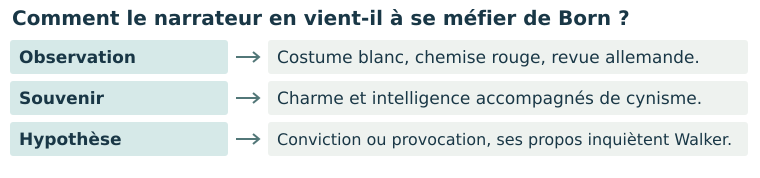
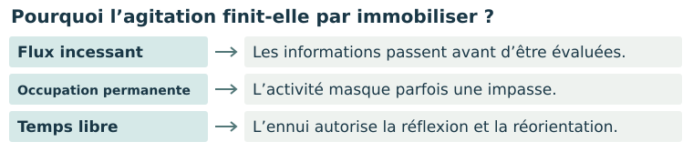
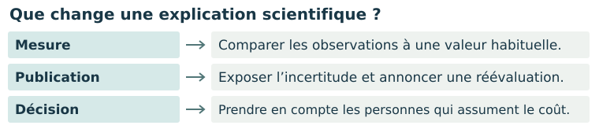

# X · MP-PC · Anglais 2010 — Corrigé brut

*Corrigé rédigé par IA, non officiel. Signalez toute erreur.*

**Rédaction** · GPT-6.2 Astra Ultra · vitesse non renseignée

Les deux cahiers durent chacun une heure trente, sans dictionnaire. La version se rédige en français. Les deux réponses au texte français se rédigent en anglais. Le sujet donne à titre indicatif 120 à 150 mots pour la première et 180 à 200 pour la seconde.

## V. Version française

**Un homme à deux visages**

Je pensais que je ne les reverrais jamais. Born enseignait à Columbia depuis sept mois et, comme je ne l’avais pas croisé une seule fois pendant tout ce temps, il me semblait peu probable de tomber sur lui maintenant. Mais les probabilités ne comptent guère face aux événements réels, et ce n’est pas parce qu’une chose a peu de chances d’arriver qu’elle n’arrivera pas. Deux jours après la soirée, à la sortie de mon dernier cours de l’après-midi, j’entrai au West End Bar en me demandant si je n’y trouverais pas un de mes amis. Le West End était un bouge sombre et immense, avec plus d’une douzaine de tables et de banquettes, un vaste comptoir ovale au centre de la salle de devant et, près de l’entrée, un coin où l’on pouvait acheter, midi et soir, de mauvais repas de cafétéria. C’était mon repaire préféré, fréquenté par des étudiants, des ivrognes et des habitués du quartier. Il se trouvait que l’après-midi était chaud et ensoleillé et, par conséquent, à cette heure-là, il n’y avait pas grand monde. Comme je faisais le tour du bar à la recherche d’un visage familier, j’aperçus Born, assis seul sur une banquette au fond. Il lisait un hebdomadaire d’actualité allemand, Der Spiegel, je crois, fumait encore un de ses cigares cubains et ne prêtait aucune attention au verre de bière à moitié vide posé sur la table à sa gauche. Il portait à nouveau son costume blanc, ou peut-être un autre, car la veste avait l’air plus propre et moins froissée que celle qu’il portait samedi soir. En revanche, la chemise blanche avait disparu, remplacée par quelque chose de rouge, d’un rouge soutenu et uni, à mi-chemin entre la brique et le cramoisi.

Bizarrement, mon premier mouvement fut de faire demi-tour et de ressortir sans le saluer. Il y aurait, je crois, beaucoup à chercher dans cette hésitation, car elle semble indiquer que je comprenais déjà que je ferais bien de me tenir à distance de Born, que je risquais des ennuis si je me laissais entraîner à le fréquenter. Comment le savais-je ? J’avais passé à peine plus d’une heure en sa compagnie, mais même en si peu de temps j’avais senti chez lui quelque chose qui clochait, quelque chose de vaguement rebutant. Il ne s’agissait pas de nier ses autres qualités, son charme, son intelligence, son humour, mais derrière tout cela il émanait de lui une noirceur et un cynisme qui m’avaient déstabilisé, m’avaient donné le sentiment qu’on ne pouvait lui faire confiance. Aurais-je eu de lui une autre impression si je n’avais pas méprisé ses idées politiques ? Impossible à dire. Mon père et moi étions en désaccord sur presque toutes les questions politiques du moment, ce qui ne m’empêchait pas de penser qu’au fond il était quelqu’un de bien, ou du moins qu’il n’était pas quelqu’un de mauvais. Mais Born n’était pas quelqu’un de bien. Il était spirituel, excentrique et imprévisible, mais soutenir que la guerre est l’expression la plus pure de l’âme humaine vous exclut d’office du nombre des gens de bien. Et s’il avait dit cela en plaisantant, histoire de provoquer un énième étudiant antimilitariste pour qu’il lui tienne tête et dénonce sa position, alors c’était tout bonnement de la perversité.

Monsieur Walker, dit-il en levant les yeux de sa revue et en me faisant signe de le rejoindre à sa table. Vous êtes justement l’homme que je cherchais.

## 1. Which aspects of modern civilisation does the author criticise?

Bréchignac criticises a civilisation that confuses ceaseless movement with progress. People switch between screens and tasks while reports, rumours and supposed revelations disappear almost as quickly as they arrive. They have time to catch a piece of news but little opportunity to judge whether it deserves their attention. Repeated messages can consequently fill a day without producing genuine communication. The author sees the accelerating succession of economic crises as another symptom of a society exhausting itself in pursuit of efficiency. Even children are kept busy as though an unoccupied moment were necessarily a failure. In her view, boredom can reveal that an activity is leading nowhere and allow someone to reconsider its purpose. Leisure and imagination give both philosophy and science the time they need to turn scattered impressions into reasoned thought.

*132 mots.*

## 2. Can science be an antidote to anxiety?

Science can relieve anxiety when it turns a frightening possibility into a question people can investigate. Imagine a town where residents notice an unusual smell in the water. An independent laboratory can compare samples from different streets, examine changes over time and explain what the results allow it to conclude. Publishing the uncertainty and setting a date for another check may be more reassuring than an official announcing immediately that everything is safe. Residents then have grounds for deciding what to believe when the next rumour appears.

Yet investigation may confirm a serious danger. That answer can properly increase anxiety, especially for a family unable to afford an alternative supply. No measurement by itself decides who should pay for repairs or who ought to receive assistance first. Those decisions require institutions willing to listen and act fairly.

I would therefore expect science to help people live with uncertainty by making particular fears intelligible and open to correction. It cannot promise an end to fear, nor should it offer that promise to win public trust. An honest explanation and a practical means of responding can do more for confidence than a guarantee which the next observation might overturn.

*197 mots.*

Le fac-similé des deux cahiers place Catherine Bréchignac, N’ayons pas peur de la science (2009), aux pages 1 et 2 du PDF et Paul Auster, Invisible (2009), à la page 5. La notice de l’ESPCI et un second fac-similé corroborent cette identification. Les rapports d’anglais de ces écrits restent à retrouver.

[Cahier de version](https://www.alloschool.com/assets/documents/course-286/x-ens-mp-pc-2010-langues-vivantes.pdf#page=5) · [Cahier d’expression](https://www.alloschool.com/assets/documents/course-286/x-ens-mp-pc-2010-langues-vivantes.pdf#page=1) · [Notice de l’ESPCI](https://www2.espci.fr/enseignement/brochure_concours_2010_polytechnique.pdf#page=20) · [Autre fac-similé de la version](https://groupe-reussite.fr/ressources/wp-content/uploads/Annales/x-ens/anglais/x-ens-anglais-2010-sujet.pdf#page=3)
