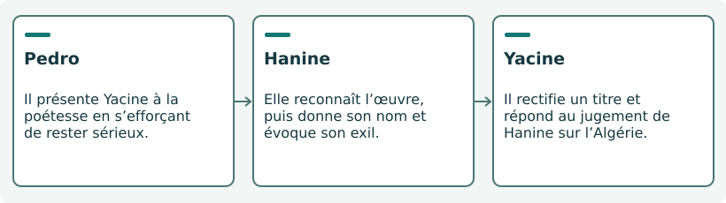

# X · MP-PC · Arabe 2010 — Corrigé brut

*Corrigé rédigé par IA, non officiel. Signalez toute erreur.*

**Rédaction** · GPT-6.2 Astra Ultra · vitesse non renseignée

La version de Waciny Laredj et les questions sur Catherine Bréchignac forment les deux parties de la composition d’arabe. Le rapport écrit de 2010 n’a pas été retrouvé dans le registre. Les réponses arabes comptent 124 et 182 mots séparés par des espaces.

## I. Version française

**À Amsterdam**

Pedro se tourna vers moi. Il attira doucement la poétesse par la main et posa l’autre sur son épaule. Elle tourna la tête vers moi et sourit. Ce qui me frappa, c’est que, dans ses grands yeux, je crus lire une certaine familiarité, comme si nous nous connaissions déjà. Elle me dévisagea comme quelqu’un qui voudrait savoir d’où venait cet être tombé tout à coup dans une ville à laquelle rien ne l’avait préparé. Je ne dis rien. Pedro intervint en s’efforçant, pour quelques minutes, de garder son sérieux. Dans ses yeux perçait une certaine ironie à l’égard de toute chose. Il prit un air un peu sévère et dit :

« Tu le connais sûrement, c’est votre grand sculpteur, Yacine.

— Allons donc ! Qui ne connaît pas maître Yacine ? Pardonnez-moi. »

Elle l’avait dit d’une voix douce et tendre. Puis elle se mit à me citer quelques titres de mes sculptures, celles que la ville d’Amsterdam avait achetées dans une exposition itinérante, il y avait au moins cinq ans. Elle s’interrompit un instant, s’efforçant de secouer sa mémoire encombrée.

« Et je crois avoir vu une de vos statues dans une exposition collective en Allemagne. Je suis restée longtemps devant elle. Elle ressemblait à celle-ci, avec toutefois une petite différence. Je me souviens même du titre, *Likha et l’argile*, si je ne me trompe.

— *Likha travaille l’argile.*

— C’est bien cela. J’ai souvent vu votre visage dans la presse. Vous étiez jeune. Vos cheveux n’étaient pas blancs comme aujourd’hui. Je suis heureuse de faire votre connaissance, maître Yacine. »

Je ne trouvais pas les paroles de politesse dont on use généralement en pareille circonstance. Elle parlait sans s’arrêter et j’étais tout occupé à suivre les phrases qui s’enchaînaient. Avant que j’aie pu la remercier, elle se présenta elle-même et compléta ce que Pedro, émerveillé comme un enfant, avait omis de dire.

« Pedro est toujours comme ça. Enfin, je suis Hanine, poétesse algérienne. Je vis à Amsterdam depuis une dizaine d’années. Je suis venue ici avant que nous n’entrions en guerre. Il me semble que cette nature humaine que nous cherchons à éluder est ainsi faite. Des gens meurent, et demain on se réconciliera, puis on s’entretuera de nouveau, et rien n’empêchera l’oubli. »

Je ne sais quel en était le secret, mais au plus profond de moi, je sentis une chaleur. Je ne parlai pas, ou plutôt je n’en eus pas l’occasion.

« Comment vont les choses dans ce pays, le tien ? Toi, au moins, tu vis là-bas au rythme de la mort quotidienne et c’est d’elle que tu façonnes ton existence. Nous, nous commençons à devenir une matière malléable dans la main de l’exil.

— Si le poète, celui qui ouvre les portes closes du monde, tient de tels propos, que dira donc celui qui n’a pas la moindre chance de parler dans la rue à un ami croisé par hasard sans courir le risque d’être assassiné ? Tu es à Amsterdam et c’est une grande chance. »

D’après Waciny Laredj, *Les Balcons de la mer du Nord*, Dar al-Adab, première édition, Beyrouth, 2002.

## II.1. Analyse du texte commun

تنتقد الكاتبة مجتمعا يخلط بين سرعة الحركة وإحراز التقدم. فالأخبار والشائعات تتوالى على الشاشات بسرعة لا تتيح لمن يتلقاها أن يميز المهم من العابر. ويتنقل المرء بين مهام متعددة فيتوهم أنه يضاعف إنتاجه، بينما تتفكك أفكاره ويظل في مكانه. وتشير الأزمات الاقتصادية المتلاحقة في رأيها إلى كلفة هذا الاضطراب الجماعي. وتكرر وسائل الاتصال رسائل فارغة فلا يتحقق من تداولها المستمر تواصل حقيقي بين الناس. ولا تفسر الكاتبة هذا العجز بحرية الخيال، بل بحرمان العقل من الوقت الذي يحتاج إليه حتى يرتب ما وصله. حتى أوقات الأطفال يشغلها الكبار من أولها إلى آخرها خوفا من الملل. ولكن الملل يكشف أحيانا أن الطريق الذي نسلكه مسدود، ويدعونا إلى مساءلة أنفسنا والبحث عن اتجاه جديد. وبذلك يحرمنا الإصرار على النشاط المتواصل من شرط من شروط التفكير المثمر.

## II.2. Réflexion personnelle

حين عرف الناس أن لكسوف الشمس موعدا يمكن حسابه، لم يتغير مشهد الظلام المفاجئ، لكن معناه تغير. فالذي يعرف سبب الظاهرة وموعد انقضائها يملك أن ينتظر عودة الضوء من غير أن يرى في السماء نذيرا موجها إليه. بهذا المعنى يخفف العلم القلق لأنه يتيح للناس فهما يمكنهم أن يتقاسموه ويختبروه، حتى إن لم يكونوا جميعا علماء.

غير أن المعرفة لا تعد دائما بموعد دقيق كهذا. فحين يتحدث الباحثون عن احتمال فيضان، قد تزداد مخاوف ساكن على ضفة النهر لأنه علم بخطر كان يجهله. ولا يكفي أن نكرر أمامه رقما حتى يشعر بالطمأنينة أو يجد حلا يناسب وضع أسرته. ما يحتاج إليه هو أن يفهم معنى الاحتمال وحدود التنبؤ وأن يعرف إلى من يلجأ إذا اضطر إلى مغادرة بيته. هنا تتوقف فائدة العلم أيضا على وجود مؤسسات جديرة بالثقة وعلى استعداد الجيران لمساعدة بعضهم بعضا. وهناك قلق من نوع آخر، كخوف المرء من أن يفقد مكانه بين أصدقائه، لا تزيله معادلة صحيحة وإن أعانته المعرفة على وصف شعوره. لذلك أرى أن العلم يحمينا من استسلام الخيال لكل شائعة، لكنه يترك لنا مهمة اختيار ما نفعل بمعرفتنا وكيف نعيش معا حين يظل المستقبل مفتوحا.

[Sujet](https://www.alloschool.com/assets/documents/course-286/x-ens-mp-pc-2010-langues-vivantes.pdf#page=6) · [Sujet complémentaire](https://www.alloschool.com/assets/documents/course-286/x-ens-mp-pc-2010-langues-vivantes.pdf#page=1)
