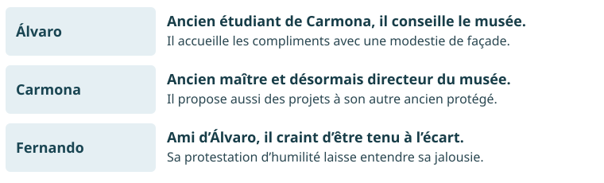

# X–ESPCI · MP-PC · Espagnol 2010 — corrigé brut

*Corrigé rédigé par IA, non officiel. Signalez toute erreur.*

**Rédaction** · GPT-6.2 Astra Ultra · vitesse non renseignée · 25 novembre 2026

Version et expression de 1 h 30 chacune, sans dictionnaire. Réponses en espagnol. Longueurs indicatives : 120 à 150 mots environ, puis 180 à 200 mots environ.

## 1. Version française

**Une exposition couronnée de succès**

L’exposition a plu à tout le monde. J’étais presque sûr qu’il en serait ainsi. Malgré l’air de modestie de circonstance avec lequel j’ai accueilli tous les éloges, sans faire le tri selon la valeur des avis exprimés — c’est incroyable, m’a dit la femme d’un dirigeant de la banque, qui portait des diamants à tous les doigts, même moi j’ai compris, alors vous voyez un peu… —, il faut bien dire que j’avais rarement obtenu un rapport aussi satisfaisant entre le travail investi, qui n’avait pas été si considérable, et le résultat, qui était spectaculaire. José Ignacio Carmona, qui, avant d’accepter l’offre de diriger le musée et de me recruter comme conseiller, avait été mon maître, presque mon gourou, et l’influence la plus marquante que j’aie eu la chance de subir pendant mes études, était enchanté. Enfin, en réalité, le mérite nous en revient à tous les deux, tu le sais bien, lui ai-je dit en aparté, […] et je me suis rendu compte qu’il était même un peu fier de moi. La réaction de Fernando Cisneros m’a davantage surpris. Il est arrivé en retard et en courant, avec cet air d’ours échauffé que le costume et la cravate donnaient à son corps large, carré, son corps de gros mammifère.

— Félicitations, Álvaro. […]

Fernando avait été l’autre chouchou de José Ignacio pendant nos études. Nous étions restés tous les trois très amis, lui et moi intimes, notre ancien professeur à un degré différent, qui traduisait la vénérable autorité qu’il exerçait sur nous. Fernando se laissait pourtant prendre de temps à autre d’une jalousie presque enfantine devant ce qu’il considérait comme une alliance qui l’avait laissé sur la touche. Non, non, ça, c’est pour vous, les apôtres de la science, disait-il, vous autres, les scientifiques, pas moi, penses-tu, moi je ne suis qu’un humble fonctionnaire de l’administration de l’État… Je ne le prenais pas au sérieux. José Ignacio, lui, cédait parfois à la tentation de se sentir coupable et lui proposait des projets que Fernando refusait invariablement, mais qui le tranquillisaient pour un temps. Les trous noirs avaient été la dernière de ces propositions […].

*Almudena Grandes, El corazón helado, 2008, selon la page du concours.*

## 2. Expression en espagnol

Catherine Bréchignac, *N’ayons pas peur de la science* (2009), « Du bon usage du temps ».

### 1. ¿Qué aspectos de la civilización moderna critica la autora?

Catherine Bréchignac critica una sociedad que confunde avanzar con acelerar. La búsqueda constante de eficacia termina por saturar las actividades y puede producir estancamiento, como sugieren las crisis económicas cada vez más frecuentes. La circulación incesante de anuncios y mensajes tampoco garantiza que se comunique algo significativo. La cultura de la inmediatez ocupa la atención sin conceder tiempo para revisar una idea o cambiar de dirección. La autora señala incluso que los adultos organizan sin descanso las actividades infantiles, como si cualquier instante de aburrimiento fuera necesariamente una pérdida. A su juicio, detenerse permite advertir que uno ha llegado a un callejón sin salida y buscar otra vía. La ciencia y la filosofía necesitan precisamente ese margen para imaginar, razonar y evitar errores.

*123 mots.*

### 2. ¿Puede la ciencia ser un antídoto contra la angustia?

La ciencia puede aliviar algunas angustias porque permite sustituir una amenaza indefinida por preguntas a las que se puede responder. Imaginemos una población que siente temblores ocasionales y oye circular historias contradictorias. Saber qué mide un sismógrafo, qué se conoce sobre la región y qué aspectos siguen siendo imprevisibles ayuda a distinguir una información fiable de una afirmación sin pruebas. A veces tranquiliza más oír una explicación honrada de lo que no sabemos que recibir una promesa de seguridad que nadie puede cumplir.

Sin embargo, el conocimiento no suprime todas las razones para estar inquieto. Las mismas mediciones pueden revelar que determinadas viviendas son vulnerables. En tal caso, la angustia de quien no tiene recursos para mudarse no se resolverá con otra gráfica. Hacen falta además decisiones públicas, apoyo mutuo y tiempo para escuchar qué preocupa a las personas afectadas. Incluso el exceso de cifras, difundidas sin contexto, puede alimentar la ansiedad que pretendía disipar. Entiendo, por tanto, la ciencia como una ayuda para pensar y actuar con más libertad. Su efecto depende también de cómo se comunican los resultados y de lo que una sociedad está dispuesta a hacer con ellos.

*192 mots.*

## Sources

École polytechnique et École supérieure de physique et de chimie industrielles. Le rapport écrit de cette option reste à retrouver.

[Sujet, p. 7](https://www.alloschool.com/assets/documents/course-286/x-ens-mp-pc-2010-langues-vivantes.pdf#page=7) · [Sujet complémentaire, p. 1–2](https://www.alloschool.com/assets/documents/course-286/x-ens-mp-pc-2010-langues-vivantes.pdf#page=1)
