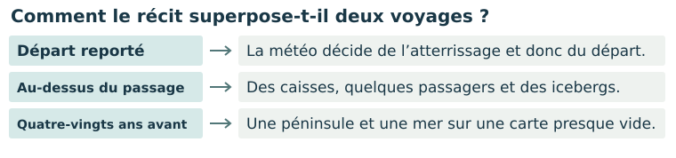
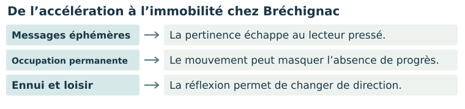
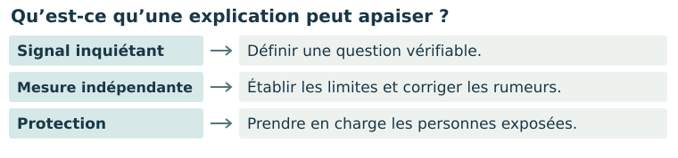

# X · MP-PC · Italien 2010 — Corrigé brut

*Corrigé rédigé par IA, non officiel. Signalez toute erreur.*

**Rédaction** · GPT-6.2 Astra Ultra · vitesse non renseignée

Les deux cahiers durent chacun une heure trente, sans dictionnaire. La version se rédige en français. Les deux réponses au texte français se rédigent en italien. Le sujet donne à titre indicatif 120 à 150 mots pour la première et 180 à 200 pour la seconde.

## V. Version française

**Voyage vers l’Antarctique**

L’avion pour l’Antarctique partit au coucher du soleil, après deux jours de reports et de coups de téléphone à la Fuerza Aérea. Je demandais une confirmation et l’on me répondait « Non, là-bas on ne peut pas atterrir. » Il était entendu dès le début qu’en cas de mauvaises conditions météorologiques le vol serait annulé et, comme nous entrions dans l’automne austral, il se pouvait qu’il n’y en eût pas d’autre. Du point de vue de la Fuerza Aérea, j’étais libre de me trouver une occupation en Patagonie jusqu’à la prochaine belle saison. Puis, un après-midi, le téléphone sonna. On me dit de me hâter parce que « là-bas » le ciel s’était dégagé, et je courus à l’aéroport. L’avion militaire était déjà chargé, ses moteurs tournaient. J’y entrai dans un fracas assourdissant et l’on referma la porte derrière moi.

J’ai dit que le soleil se couchait, mais il restait suspendu ou descendait avec une extrême lenteur. Nous survolions le passage de Drake. Des caisses de matériel et de vivres occupaient les trois quarts de l’avion et nous étions une quinzaine assis sur les quelques strapontins. Des scientifiques chinois et coréens, un professeur de Boston, des parents d’officiers d’une base chilienne de l’Antarctique, quelques Américains âgés à qui il ne manquait plus qu’un continent pour les avoir vus tous les sept. Plus tard, à travers les hublots masqués par les râteliers de civières, apparaîtraient les premiers icebergs tabulaires, grands marbres flottants, seigneurs immaculés de cette mer.

Il y a quatre-vingts ans à peine, les cartes de l’Amirauté donnaient de l’Antarctique une géographie curieuse, un blanc indéterminé d’où émergeaient, comme dans les dessins à compléter, deux formes seulement en pointillés. La péninsule de Palmer, mille deux cents kilomètres plus au sud sur cette même route, et la mer de Ross dans un autre quadrant. Y aller alors à bord de voiliers équipés d’une petite chaudière à vapeur, sans télégraphe ni radio, c’était comme partir pour la Lune. L’Antarctique était une autre planète, un corps céleste habité par des millions de manchots, Martiens gauches et impeccables. On ne savait pas très bien où finissait l’eau et où commençait la glace, ni si la glace prenait fin pour laisser place à une terre.

*Daniele Del Giudice, Horizon mobile, 2009.*

## 1. Quali aspetti della civiltà moderna critica l’autrice?

Bréchignac critica una civiltà che considera ogni aumento della velocità come una garanzia di progresso. Tra uno schermo e l’altro, si passa da una notizia a una voce senza avere il tempo di valutarne la pertinenza. L’informazione scade presto, i messaggi si ripetono e la quantità di attività finisce per ostacolare la comunicazione. Il succedersi sempre più rapido delle crisi economiche appare all’autrice un sintomo della stessa agitazione. Neppure ai bambini è concesso un momento vuoto: si organizzano occupazioni continue, come se annoiarsi fosse una colpa. Eppure la noia può rendere evidente un vicolo cieco e permettere di cambiare direzione. Per ritrovare un ritmo fecondo occorrono tempo libero, immaginazione e riflessione, condizioni che nutrono tanto la ricerca scientifica quanto la filosofia e aiutano a sottrarsi alla paura.

*127 mots.*

## 2. La scienza può essere un antidoto all’angoscia?

La scienza può attenuare l’angoscia quando trasforma un sospetto indistinto in una domanda alla quale è possibile rispondere. Se gli abitanti di un paese avvertono un odore insolito nell’acqua, un laboratorio indipendente può confrontare campioni prelevati in luoghi e momenti diversi. Spiegare quali sostanze siano state cercate, quali limiti abbia la misura e quando verrà ripetuta offre una base per giudicare le voci che cominciano a circolare. Promettere immediatamente che tutto va bene sarebbe più rassicurante soltanto per qualche ora.

Può darsi, però, che l’analisi confermi un pericolo. In quel caso la paura è comprensibile e conoscere il risultato non basta a proteggere una famiglia che non dispone di un’altra fonte. Occorrono acqua sicura, assistenza e una decisione pubblica su chi sosterrà il costo degli interventi. Neppure il ricercatore più competente può sostituirsi da solo a queste responsabilità.

Perciò vedo nella scienza un antidoto alla paralisi che nasce dal non sapere come controllare una diceria. Non le chiederei di cancellare ogni inquietudine: alcune paure richiamano l’attenzione su un danno reale. Le chiederei piuttosto di aiutarci a distinguerle e di rendere i risultati abbastanza chiari perché ciascuno possa partecipare a una scelta ragionata.

*192 mots.*

Les deux cahiers sont réunis dans le fac-similé, avec l’expression de Catherine Bréchignac aux pages 1 et 2 et la version de Daniele Del Giudice à la page 8 du PDF. La notice de l’ESPCI confirme le format de l’épreuve. Le rapport spécifique de l’écrit italien reste à retrouver.

[Cahier de version](https://www.alloschool.com/assets/documents/course-286/x-ens-mp-pc-2010-langues-vivantes.pdf#page=8) · [Cahier d’expression](https://www.alloschool.com/assets/documents/course-286/x-ens-mp-pc-2010-langues-vivantes.pdf#page=1) · [Notice officielle de l’ESPCI](https://www2.espci.fr/enseignement/brochure_concours_2010_polytechnique.pdf#page=20)
