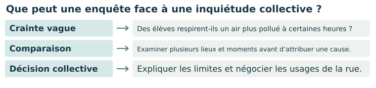

# X · MP-PC · Portugais 2010 — Corrigé guidé

*Corrigé rédigé par IA, non officiel. Signalez toute erreur.*

**Rédaction** · GPT-6.2 Astra Ultra · vitesse non renseignée

Les deux cahiers durent chacun une heure trente, sans dictionnaire. La version se rédige en français. Les deux réponses au texte français se rédigent en portugais. Le sujet donne à titre indicatif 120 à 150 mots pour la première et 180 à 200 pour la seconde.

## V. Version française

*Chácara* signifie une propriété de campagne et désigne cette maison familiale. *Malas* est repris au singulier lorsque la personne qui raconte sort les vêtements d’une valise. *Patrões* désigne les maîtres de maison, *capas* des capes ou des manteaux. *Não pude deixar de rir* traduit une réaction irrépressible. Dans la dernière phrase, le *não* après *a que lutas* renforce l’exclamation française.

**Une nouvelle habitante à la Chácara**

Depuis qu’elle est arrivée, nous n’avons plus une minute de tranquillité. À chaque instant, elle réclame quelque chose et elle n’est jamais contente. Elle se plaint des domestiques, de la maison, du climat, de tout enfin, comme si nous étions responsables de ce qui lui arrive. Je ne l’ai pas encore vue au repos, et je crois que c’est une attitude qui lui convient mal. Elle va sans cesse de-ci de-là, occupée à quelque chose ou simplement à imaginer ce qu’elle pourrait faire. Cela lui donne un air fébrile, teinté d’hostilité, qui installe dans toute la maison une atmosphère de malaise et d’attente. Là-dedans, les domestiques se plaignent, et ici, dehors, les maîtres ne montrent pas un visage des plus encourageants.

Malgré toute cette agitation, chose curieuse, dès le premier instant elle ne m’a pas paru en parfaite santé. Elle s’est plainte de maux de tête et m’a semblé pâle. Des cernes sombres ont bientôt entouré ses yeux. Dès qu’elle est entrée dans sa chambre, elle a commencé à défaire les nombreuses valises qu’elle avait apportées. Je lui ai demandé à quoi lui servaient tant de robes, si elle comptait les porter toutes. Et j’ai ajouté « Ici, à la maison, on sort si rarement ! » Elle m’a répondu avec irritation « Qu’est-ce que cela peut bien me faire qu’on sorte ou non dans cette maison ? Je ferai exactement ce que je voudrai. » Puis elle m’a demandé s’il n’y avait pas de distractions en ville, des bals, du théâtre, des réunions d’un genre quelconque. Je n’ai pas pu m’empêcher de rire tout en sortant de la valise cette montagne de manteaux et de robes. Voyant l’air fâché dont elle me regardait, je lui ai aussitôt assuré que nous n’avions ni bals ni théâtres, que tout au plus M. le baron réunissait de temps à autre quelques familles dans sa propriété, mais que nous autres, de la Chácara, n’allions jamais à ces réceptions. « Pourquoi ? » a-t-elle demandé, toujours occupée à m’aider à fouiller dans les boîtes. « C’est la façon de vivre de M. Demétrio », ai-je répondu. Elle a tout lâché, a posé sur moi un regard dur. « Je ne veux pas vivre selon les principes de M. Demétrio », a-t-elle dit. J’ai simplement haussé les épaules, en imaginant à quelles luttes il nous faudrait assister si elle entendait vraiment inaugurer un autre genre de vie.

*Lúcio Cardoso, Chronique de la maison assassinée, 1959.*

## 1. Que aspectos da civilização moderna a autora critica?

Construire le paradoxe activité permanente et stagnation. *Tédio* désigne l’ennui, *ócio* un loisir disponible pour la pensée. La référence aux enfants appartient à la critique sociale. *Acabar por* suivi d’un infinitif marque l’aboutissement inattendu d’un processus.

Bréchignac critica uma sociedade que confunde a rapidez da circulação das notícias com o avanço do pensamento. O excesso de informações, a troca contínua de telas e o hábito de executar várias tarefas ao mesmo tempo impedem que se examine a pertinência do que se recebe. Mensagens vazias acabam por ocupar o lugar de uma comunicação efetiva. A própria sucessão acelerada das crises econômicas lhe parece um sinal dessa agitação que produz estagnação. Na vida cotidiana, exige-se atividade permanente até das crianças, cujo tempo é preenchido para que nunca sintam tédio. No entanto, o tédio pode revelar que chegamos a um impasse e nos dar a oportunidade de mudar de direção. A autora defende o tempo livre necessário para reorganizar as ideias, imaginar e exercer a razão, tanto na ciência quanto na filosofia.

*133 mots.*

## 2. A ciência pode ser um antídoto para a angústia?

La métaphore d’un antidote suggère une efficacité automatique. La discuter en distinguant entre mesure, explication et arbitrage. Pour garder une véritable valeur de possibilité, utiliser *pode ser que* avec le subjonctif. Une observation de pollution localisée ne détermine à elle seule ni la cause ni la meilleure politique communale.

Uma família que vê todos os dias uma fila de carros junto à escola pode se perguntar que ar as crianças respiram. Sem dados, é difícil saber se o cheiro mais forte corresponde ao pior momento do dia ou se outra rua apresenta o mesmo problema. Medições feitas em diferentes horários e locais permitem formular uma pergunta mais precisa e comparar explicações. Já há algum alívio em saber o que se pode verificar e quando virão os resultados.

Mas os resultados também podem dar razão às famílias e aumentar sua preocupação. Nesse caso, seria estranho dizer que a ciência falhou porque ninguém ficou mais tranquilo. Seu valor está em tornar discutível, diante de todos, uma situação que antes dependia da impressão de cada pessoa. Decidir se é melhor mudar o trajeto dos ônibus ou limitar o estacionamento envolve escolhas sobre custos, horários e acesso à escola. Nenhum aparelho pode decidir isso sozinho.

A ciência me parece um recurso contra a angústia quando permite agir com razões que outras pessoas podem examinar. Para que esse recurso funcione, são igualmente necessários tempo para ouvir as dúvidas e instituições dispostas a responder pelo que farão com as descobertas.

*195 mots.*

La version reproduit un extrait de Crônica da casa assassinada de Lúcio Cardoso (1959). La pièce d’expression provient de N’ayons pas peur de la science de Catherine Bréchignac (2009). Les réponses sont écrites en portugais brésilien. La notice de l’ESPCI documente le concours. Aucun rapport spécifique à la composition portugaise n’a été retrouvé.

[Cahier de version](https://www.alloschool.com/assets/documents/course-286/x-ens-mp-pc-2010-langues-vivantes.pdf#page=9) · [Cahier d’expression](https://www.alloschool.com/assets/documents/course-286/x-ens-mp-pc-2010-langues-vivantes.pdf#page=1) · [Notice officielle de l’ESPCI](https://www2.espci.fr/enseignement/brochure_concours_2010_polytechnique.pdf#page=20)
