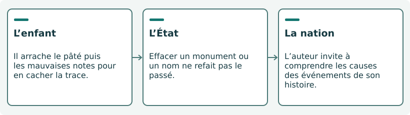

# X · MP-PC · Russe 2010 — Corrigé brut

*Corrigé rédigé par IA, non officiel. Signalez toute erreur.*

**Rédaction** · GPT-6.2 Astra Ultra · vitesse non renseignée

Le texte d’Andreï Kontchalovski est suivi des questions du cahier commun sur « Du bon usage du temps » de Catherine Bréchignac. Le rapport écrit de russe de 2010 reste à retrouver. Les deux réponses russes comptent 125 et 183 mots.

## I. Version française

**La guerre contre la mémoire**

Je me souviens qu’à l’école primaire, dès que je faisais un pâté sur une page de mon cahier, je l’arrachais sur-le-champ. J’avais envie de recommencer ma vie. Plus tard, c’était à mon carnet de notes que j’arrachais les pages où figuraient de mauvaises notes, pour que mes parents n’aient pas trop mauvaise opinion de moi. L’enfance est précisément faite pour cela, pour croire qu’en cachant les traces de ses erreurs on devient meilleur et plus raisonnable. Mais dans nos parlements ce sont des adultes qui siègent, pas des enfants. Et un adulte qui se conduit comme un enfant, on appelle cela un sot.

On ne peut pas refaire le passé, et une nation ne deviendra pas meilleure si l’on commence à arracher des pages à son histoire. Il est dans la nature humaine de vouloir oublier le passé, refaire l’histoire, fermer les yeux sur la honte obscure que nous inspirent nos actes. C’est une réaction affective. Voilà de quoi expliquer le comportement de la foule à Bagdad, qui dansait sur la statue renversée du dictateur. Mais en politique, et quand il s’agit de prendre des décisions pour le pays, les émotions ne sont pas les meilleures conseillères. La guerre contre la mémoire, la guerre menée au passé à l’échelle de l’État est dangereuse. Passe encore pour les bolcheviks. L’histoire, la culture de leur peuple, sa religion leur étaient indifférentes. Nous savons que c’étaient des vandales. Voilà pourquoi ils détruisaient tout, monuments et églises, et changeaient les noms millénaires des villes. Mais la Douma d’État, elle, a pourtant à cœur la renaissance de la Russie.

Non, la Russie ne connaîtra pas de renaissance tant qu’elle gardera ce désir enfantin de « recommencer avec un cahier tout neuf ». Il faut apprendre à comprendre les causes de sa propre histoire, car rien au monde n’arrive par hasard.

Andreï Kontchalovski, 2007.

## II.1. Analyse du texte commun

Автор критикует образ жизни, при котором всякое движение принимают за продвижение вперёд. Новости устаревают раньше, чем человек успевает оценить их значение. Телефон и компьютер позволяют переходить от одной задачи к другой, но постоянное переключение мешает выстроить мысль. Всё больше сообщений повторяют друг друга, не создавая подлинного общения. Возникает парадокс: общество стремится к эффективности, однако избыток беспорядочной активности ведёт к застою, симптом которого автор видит в учащении экономических кризисов. Особенно наглядно эта установка проявляется в отношении к детям. Их день заранее заполнен занятиями, словно скучать всегда вредно. Между тем остановка даёт возможность заметить, что выбранный путь ведёт в тупик, и поискать другое направление. Поэтому угрозой для мысли автор считает вовсе не прогулки воображения, а исчезновение свободного времени, необходимого и для научного поиска, и для самостоятельного суждения.

## II.2. Réflexion personnelle

Чтобы ответить на этот вопрос, я бы различил тревогу перед непонятным событием и тревогу перед вполне понятной опасностью. Ночью от сильного толчка в доме качается люстра. Объяснение геолога помогает понять причину случившегося и не принимать на веру слухи, будто завтра город обязательно разрушится. Полезно и честное признание специалиста, что назначить точный час следующего толчка он не может. Оно лишает ложное предсказание убедительности и показывает, какие вопросы вообще имеют смысл.

Однако тот же геолог может установить, что район действительно подвержен землетрясениям. Теперь у жителя есть веская причина тревожиться за старый дом. В этом случае успокаивает не одно знание, а возможность им воспользоваться. Если обследуют здания, укрепят школу и открыто объяснят результаты проверки, семья получит основания доверять принятым решениям. Если отчёт останется в шкафу, сведения о риске могут, наоборот, усилить чувство бессилия.

Наконец, человек боится не только непонятных явлений. Иногда его тревожит судьба близкого, и никакая точность прогноза не заменит присутствия другого человека рядом. Поэтому я назвал бы науку средством против слухов и беспомощности перед неизвестным. Она не обязана устранять всякую тревогу: иногда тревога разумна и именно она побуждает общество применить то, что уже известно.

[Sujet](https://www.alloschool.com/assets/documents/course-286/x-ens-mp-pc-2010-langues-vivantes.pdf#page=10) · [Sujet complémentaire](https://www.alloschool.com/assets/documents/course-286/x-ens-mp-pc-2010-langues-vivantes.pdf#page=1)
