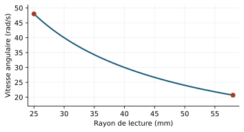
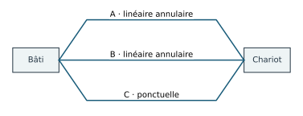
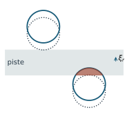
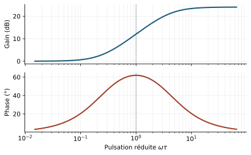
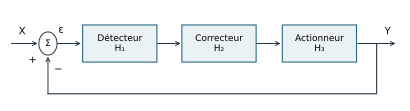
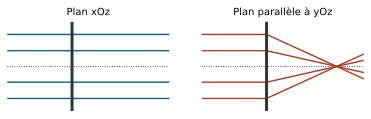
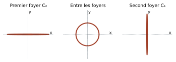
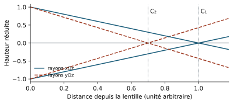

# X MP 2010 — Composition de physique et sciences de l’ingénieur · Corrigé brut

*Corrigé rédigé par IA, non officiel. Signalez toute erreur.*

**Lecture du rapport du jury** · GPT-6.2 Astra Ultra · vitesse non renseignée

**Rédaction** · GPT-6.2 Astra Ultra · vitesse non renseignée

## Lecteurs optiques numériques

## I.1 — Cinématique du lecteur

### Question I.1 — Longueur de la piste

La spirale d’Archimède obéit à $r=r_0+b\theta$ avec $b=p/(2\pi)$. Sa longueur élémentaire exacte est $\mathrm ds=\sqrt{r^2+b^2}\,\mathrm d\theta$. Ici $b/r_0$ est de l’ordre de $10^{-5}$. On peut donc remplacer $\mathrm ds$ par $r\,\mathrm d\theta=(2\pi/p)r\,\mathrm dr$ avec une erreur relative inférieure à $10^{-10}$. L’intégration donne
$$L\simeq\frac{\pi(r_1^2-r_0^2)}p
=\frac{\pi(0{,}058^2-0{,}025^2)}{1{,}6\times10^{-6}}
\simeq5{,}38\ \mathrm{km}.$$
On retrouve ce résultat en divisant l’aire annulaire gravée par la distance entre deux spires voisines.

### Question I.2 — Durée de lecture

La vitesse linéaire étant imposée le long de la piste, $T=L/V\simeq5378/1{,}2\simeq4480\ \mathrm s$, soit environ **75 minutes**. Cet ordre de grandeur correspond à la durée d’un CD audio.

### Question I.3 — Vitesse angulaire du disque

À la précision de la question 1, $V=r\omega$. La vitesse angulaire en valeur absolue est donc $\omega(r)=V/r$, une hyperbole décroissante. Au début de la lecture, $\omega_0=48{,}0\ \mathrm{rad\,s^{-1}}$, soit $458\ \mathrm{tr\,min^{-1}}$. À la fin, $\omega_1=20{,}7\ \mathrm{rad\,s^{-1}}$, soit $198\ \mathrm{tr\,min^{-1}}$. Le facteur de conversion en tours par minute est $60/(2\pi)$.

### Question I.4 — Avance radiale du spot

L’avancée radiale est d’un pas par tour. En valeur positive vers l’extérieur,
$$\dot u(r)=\frac p{2\pi}\omega(r)\simeq \frac{pV}{2\pi r}.$$
On obtient $\dot u_0=12{,}2\ \mathrm{\mu m\,s^{-1}}$ et $\dot u_1=5{,}27\ \mathrm{\mu m\,s^{-1}}$. Le spot avance donc plus lentement sur les derniers tours.

## I.2 — Guidage du chariot

### Question I.5 — Liaisons du chariot

En A et en B, les trois rotations et la seule translation selon $x$ sont admises. Il s’agit de deux liaisons **linéaires annulaires** d’axe parallèle à $x$ (ou sphère-cylindre). En C, les trois rotations ainsi que les translations suivant $x,y$ sont admises. C’est une liaison **ponctuelle** de normale $\vec z$. Les trois liaisons sont placées en parallèle entre le même chariot et le même bâti.

### Question I.6 — Liaison équivalente

Comme $\overrightarrow{AB}=a\vec x$, la relation de transport des vitesses donne $\vec V_B-\vec V_A=\vec\Omega\times a\vec x=a(\dot\gamma\vec y-\dot\beta\vec z)$. En A et B, les vitesses sont parallèles à $x$. Leurs composantes $y,z$ imposent donc $\dot\beta=\dot\gamma=0$. Il ne reste comme rotation possible que $\dot\alpha\vec x$.

Le point C est à une distance transverse non nulle $b$ de la droite AB. Une rotation autour de $x$ produirait en C une composante de vitesse suivant $z$ de module $b|\dot\alpha|$, interdite par l’appui ponctuel. Ainsi $\dot\alpha=0$. En A le torseur a pour éléments $\vec\Omega=\vec 0$ et $\vec V_A=\dot u\vec x$. La liaison équivalente est une glissière de direction $x$.

### Question I.7 — Degré d’hyperstatisme

Les deux liaisons linéaires annulaires fournissent deux inconnues d’effort chacune, la ponctuelle en fournit une, soit cinq contraintes. La mobilité du chariot est $m=1$ et le rang nécessaire des contraintes sur un solide spatial vaut $6-m=5$. Donc $h=5-5=0$. Le guidage est isostatique dans le modèle idéal. Chaque contact impose une condition indépendante.

## I.3 — Dynamique de la transmission

### Question I.8 — Couple de torsion

L’arbre est supposé sans précontrainte. Si le moteur a tourné davantage que la vis, l’arbre entraîne cette dernière dans le sens positif. Le couple exercé sur l’engrenage est donc
$$C_1=K_t(\theta_m-\theta_1).$$
Le couple appliqué en retour au rotor est $-C_1$.

### Question I.9 — Bilan du rotor

Le stator exerce le couple moteur $C_m$ et l’arbre oppose $-C_1$. Le poids et les efforts des paliers parfaits n’ont pas de moment projeté sur l’axe de rotation dans ce modèle. Le théorème du moment dynamique projeté donne
$$I_m\ddot\theta_m=C_m-K_t(\theta_m-\theta_1).$$

### Question I.10 — Bilan du chariot

La crémaillère pousse selon $x$ avec la force $F_p$. Le poids est vertical et les réactions du guidage idéal sont sans composante selon le mouvement autorisé. En négligeant les frottements, la projection de la résultante dynamique fournit $M\ddot u=F_p$.

### Question I.11 — Couplage des deux déplacements

Introduisons $\theta_1=u/K_e$ dans les relations de torsion. Sur le chariot $F_p=C_1/K_e$ et sur le rotor le couple du ressort vaut $-C_1$. Il vient
$$I_m\ddot\theta_m+K_t\theta_m-\frac{K_t}{K_e}u=C_m,$$
$$M\ddot u-\frac{K_t}{K_e}\theta_m+\frac{K_t}{K_e^2}u=0.$$
Les termes élastiques disparaissent dans les deux équations lorsque $u=K_e\theta_m$, ce qui correspond à un arbre sans torsion.

### Question I.12 — Matrices d’inertie et de raideur

Avec les coordonnées généralisées $(\theta_m,u)$ et les efforts $(C_m,0)$, le système s’écrit $[M]\ddot X+[K]X=F$ avec
$$[M]=\begin{pmatrix}I_m&0\\0&M\end{pmatrix},\qquad
[K]=K_t\begin{pmatrix}1&-1/K_e\\-1/K_e&1/K_e^2\end{pmatrix},\qquad F=\begin{pmatrix}C_m\\0\end{pmatrix}.$$
Numériquement, en unités SI avec les angles en radians,
$$[M]=\begin{pmatrix}1{,}25\,10^{-10}&0\\0&5{,}00\,10^{-4}\end{pmatrix},\qquad
[K]=\begin{pmatrix}0{,}785&-1{,}9625\,10^4\\-1{,}9625\,10^4&4{,}90625\,10^8\end{pmatrix}.$$
Les deux lignes sont respectivement un bilan de couple en $\mathrm{N\,m}$ et un bilan de force en $\mathrm N$. La symétrie de la raideur se retrouve en développant l’énergie $\tfrac12K_t(\theta_m-u/K_e)^2$.

### Question I.13 — Fréquences propres

Une amplitude libre non nulle vérifie $([K]-\omega^2[M])A=0$. Le déterminant est nul. Après division par $MI_m$ il reste
$$\omega^2\left[\omega^2-K_t\left(\frac1{I_m}+\frac1{M K_e^2}\right)\right]=0,
\qquad \omega^4-9{,}8753\times10^{11}\omega^2=0$$
en unités SI. Le mode $f_1=0$ est un mouvement d’ensemble sans torsion. Le mode élastique a $\omega_2\simeq9{,}94\times10^5\ \mathrm{rad\,s^{-1}}$ et $f_2=\omega_2/(2\pi)\simeq158\ \mathrm{kHz}$. La dynamique libre contient donc un mode oscillant non amorti et un mode à fréquence nulle, qui peut également dériver à vitesse constante.

## I.4 — Réglage radial fin

### Question I.14 — Géométrie du parallélogramme

Avec une longueur de bras $l_r$ et un angle compté dans le sens du déplacement, $x_r=l_r\sin\alpha_r\simeq l_r\alpha_r$. Les quatre amincissements du parallélogramme radial tournent chacun d’un angle de module $|\alpha_r|$. Leur énergie totale vaut $4(c\alpha_r^2/2)$. À l’équilibre la force appliquée satisfait $f_r\,\mathrm dx_r=\mathrm d(2c\alpha_r^2)$, d’où
$$f_r=\frac{4c\alpha_r}{l_r\cos\alpha_r}\simeq\frac{4c}{l_r^2}x_r.$$

### Question I.15 — Raideur équivalente

La force nécessaire pour maintenir le déplacement est $f_r=k_rx_r$ au premier ordre. Ainsi $k_r=4c/l_r^2$, en $\mathrm{N\,m^{-1}}$. L’effort de rappel exercé par la structure sur le support a le signe opposé.

### Question I.16 — Transfert de la partie mécanique

La force motrice $f_r$, le rappel $-k_rx_r$ et le frottement $-\mu\dot x_r$ sont les trois forces suivant l’axe autorisé. On obtient
$$m\ddot x_r+\mu\dot x_r+k_rx_r=f_r,\qquad
H_r(p)=\frac{X_r(p)}{F_r(p)}=\frac1{mp^2+\mu p+k_r}.$$
Le transfert suppose des conditions initiales nulles. Son gain statique est la souplesse $1/k_r$.

### Question I.17 — Force électromagnétique

Pour la longueur active $l$ de conducteur, la résultante de Laplace a pour module $Bl|i|$. En orientant le courant moteur pour qu’un courant positif pousse le support dans le sens $+x_r$, on a $f_r=Bl\,i$. Dans cette convention, $e_m=Bl\dot x_r$ est la force contre-électromotrice à vaincre. On a bien $f_r\dot x_r=e_m i$ pour la puissance convertie.

### Question I.18 — Équation électrique

Avec la convention moteur de la question 17, le transformateur impose $u_b=K_bu$. La tension alimente la résistance et l’inductance et compense la contre-électromotrice,
$$K_bu=Ri+L\frac{\mathrm di}{\mathrm dt}+e_m,\qquad e_m=Bl\dot x_r.$$
En multipliant par $i$, on retrouve les pertes Joule, la variation d’énergie de l’inductance et la puissance transmise au support. Ce contrôle fixe la polarité de l’actionneur malgré les conventions possibles sur la flèche de la f.é.m.

### Question I.19 — Courant et force dans le domaine de Laplace

À conditions initiales nulles, la chute de tension aux bornes de l’impédance $R+Lp$ est $K_bU-Bl\,pX_r$. D’où
$$I(p)=\frac{K_bU(p)-Bl\,pX_r(p)}{R+Lp},\qquad
F_r(p)=\frac{K_bBl\,U(p)-(Bl)^2pX_r(p)}{R+Lp}.$$
Le terme lié à la vitesse a bien un effet de freinage sur la mécanique.

### Question I.20 — Transfert de l’actionneur complet

Remplaçons $F_r$ dans $(mp^2+\mu p+k_r)X_r=F_r$. En regroupant les termes qui contiennent $X_r$, il vient
$$\frac{X_r}{U}=
\frac{K_bBl}{(R+Lp)(mp^2+\mu p+k_r)+(Bl)^2p}.$$
Le dénominateur développé vaut $Lm p^3+(Rm+L\mu)p^2+[R\mu+Lk_r+(Bl)^2]p+Rk_r$. En particulier la conversion électromécanique augmente l’amortissement.

### Question I.21 — Modèle du second ordre

Dans la bande étudiée, la petite constante électrique $L/R$ permet de négliger les termes proportionnels à $L$. Posons $\omega_0^2=k_r/m$, $2\zeta\omega_0=\mu/m+(Bl)^2/(mR)$ et $A_3=K_bBl/(mR)$. Le transfert devient
$$H_3(p)=\frac{A_3}{p^2+2\zeta\omega_0p+\omega_0^2}
=\frac{K_3}{1+2\zeta p/\omega_0+(p/\omega_0)^2}.$$
Les données donnent $\omega_0=313\ \mathrm{rad\,s^{-1}}$ ($49{,}8\ \mathrm{Hz}$), $\zeta=5{,}87/(2\omega_0)=0{,}00938$, $A_3=1{,}11\times10^6$ en unités SI et $K_3=A_3/\omega_0^2=11{,}34\ \mathrm{m\,V^{-1}}$. Les deux pôles ont une partie réelle $-\zeta\omega_0=-2{,}94\ \mathrm{s^{-1}}$. Le système est asymptotiquement stable et très faiblement amorti, donc susceptible d’une forte résonance.

## I.5 — Asservissement du lecteur

### Question I.22 — Retour unitaire et stabilité

Le comparateur fournit $\varepsilon=X-Y$, puis $Y=H\varepsilon$. On obtient
$$\frac YX=\frac{H}{1+H},\qquad \frac{\varepsilon}{X}=\frac1{1+H}.$$
Pour un système continu rationnel, la stabilité asymptotique exige que tous les pôles en boucle fermée aient une partie réelle strictement négative. Si $H=N/D$ sans simplification cachant un mode interne, le polynôme à tester est $D+N$. En fréquence on peut employer le critère de Nyquist du point $-1$, en tenant compte des pôles ouverts instables. Dans le cas usuel d’une boucle ouverte stable avec un seul passage pertinent à gain unité, des marges de phase et de gain positives assurent la stabilité.

### Question I.23 — Aires des deux spots latéraux

Prenons $\xi_r>0$ vers le spot supérieur et $\Delta a=a^+-a^-$. Sur la figure 12, les cercles en position centrée sont tangents aux deux bords extérieurs de la piste. Lors d’un petit décalage positif, le spot supérieur reste entièrement hors de la piste et le spot inférieur y pénètre d’une hauteur $t=\xi_r$. La différence cherchée est alors l’aire $S(t)$ d’un segment de disque. Pour $0\le t\le2R_s$, une intégration par tranches parallèles au bord donne
$$S(t)=\int_0^t2\sqrt{2R_s v-v^2}\,\mathrm dv
=R_s^2\arccos\!\left(1-\frac{t}{R_s}\right)
-(R_s-t)\sqrt{2R_st-t^2}.$$
Pour $|\xi_r|<\min(h,2R_s)$, $\Delta a=\operatorname{sgn}(\xi_r)S(|\xi_r|)$. Plus généralement on prolonge $S$ par zéro pour $t<0$ et par $\pi R_s^2$ pour $t>2R_s$. La largeur finie de piste donne alors $\Delta a=\operatorname{sgn}(\xi_r)[S(|\xi_r|)-S(|\xi_r|-h)]$.

Près du centrage $S(t)\simeq(4/3)\sqrt{2R_s}\,t^{3/2}$. La pente à l’origine est donc nulle pour ces tangences et une loi linéaire à gain non nul ne représente pas le signal. Le développement local lui-même exige $|\xi_r|\ll R_s$. Le calcul de l’aire reste pertinent lorsque la déviation devient comparable au rayon du spot.

### Question I.24 — Gain du détecteur de focalisation

La portion rectiligne de la figure 13 passe par l’origine et par $(20\ \mathrm{\mu m},5\ \mathrm V)$. Le détecteur est instantané. Dans cette zone son transfert est la constante réelle positive
$$H_1(p)=\frac{U(p)}{Z_f(p)}=\frac{5}{20}\ \mathrm{V\,\mu m^{-1}}
=2{,}5\times10^5\ \mathrm{V\,m^{-1}}.$$
Le symbole $Z_f$ désigne la transformée de l’écart axial $\zeta_f$. Près de l’origine, le signe de la tension donne le sens de cet écart.

### Question I.25 — Maximum d’avance de phase

Pour un correcteur d’avance $k>1$, posons $x=\omega\tau$ et $p=i\omega$. Le gain et la phase sont
$$|H_2|=\sqrt{\frac{1+k^2x^2}{1+x^2/k^2}},\qquad
\varphi_2=\arctan(kx)-\arctan(x/k).$$
Le gain part de 1, croît entre $1/(k\tau)$ et $k/\tau$ avec une asymptote à $+20\ \mathrm{dB}$ par décade, puis tend vers $k^2$. La phase part de zéro et y revient. Sa dérivée par rapport à $x$ s’annule en $x=1$. Le maximum se situe à $p=i/\tau$, où $|H_2|=k$ et
$$\varphi_{\max}=2\arctan k-\frac{\pi}{2}
=\arcsin\frac{k^2-1}{k^2+1}.$$
Cette avance contribue à la marge réelle si la coupure à gain unité de la boucle est placée à cette pulsation.

### Question I.26 — Réglage de la boucle de focalisation

Les paramètres axial et radial sont donnés identiques. En mètres, secondes et volts, la partie actionneur est donc $H_3(p)=A_3/(p^2+bp+c_0)$ avec $A_3=1{,}11045\times10^6$, $b=5{,}87$ et $c_0=9{,}79\times10^4$. La chaîne directe est $H=H_1H_2H_3$, avec le retour négatif de la figure. Posons $A=H_1A_3=2{,}776125\times10^{11}\ \mathrm{s^{-2}}$.

Le réglage usuel consiste à **centrer le maximum d’avance à la coupure**, soit $\omega_c=1/\tau$. Ainsi les conditions de gain unité et de marge de phase $85^\circ$ sont
$$\sqrt{(c_0-\omega_c^2)^2+(b\omega_c)^2}=Ak,$$
$$180^\circ-\arg(c_0-\omega_c^2+i b\omega_c)
+\varphi_{\max}(k)=85^\circ.$$
Dans la seconde relation les angles sont exprimés en degrés et l’argument est pris entre $0^\circ$ et $180^\circ$. Comme la coupure calculée se situe très au-dessus de $\sqrt{c_0}$, l’actionneur y apporte presque $-180^\circ$. On déduit $k\simeq\tan(45^\circ+85^\circ/2)=22{,}9$ puis $\omega_c\simeq\sqrt{Ak}=2{,}52\times10^6\ \mathrm{rad\,s^{-1}}$ et $\tau\simeq3{,}97\times10^{-7}\ \mathrm s$. La substitution dans les deux relations confirme une marge de $85^\circ$ dans le modèle du second ordre.

On peut contrôler la stabilité sans lecture graphique. Le polynôme caractéristique vaut $(1+sp)(p^2+bp+c_0)+A(1+k^2sp)$, avec $s=\tau/k>0$. Ses coefficients sont positifs et le critère de Routh du troisième ordre demande $(1+sb)(b+s c_0+A k^2s)>s(c_0+A)$. La différence vaut $b+s b^2+A s(k^2-1)+s^2 b(c_0+A k^2)>0$ pour $k>1$. La boucle refermée est stable. La seule exigence de marge ne fixerait pas à elle seule les deux paramètres sans le choix de centrage.

## II.1 — Isolateur optique

### Question II.1 — Déphasage entre les axes de la lame

L’axe $x$ est la bissectrice des directions propres. Puisque $\vec e_x=(\vec e_L+\vec e_R)/\sqrt2$, on a $E_R/E_L=1$ à l’entrée. Les chemins optiques à incidence normale valent $n_Ld$ et $n_Rd$. Avec le facteur de propagation $\exp(-ik_0nz)$ du sujet, la lame multiplie les composantes par $e^{-ik_0n_Ld}$ et $e^{-ik_0n_Rd}$. À la sortie,
$$\frac{E_R}{E_L}=e^{i\delta},\qquad \delta=k_0(n_L-n_R)d.$$

### Question II.2 — Retard d’un quart d’onde

Les données donnent $\delta=2\pi(8{,}90\times10^{-3})(1{,}250\times10^{-3})/(780\times10^{-9})=89{,}62\ \mathrm{rad}$. Après retrait de **quatorze** tours complets, il reste $1{,}65\ \mathrm{rad}$, soit environ $94{,}6^\circ$. Ainsi $E_R/E_L\simeq-0{,}080+i\,0{,}997\simeq i$. La différence de chemin optique, modulo une longueur d’onde, est proche de $\lambda_0/4$. Dans les questions suivantes on emploie le modèle idéal $\delta=\pi/2$.

### Question II.3 — Courbe décrite par le champ

Dans le plan d’observation, les deux composantes sur les axes propres ont même amplitude $E_0/\sqrt2$ et vibrent en quadrature. L’extrémité du champ décrit donc un cercle de rayon $E_0/\sqrt2$. Plus précisément, en incluant la moitié de la différence de phase dans l’origine du temps, on peut écrire
$$E_x=E_0\cos(\delta/2)\cos s,\qquad E_y=E_0\sin(\delta/2)\sin s,\qquad s=\omega t+\mathrm{constante}.$$
Ces deux demi-axes sont égaux pour $\delta=\pi/2$. Les valeurs numériques littérales de la question 2 produisent une ellipse très proche du cercle.

### Question II.4 — Réflexion sur le disque

À la surface d’un conducteur parfait, le champ électrique tangent total est nul. À incidence normale les deux composantes sont tangentes et l’on a, à la surface, $\vec E_{\rm réfl}=-\vec E_{\rm inc}$. Le facteur complexe pour chacune vaut $-1=e^{i\pi}$. Dans la même base transverse fixe, $E_R/E_L=e^{i\delta}\simeq i$ reste inchangé. Le sens de propagation, lui, s’inverse.

### Question II.5 — Retour vers le cube

La traversée en sens inverse ajoute le même retard relatif de lame aux composantes propres car leurs chemins optiques augmentent de nouveau de $n_Ld$ et $n_Rd$. Le rapport final est donc $e^{2i\delta}\simeq-1$. Dans le cas idéal, $\vec E$ est proportionnel à $\vec e_L-\vec e_R=\sqrt2\vec e_y$. La polarisation rectiligne a tourné de $90^\circ$ par rapport à l’entrée. Le cube la dévie vers la photodiode. Avec le retard numérique arrondi du sujet, il subsiste une petite composante selon $x$.

## II.2 — Focalisation sur le disque

### Question II.6 — Diamètre du premier anneau noir

Le premier minimum est à l’angle $\alpha_1$ tel que $\sin\alpha_1=0{,}61\lambda_0/a$. Dans le modèle focal paraxial, le rayon de l’anneau noir est $f_2\tan\alpha_1\simeq f_2\alpha_1$. Son diamètre vaut donc
$$\phi_D\simeq1{,}22\,\frac{\lambda_0f_2}{a}.$$
La quantité $a$ est le rayon de la pupille.

### Question II.7 — Tache paraxiale et angle d’ouverture

Avec $f_2/a=2$, on trouve $\phi_D=1{,}22\times0{,}780\times2=1{,}90\ \mathrm{\mu m}$. Le rayon marginal convergent fait avec l’axe l’angle $u=\arctan(a/f_2)=26{,}6^\circ$. On a $\tan u=0{,}500$ tandis que $\sin u=0{,}447$. Le faisceau de convergence est trop ouvert pour assimiler précisément ces deux quantités. Les conditions de Gauss sont mal satisfaites même si l’angle diffracté $\alpha_1$ à la pupille est petit.

### Question II.8 — Ouverture numérique exacte

Sans approximation de petit angle, $\sin u=a/\sqrt{a^2+f_2^2}=1/\sqrt5$. Dans l’air l’ouverture numérique vaut donc $0{,}447$. La formule non paraxiale donne
$$\phi_{\rm NP}=\frac{1{,}22\,\lambda_0}{0{,}447}=2{,}13\ \mathrm{\mu m}.$$
Elle dépasse $\phi_D$ d’environ $12\,\%$, dans le sens attendu puisque $\sin u<\tan u$.

### Question II.9 — Position de la face avant du CD

Notons $s$ la distance entre $L_2$ et la face avant et $y$ la hauteur d’un rayon sur cette face. Le rayon incident convergerait à la distance $f_2-s\simeq y/u$ s’il restait dans l’air. La réfraction donne $u'\simeq u/n$ dans le diélectrique. Pour atteindre la surface réfléchissante située à la profondeur $e$, il faut donc $e\simeq y/u'=n(f_2-s)$. Ainsi
$$s=f_2-\frac en=2{,}5-\frac{1{,}2}{1{,}55}\simeq1{,}73\ \mathrm{mm}.$$
La profondeur apparente de la face réfléchissante pour l’observateur dans l’air est $e/n$.

### Question II.10 — Invariance de l’ouverture numérique

À l’entrée du disque, Snell-Descartes donne $n_{\rm air}\sin u=n\sin u'$. L’ouverture numérique au foyer est donc inchangée. La formule $\phi_{\rm NP}=1{,}22\lambda_0/\mathrm{NA}$, où $\lambda_0$ est la longueur d’onde dans le vide, conserve le même diamètre. Dans le modèle paraxial un dioptre plan a un grandissement transverse unité. Il déplace axialement le plan de convergence tout en conservant les dimensions transverses de son image, en accord avec le résultat.

## II.3 — Détection des défauts de focalisation

### Question II.11 — Rayons traversant la lentille cylindrique

La face cylindrique est invariante selon $x$. Pour les rayons parallèles à $z$ contenus dans $xOz$, la section de la lentille a des faces parallèles. Les rayons ressortent parallèles à $z$. Dans un plan parallèle à $yOz$, la section de la lentille est plan-convexe. Les rayons incidents parallèles à $z$ convergent dans ce plan. Chaque valeur de $x$ donne le même comportement décalé latéralement, d’où une ligne focale parallèle à $x$ pour le faisceau complet.

### Question II.12 — Association avec une lentille sphérique

Dans le plan $xOz$, la lentille cylindrique n’ajoute aucune vergence. La lentille sphérique, elle, fait converger le faisceau parallèle à son foyer image. La position de convergence dans ce plan reste donc celle de la seule lentille sphérique, appelée $C_1$ dans la suite.

### Question II.13 — Deux segments focaux

La vergence supplémentaire du cylindre dans $yOz$ fait converger la coordonnée $y$ au premier foyer $C_2$. Les rayons ont alors $y=0$ et conservent des valeurs différentes de $x$. Leur lieu est un segment **parallèle à $x$**. Plus loin, au foyer $C_1$ de la section $xOz$, tous les rayons ont $x=0$, tandis que leurs coordonnées $y$ se sont à nouveau écartées. Ils dessinent un segment **parallèle à $y$**. Entre les deux, le faisceau a généralement une section elliptique.

### Question II.14 — Identification des plans principaux

Les rayons passant par $A_1,A_2$ conservent leur foyer $C_1$. Le plan $A_1A_2C_1$ est donc $xOz$. Les rayons passant par $B_1,B_2$ convergent plus tôt en $C_2$ grâce à la puissance cylindrique, leur plan est $yOz$. Comme $C_1$ et $C_2$ sont sur le même axe $Oz$, $B_1B_2C_1$ et $B_1B_2C_2$ désignent bien le même plan.

### Question II.15 — Dimensions des traits focaux

Depuis la pupille en $z=0$, les demi-largeurs géométriques sont $a|1-z/R_1|$ selon $x$ et $a|1-z/R_2|$ selon $y$. Ce sont les projections linéaires des triangles de base $a$ et de hauteur $R_1$ ou $R_2$. Au foyer aval $C_1$, la dimension $x$ s’annule. Au foyer amont $C_2$, c’est la dimension $y$ qui s’annule. Avec l’indice du point où l’on mesure chaque trait,
$$\Delta_1=2a\,\frac{R_1-R_2}{R_2}\quad(\text{en }C_1,\ \parallel y),\qquad
\Delta_2=2a\,\frac{R_1-R_2}{R_1}\quad(\text{en }C_2,\ \parallel x).$$
Les segments sont perpendiculaires au plan du couple de rayons qui y a déjà convergé sur l’axe. Le graphique superpose les deux coupes pour lire leurs longueurs.

### Question II.16 — Cercle de moindre confusion

Entre les foyers, la demi-largeur selon $x$ décroît comme $a(1-z/R_1)$ et celle selon $y$ croît comme $a(z/R_2-1)$. Le contour est circulaire lorsque ces deux termes sont égaux. Il vient
$$z_{\rm mc}=\frac{2R_1R_2}{R_1+R_2},\qquad
d_{\rm mc}=2a\,\frac{R_1-R_2}{R_1+R_2}.$$
La position est la moyenne harmonique des deux distances focales. Elle est proche de leur milieu lorsqu’elles se distinguent peu.

## II.4 — Faisceau réfléchi et photodétecteur

### Question II.17 — Grandissement axial

Avec des distances algébriques orientées selon la lumière, posons $s=\overline{OA}$ et $s'=\overline{OA'}$. La conjugaison d’une lentille mince dans l’air donne $1/s'-1/s=1/f'$. En différentiant on obtient $-\mathrm ds'/(s')^2+\mathrm ds/s^2=0$. Le rayon passant par le centre donne le grandissement transverse $G=s'/s$. Ainsi
$$g=\frac{\mathrm ds'}{\mathrm ds}=\left(\frac{s'}s\right)^2=G^2.$$
Le déplacement axial de l’image a le même sens que celui de l’objet.

### Question II.18 — Grandissement du système afocal

Le rayon issu d’un point objet de hauteur $y$ situé dans le plan focal de $L_2$ ressort parallèle à la pente $-y/f_2$. La lentille $L_1$ le conduit au point de hauteur $y'=f_1(-y/f_2)$ dans son plan focal. Le grandissement transverse du système de retour vaut donc
$$G=-\frac{f_1}{f_2}=-7.$$
Le signe traduit le renversement. Cette relation s’applique au faisceau réfléchi représenté de gauche à droite dans la figure 19.

### Question II.19 — Déplacement de l’image après réflexion

Le point de convergence du faisceau incident resterait en $F_2$ en l’absence de miroir. Le point source apparent du faisceau réfléchi est le symétrique de ce point par rapport à la surface réfléchissante. Si le miroir s’avance de $\delta$ vers $L_2$, la source avance de $2\delta$ dans le même sens. L’association des lentilles donne un grandissement axial $G^2$ (produit des grandissements axiaux de chaque lentille, ou limite du système conjugué). L’image sur la voie de retour se déplace ainsi **dans le sens de la lumière** de
$$\delta'=2G^2\delta=98\delta.$$

### Question II.20 — Dimensions du faisceau sur la photodiode

Avec $R_2=10{,}1\ \mathrm{mm}$, la relation de vergence donne
$$R_C=(n_C-1)\frac{R_1R_2}{R_1-R_2}\simeq133\ \mathrm{mm}.$$
Le diamètre de $2{,}5\ \mathrm{mm}$ est celui du faisceau **sur $L_1$**. Dans le cône convergeant vers $C_1$, il reste à la lentille cylindrique la distance $R_1$ au foyer, contre $f_1$ à $L_1$. Les triangles semblables de la figure 19 donnent donc, au plan de LC, $2a=2{,}5\,R_1/f_1=1{,}50\ \mathrm{mm}$.

La substitution dans les résultats de II.15 et II.16 donne $\Delta_1=59{,}4\ \mathrm{\mu m}$ en $C_1$, $\Delta_2=57{,}1\ \mathrm{\mu m}$ en $C_2$ et $d_{\rm mc}=29{,}1\ \mathrm{\mu m}$. Le plan du cercle est à $z_{\rm mc}=10{,}296\ \mathrm{mm}$ de LC.

### Question II.21 — Image d’une source étendue

Chacun des points de la tache source produit sa propre figure focale, décalée transversalement de $|G|$ fois sa position. Le diamètre de $1{,}4\ \mathrm{\mu m}$ imposé ici donne une extension d’image de $9{,}8\ \mathrm{\mu m}$. Dans le modèle géométrique des contours, l’enveloppe est le motif du point source élargi de ce diamètre. Les traits gagnent une largeur d’environ $10\ \mathrm{\mu m}$ et atteignent environ $69$ et $67\ \mathrm{\mu m}$ en longueur. Le cercle atteint environ $39\ \mathrm{\mu m}$ de diamètre. Un calcul du profil d’intensité demanderait la répartition lumineuse sur la source.

### Question II.22 — Ellipse et sens du défaut de focalisation

Le détecteur est fixé entre $C_2$ et $C_1$, là où la tache centrée est ronde. Si le CD se rapproche de $L_2$, la source réfléchie et son image se déplacent dans le sens de propagation sur le schéma de retour. Le détecteur fixe se retrouve **en amont** du cercle déplacé, du côté de $C_2$. La tache s’allonge selon $x$, comme le premier trait focal. Lorsque le CD s’éloigne, le déplacement s’inverse. Le détecteur échantillonne la région du côté de $C_1$, où la tache s’allonge selon $y$. Deux paires de quadrants permettent ainsi de distinguer les deux signes de l’erreur.

### Question II.23 — Déplacements donnant les deux traits focaux

Pour que le trait de $C_2$ atteigne le détecteur fixe, la figure doit avancer de $z_{\rm mc}-R_2=0{,}196\ \mathrm{mm}$. Par II.19, cela correspond à un rapprochement du CD de $(z_{\rm mc}-R_2)/98=2{,}00\ \mathrm{\mu m}$. Pour amener $C_1$ sur le détecteur, la figure doit reculer de $R_1-z_{\rm mc}=0{,}204\ \mathrm{mm}$, ce qui correspond à un éloignement du CD de $2{,}08\ \mathrm{\mu m}$. Les valeurs sont très proches car les traits ont des longueurs voisines.

### Question II.24 — Positions des deux spots auxiliaires

Un réseau de $10$ traits par millimètre a un pas $d=0{,}10\ \mathrm{mm}=100\ \mathrm{\mu m}$. À incidence normale, les ordres $\pm1$ obéissent à $\sin\theta_{\pm}=\pm\lambda_0/d=\pm0{,}00780$. Les angles valent donc $\pm7{,}80\ \mathrm{mrad}$, soit $\pm0{,}447^\circ$. Dans le modèle de focalisation des trois faisceaux, leurs centres sont séparés du spot principal de
$$s=f_2\tan|\theta_{\pm}|\simeq19{,}5\ \mathrm{\mu m}.$$
Sur la photodiode, le grandissement transverse donne $|G|s\simeq137\ \mathrm{\mu m}$ de part et d’autre du centre. Les deux spots auxiliaires y sont donc distants entre eux d’environ $273\ \mathrm{\mu m}$.

### Question II.25 — Compatibilité avec le motif détecteur

Le centre du motif comporte quatre quartiers. La cote de $50\ \mathrm{\mu m}$ de chaque côté du centre sur l’axe oblique de la figure 21 laisse place à la tache centrale de diamètre environ $29\ \mathrm{\mu m}$ (environ $39\ \mathrm{\mu m}$ avec l’élargissement de II.21). Les traits focaux d’environ $60\ \mathrm{\mu m}$ sont aussi du même ordre que l’ensemble des quartiers.

Dans la direction des deux détecteurs latéraux, leur bande active se situe, d’après la cotation, entre $50+30=80\ \mathrm{\mu m}$ et $80+120=200\ \mathrm{\mu m}$ du centre. Son milieu est donc à $140\ \mathrm{\mu m}$, en accord avec les $137\ \mathrm{\mu m}$ prévus pour les spots auxiliaires. L’étendue de ces spots tient dans les $120\ \mathrm{\mu m}$ disponibles suivant cet axe et les $200\ \mathrm{\mu m}$ suivant l’axe perpendiculaire.
