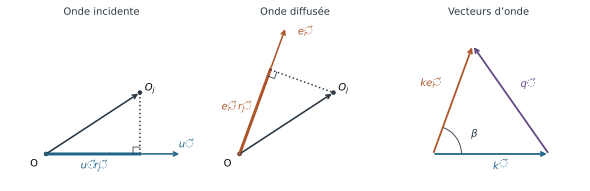
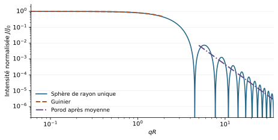
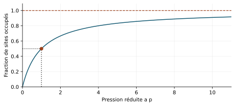
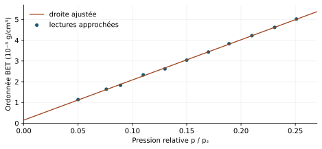
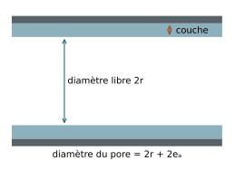

# X MP 2010 — Composition de physique · Corrigé brut

*Corrigé rédigé par IA, non officiel. Signalez toute erreur.*

**Lecture du rapport du jury** · GPT-6.2 Astra Ultra · vitesse non renseignée

**Rédaction** · GPT-6.2 Astra Ultra · vitesse non renseignée

## Caractérisation de particules et de pores à l’échelle nanométrique

## I.1 — Diffusion par un électron

### Question I.1.1 — Déplacement forcé de l’électron

Avec le champ évalué à l’origine et la seule force électrique, la deuxième loi de Newton s’écrit $m_e\ddot{\vec\delta}=-eE_0e^{i\omega t}\vec e_z$. En cherchant la réponse forcée à la pulsation $\omega$, on obtient $-m_e\omega^2\delta_0=-eE_0$. Ainsi
$$
\vec\delta(t)=\frac{eE_0}{m_e\omega^2}e^{i\omega t}\vec e_z .
$$
Le déplacement physique est la partie réelle. L’accélération est opposée au champ en raison de la charge négative. La solution homogène ajouterait une position et une vitesse de dérive constantes au mouvement forcé.

### Question I.1.2 — Amplitude à la longueur d’onde des rayons X

La conversion d’aire donne $I_0=200\times10^6\ \mathrm{W\,m^{-2}}$. L’amplitude du champ et la pulsation valent $E_0=[2I_0/(\varepsilon_0c)]^{1/2}\simeq4\times10^5\ \mathrm{V\,m^{-1}}$ et $\omega=2\pi c/\lambda\simeq2\times10^{19}\ \mathrm{rad\,s^{-1}}$. Avec la masse et la charge de l’électron, on trouve
$$
\delta_0=\frac{eE_0\lambda^2}{4\pi^2m_ec^2}\simeq2\times10^{-22}\ \mathrm m,
\qquad \frac{\delta_0}{\lambda}\simeq2\times10^{-12}.
$$
La variation de phase sur une excursion est au plus de l’ordre de $k\delta_0\ll1$. Le champ peut donc être évalué au centre du mouvement. Dans la géométrie donnée, l’oscillation transversale a même une projection nulle sur $\vec k$.

### Question I.1.3 — Comparaison aux fréquences atomiques

La pulsation de liaison donnée par le sujet vaut $\omega_0=2\pi cR_\infty\simeq2\times10^{16}\ \mathrm{rad\,s^{-1}}$. Le rapport $\omega/\omega_0=1/(\lambda R_\infty)\simeq9\times10^2$ est très grand. Dans un modèle de liaison harmonique, la force de rappel a pour amplitude $m_e\omega_0^2\delta_0$, contre $m_e\omega^2\delta_0$ pour le terme inertiel. Leur rapport est de l’ordre de $10^{-6}$. Sur la durée d’une oscillation imposée, le mouvement forcé est donc assimilable à celui d’un électron libre.

### Question I.1.4 — Zone de rayonnement et temps retardé

Les champs fournis correspondent au rayonnement dipolaire en champ lointain. La source doit être petite devant la longueur d’onde, son mouvement non relativiste, et l’observateur assez loin pour que $kr\gg1$ et que $r$ dépasse largement l’extension de la source. Les termes rayonnés en $1/r$ dominent alors les champs d’induction et quasi statiques. Une variation du dipôle met $r/c$ à parcourir la distance jusqu’à $M$ dans le vide. Le champ reçu à $t$ dépend donc de l’accélération du dipôle à l’instant antérieur $t-r/c$.

### Question I.1.5 — Longueur de diffusion Thomson

Le moment dipolaire vaut $p(t)=-e\delta_0e^{i\omega t}$. Sa dérivée seconde est $\ddot p(t)=e\omega^2\delta_0e^{i\omega t}=(e^2/m_e)E_0e^{i\omega t}$. En la prenant au temps retardé dans le champ donné, on obtient
$$
\vec E_1(M)=\frac{b}{r}E_0e^{i\omega(t-r/c)}\sin\theta\,\vec e_\theta,
\qquad b=\frac{e^2}{4\pi\varepsilon_0m_ec^2}\simeq3\times10^{-15}\ \mathrm m.
$$
Le quotient $b/r$ est sans dimension. La pulsation disparaît parce que les deux dérivations compensent la dépendance en $1/\omega^2$ du déplacement forcé.

### Question I.1.6 — Rayonnement du noyau

Pour une charge $Q$ de masse $m$ soumise au même champ, $\ddot{\vec p}=Q\vec a=(Q^2/m)\vec E$. Le champ rayonné est donc proportionnel à $Q^2/m$. Pour un noyau de charge $Ze$ et de masse $M_N\simeq A m_p$, le rapport des amplitudes au même point vaut
$$
\frac{|E_{\rm noyau}|}{|E_{\rm électron}|}
=\frac{Z^2m_e}{M_N}\simeq\frac{Z^2}{1800\,A}.
$$
Il est de l’ordre de $5\times10^{-4}$ pour l’hydrogène et de quelques centièmes au plus pour les noyaux lourds usuels. Le rapport des intensités est encore le carré de ce petit nombre. La grande inertie nucléaire explique la faiblesse de sa diffusion.

## I.2 — Interférences entre électrons

### Question I.2.1 — Deux projections pour la phase diffusée

Notons $O_j$ la position moyenne d’un électron, $\vec r_j=\overrightarrow{OO_j}$ et $\vec u=\vec k/k$. Sur le trajet incident, le déplacement du diffuseur de $O$ à $O_j$ change la phase locale de $-k\,\vec u\cdot\vec r_j$ avec la convention $e^{i(\omega t-\vec k\cdot\vec r)}$. Sur le trajet sortant vers $M$, la distance est $O_jM=|r\vec e_r-\vec r_j|\simeq r-\vec e_r\cdot\vec r_j$. Le chemin économisé apporte la phase **positive** $k\vec e_r\cdot\vec r_j$. Les deux projections sont représentées ci-dessous.
Dans l’approximation de champ lointain, tous les électrons partagent le même facteur $1/r$, la même polarisation et le même $\sin\theta$. L’approximation de phase au premier ordre correspond à des rayons diffusés parallèles sur l’objet, avec une correction de phase quadratique négligeable. Les champs s’ajoutent donc selon
$$
\vec E(M)=\vec E_1(M)\sum_{j=1}^{N}e^{\,i\vec q\cdot\vec r_j},
\qquad \vec q=k\vec e_r-\vec k .
$$

### Question I.2.2 — Norme du vecteur de diffusion

Les vecteurs d’onde incident $\vec k$ et diffusé $k\vec e_r$ ont la même norme $k$ et forment l’angle $\beta$. Lorsqu’ils sont tracés depuis la même origine, $\vec q$ joint leurs extrémités. C’est la base d’un triangle isocèle dont la bissectrice partage la base en deux segments $k\sin(\beta/2)$. Par suite
$$
q=2k\sin(\beta/2)=\frac{4\pi}{\lambda}\sin(\beta/2).
$$
On retrouve $q=0$ dans la direction incidente et $q=2k$ en rétrodiffusion.

### Question I.2.3 — Puissance moyenne et section efficace

Le champ lointain est une onde localement plane dont l’intensité moyenne temporelle vaut $I(M)=(\varepsilon_0 c/2)|\vec E(M)|^2$ pour une amplitude complexe. La puissance reçue en incidence normale est $\delta P=I(M)\delta S_M=I(M)\,r^2\delta\Omega$. Comme $I_0=(\varepsilon_0 c/2)E_0^2$, on a $\sigma(\vec q)=r^2|\vec E(M)|^2/E_0^2$. En insérant le champ précédent, il vient
$$
\sigma(\vec q)=b^2\sin^2\theta\,
\left|\sum_{j=1}^{N} e^{i\vec q\cdot\vec r_j}\right|^2 .
$$
La décroissance du champ en $1/r$ est exactement compensée, pour la puissance par angle solide, par la surface croissant comme $r^2$.

### Question I.2.4 — Limites incohérente et cohérente

Multiplier la somme des amplitudes par sa conjuguée fait apparaître les séparations $\vec r_{jk}=\vec r_j-\vec r_k$. En regroupant les termes conjugués,
$$
\frac{\sigma(\vec q)}{b^2\sin^2\theta}
=\sum_{j,k}e^{i\vec q\cdot\vec r_{jk}}
=N+2\sum_{j<k}\cos(\vec q\cdot\vec r_{jk}).
$$
Lorsque $q|\vec r_{jk}|\gg1$ pour chaque paire distincte et que les positions sont aléatoires, les phases croisées sont dispersées et leurs contributions s’annulent en moyenne. L’intensité moyenne vaut alors $N$ fois celle d’un électron. Des fluctuations d’interférence sont possibles pour une configuration particulière. À l’inverse, si $q|\vec r_{jk}|\ll1$ pour toutes les paires, les cosinus valent presque 1. Les $N$ amplitudes sont en phase et l’intensité vaut environ $N^2$ fois celle d’un seul électron.

### Question I.2.5 — Ordre de grandeur des petits angles

Une dimension $D$ affecte le signal lorsque la phase $qD$ varie d’une quantité de l’ordre de l’unité. Pour $D\sim10\ \mathrm{nm}$, cela donne $q\sim0{,}1\ \mathrm{nm^{-1}}$. Au petit angle, $q\simeq2\pi\beta/\lambda$. Avec $\lambda=0{,}1\ \mathrm{nm}$, on trouve $\beta\sim1{,}6\times10^{-3}$ rad, soit **environ $0{,}1^\circ$**. À des angles aussi faibles, il est difficile de séparer le faible signal diffusé du faisceau direct intense. La divergence du faisceau et la résolution angulaire deviennent importantes.

## I.3 — Diffusion par une suspension de nanoparticules

### Question I.3.1 — Contraste électronique et translation d’une particule

Écrivons la densité comme un fond uniforme $\rho_1$ plus l’excès $\Delta\rho$ sur chaque particule. Pour $\vec q\ne0$, l’intégrale du fond sur le grand volume $V$ est négligeable selon l’hypothèse du sujet. Une particule centrée à l’origine apporte ainsi le facteur d’amplitude $\Delta\rho\,g(\vec q)$. Pour une particule centrée en $\vec R$, le changement de variable $\vec r=\vec R+\vec u$ fournit le facteur $\Delta\rho\,e^{i\vec q\cdot\vec R}g(\vec q)$. La translation conserve le module de cette amplitude.
Dans la suspension diluée, les interférences entre particules de positions indépendantes s’annulent en moyenne hors du faisceau direct. Chaque particule contribue donc la même section $b^2(\Delta\rho)^2|g|^2$ et
$$
J(\vec q)=\frac{n}{V}\,b^2(\Delta\rho)^2|g(\vec q)|^2 .
$$
Le contraste nul $\Delta\rho=0$ fait disparaître le signal.

### Question I.3.2 — Facteur de forme d’une sphère

Prenons $\vec q$ comme axe polaire et notons $\alpha$ l’angle entre $\vec q$ et le rayon $\vec r$. L’intégrale azimutale donne $2\pi$ et, avec $u=\cos\alpha$, l’intégrale polaire donne $\int_{-1}^{1}e^{iqru}\,du=2\sin(qr)/(qr)$. Ainsi
$$
g(q)=4\pi\int_0^Rr^2\frac{\sin(qr)}{qr}\,dr
=\frac{4\pi}{q^3}\,[\sin(qR)-qR\cos(qR)].
$$
Avec $x=qR$ et $V_P=4\pi R^3/3$, cela s’écrit $g=3V_P(\sin x-x\cos x)/x^3$. Le résultat est réel par symétrie de la sphère. En $q=0$, l’intégrale initiale donne $g(0)=V_P$.

### Question I.3.3 — Développement de Guinier

Pour $x=qR\ll1$, on trouve $\sin x-x\cos x=x^3/3-x^5/30+O(x^7)$. Il suit $g/V_P=1-x^2/10+O(x^4)$. L’intensité est proportionnelle au carré du facteur de forme, d’où
$$
J(q)=J_0[1-x^2/5+O(x^4)],\qquad
J_0=\frac nV b^2(\Delta\rho)^2 V_P^2 .
$$
Comme $e^{-x^2/5}=1-x^2/5+O(x^4)$, la loi de Guinier $J_G(q)=J_0e^{-(qR)^2/5}$ a le même développement au second ordre.

### Question I.3.4 — Surface des particules et grande valeur de $qR$

En mettant $qR$ en facteur dans le numérateur de $g$, l’expression exacte devient
$$
J(q)=\frac nV b^2(\Delta\rho)^2
\frac{16\pi^2 R^2}{q^4}
\left[\cos(qR)-\frac{\sin(qR)}{qR}\right]^2.
$$
Quand $qR\gg1$, le facteur entre crochets est dominé par $\cos(qR)$, sauf au voisinage de ses zéros. Avec $S=n\,4\pi R^2$, le terme dominant est
$$
J(q)\simeq4\pi b^2(\Delta\rho)^2\,\frac{S}{V}\,\frac{\cos^2(qR)}{q^4}.
$$
L’enveloppe à cette échelle dépend de la surface totale des interfaces par unité de volume.

### Question I.3.5 — Polydispersité et loi de Porod

Pour des rayons différents de dispersion $\Delta R$, les phases $qR$ se répartissent sur une plage $q\Delta R$. Lorsque cette plage couvre plusieurs oscillations, la moyenne de $\cos(2qR)$ pondérée par la surface s’annule approximativement. Or $\cos^2(qR)=[1+\cos(2qR)]/2$. Il reste donc
$$
J_P(q)\simeq 2\pi b^2(\Delta\rho)^2\,\frac{S}{V}\,\frac{1}{q^4},
\qquad S=\sum_{j=1}^n 4\pi R_j^2 .
$$
Une représentation de $\log J$ en fonction de $\log q$ donne ainsi une droite de pente $-4$ dans le régime de Porod.

### Question I.3.6 — Deux échelles dans la suspension de silice

La figure 2 se lit des grandes tailles vers les petites quand $q$ augmente. Au-dessous de quelques $10^{-3}\ \mathrm{nm^{-1}}$, la forte remontée vers les petits $q$ révèle les corrélations entre particules au sein d’amas. L’encart montre ces amas. Au voisinage de $10^{-2}\ \mathrm{nm^{-1}}$, un épaulement puis une décroissance arrondie traduisent le régime de Guinier des particules élémentaires. Entre environ $0{,}1$ et $1\ \mathrm{nm^{-1}}$, la pente est voisine de $-4$, comme prévu par la loi de Porod pour les interfaces silice–liquide. La courbe s’aplatit à son extrémité droite, en dehors de cette plage de pente $-4$.
Pour estimer le rayon, la pente de $\ln J$ en fonction de $q^2$ est $-R^2/5$ dans la zone de Guinier. Deux lectures approximatives dans l’épaulement sont $J_1\simeq5\times10^5\ \mathrm{cm^{-1}}$ à $q_1\simeq0{,}01\ \mathrm{nm^{-1}}$ et $J_2\simeq3\times10^5\ \mathrm{cm^{-1}}$ à $q_2\simeq0{,}02\ \mathrm{nm^{-1}}$. Elles conduisent à
$$
R\simeq\sqrt{\frac{5\ln(J_1/J_2)}{q_2^2-q_1^2}}\sim 9\times10^1\ \mathrm{nm}.
$$
L’épaulement chevauche la contribution des amas et la distribution des tailles arrondit la transition. La lecture donne donc un rayon de plusieurs dizaines de nanomètres et un diamètre d’ordre $10^2\ \mathrm{nm}$, en accord d’ordre de grandeur avec l’échelle de $200\ \mathrm{nm}$ de la micrographie.

## II.1 — Adsorption monocouche

### Question II.1.1 — Constante d’équilibre de la monocouche

La réaction consomme un site libre et une molécule gazeuse pour former un site occupé. Dans le mélange de surface idéal, les activités des sites occupés et libres valent leurs fractions respectives $\tau$ et $1-\tau$. L’activité du gaz parfait est $p/p^0$. La loi d’action de masse donne donc
$$
K(T)=\frac{\tau}{(1-\tau)(p/p^0)} .
$$
Le rapport est sans dimension, comme l’exige la définition thermodynamique de $K$.

### Question II.1.2 — Influence de la température

L’adsorption cède de la chaleur à pression fixée, ainsi $\Delta_r H^0<0$. La loi de Van ’t Hoff donne $\mathrm d\ln K/\mathrm dT=\Delta_r H^0/(R_{\rm GP}T^2)<0$. Si l’enthalpie est constante, l’intégration entre $T_1$ et $T$ fournit
$$
\ln\frac{K(T)}{K(T_1)}=-\frac{\Delta_r H^0}{R_{\rm GP}}\left(\frac1T-\frac1{T_1}\right).
$$
En chauffant, on réduit $K$ et on favorise la désorption, conformément au signe de l’échange thermique.

### Question II.1.3 — Isotherme de Langmuir

La relation d’équilibre devient $\tau=ap(1-\tau)$. D’où $\tau=ap/(1+ap)$. À faible pression, $\tau\sim ap$, de pente initiale $a$. À $p=1/a$ la moitié des sites sont occupés. À forte pression, $\tau$ tend vers 1 avec une pente de plus en plus faible. Le plateau exprime le remplissage d’une unique couche. Sur l’isotherme expérimentale, la croissance reprend au contraire fortement vers $p/p_s\simeq0{,}8$. Le début de remplissage est compatible avec une adsorption de surface. La suite suppose que d’autres molécules s’accumulent au-delà de la première couche et que les pores se remplissent.

## II.2 — Adsorption multicouche

### Question II.2.1 — Nature des couches supérieures

La première molécule touche le solide. Toute molécule supplémentaire s’ajoute sur une couche constituée de molécules déjà adsorbées de même espèce. Le modèle leur attribue la même énergie d’adsorption, d’où un même facteur $b$ pour chaque étage après le premier. À pression sous-saturante, $bp<1$ assure que les probabilités des grandes hauteurs diminuent et que la somme sur les colonnes est normalisable. Si $bp\geq1$ avec une fraction de sites remplis positive, les poids de la suite géométrique ne pourraient pas avoir une somme finie.

### Question II.2.2 — Distribution des hauteurs

Avec $x=bp$, la première relation donne $\theta_1=ap\theta_0=Cx\theta_0$. Pour passer d’une colonne de hauteur $n-1$ à une de hauteur $n\geq2$, on multiplie par $x$. Ainsi pour tout $n\geq1$,
$$
\theta_n=Cx^n\theta_0.
$$
Le facteur $C=a/b$ ne compte qu’une seule fois le contact avec le solide.

### Question II.2.3 — Fraction de sites nus

Chaque site a exactement une hauteur, y compris zéro, donc $1=\sum_{n\geq0}\theta_n=\theta_0[1+C\sum_{n\geq1}x^n]$. Comme $0\leq x<1$, la série vaut $x/(1-x)$ et
$$
\theta_0=\frac{1-x}{1+(C-1)x}.
$$
À pression nulle tous les sites sont libres, et cette fraction tend vers zéro à l’approche de la saturation.

### Question II.2.4 — Nombre de couches moyen

Un site de hauteur $n$ porte $n$ molécules, donc $\tau=\sum_{n\geq1}n\theta_n=C\theta_0 x/(1-x)^2$. En substituant $\theta_0$, on obtient
$$
\tau=\frac{Cx}{(1-x)[1+(C-1)x]},\qquad x=bp .
$$
Ce nombre moyen peut dépasser l’unité. Le modèle identifie l’accumulation d’une quantité macroscopique de liquide à la divergence pour $x\to1^-$. La coexistence avec le gaz ayant lieu à $p_s$ en géométrie plane, cela fixe $bp_s=1$, donc $x=p/p_s$.

### Question II.2.5 — Lecture de la droite BET et surface spécifique

Posons $x=p/p_s$. L’ordonnée $y=x/[v_A(1-x)]$ est affine en $x$. Si $A$ est la pente et $B$ l’ordonnée à l’origine, $B=1/(v_SC)$, $A=(C-1)/(v_SC)$, donc $v_S=1/(A+B)$ et $C=1+A/B$. Sur la figure 5, on lit par exemple environ $(0{,}05,0{,}0011)$ et $(0{,}25,0{,}0050)$ en unités de l’axe. La pente est proche de $0{,}019\ \mathrm{g\,cm^{-3}}$. L’extrapolation près de l’origine donne un petit $B$ de l’ordre de $10^{-4}\ \mathrm{g\,cm^{-3}}$. Selon la lecture, $C$ est de l’ordre de $10^2$, tandis que $v_S$ est bien mieux fixé à environ $51\ \mathrm{cm^3\,g^{-1}}$.
Aux conditions standard données, $V_M=25\,000\ \mathrm{cm^3\,mol^{-1}}$. Une monocouche représente $v_S/V_M\simeq2{,}0\times10^{-3}\ \mathrm{mol\,g^{-1}}$. Avec $s_m=0{,}16\times10^{-18}\ \mathrm{m^2}$ par molécule, on déduit
$$
\Sigma=\frac{v_S}{V_M}N_A s_m\simeq2\times10^2\ \mathrm{m^2\,g^{-1}}.
$$
Cette grande surface par unité de masse comprend les parois internes des pores.

## III — Condensation capillaire

### Question III.1 — Dimension de la tension superficielle

La relation de Laplace impose $\gamma=(p_G-p_L)r/2$. Le produit d’une pression par une longueur a pour unité $\mathrm{Pa\,m=N\,m^{-1}}$. Une autre écriture est $\mathrm{J\,m^{-2}}$, unité d’énergie de création de surface.

### Question III.2 — Potentiel chimique de la vapeur

À température fixée, $\mathrm d\mu_G=v_G\,\mathrm dp$. Pour une mole de gaz parfait, $v_G=R_{\rm GP}T/p$. L’intégration entre $p^0$ et $p_G$ donne
$$
\mu_G(T,p_G)=\mu_G(T,p^0)+R_{\rm GP}T\ln\frac{p_G}{p^0}.
$$
L’argument du logarithme est un rapport de pressions.

### Question III.3 — Équilibre au niveau du ménisque

Le transfert d’une mole de la phase liquide vers la phase gazeuse fait intervenir la différence des potentiels chimiques. À l’équilibre, $\mu_G(T,p_G)=\mu_L(T,p_L)$. La courbure impose $p_L=p_G-2\gamma/r$, d’où
$$
\mu_G(T,p^0)+R_{\rm GP}T\ln(p_G/p^0)
=\mu_L(T,p^0)+v_L(p_G-2\gamma/r-p^0).
$$
Les deux phases ont la même température, mais leurs pressions diffèrent à cause du ménisque.

### Question III.4 — Limite plane

Lorsque $r\to\infty$, le saut de pression disparaît, d’où $p_G=p_L$. À température fixée, la pression qui réalise $\mu_G(T,p)=\mu_L(T,p)$ pour une interface plane de ce corps pur est par définition sa pression de vapeur saturante $p_s(T)$. Elle constitue une référence mesurable pour éliminer les deux potentiels chimiques standard.

### Question III.5 — Élimination des références chimiques

Écrivons la condition de la question III.3 pour la bulle de rayon $r$ et retranchons celle de l’interface plane à $p_s$. Les potentiels chimiques de référence s’éliminent. Avec $p_G=p_G(r)$, il reste
$$
R_{\rm GP}T\ln\frac{p_G}{p_s}=v_L(p_G-p_s)-\frac{2\gamma v_L}{r}.
$$
Cette relation est implicite car $p_G$ apparaît des deux côtés.

### Question III.6 — Approximation de Kelvin

Pour $y=p_G/p_s\leq1$, $|1-y|\leq|\ln y|$. La valeur absolue du premier terme à droite de III.5, comparée à celle de son membre gauche, est donc au plus $v_Lp_s/(R_{\rm GP}T)=v_L/v_{G,s}$. Le liquide est beaucoup plus dense que la vapeur, donc $v_L\ll v_{G,s}$. On néglige ainsi le terme de compressions communes $v_L(p_G-p_s)$ et l’on trouve
$$
p_G\simeq p_s\exp(-r_0/r),\qquad r_0=\frac{2\gamma v_L}{R_{\rm GP}T}.
$$
La longueur $r_0$ est positive. La pression d’équilibre est donc inférieure à $p_s$ pour le ménisque concave vu du liquide et tend vers $p_s$ lorsque le rayon augmente.

### Question III.7 — Pressions de condensation de l’azote

Le volume molaire liquide vaut $v_L=M/\rho=28/0{,}81\simeq35\ \mathrm{cm^3\,mol^{-1}}=3{,}5\times10^{-5}\ \mathrm{m^3\,mol^{-1}}$. Avec $T=77\ \mathrm K$, on trouve $r_0\simeq9{,}6\times10^{-10}\ \mathrm m$, soit $1\ \mathrm{nm}$. La figure 6 cote le diamètre libre $D=2r$. Pour $D=5$, $10$ et $100\ \mathrm{nm}$, les exposants $-2r_0/D$ valent environ $-0{,}38$, $-0{,}19$ et $-0{,}019$. On obtient respectivement $p_G/p_s\simeq0{,}68$, $0{,}83$ et $0{,}98$, soit à un chiffre significatif $0{,}7$, $0{,}8$ et une valeur proche de 1. Si une taille est donnée comme **rayon** de ménisque, c’est directement $r$ qui entre dans la formule. Pour les mêmes valeurs numériques de rayons, on aurait $0{,}83$, $0{,}91$ et $0{,}99$.

### Question III.8 — Diamètre des pores d’aluminosilicate

Le remplissage des pores produit la forte augmentation près de $p/p_s\simeq0{,}84$ sur la figure 3. On utilise un point central de cette montée, dont la largeur traduit une gamme de tailles. En inversant la formule de Kelvin, $r=-r_0/\ln(p/p_s)$. Pour $0{,}84$, on obtient $r\simeq5{,}5\ \mathrm{nm}$. Il s’agit du rayon du cœur gazeux au seuil de condensation, alors que la surface des parois est déjà couverte d’une couche $e_A=2{,}1\ \mathrm{nm}$. Le diamètre géométrique du pore est donc
$$
D_{\rm pore}=2(r+e_A)\simeq15\ \mathrm{nm}.
$$
Des lectures allant de $0{,}83$ à $0{,}85$ donnent environ $14{,}5$ à $16\ \mathrm{nm}$. Un diamètre au nanomètre près serait plus précis que la lecture de l’isotherme.

