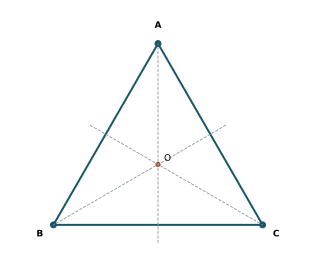
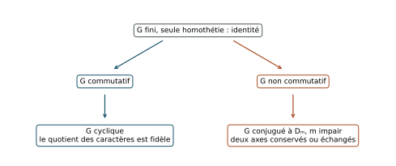

# École polytechnique MP — Deuxième composition de mathématiques 2010 · Corrigé brut

*Corrigé rédigé par IA, non officiel. Signalez toute erreur.*

**Rédaction** · GPT-6.2 Astra Ultra · vitesse non renseignée

**Révision (tour 1)** · GPT-6.2 Astra Ultra · vitesse non renseignée · 26 novembre 2026

**Sous-groupes finis de $\operatorname{GL}_2(\mathbb C)$.** On note $N=|G|$. La preuve construit d’abord les projecteurs sur les invariants, puis sépare les groupes commutatifs de ceux qui échangent deux droites propres.

## I. Sous-groupes finis et diagonalisation

### Question 1

Posons $N=|G|$. Tout $g\in G$ vérifie $g^N=I$. Le polynôme annulateur $X^N-1$ est scindé à racines simples sur $\mathbb C$, donc $g$ est diagonalisable. Si la famille commute, raisonnons par récurrence sur $\dim E$. Si tous ses éléments sont scalaires, toute base convient, ce qui traite aussi les dimensions 0 et 1. Sinon, choisissons $g$ non scalaire : $E$ est somme directe d’au moins deux espaces propres de $g$, de dimensions strictement plus petites. Chaque $h\in G$ les préserve car $g(hv)=h(gv)$. Sur chacun, les restrictions forment un groupe fini commutatif. La récurrence donne des bases propres communes ; leur réunion est la base cherchée.

## II. Isométries du triangle équilatéral

### Question 2a

La permutation des sommets détermine l’isométrie, car une isométrie fixant trois points non alignés est l’identité (un point est déterminé par ses trois distances à ces sommets). On a donc au plus $3!=6$ éléments. L’identité, les rotations de centre $O$ et d’angles $2\pi/3,4\pi/3$, et les trois réflexions suivant les médianes réalisent six permutations distinctes. Le groupe a exactement six éléments.

### Question 2b

Notons $a=\overrightarrow{OA}$, $b=\overrightarrow{OB}$ ; le troisième rayon vaut $-a-b$ car $O$ est le centre de gravité. Chaque isométrie fixe $O$, donc est linéaire dans ce repère. Les colonnes de sa matrice dans $(a,b)$ sont deux colonnes distinctes prises dans $(1,0)^t,(0,1)^t,(-1,-1)^t$. Les coefficients sont donc dans $\{-1,0,1\}$. L’application « matrice dans cette base » est un morphisme injectif et identifie le groupe à son image dans $\operatorname{GL}_2(\mathbb C)$.

### Question 2c

Dans cette base, la rotation $A\mapsto B\mapsto C$ a pour matrice $R=\left(\begin{smallmatrix}0&-1\\1&-1\end{smallmatrix}\right)$ ; la réflexion échangeant $A,B$ a pour matrice $S=\left(\begin{smallmatrix}0&1\\1&0\end{smallmatrix}\right)$. Le polynôme de $R$ est $X^2+X+1$. Pour $c=e^{2\pi i/3}$, le vecteur $v=(1,-c)^t$ vérifie $Rv=cv$. La relation $SRS=R^{-1}$ montre que $w=-Sv=(c,-1)^t$ est propre pour $c^{-1}$. Les valeurs propres distinctes garantissent une base $(v,w)$. Dans cette base $R'=\operatorname{diag}(c,c^{-1})$ et $S'=\left(\begin{smallmatrix}0&-1\\-1&0\end{smallmatrix}\right)$. Les six matrices $R'^k$ et $R'^k S'$ pour $k=0,1,2$ sont les six matrices définissant $D_3$.

## III. Commutant, invariants et divisibilité

### Question 3

La conjugaison $i(B)$ est linéaire et inversible, d’inverse $i(B^{-1})$. L’associativité donne $i(BC)=i(B)\circ i(C)$. Une matrice du noyau commute avec toute matrice, en particulier avec les projecteurs $E_{jj}$ : elle préserve donc tous les axes et est diagonale. Commuter ensuite avec $E_{ij}$ impose l’égalité de ses coefficients diagonaux $i$ et $j$. Réciproquement tout scalaire commute avec tout. Le noyau est $G\cap\mathbb C^*I_n$, d’où le critère.

### Question 4

Pour toute matrice fixe $M$, on a $BM=MB$ pour $B\in G$. Si $Mx=0$ alors $M(Bx)=B(Mx)=0$, donc le noyau est stable. Si $y=Mx$, alors $By=M(Bx)$ appartient à l’image. L’image est aussi stable.

### Question 5

Si $M\ne0$ commute avec $G$, son noyau stable est propre ; par irréductibilité, il vaut 0. Ainsi $M$ est inversible en dimension finie. Pour toute $M$ du commutant, choisissons une valeur propre complexe $\lambda$. La matrice $M-\lambda I_n$ appartient aussi au commutant et n’est pas inversible ; elle est donc nulle. L’espace fixe est $\mathbb C I_n$ de dimension 1.

### Question 6

Dans la base $(E_{ij})$, $ME_{ij}N=\sum_{k,\ell}M_{ki}N_{j\ell}E_{k\ell}$. Son coefficient devant $E_{ij}$ est $M_{ii}N_{jj}$. En sommant sur toutes les paires $(i,j)$, $\operatorname{Tr}(\Phi)=(\sum_iM_{ii})(\sum_jN_{jj})=\operatorname{Tr}(M)\operatorname{Tr}(N)$.

### Question 7a

Pour $C\in G$, $CP=N^{-1}\sum_{B\in G}CB=P$ car $B\mapsto CB$ est une bijection de $G$. En moyennant sur $C$, on obtient $P^2=P$. Son polynôme annulateur $X(X-1)$ est scindé à racines simples, donc $P$ est diagonalisable.

### Question 7b

Puisque $CP=P$ pour chaque $C$, $Px$ est fixe par $G$. Inversement, si $x$ est fixe par tous $B$, la moyenne $Px$ vaut $x$ ; ainsi $\operatorname{Im}P=E^G$. Un projecteur a pour trace le rang, donc $\dim E^G=\operatorname{Tr}P=N^{-1}\sum_{B\in G}\operatorname{Tr} B$.

### Question 8

L’opérateur $Q=N^{-1}\sum_{B\in G} i(B)$ vérifie $i(C)Q=Q$ par réindexation et agit comme l’identité sur les invariants. Il projette donc sur $A^{\widetilde G}$, même si $i$ possède un noyau. Par 6 et linéarité de la trace,
$$\dim A^{\widetilde G}=N^{-1}\sum_{B\in G}\operatorname{Tr}(B)\operatorname{Tr}(B^{-1}).$$

Si $h=|\ker i|$, chaque élément $T$ de $\widetilde G$ a exactement $h$ antécédents dans $G$, et $N=h|\widetilde G|$. La somme $N^{-1}\sum_{B\in G}i(B)$ est donc aussi la moyenne uniforme $|\widetilde G|^{-1}\sum_{T\in\widetilde G}T$. Cela explique directement l’usage du dénominateur $|G|$ de l’énoncé lorsque le morphisme de conjugaison possède un noyau.

### Question 9a

Sous l’hypothèse d’irréductibilité, la question 5 écrit $X=\lambda I_n$. Sa trace vaut $n\lambda$, donc $X=(\operatorname{Tr}X/n)I_n$.

### Question 9b

Pour $C\in G$ et $D=CBC^{-1}$ on a $\operatorname{Tr}(B^{-1})=\operatorname{Tr}(D^{-1})$ et $D$ parcourt $G$. Ainsi $CYC^{-1}=Y$. De plus $\operatorname{Tr}(Y)=\sum_B\operatorname{Tr}(B^{-1})\operatorname{Tr}(B)=N$ par 8 et 5. Par 9a, $Y=(N/n)I_n$.

### Question 10a

Les valeurs propres de $B$ sont des racines de $X^N-1$, donc des puissances de $\zeta=e^{2\pi i/N}$. Leur somme avec multiplicités, $\operatorname{Tr}B$, appartient à $Z_G$. Il en va de même pour $B^{-1}\in G$, donc $Y=\sum_B\operatorname{Tr}(B^{-1})B$ appartient à $Z_G[G]$.

### Question 10b

Pour $C_k=\zeta^i B$ et $D\in G$, écrivons $\operatorname{Tr}(D^{-1})=\sum_j n_{Dj}\zeta^j$ avec $n_{Dj}\in\mathbb Z$. Il vient $YC_k=\sum_{D,j}n_{Dj}\zeta^{i+j}DB$. Comme $DB\in G$ et $\zeta^N=1$, chaque terme sans son coefficient figure dans la liste des $C_\ell$. En les regroupant, on obtient les entiers $a_{\ell k}$. Aucune indépendance de cette liste n’est requise.

### Question 10c

Définissons $J:\mathbb C^{N^2}\to M_n(\mathbb C)$ par $J(e_k)=C_k$. L’égalité de 10b et $Y=(N/n)I_n$ donnent $JA=(N/n)J$, soit $JR=0$. Comme $J\ne0$ (tout $C_k$ est inversible), $R$ ne peut pas être inversible : sinon $J=JRR^{-1}=0$. Donc $\det R=0$.

### Question 10d

$\det(XI_{N^2}-A)$ est unitaire de degré $N^2$, à coefficients entiers. Par 10c, $N/n$ en est racine. Si une racine rationnelle d’un tel polynôme s’écrit $u/v$ sous forme irréductible, avec $v>0$, multiplier l’équation par $v^{N^2}$ donne $v\mid u^{N^2}$ ; ainsi $v=1$. Par conséquent $N/n$ est entier et $n\mid N$.

Avec les lettres de l’énoncé, $0$ est valeur propre de $R=(N/n)I-A$ et $N/n$ est valeur propre de la matrice entière $A$. C’est le polynôme caractéristique de cette dernière qui fournit l’équation unitaire sur les entiers ; aucun choix d’une sous-famille indépendante des $C_k$ n’est nécessaire.

## IV. Sous-groupes finis du groupe linéaire en dimension deux

### Question 11a

La sesquilinéarité et la symétrie hermitienne passent à la moyenne. Pour $v\ne0$, tous les $Bv$ sont non nuls, donc la moyenne de leurs normes au carré est strictement positive. On obtient un produit scalaire hermitien. Pour $C\in G$, la moyenne de $\langle BCv,BCw\rangle$ sur $B$ est celle de $\langle Dv,Dw\rangle$ sur $D=BC\in G$. Le produit obtenu est invariant.

### Question 11b

La réductibilité donne une droite stable $L$. Pour $v\in L^{\perp_0}$, $w\in L$, on a $\langle Bv,w\rangle_0=\langle v,B^{-1}w\rangle_0=0$, car $B^{-1}w\in L$. L’orthogonal est donc une seconde droite stable. En prenant un vecteur non nul sur chaque droite on obtient une base orthogonale dans laquelle tout $B$ est diagonal. Les éléments de $G$ commutent.

### Question 12a

Le polynôme $X^2-1$ annule $B$ et est scindé à racines simples. Ainsi $B$ est diagonalisable et ses valeurs propres sont $\pm1$. Leur produit vaut 1, donc elles sont toutes deux 1 ou toutes deux $-1$. Les deux possibilités sont $B=I_2$ et $B=-I_2$ ; chacune convient.

### Question 12b

Si $G$ n’est pas commutatif, la contraposée de 11b montre que son action sur $\mathbb C^2$ est irréductible. D’après 10d, $2\mid |G|$. Le théorème admis au préambule fournit alors $B\ne I_2$ vérifiant $B^2=I_2$. Comme $G\subset\operatorname{SL}_2(\mathbb C)$ ici, 12a impose $B=-I_2$.

### Question 13a

Si $G_0=G\cap\operatorname{SL}_2(\mathbb C)$ était non commutatif, il contiendrait $-I_2$ par 12b, contrairement à l’hypothèse sur $G$. Ainsi $G_0$ est commutatif et se diagonalise dans une même base par 1. Le déterminant vaut 1, donc chaque matrice conjuguée s’écrit $\operatorname{diag}(\lambda,\lambda^{-1})$. Le changement de base fournit l’isomorphisme $B\mapsto PBP^{-1}$ sur le groupe diagonal $\Gamma_0$.

### Question 13b

L’application $\operatorname{diag}(\lambda,\lambda^{-1})\mapsto\lambda$ identifie $\Gamma_0$ à un sous-groupe fini $H$ de $\mathbb C^*$. Posons $m=|H|$. Chacun de ses éléments vérifie $\lambda^m=1$, et cette équation a exactement $m$ solutions. Ainsi $H=\mu_m$, engendré par $c=e^{2\pi i/m}$, donc $\Gamma_0=Z_m$. Si $m$ était pair, $c^{m/2}=-1$ donnerait $-I_2\in\Gamma_0$ et donc $-I_2\in G$, exclu. Ainsi $m$ est impair.

### Question 13c

Le morphisme $\det:G\to\mathbb C^*$ a pour noyau $G_0$. Si ce noyau est trivial, $G$ est isomorphe à son image, sous-groupe du groupe commutatif $\mathbb C^*$. Donc $G$ est commutatif.

### Question 14a

$G_0=Z_m$ est le noyau du déterminant, donc est normal dans $G$. En particulier $B_0 C B_0^{-1}\in Z_m$. Comme $G$ n’est pas commutatif, $m\ne1$ par 13c, et $m$ est impair. Pour $C=\operatorname{diag}(c,c^{-1})$, les deux valeurs propres sont distinctes. Sa conjuguée est diagonale à valeurs propres distinctes, donc ses droites propres sont les deux axes. Ainsi $B_0$ permute les axes. Il ne les fixe pas tous deux, puisqu’il n’est pas diagonal. Il les échange, donc $B_0=\left(\begin{smallmatrix}0&b\\b'&0\end{smallmatrix}\right)$ avec $bb'\ne0$.

### Question 14b

On calcule $B_0^2=bb'I_2$. L’unique homothétie de $G$ étant $I_2$, on a $bb'=1$, soit $b'=1/b$.

### Question 14c

Prenons $Q=\operatorname{diag}(-1/b,1)$. Dans $QB_0Q^{-1}$, le coefficient supérieur droit vaut $(-1/b)b=-1$, et l’inférieur gauche vaut $(1/b)(-b)=-1$. On obtient $S=\left(\begin{smallmatrix}0&-1\\-1&0\end{smallmatrix}\right)$.

### Question 15a

Écrivons $B=\operatorname{diag}(u,v)$. Comme $B_0$ échange les axes, $B_0BB_0^{-1}=\operatorname{diag}(v,u)$. Le produit avec $B$ vaut $uvI_2\in G$. L’hypothèse donne $uv=1$, donc $\det B=1$ et $B\in G_0=Z_m$.

### Question 15b

Toute matrice non diagonale $B\in G$ échange les axes par le raisonnement de 14a, donc $B_0^{-1}B$ est diagonale et appartient à $Z_m$ par 15a. Inversement chaque $B_0C$, $C\in Z_m$, appartient à $G$ et échange les axes. Ainsi $G=Z_m\sqcup B_0Z_m$. La conjugaison par $Q$ fixe chaque matrice de $Z_m$ et envoie $B_0$ sur $S$. Comme $S$ inverse le générateur diagonal, $SZ_m=Z_mS$ ; les matrices obtenues sont exactement les $2m$ matrices de $D_m$. La conjugaison est l’isomorphisme demandé.

En posant $D=\operatorname{diag}(c,c^{-1})$, les relations dans la base finale sont $D^m=S^2=I$ et $SDS=D^{-1}$. En particulier $(D^iS)(D^jS)=D^{i-j}$ et $(D^iS)D^j=D^{i-j}S$. La première classe contient les $m$ matrices diagonales distinctes, la seconde les $m$ matrices antidiagonales distinctes. Leur disjonction vérifie à la fois l’ordre $2m$ et la loi du groupe annoncé.

### Question 16a

Dans le cas commutatif, par 1 il existe une base commune, de matrice de passage $P$, dans laquelle $P^{-1}BP=\operatorname{diag}(\chi_1(B),\chi_2(B))$. Ces coefficients sont non nuls. La multiplication diagonale donne $\chi_j(BC)=\chi_j(B)\chi_j(C)$ pour $j=1,2$. Ce sont les deux morphismes cherchés.

### Question 16b

Le rapport des deux caractères $\chi=\chi_1/\chi_2$ est un morphisme. Si $\chi(B)=1$, les deux coefficients diagonaux sont égaux, donc $B$ est scalaire ; ainsi $B=I_2$. Le morphisme est injectif et $\chi(B)^N=1$ pour $N=|G|$. Il envoie $N$ éléments sur $N$ racines possibles, d’où un isomorphisme $G\simeq\mu_N$.

### Question 16c

Choisissons $B_*$ générateur de $G$ via cet isomorphisme. Comme $B_*^N=I$, ses valeurs propres sont $c=e^{2\pi i p/N}$ et $d=e^{2\pi i q/N}$ pour deux entiers $p,q$. Le groupe est formé de $P\operatorname{diag}(c^k,d^k)P^{-1}$, $0\le k<N$. Le quotient $c/d$ engendre $\mu_N$, donc a pour ordre $N/\gcd(p-q,N)=N$. Ainsi $\gcd(p-q,N)=1$.

### Question 17

À conjugaison près, on obtient :

1. Les groupes cycliques engendrés par $\operatorname{diag}(e^{2\pi i p/N},e^{2\pi i q/N})$, avec $N\ge1$ et $\gcd(p-q,N)=1$. Une puissance est scalaire exactement lorsque $N\mid k(p-q)$, donc lorsque $N\mid k$. Le groupe a ordre $N$ et convient.
2. Les groupes $D_m$ avec $m\ge3$ impair, d’ordre $2m$. Les matrices antidiagonales ne sont pas scalaires ; une matrice diagonale est scalaire lorsque $m\mid2k$, donc lorsque $m\mid k$. Pour $m\ge3$, l’échange des axes ne commute pas avec le générateur de $Z_m$, ce qui donne bien le cas non commutatif.

Les questions 11 à 16 établissent que cette liste est exhaustive. Le cas $D_1$ est déjà un groupe cyclique d’ordre 2.

### Question 18

Une image isomorphe serait un sous-groupe commutatif de huit éléments d’exposant 2. En base propre commune, tous ses éléments seraient diagonaux et leurs deux coefficients seraient dans $\{1,-1\}$. Cela ne permet que quatre matrices. La contradiction exclut un tel plongement dans $\operatorname{GL}_2(\mathbb C)$, même en autorisant les homothéties.
