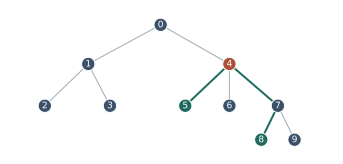
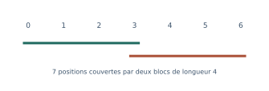
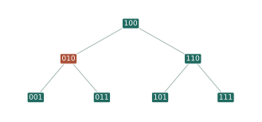

# X · MP · Informatique (option) 2010 — corrigé brut

*Corrigé rédigé par IA, non officiel. Signalez toute erreur.*

**Rédaction** · GPT-6.2 Astra Ultra · vitesse non renseignée · 25 novembre 2026

**Plus proche ancêtre commun.** Langage choisi : OCaml. Les tableaux de l’énoncé sont globaux et indexés à partir de 0. Les étiquettes des parties I à IV vérifient la propriété des intervalles de sous-arbres. Dans la partie V, les nœuds portent directement les valeurs du tableau, qui peuvent se répéter.

## I. Appartenance et solution simple

### Question 1 · Taille de chaque sous-arbre

On emploie OCaml et le type du sujet `type arbre = Noeud of int * arbre list`. Le nom `a` désigne l’arbre global. La procédure suivante remplit le tableau global `taille`.

```ocaml
let remplir_taille () =
  let rec visite (Noeud (i, enfants)) =
    let s = List.fold_left (fun total fils -> total + visite fils)
              1 enfants in
    taille.(i) <- s;
    s
  in
  ignore (visite a)
```

Les sous-arbres des fils sont disjoints et leur union avec la racine est le sous-arbre courant. Chaque nœud est traité une fois et les listes d’enfants contiennent au total $n-1$ entrées. Le temps est $O(n)$.

### Question 2 · Appartenance en temps constant

Le sous-arbre de $j$ est le segment d’étiquettes de $j$ à $j+\mathrm{taille}[j]-1$. Pour éviter un débordement à la borne supérieure, on peut comparer la différence après avoir vérifié son signe.

```ocaml
let appartient i j = j <= i && i - j < taille.(j)
```

Cette formulation admet $i=j$ et s’exécute en $O(1)$.

### Question 3 · Premier algorithme d’ancêtre commun

En effet l’étiquette de la racine d’un sous-arbre est son minimum strict parmi ses nœuds distincts. Il suffit de chercher le plus grand ancêtre commun par son numéro.

```ocaml
let ppac1 i j =
  let rec cherche k =
    if appartient i k && appartient j k then k
    else cherche (k - 1)
  in
  cherche (min i j)
```

La racine 0 est toujours admissible, la descente termine. Le temps est $O(n)$ et le cas d’un nœud ancêtre de l’autre est inclus.

## II. Tour eulérien et minimums dyadiques

### Question 4 · Longueur du tour eulérien

Le tour écrit une première fois la racine, puis un nœud à chaque traversée d’une arête. Chacune des $n-1$ arêtes est parcourue une fois à la descente et une fois à la remontée. La longueur est donc $m=1+2(n-1)=2n-1$, également pour l’arbre à un sommet.

### Question 5 · Construire tour et index

```ocaml
let remplir_euler () =
  let pos = ref 0 in
  let ecrit i =
    euler.(!pos) <- i;
    index.(i) <- !pos;
    incr pos
  in
  let rec visite (Noeud (i, enfants)) =
    ecrit i;
    List.iter (fun fils -> visite fils; ecrit i) enfants
  in
  visite a
```

Le dernier passage au nœud $i$ reste dans `index.(i)`, donc `euler.(index.(i)) = i`. On effectue $m$ écritures, soit $O(n)$ opérations.

### Question 6 · L’ancêtre est le minimum des étiquettes du segment

Posons $b=\mathrm{PPAC}(i,j)$ et ordonnons les deux positions choisies dans le tour. Toutes les occurrences de $i$ et $j$ appartiennent au bloc du sous-arbre $b$, donc le segment entre les deux reste dans ce bloc. Si $b=i$ ou $b=j$, le segment contient $b$ à une extrémité. Sinon $i$ et $j$ sont dans deux sous-arbres fils distincts de $b$. Le trajet entre ces visites remonte nécessairement à $b$. Ainsi le segment contient $b$, et par (P) tous les autres nœuds du segment ont des étiquettes supérieures. Son minimum est $b$, même si l’on a choisi des occurrences autres que les premières.



### Question 7 · Logarithme entier

```ocaml
let log2 n =
  let rec compte x k =
    if x = 1 then k else compte (x / 2) (k + 1)
  in
  compte n 0
```

Pour $n\ge1$ on obtient le nombre de divisions nécessaires, c’est-à-dire $k$ tel que $2^k\le n<2^{k+1}$. Le temps $O(\log n+1)$ ne sera pas payé à chaque requête de la partie II.

### Question 8 · Prétraiter les minimums dyadiques

On nomme `table` la matrice globale $M$ et `logs` un tableau auxiliaire de taille $m+1$ pour les requêtes. Les noms de valeurs OCaml commencent par une minuscule.

```ocaml
let remplir_M () =
  let m = Array.length euler in
  logs.(1) <- 0;
  for l = 2 to m do logs.(l) <- 1 + logs.(l / 2) done;
  for i = 0 to m - 1 do table.(i).(0) <- euler.(i) done;
  for j = 1 to logs.(m) do
    let demi = 1 lsl (j - 1) in
    for i = 0 to m - 2 * demi do
      table.(i).(j) <-
        min table.(i).(j-1) table.(i+demi).(j-1)
    done
  done
```

Une induction sur $j$ justifie les entrées, avec le singleton pour base. Le prétraitement occupe $O(n\log(n+1))$ temps et mémoire, y compris les logarithmes.

### Question 9 · Minimum sur un segment arbitraire

Pour $l=j-i+1$, choisir $k=\lfloor\log_2 l\rfloor$ par consultation de `logs`. Les blocs de longueur $2^k$ ancrés en $i$ et terminés en $j$ couvrent tout le segment puisque $l<2^{k+1}$. Pour un singleton, ce sont deux copies du même bloc.

```ocaml
let minimum i j =
  let k = logs.(j-i+1) in
  let longueur = 1 lsl k in
  min table.(i).(k) table.(j-longueur+1).(k)
```

Il y a deux lectures de la matrice et un nombre constant d’opérations.



### Question 10 · Requête PPAC en temps constant

```ocaml
let ppac2 i j =
  let x = index.(i) and y = index.(j) in
  minimum (min x y) (max x y)
```

Les questions 6 et 9 prouvent la correction et la borne $O(1)$.

## III. Opérations sur les bits

### Question 11 · Position du bit de poids fort

```ocaml
let bit_fort_simple x =
  let rec recherche v rang =
    if v = 1 then rang else recherche (v lsr 1) (rang + 1)
  in
  recherche x 0
```

Sur l’entrée non nulle demandée, on retire les bits du bas jusqu’à ce que le 1 le plus à gauche occupe le rang zéro. Le nombre de décalages est la position recherchée et est au plus $N-1$.

### Question 12 · Accélérer avec une table de 256 entrées

On peut utiliser l’opération de comparaison entre entiers naturels et des bornes littérales. Les quatre branches possibles correspondent aux bits 0–7, 8–15, 16–23 et 24–29 des mots de l’exercice. L’entrée de table pour zéro est une sentinelle.

```ocaml
let octet = Array.init 256 (fun x ->
  if x = 0 then -1 else bit_fort_simple x)

let bit_fort x =
  if x < 256 then octet.(x)
  else if x < 65_536 then 8 + octet.(x lsr 8)
  else if x < 16_777_216 then 16 + octet.(x lsr 16)
  else 24 + octet.(x lsr 24)
```

Le rang dans l’octet le plus élevé est ajouté au rang de son bit de poids faible. La requête effectue zéro ou un décalage. Aucune connaissance de la largeur effective du mot OCaml n’est utilisée pour calculer ce rang.

## IV. Arbre binaire complet

### Question 13 · Coder les nœuds de l’arbre complet

Notons `code` et `inverse` les tableaux $B$ et $B^{-1}$. Un parent de hauteur $h>0$ et de code $b$ a pour enfants les codes $b-2^{h-1}$ et $b+2^{h-1}$. C’est le remplacement du suffixe $10^h$ par $010^{h-1}$ ou $110^{h-1}$.

```ocaml
let remplir_B () =
  let d = log2 (Array.length code) in
  let rec visite h b (Noeud (i, fils)) =
    code.(i) <- b;
    inverse.(b) <- i;
    match fils with
    | [] -> ()
    | [g; dr] ->
        let pas = 1 lsl (h-1) in
        visite (h-1) (b-pas) g;
        visite (h-1) (b+pas) dr
    | _ -> invalid_arg "arbre binaire complet attendu"
  in
  visite d (1 lsl d) a
```

Puisque $n=2^{d+1}-1$, $d=\lfloor\log_2n\rfloor$. Le cas de la feuille unique attribue le code 1. Le remplissage complet est linéaire.

### Question 14 · Décoder la divergence de deux chemins

Pour deux nœuds incomparables, l’une de leurs routes emprunte la branche gauche et l’autre la branche droite à partir de leur PPAC. Le premier bit différent est un véritable bit de chemin pour les deux codes. Son rang $k$ est la **hauteur du PPAC**. Les bits de rang strictement supérieur à $k$ décrivent son chemin depuis la racine. Son code s’obtient en conservant ces bits communs, puis en mettant le bit $k$ à 1 et tous les bits inférieurs à zéro. Pour les feuilles de codes $001$ et $011$, le XOR est $010$, donc $k=1$ et le code de l’ancêtre est $010$.



### Question 15 · Ancêtre commun par les bits

```ocaml
let ppac3 i j =
  if appartient i j then j
  else if appartient j i then i
  else
    let x = code.(i) in
    let k = bit_fort (x lxor code.(j)) in
    let prefixe = (x lsr k) lor 1 in
    inverse.(prefixe lsl k)
```

L’expression `(x lsr k) lor 1` conserve les bits strictement plus élevés que $k$ et force celui de rang $k$ à 1 après le dernier décalage. Le résultat reste un code valide. Le coût de la requête est constant.

## V. Arbre cartésien

### Question 16 · Coût maximal de la construction récursive

Un tableau strictement croissant place toujours le minimum au bord gauche. La recherche linéaire des minimums successifs coûte $n+(n-1)+\cdots+1=\Theta(n^2)$. C’est aussi une borne supérieure, car les segments traités à une même profondeur sont disjoints et la hauteur est au plus $n$.

### Question 17 · Construire l’arbre cartésien incrémental

Dans la pile, chaque paire contient la valeur et le sous-arbre gauche éventuellement déjà achevé. Quand la nouvelle valeur égale le sommet de pile, on le garde en place, conformément à la convention $v_j\le v$ de l’énoncé.

```ocaml
let construire_A t =
  let noeud v g d =
    match g, d with
    | None, None -> Noeud (v, [])
    | Some a, None | None, Some a -> Noeud (v, [a])
    | Some a, Some b -> Noeud (v, [a; b])
  in
  let rec extraire plus_grand pile droit =
    match pile with
    | (v, gauche) :: reste when plus_grand v ->
        extraire plus_grand reste (Some (noeud v gauche droit))
    | _ -> pile, droit
  in
  let pile = ref [] in
  Array.iter (fun v ->
    let reste, gauche = extraire (fun ancien -> ancien > v) !pile None in
    pile := (v, gauche) :: reste) t;
  match extraire (fun _ -> true) !pile None with
  | [], Some arbre -> arbre
  | _ -> invalid_arg "segment vide"
```

Les éléments retirés sont exactement le suffixe strictement supérieur à $v$ de la branche droite. Les refermer du plus profond vers le plus haut reconstitue leur sous-arbre dans le bon ordre. Ce sous-arbre devient le fils gauche du nouveau nœud. Les éléments qui restent sur la pile seront ses ancêtres. Le dernier appel referme toute la branche jusqu’à la racine. Quand plusieurs cases ont la même valeur, elles restent bien des nœuds distincts.

### Question 18 · Complexité amortie

Sur l’ensemble de l’exécution chaque élément est empilé exactement une fois et dépilé exactement une fois, soit lors d’une insertion ultérieure, soit lors de la fermeture finale. Chaque dépilement effectue un test et construit un nœud de taille constante. Chaque insertion peut en outre effectuer un seul test d’arrêt infructueux. Le nombre total d’opérations est $O(n)$, même si une insertion particulière dépile toute la branche. L’arbre et la pile occupent au plus $O(n)$ cases.
