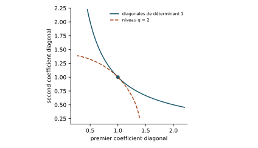

# École polytechnique MP — Première composition de mathématiques 2010 · Corrigé brut

*Corrigé rédigé par IA, non officiel. Signalez toute erreur.*

**Rédaction** · GPT-6.2 Astra Ultra · vitesse non renseignée

**Révision** · GPT-6.2 Astra Ultra · vitesse non renseignée

**Sur quelques questions de calcul différentiel.** Les extrémums sont cherchés successivement sur la sphère et sur le groupe spécial linéaire. Le dernier calcul utilise la conjugaison pour exprimer la différentielle de l’exponentielle matricielle.

## Préliminaires. Formes linéaires

### Question 1.a

Si $\beta=0$, son noyau est tout l’espace et $\alpha=0$. Sinon choisissons $e$ tel que $\beta(e)=1$. Pour tout $x$, $x-\beta(x)e\in\ker\beta\subset\ker\alpha$. Donc $\alpha(x)=\alpha(e)\beta(x)$, et $\lambda=\alpha(e)$ convient.

### Question 1.b

Posons $B(x)=(\beta_1(x),\ldots,\beta_r(x))$. Sur $\mathrm{Im}\,B$, la formule $\ell(Bx)=\alpha(x)$ est bien définie, car $Bx=By$ implique $x-y\in\ker B=\bigcap_i\ker\beta_i\subset\ker\alpha$. Elle définit une forme linéaire. En complétant une base de $\mathrm{Im}\,B$ en une base de $\mathbb R^r$, prolongeons-la en une forme linéaire sur $\mathbb R^r$. Elle s’écrit $z\mapsto\sum_i\lambda_i z_i$. En composant par $B$, on obtient $\alpha=\sum_i\lambda_i\beta_i$.

## I. Extrémums sur la sphère

### Question 2

Pour chaque $t$, $\langle\gamma(t),\gamma(t)\rangle=1$. La règle de dérivation d’une forme bilinéaire et la symétrie du produit scalaire donnent $2\langle\gamma(t),\gamma'(t)\rangle=0$.

### Question 3

Posons $w=v/\|v\|$. Le couple $(x,w)$ est orthonormé. La courbe $\gamma(t)=\cos(\|v\|t)x+\sin(\|v\|t)w$ est lisse et sa norme vaut 1 pour tout $t$. Elle satisfait $\gamma(0)=x$ et $\gamma'(0)=\|v\|w=v$. On la restreint à l’intervalle demandé.

### Question 4

La sphère unité est compacte et non vide en dimension finie, et $f$ est continue. Sa restriction y atteint son minimum et son maximum. Soit $x$ un point d’extrémum. Pour tout $v\ne0$ de $x^\perp$, la courbe précédente donne un extrémum intérieur en 0 pour $f\circ\gamma$, donc $df_x(v)=(f\circ\gamma)'(0)=0$. Ceci vaut aussi pour $v=0$. Le noyau de $h\mapsto\langle x,h\rangle$ est ainsi contenu dans celui de $df_x$. Par 1.a, $df_x(h)=\lambda\langle x,h\rangle$ pour tout $h$.

### Question 5.a

Les coordonnées de $f(x)=\langle x,Ax\rangle$ sont polynomiales en les coordonnées de $x$, donc $f$ est $C^1$. Par symétrie de $A$,
$$f(x+h)-f(x)=2\langle Ax,h\rangle+\langle h,Ah\rangle.$$
Le dernier terme est $O(\|h\|^2)$, donc $df_x(h)=2\langle Ax,h\rangle$.

### Question 5.b

À un extrémum de la restriction, $\langle 2Ax-\lambda x,h\rangle=0$ pour tout $h$ par 4 et 5.a. En prenant $h=2Ax-\lambda x$, on obtient $Ax=(\lambda/2)x$. Puisque $\|x\|=1$, c’est un vecteur propre.

## II. Minimum d’une norme sous contrainte de déterminant

### Question 6.a

Le coefficient $(j,j)$ de $M^tM$ (ici $M^t$ désigne la transposée de $M$) est $\sum_i m_{ij}^2$. En sommant sur $j$, $q(M)=\mathrm{Tr}(M^tM)$.

### Question 6.b

On a $(A,B)_F=\mathrm{Tr}(A^tB)=\sum_{ij}a_{ij}b_{ij}$. Cette expression est bilinéaire symétrique et $(A,A)_F$ est une somme de carrés, nulle seulement lorsque $A=0$. Elle définit le produit scalaire de Frobenius.

### Question 6.c

La fonction $q$ est un polynôme donc $C^1$. L’identité $q(M+H)=q(M)+2(M,H)_F+q(H)$ donne $dq_M(H)=2\mathrm{Tr}(M^tH)$.

### Question 7

Dans le développement suivant la ligne $i$, aucun cofacteur de cette ligne ne dépend de ses coefficients. Donc $\det(M+tE_{ij})=\det M+t\widetilde M_{ij}$. Les dérivées partielles du déterminant sont ainsi les cofacteurs. L’application déterminant est polynomiale. Par linéarité de la différentielle de $f=\det-1$,
$$df_M(H)=\sum_{ij}\widetilde M_{ij}h_{ij}=\mathrm{Tr}(\widetilde M^{t}H).$$

### Question 8

La préimage de $\{1\}$ par le déterminant continu est fermée. Comme $q(I)=n$, considérons $K=\{M\in\mathrm{SL}_n(\mathbb R):q(M)\le n\}$. Cet ensemble est fermé, borné pour la norme de Frobenius et non vide. Il est compact en dimension finie et $q$ y atteint un minimum $m\le n$. Hors de $K$, $q(M)>n$, donc ce point minimise bien sur tout $\mathrm{SL}_n(\mathbb R)$.

Pour $n\ge2$, les diagonales $(s,s^{-1},1,\ldots,1)$, $s>0$, donnent des matrices de déterminant $1$ avec $q=s^2+s^{-2}+n-2\to+\infty$ lorsque $s\to+\infty$. Le sous-niveau utilisé dans la preuve est donc indispensable à cet argument de compacité. Pour $n=1$, le groupe est le singleton $\{1\}$.

### Question 9

Considérons $M$ comme matrice complexe. Elle est semblable à une triangulaire supérieure $U$ de diagonale $(\lambda_1,\ldots,\lambda_n)$. Les puissances, puis l’exponentielle par convergence de sa série, respectent la similitude. La diagonale de $U^k$ est $(\lambda_j^k)_j$, donc celle de $e^U$ est $(e^{\lambda_j})_j$. Finalement $\det(e^M)=\prod_j e^{\lambda_j}=e^{\mathrm{Tr}M}$. Le calcul s’applique en particulier à toute matrice réelle.

### Question 10

Pour $\det M=1$, l’identité des cofacteurs donne $\widetilde M^t=M^{-1}$. Par 7, $\mathrm{Tr}(M^{-1}H)=0$. La courbe $\gamma(t)=M e^{tM^{-1}H}$ est $C^1$ et par 9 vérifie $\det\gamma(t)=e^{t\mathrm{Tr}(M^{-1}H)}=1$. On a $\gamma(0)=M$ et $\gamma'(0)=M(M^{-1}H)=H$.

### Question 11.a

Si $M$ minimise $g$ et $df_M(H)=0$, la courbe de 10 reste dans $\mathrm{SL}_n(\mathbb R)$. La fonction réelle $q\circ\gamma$ a donc un minimum intérieur en 0. En dérivant, $dq_M(H)=(q\circ\gamma)'(0)=0$.

### Question 11.b

Par 11.a et 1.a, $dq_M=\lambda\,df_M$. Les formules de 6.c et 7 et la non-dégénérescence du produit de Frobenius donnent $2M=\lambda\widetilde M=\lambda M^{-t}$. Ainsi $M^tM=(\lambda/2)I$, avec $\lambda/2>0$ car $M^tM$ est définie positive. Son déterminant vaut 1, donc $(\lambda/2)^n=1$ et $\lambda/2=1$. La matrice est orthogonale. Le minimum vaut alors $\mathrm{Tr}(I)=n$, et chaque orthogonale de déterminant 1 l’atteint.

La coupe diagonale de la figure correspond à $n=2$. Avec des entrées $s$ et $s^{-1}$ positives, $q-2=(s-s^{-1})^2$ est nul exactement en $s=1$. Les autres matrices minimisantes en dimension deux sont les rotations, comme le donne la caractérisation par orthogonalité et déterminant un.

## III. Différentielle de l’exponentielle matricielle

### Question 12.a

Pour tout $i,j$, $B_{ij}(t)=\sum_k(C_1)_{ik}(t)(C_2)_{kj}(t)$ est $C^1$. En dérivant terme à terme et en reconstituant les matrices, $B'=C_1'C_2+C_1C_2'$. L’ordre des facteurs est maintenu.

### Question 12.b

Les coefficients de $C^{-1}$ sont les cofacteurs transposés de $C$ divisés par $\det C$, qui ne s’annule pas. Donc $D=C^{-1}$ est $C^1$. En dérivant $CD=I$, $C'D+CD'=0$, d’où $D'=-C^{-1}C'C^{-1}$.

### Question 13.a

Posons $A(t)=I+\alpha(C_1(t)-I)+\beta(C_2(t)-I)$. Elle est $C^1$, $A(0)=I$ et $A'(0)=\alpha C_1'(0)+\beta C_2'(0)$. Le sujet demande ici une courbe dans l’espace des matrices.

### Question 13.b

Les fonctions $t\mapsto\det C_i(t)$ sont continues et valent 1 en 0. Elles restent simultanément non nulles sur un intervalle $]-\varepsilon,\varepsilon[$ pour $\varepsilon>0$ assez petit. Les deux matrices y sont inversibles.

### Question 13.c

Posons $U=C_1'(0)$, $V=C_2'(0)$. Par 12.b, $(C_2^{-1})'(0)=-V$. En gardant $s$ fixé, $\partial_t L(s,0)=C_1(s)V C_1(s)^{-1}-V$. La dérivée en $s=0$ vaut donc $UV-VU$. Les dérivées mixtes coïncident puisque $L$ est de classe $C^2$ sur le voisinage décrit en 13.b.

### Question 14.a

Pour $X,Z$ inversibles, $XZ Y(XZ)^{-1}=X(ZYZ^{-1})X^{-1}$, donc $\Phi(XZ)=\Phi(X)\Phi(Z)$. La conjugaison est linéaire inversible d’inverse $\Phi(X^{-1})$. Chaque coefficient de $XYX^{-1}=XY\widetilde X^t/\det X$ est rationnel en les coefficients de $X,Y$, à dénominateur non nul sur le domaine. En évaluant successivement sur les matrices d’une base pour $Y$, on en déduit la régularité $C^1$ de $\Phi$ (et même sa régularité lisse).

### Question 14.b

Pour $t$ proche de 0, $I+tX$ est inversible et la dérivée de son inverse en 0 vaut $-X$ par 12.b. Pour $Y$ fixé, la dérivée de $(I+tX)Y(I+tX)^{-1}$ est donc $XY-YX$ en 0. Ainsi $d\Phi_I(X)(Y)=XY-YX=\varphi(X)(Y)$.

### Question 15.a

À $t$ assez petit, $X+tH=X(I+tX^{-1}H)=(I+tHX^{-1})X\in\mathrm{GL}_n$. Appliquons $f$ puis dérivons en 0. La multiplication par $f(X)$ est linéaire de chaque côté et donne
$$df_X(H)=f(X)df_I(X^{-1}H)=df_I(HX^{-1})f(X).$$

### Question 15.b

On a $(e^{tX})'=e^{tX}X$. En posant $B=df_I(X)$ et en utilisant 15.a, $a'(t)=a(t)B$ et $a(0)=I_V$. Aussi $b'(t)=b(t)B$ avec la même donnée initiale. Par unicité de l’équation linéaire, ou en dérivant $a(t)e^{-tB}$, on a $a=b$ pour tout $t$.

### Question 15.c

Le déterminant est un morphisme lisse vers $\mathbb R^\times=\mathrm{GL}(\mathbb R)$. En $I$, les cofacteurs forment $I$, donc sa différentielle vaut $H\mapsto\mathrm{Tr}(H)$ d’après 7. La formule de 15.b en $t=1$ donne $\det(e^X)=e^{\mathrm{Tr}X}$.

### Question 15.d

Pour $V=M_n(\mathbb R)$ et $f=\Phi$, la question 14.b identifie $df_I(X)$ à $\varphi(X)$. Par 15.b en $t=1$, $\Phi(e^X)=\exp(\varphi(X))$ comme endomorphismes de $M_n(\mathbb R)$.

### Question 16.a

L’exponentielle matricielle est lisse : sa série de puissances et ses séries dérivées convergent uniformément sur chaque boule bornée, les facteurs polynomiaux en le degré étant dominés par la factorielle. Ainsi $\partial_t u(1,0)=d\exp_X(Y)$ et par définition $A(1,0)=e^{-X}d\exp_X(Y)$.

### Question 16.b

L’identité $\partial_s u=(X+tY)u$ donne $\partial_s\partial_t u=Yu+(X+tY)\partial_t u$, les dérivées mixtes s’échangeant par régularité. En dérivant $A=e^{-sX}\partial_tu$ et en annulant les termes en $X$, on obtient
$$\partial_s A(s,t)= e^{-sX}Yu(s,t)+t e^{-sX}Y\partial_tu(s,t).$$
En $t=0$, il reste $e^{-sX}Ye^{sX}=\Phi(e^{-sX})(Y)=\exp(-s\varphi(X))(Y)$ d’après 15.d.

### Question 16.c

Comme $u(0,t)=I$, on a $A(0,0)=0$. Intégrons 16.b de 0 à $s$, avec la convention de l’intégrale orientée pour $s<0$. La série exponentielle converge uniformément sur tout segment borné, d’où
$$A(s,0)=\sum_{k=0}^\infty\frac{(-1)^k s^{k+1}}{(k+1)!}\,\varphi(X)^k(Y).$$

### Question 16.d

En prenant $s=1$ dans 16.c puis en appliquant 16.a, on obtient
$$\boxed{\displaystyle d\exp_X(Y)=e^X\sum_{k=0}^{\infty}\frac{(-1)^k}{(k+1)!}\,\varphi(X)^k(Y).}$$
Ici $\varphi(X)^0(Y)=Y$ et les termes suivants sont les commutateurs itérés avec $X$. Si $XY=YX$, tous les termes avec $k\ge1$ sont nuls et la formule redonne $e^X Y$.

La formule intégrale équivalente est $d\exp_X(Y)=\int_0^1e^{(1-s)X}Ye^{sX}\,ds$. Pour $X=\operatorname{diag}(0,1)$ et $Y=E_{12}$, l’intégrande vaut $e^sE_{12}$ et on trouve $(e-1)E_{12}$. Cet exemple contrôle l’ordre des facteurs dans un cas où ils ne commutent pas.
