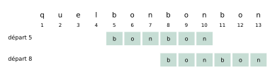
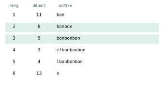
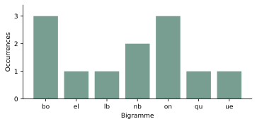

# École polytechnique · PSI et PT · Informatique 2010 · Corrigé guidé

*Corrigé rédigé par IA, non officiel. Signalez toute erreur.*

**Rédaction** · GPT-6.2 Astra Ultra · vitesse non renseignée · 25 novembre 2026

**Rechercher un mot dans un texte et compter ses occurrences.** Le langage choisi est Python. Pour réaliser les tableaux indicés à partir de 1 du sujet, une liste Python réserve la case 0, `allouer(n)` produit `[None] * (n + 1)` et `taille(t)` vaut `len(t) - 1`. Les lettres sont codées de 1 à 26. On recherche des mots non vides. La primitive `afficher` écrit le compteur associé au dernier mot affiché.

## Repères

Trois indices interviennent. Une position dans le texte désigne un suffixe, un rang désigne une case dans la liste triée des suffixes, et une position dans le mot sert à comparer les lettres. Le rang renvoyé par la question 11 appartient au deuxième ensemble.

## I · Méthode directe

### Question 1 · Reconnaître le début d’un suffixe

**Indication.** Vérifier la longueur restante avant de comparer les lettres une à une.

#### Solution

```python
def enTeteDeSuffixe(mot, tab, k):
    m, n = taille(mot), taille(tab)
    if m > n - k + 1:
        return False
    for j in range(1, m + 1):
        if mot[j] != tab[k + j - 1]:
            return False
    return True
```

L’indice $k$ est valide par hypothèse. À l’itération $j$, les $j-1$ premières lettres coïncident déjà. L’égalité de toutes les lettres suffit, même si le suffixe continue au-delà du mot. Le pire coût est $O(m+1)$.

### Question 2 · Rechercher un mot directement

**Indication.** Une occurrence commence à l’un des indices du texte. Arrêter la recherche dès le premier succès.

#### Solution

```python
def rechercherMot(mot, tab):
    for k in range(1, taille(tab) + 1):
        if enTeteDeSuffixe(mot, tab, k):
            return True
    return False
```

La question 1 élimine les suffixes trop courts. Le parcours examine au plus $n$ départs et effectue $O(n(m+1)+1)$ opérations.

### Question 3 · Compter avec recouvrement

**Indication.** Après un succès, avancer le départ d’une seule position.

#### Solution

```python
def compterOccurrences(mot, tab):
    nombre = 0
    for k in range(1, taille(tab) + 1):
        if enTeteDeSuffixe(mot, tab, k):
            nombre += 1
    return nombre
```

Dans « quelbonbonbon », « bonbon » commence aux positions 5 et 8. Les deux occurrences partagent trois lettres et contribuent toutes deux au résultat. Le coût maximal est le même qu’à la question 2.



### Question 4 · Compter les fréquences des lettres

**Indication.** Une lettre a déjà une représentation entière utilisable comme numéro de compteur.

#### Solution

```python
def frequenceLettre(tab):
    frequences = allouer(26)
    for lettre in range(1, 27):
        frequences[lettre] = 0
    for pos in range(1, taille(tab) + 1):
        frequences[tab[pos]] += 1
    return frequences
```

La somme des 26 valeurs est $n$. Le sujet nomme ici « fréquence » le nombre d’apparitions, comme le montre « b(3) » dans son exemple. Le temps est $O(n+26)$.

### Question 5 · Afficher les bigrammes présents

**Indication.** Mémoriser à la fois un compteur par paire et la position d’une occurrence pour appeler la primitive d’affichage.

#### Solution

```python
def afficherFrequenceBigramme(tab):
    compte = [[0] * 27 for a in range(27)]
    debut = [[0] * 27 for a in range(27)]
    for i in range(1, taille(tab)):
        a, b = tab[i], tab[i + 1]
        compte[a][b] += 1
        debut[a][b] = i
    for a in range(1, 27):
        for b in range(1, 27):
            if compte[a][b]:
                afficherMot(tab, debut[a][b], 2)
                afficher(compte[a][b])
```

Les indices 0 sont inutilisés dans les deux matrices Python. Toute occurrence du bigramme convient à l’affichage. Dans l’exemple, « bo » et « on » apparaissent chacun trois fois. Le temps est $O(n+26^2)$ et les matrices occupent $O(26^2)$ cases. Pour $n<2$, aucun bigramme n’est affiché.

## II · Tableau des suffixes

### Question 6 · Comparer deux suffixes

**Indication.** Si les lettres coïncident jusqu’à l’épuisement de l’un des deux suffixes, le plus court précède le plus long.

#### Solution

```python
def comparerSuffixes(tab, k1, k2):
    n = taille(tab)
    a, b = k1, k2
    while a <= n and b <= n:
        if tab[a] != tab[b]:
            return tab[a] - tab[b]
        a += 1
        b += 1
    return (n - a + 1) - (n - b + 1)
```

À la première différence, le signe de la différence des codes des lettres donne l’ordre. À défaut de différence, la dernière instruction compare les longueurs restantes. Pour deux indices identiques elle vaut zéro. Ainsi, dans l’exemple, le suffixe 11 « bon » précède le suffixe 8 « bonbon ».

### Question 7 · Trier les indices de départ

**Indication.** Au lieu de recopier les suffixes, déplacer uniquement leurs indices. Pour fusionner deux sections déjà triées, utiliser le comparateur de la question 6.

#### Solution

```python
def calculerSuffixes(tab):
    n = taille(tab)
    ordre = allouer(n)
    tampon = allouer(n)
    for i in range(1, n + 1):
        ordre[i] = i

    def trier(g, d):
        if g >= d:
            return
        milieu = (g + d) // 2
        trier(g, milieu)
        trier(milieu + 1, d)
        a, b = g, milieu + 1
        for k in range(g, d + 1):
            if (b > d or
                (a <= milieu and comparerSuffixes(tab, ordre[a], ordre[b]) <= 0)):
                tampon[k] = ordre[a]
                a += 1
            else:
                tampon[k] = ordre[b]
                b += 1
        for k in range(g, d + 1):
            ordre[k] = tampon[k]

    trier(1, n)
    return ordre
```

L’ordre final conserve une fois chacun des entiers de 1 à $n$. Pour « quelbonbonbon », les indices triés sont $(11,8,5,3,4,13,10,7,12,9,6,1,2)$. Le tri effectue $O(n\log(n+1))$ comparaisons de suffixes. Une comparaison pouvant lire $O(n)$ lettres, une borne globale est $O(n^2\log(n+1))$ pour $n\geqslant1$. Le tampon et le résultat occupent $O(n)$ cases.

## III · Exploiter le tableau trié

### Question 8 · Comparer le mot à un début de suffixe

**Indication.** L’épuisement du mot est un succès, y compris quand il reste des lettres dans le suffixe. L’épuisement du suffixe seul a une autre signification.

#### Solution

```python
def comparerMotSuffixe(mot, tab, k):
    m, n = taille(mot), taille(tab)
    j = 1
    while j <= m and k <= n:
        if mot[j] != tab[k]:
            return mot[j] - tab[k]
        j += 1
        k += 1
    if j > m:
        return 0
    return 1
```

Quand le suffixe est seul épuisé, il est un préfixe strict du mot et le mot est donc plus grand. Un résultat nul désigne exactement une occurrence en tête. Le coût est $O(m+1)$.

### Question 9 · Rechercher par dichotomie

**Indication.** Le signe rendu compare le mot demandé au suffixe visité. Un signe positif impose de chercher plus à droite.

#### Solution

```python
def rechercherMot2(mot, tab, tabS):
    gauche, droite = 1, taille(tabS)
    while gauche <= droite:
        milieu = (gauche + droite) // 2
        r = comparerMotSuffixe(mot, tab, tabS[milieu])
        if r == 0:
            return True
        if r > 0:
            gauche = milieu + 1
        else:
            droite = milieu - 1
    return False
```

Dans le tableau trié, tous les suffixes commençant par le mot forment un intervalle. De part et d’autre de cet intervalle, les valeurs de comparaison sont respectivement positives puis négatives. La mise à jour supprime toujours le milieu visité.

### Question 10 · Comparer les deux méthodes

**Indication.** Séparer les comparaisons de mots du nombre de lettres lues à l’intérieur d’une comparaison.

#### Solution

La recherche directe demande $O(n)$ comparaisons de mots dans le pire cas. La recherche dichotomique en demande $O(\log(n+1))$. Un moteur de recherche peut préparer le tableau des suffixes une fois pour un texte donné et le réutiliser pour de nombreuses requêtes. Les recherches suivantes bénéficient du gain sans reconstruire l’index. La mise à jour du texte peut en revanche modifier l’ordre des suffixes et demande une indexation appropriée.

### Question 11 · Atteindre la première case correspondante

**Indication.** Un résultat nul fournit déjà un candidat. Pour chercher le premier, conserver son indice et continuer à gauche.

#### Solution

```python
def rechercherPremierSuffixe(mot, tab, tabS):
    gauche, droite = 1, taille(tabS)
    premier = 0
    while gauche <= droite:
        milieu = (gauche + droite) // 2
        r = comparerMotSuffixe(mot, tab, tabS[milieu])
        if r > 0:
            gauche = milieu + 1
        else:
            if r == 0:
                premier = milieu
            droite = milieu - 1
    return premier
```

Le résultat est un **rang dans le tableau trié**. Dans l’exemple, « bonbon » est un préfixe aux rangs 2 et 3, d’où la réponse 2, bien que le départ du suffixe situé au rang 2 soit 8. L’absence est codée par 0, qui n’est pas un rang.



### Question 12 · Dénombrer un intervalle de suffixes

**Indication.** Pour un intervalle fermé non vide, le nombre de cases est le dernier rang moins le premier, plus un.

#### Solution

```python
def rechercherDernierSuffixe(mot, tab, tabS):
    gauche, droite = 1, taille(tabS)
    dernier = 0
    while gauche <= droite:
        milieu = (gauche + droite) // 2
        r = comparerMotSuffixe(mot, tab, tabS[milieu])
        if r < 0:
            droite = milieu - 1
        else:
            if r == 0:
                dernier = milieu
            gauche = milieu + 1
    return dernier

def compterOccurrences2(mot, tab, tabS):
    premier = rechercherPremierSuffixe(mot, tab, tabS)
    if premier == 0:
        return 0
    return rechercherDernierSuffixe(mot, tab, tabS) - premier + 1
```

Si la première recherche réussit, chaque rang entre les deux bornes correspond à un départ distinct, avec les recouvrements autorisés. Deux recherches dichotomiques suffisent, soit $O((m+1)\log(n+1)+1)$ opérations.

### Question 13 · Afficher tous les mots de longueur k

**Indication.** Tous les suffixes ayant les mêmes k premières lettres forment un groupe contigu. Un seul représentant et un compteur suffisent.

#### Solution

```python
def afficherFrequenceKgramme(tab, tabS, k):
    n = taille(tab)
    representant = 0
    nombre = 0
    for rang in range(1, taille(tabS) + 1):
        pos = tabS[rang]
        if n - pos + 1 < k:
            continue
        j = 0
        while (nombre > 0 and j < k
               and tab[representant + j] == tab[pos + j]):
            j += 1
        if nombre and j == k:
            nombre += 1
        else:
            if nombre:
                afficherMot(tab, representant, k)
                afficher(nombre)
            representant = pos
            nombre = 1
    if nombre:
        afficherMot(tab, representant, k)
        afficher(nombre)
```

On prend $k\geqslant1$. Tout suffixe de longueur au moins $k$ fournit une occurrence et les suffixes plus courts n’en fournissent aucune. L’ordre lexicographique rassemble exactement les occurrences de chaque mot. La dernière sortie, après la boucle, vide le groupe qui reste en mémoire. Le parcours fait au plus $O(n(k+1))$ lectures ou écritures de lettres, affichage compris, et consomme $O(1)$ cases auxiliaires, l’index étant déjà construit. Pour $k>n$, rien n’est affiché.


