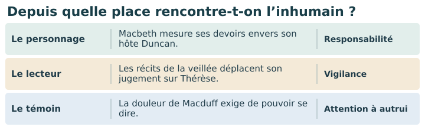

# Banque PT — Français A 2011 · Corrigé brut

*Corrigé rédigé par IA, non officiel. Signalez toute erreur.*

**Rédaction** · GPT-6.2 Astra Ultra · vitesse non renseignée

[Énoncé officiel](https://www.banquept.fr/documents/2011/fr_a_pt_2011.pdf) · [Rapport du jury](https://www.banquept.fr/documents/ecrit/rapport/2011/rapport_fra_a_ecrit_2011.pdf) · [Programme officiel](https://www.education.gouv.fr/bo/2010/17/esrs1000116a.htm) · [Grille de la session](https://www.banquept.fr/documents/livret/2011/Livret_PT_2011.pdf#page=13)

Épreuve de quatre heures sur « Le mal ». Jean-Jacques Rousseau, Profession de foi du vicaire savoyard (Émile, livre IV, extrait prescrit) · William Shakespeare, Macbeth (traduction de Pierre-Jean Jouve) · Jean Giono, Les Âmes fortes.

## Sujet

Sujet sur André Glucksmann et Térence.

Parodiant le dramaturge latin Térence (« rien de ce qui est humain ne m’est étranger »), le philosophe et essayiste contemporain André Glucksmann affirme « que rien de ce qui est inhumain ne me demeure étranger. » (Le XIe commandement)

Les œuvres au programme vous permettent-elles de vérifier cette assertion ?

## Dissertation

Au banquet de Macbeth, les convives voient leur roi s’adresser avec épouvante à une place qu’ils croient vide. Le spectateur, lui, sait pourquoi cette place est devenue insupportable. Il a été admis assez près de Macbeth pour comprendre ce que les invités ignorent. Doit-il pour autant se dire semblable à celui qui a fait tuer son compagnon ? Glucksmann transforme la maxime de Térence en un commandement qui engage celui qui le prononce, « que rien de ce qui est inhumain ne me demeure étranger ». Le verbe « demeure » laisse à entendre qu’il y aurait un travail à faire sur une première réaction d’horreur ou de distance. À quelles conditions peut-on reconnaître l’inhumain comme une possibilité qui nous concerne, sans effacer la distance entre celui qui fait le mal et celui qui le subit ?

L’inhumain paraît d’abord désigner une limite qu’il serait mauvais d’abolir. Lorsque Macduff apprend que les siens ont été tués, il demande à plusieurs reprises si les enfants aussi sont morts. Le spectateur connaissait déjà le sort de la famille. Pourtant le trajet de cette nouvelle jusqu’à son père fait entendre ce qui échappe au simple énoncé d’un fait. Dans cette répétition, une conscience se heurte à ce qu’elle ne peut recevoir comme un événement ordinaire. Éprouver de l’effroi, ici, est une manière de rester humain. Si l’on voulait ne plus jamais rien sentir d’étranger dans la cruauté, on finirait par en prendre son parti. Le commandement de Glucksmann n’est défendable que s’il sauvegarde cette résistance.

Mais il arrive aussi que l’horreur dispense de penser. Il suffirait de traiter Macbeth en monstre d’une espèce différente pour s’assurer une confortable innocence. Or Shakespeare nous montre son héros avant la faute. Il connaît les liens qui l’obligent envers Duncan. Il est son parent, son sujet, son hôte. Il voit même que seule l’ambition le pousse. Ces obligations si distinctement énumérées empêchent de se représenter le criminel comme un homme dépourvu de tout sens moral. C’est en comprenant ce qu’exigent les liens les plus communs qu’il décide de les rompre. Si son acte reste inhumain, les conditions qui en font un acte imputable sont profondément humaines. Elles ne sont pas étrangères à quiconque a déjà éprouvé le pouvoir d’enfreindre ce qu’il savait devoir faire.

Rousseau rend intelligible ce paradoxe dans la Profession de foi du vicaire savoyard. Le vicaire fait appel à une expérience que son auditeur peut vérifier. Nous éprouvons à la fois le pouvoir de vouloir le bien et la force de ce qui nous en détourne. Attribuer le mal moral à Dieu reviendrait à méconnaître ce que signifie pour nous agir librement. Mais conclure que nous voulons tous le mal parce que nous sommes libres serait commettre l’erreur inverse. La conscience dont parle le vicaire donne une orientation au jugement. Elle permet qu’un homme s’accuse lui-même jusque dans la satisfaction d’une passion. Lire ces pages à la première personne, c’est reconnaître en soi la possibilité d’une division, tout autre chose que s’attribuer d’avance toutes les fautes.

La difficulté est parfois de découvrir cette division chez celui qui raconte. Au cours de la veillée des Âmes fortes, Thérèse et sa contradictrice reviennent sur la même histoire. Les dons de madame Numance peuvent signaler une générosité sans mesure, l’exploitation d’une protectrice ou ce que la donatrice trouve elle-même à donner toujours davantage. Selon les moments, le lecteur est prêt à plaindre Thérèse, à se méfier d’elle ou à admirer l’intelligence avec laquelle elle comprend une autre femme. Il peut alors s’apercevoir qu’il a pris plaisir à une version de la relation dont il désapprouve pourtant la dureté. L’inhumain cesse de lui être extérieur par le chemin inattendu de son intérêt pour un beau récit. Il se découvre engagé là où il se croyait simple arbitre.

Cette découverte impose toutefois une réserve. Je n’acquiers pas une connaissance entière de madame Numance en décidant de me reconnaître dans Thérèse. La construction du roman empêche d’ailleurs le lecteur de vérifier souverainement ce qui s’est passé entre les femmes. Il est renvoyé aux conditions de la veillée, au désir des conteuses d’entraîner leur auditoire et aux lacunes qui demeurent. Ici, ne rien laisser demeurer étranger implique de prêter attention à une histoire dont je ne commanderai jamais le sens. Faire comme si je possédais toutes les raisons de l’autre pourrait être une seconde manière de lui retirer sa voix. La compréhension qui vaut d’être recherchée sait où s’arrête ce qu’elle peut affirmer.

Enfin la maxime gagnerait à se lire du point de vue de celui à qui la victime s’adresse. Après la nouvelle du désastre, Malcolm voudrait que Macduff réagisse en homme. Macduff réclame aussi le droit qu’a un homme de sentir son malheur. Cette réplique récuse une définition appauvrie de l’humanité, selon laquelle la résolution devrait effacer le chagrin. Le spectateur peut ne connaître aucune expérience comparable. Il a tout de même à reconnaître le chagrin de Macduff comme une réalité qui le concerne et dont il ne possède pas la mesure. Le passage de Térence à Glucksmann ne porte donc pas uniquement sur notre propre capacité au mal. Il oblige à nous rendre présents aux effets qu’un acte inhumain continue de produire dans la vie d’autrui.

L’assertion se vérifie ainsi comme un impératif plus sûrement que comme l’énoncé d’une expérience acquise. Une proximité trop vite proclamée risquerait de confondre celui qui souffre, celui qui agit et celui qui regarde. Le théâtre apprend à suivre un choix qu’on condamne, Rousseau à interroger ses propres divisions, Giono à soupçonner les plaisirs de son jugement. En donnant à l’effroi la suite d’une enquête et d’une écoute, ces œuvres empêchent que l’inhumain soit relégué dans un monde auquel nous n’aurions jamais de comptes à rendre.

