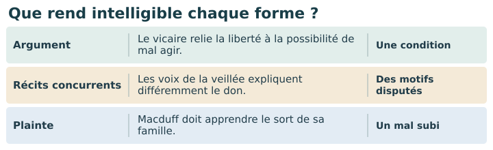

# Banque PT — Français B 2011 · Corrigé brut

*Corrigé rédigé par IA, non officiel. Signalez toute erreur.*

**Rédaction** · GPT-6.2 Astra Ultra · vitesse non renseignée

**Révision (tour 1)** · GPT-6.2 Astra Ultra · vitesse non renseignée

[Énoncé officiel](https://www.banquept.fr/documents/2011/fr_b_pt_2011.pdf) · [Rapport du jury](https://www.banquept.fr/documents/ecrit/rapport/2011/rapport_fra_b_ecrit_2011.pdf) · [Programme officiel](https://www.education.gouv.fr/bo/2010/17/esrs1000116a.htm) · [Grille de la session](https://www.banquept.fr/documents/livret/2011/Livret_PT_2011.pdf#page=13)

Épreuve de quatre heures sur « Le mal ». Jean-Jacques Rousseau, Profession de foi du vicaire savoyard (Émile, livre IV, extrait prescrit) · William Shakespeare, Macbeth (traduction de Pierre-Jean Jouve) · Jean Giono, Les Âmes fortes.

## Sujet

Olivier Abel, « Justice et Mal », dans A. Garapon et D. Salas, La Justice et le mal, Odile Jacob, 1997.

Le texte commence sur la page de garde, après les consignes, par « Dans cette question, qui précède toute justice ». Il se termine page 4 par « vaine, sinon insoutenable ». Les questions suivent sur cette même page.

Vous résumerez cet extrait en 180 mots (+ ou – 10%) et vous indiquerez le nombre exact de mots utilisés. (8 pts)

## Résumé

Avant de juger le mal, nous puisons dans notre langue de quoi dire ce que les mots semblent incapables de contenir. Accuser, c’est chercher une origine, ouvrir une controverse sans jamais rendre justifiable ce qui fut commis. Se plaindre, c’est éprouver sans recours un malheur irréversible. Sa répétition donne à la plainte une mesure qui soulage. Notre droit garde quelque chose de ces débats et de ces rites.

Raconter rapproche celui qui agit et celui qui souffre. Une suite se dessine, mais où ferait-on commencer le mal, quel sens unique lui donner ? Ce qui résiste au récit nous oblige à le reprendre.

Les Écritures laissent pareillement ouvertes des questions contraires sur la bonté et la puissance divines. Sommes-nous responsables de chaque commencement du mal, comme le croit Pélage, ou prolongeons-nous avec Augustin un mal antérieur ? Leibniz comprend les maux inévitables par la coexistence du plus grand nombre de perfections compatibles dans un monde fini. Bayle oppose à ce regard divin inaccessible la souffrance éprouvée, dont un instant ruine pour celui qui endure toutes les justifications.

*180 mots.*

« Le mal n’est pas explicable, mais seulement racontable ». Vous direz si la lecture des œuvres au programme vous permet de confirmer ou d’infirmer ce point de vue.

## Dissertation

Lorsque se réunit la veillée des Âmes fortes, il y a des histoires que plusieurs femmes connaissent et que personne ne paraît capable de clore. Les faits reparaissent sous un autre éclairage sitôt qu’une nouvelle voix prend la parole. Est-ce faute d’une information qui permettrait enfin de tout expliquer ? Ou bien cette reprise est-elle la forme la plus juste sous laquelle un mal commis ou subi puisse nous atteindre ? Olivier Abel écrit que « le mal n’est pas explicable, mais seulement racontable ». L’expression paraît accorder au récit un privilège et lui imposer une limite. Il peut rendre présente une expérience sans lui assigner une raison suffisante. Mais les œuvres suggèrent aussi qu’un récit contient déjà des explications et que certaines douleurs se disent à peine sous la forme d’une histoire.

Le récit possède d’abord un avantage sur la formule générale. Une explication par l’ambition nous ferait reconnaître la passion de Macbeth dans celle de bien d’autres hommes. Il resterait à comprendre ce que signifie pour cet homme, à ce moment, l’annonce qu’il sera roi. La prophétie des sorcières rencontre d’abord la confirmation de l’un des titres annoncés. L’avenir royal prend de ce fait une consistance nouvelle. Puis Macbeth en fait part à sa femme. Les deux époux entrent dans un échange où son hésitation rencontre une idée de la virilité qu’il croit devoir soutenir. La scène dramatique fait voir comment une promesse, une nouvelle et des paroles adressées composent une situation qui n’existait pas d’avance. Banquo aussi a entendu prédire un avenir royal à sa descendance et ne tire pas de cette annonce la même obligation d’agir. Ce contrepoint, offert par la pièce elle-même, interdit de traiter la prophétie comme une cause suffisante.

Cette attention à la succession des choix donne à entendre autre chose encore. Un acte fait souffrir quelqu’un, dont l’histoire ne se laisse pas déduire des motifs de celui qui agit. Quand Ross doit apprendre à Macduff le sort de sa famille, ses hésitations retardent la nouvelle. Macduff s’accroche à la possibilité qu’il reste quelqu’un, et la répétition de sa question étend pour le spectateur le temps où il doit entrer dans un malheur qu’on lui annonce en quelques mots. L’ambition du roi peut bien expliquer à quel titre cette famille était menacée. Elle ne dit rien de la découverte que fait le père. L’œuvre donne place aux deux histoires sans présenter l’une comme la mesure de l’autre. Tel est le gain décisif du récit sur une explication qui croirait en avoir fini avec le mal en identifiant son auteur.

Pourtant celui qui raconte choisit déjà des causes. Lorsqu’on reprend l’histoire de Thérèse et de madame Numance, il importe de savoir qui attribue à qui l’initiative. Giono fait varier le sens même de la générosité. Un don peut apparaître comme la réponse à une détresse, comme une forme de bonheur recherchée sans mesure par celle qui donne ou comme une occasion reconnue et exploitée par celle qui reçoit. Une suite temporelle apparemment identique abrite ainsi des explications réellement différentes. Le lecteur doit apprendre à distinguer le fait rapporté de la raison qu’une voix lui donne. Giono obtiendrait difficilement cet effet si raconter était une opération entièrement étrangère à expliquer. C’est précisément parce que chaque histoire explique quelque chose que leur désaccord devient instructif.

Rousseau présente une objection plus directe. La Profession de foi du vicaire savoyard entreprend bel et bien d’expliquer comment le mal peut exister dans un monde ordonné. Si l’on veut un être capable d’agir librement, il faut lui reconnaître le pouvoir de mal user de sa liberté. Interdire à l’avance toute faute par une disposition providentielle supprimerait avec la faute une condition de la valeur morale. L’argument peut être discuté, mais il serait arbitraire de le réduire à une histoire. Il distingue les conditions générales d’une action et les motifs particuliers d’une personne. Son domaine doit être défini avec soin. Comprendre que Macbeth pouvait mal choisir ne suffit pas à comprendre pourquoi il a, cette fois-là, choisi ainsi. Cela suffit encore moins à prétendre que les siens ou ceux de Macduff auraient dû souffrir.

Le dispositif adopté par Rousseau indique d’ailleurs comment une explication peut faire droit à cette limite. Le vicaire s’adresse à un jeune interlocuteur. Il lui parle depuis une existence traversée par le doute, lui demande de consulter sa propre expérience et reconnaît les bornes de ce qu’il est capable de soutenir. Son raisonnement nous arrive donc comme une parole adressée par quelqu’un qui a dû se former lui-même un jugement. La construction personnelle de cette conviction ne détruit pas sa portée rationnelle. Elle permet de reconnaître le point où elle cesse de répondre à une souffrance singulière. Il faut distinguer l’effort légitime pour rendre compte d’un pouvoir de mal faire et la prétention de donner à celui qui souffre la raison de son malheur.

Reste la difficulté que marque Abel lui-même lorsqu’il demande si le mal est entièrement racontable. Lady Macbeth, durant son sommeil, revient à quelques mots et à un geste des mains. Ceux qui la regardent ne reçoivent pas une histoire complète et ordonnée. Le public, qui connaît plus de choses que les témoins présents sur scène, peut comprendre à quoi se rattache cette répétition. Mais aucune chronologie ne lui en livrera toute la charge. La scène donne une forme à ce qui ne prend pas la forme d’un récit. De même, au matin de la veillée de Giono, les voix cessent sans qu’une vérité dernière des relations entre les personnages ait été offerte aux auditrices. Entendre un récit peut donc conduire à respecter aussi ce que la narration ne saura pas résoudre.

Nous pouvons confirmer la formule d’Abel si elle vise l’explication qui voudrait faire disparaître tout reste d’incompréhensible, ou pire, faire accepter un tort à celui qui le subit. Le récit rend alors au mal son histoire et aux personnes leur place. Mais il explique aussi, partiellement, tandis que la réflexion philosophique éclaire les conditions de la responsabilité. Et ni le récit ni l’argument ne possèdent tout le langage du mal. Il faut parfois la répétition d’un mot, la présence d’un témoin et la patience de l’écouter là où aucune histoire ne pourrait encore conclure.

