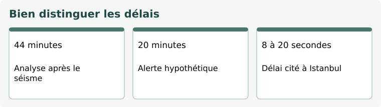
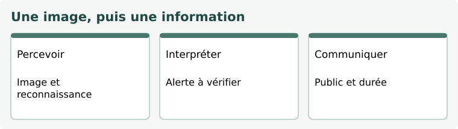
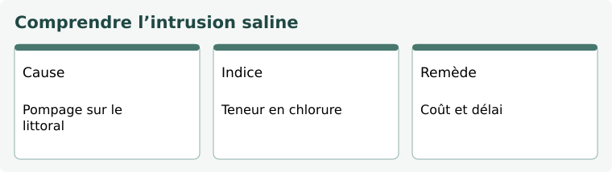
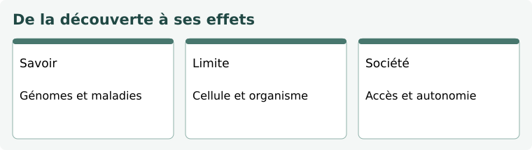
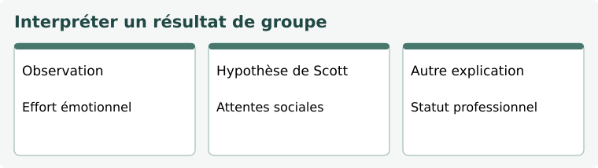

# Banque PT — Langue vivante A 2011 · Corrigé guidé

*Corrigé rédigé par IA, non officiel.*

**Rédaction** · GPT-6.2 Astra Ultra · vitesse non renseignée

L’épreuve dure trois heures. Chaque candidat traite la langue choisie à l’inscription. La version française vaut 10 points. La question a demande 80 à 100 mots pour 4 points. La question b demande 200 à 250 mots pour 6 points.

[Sujet](https://www.banquept.fr/documents/2011/lv_a_pt_2011.pdf) · [Rapport du jury](https://www.banquept.fr/documents/ecrit/rapport/2011/rapport_lv_a_ecrit_2011.pdf) · [Grille du livret](https://www.banquept.fr/documents/livret/2011/Livret_PT_2011.pdf#page=13)

## Allemand

*Geophysik: Vorboten von Erdbeben verzweifelt gesucht*

Holger Kroker, Die Welt, 20 février 2011. Article, pages 2–3. Le texte traduit se trouve page 2 et les questions page 3. Rapport allemand, pages 1–2 du PDF.

Rétablir la chronologie. Les signaux sont identifiés après le séisme, sur 44 minutes d’enregistrement. Les 20 minutes de la question a relèvent d’une hypothèse. En b, distinguer les catastrophes liées à l’eau ou à la météo et l’origine tectonique des séismes.

### Version française

De « Die Forscher interessierten sich » à « nicht gebrochen ist ».

Les chercheurs se sont surtout intéressés à ce qui avait précédé le séisme. Une question les occupait, celle qui préoccupe toute la communauté des sismologues. Existe-t-il des signes précurseurs qui permettraient de prévoir un tremblement de terre ? Ce travail a été laborieux, mais les chercheurs rendent effectivement compte, dans le dernier numéro de Science, d’une phase de formation caractéristique. À partir des données des sismomètres, ils ont retracé le déroulement des événements jusqu’à la secousse dévastatrice. « Nous avons, pour ainsi dire, pu observer en temps réel le séisme en train de se former », explique Schmittbuhl.

Les sismomètres ont commencé à enregistrer des signaux quarante-quatre minutes avant la forte secousse. Pour cette période, les scientifiques ont identifié avec certitude dix-huit séismes de faible intensité. Vingt-deux autres cas possibles restent à examiner. Malgré leurs différences d’intensité, ces séismes se ressemblaient beaucoup. L’enchaînement des ondes P et S, les deux catégories d’ondes sismiques, était remarquablement semblable. « Durant ces quarante-quatre minutes, les secousses se sont succédé à des intervalles de plus en plus courts, jusqu’à des fractions de seconde vers la fin », rapporte Schmittbuhl. Les chercheurs ont pu localiser l’origine de tous ces séismes à quelques mètres près. Tous se sont produits dans la même zone, celle où a ensuite pris naissance le séisme qui a causé les dégâts.

Être averti trois quarts d’heure avant un tremblement de terre serait une formidable avancée, tout particulièrement sur le Bosphore. C’est en effet là que se trouve le dernier segment de la faille nord-anatolienne où la rupture ne s’est pas encore produite.

### Question a

*Was würde eine Vorwarnzeit von 20 Minuten in Erdbebengebieten genau ändern?*

Zwanzig Minuten wären in Istanbul wesentlich mehr als die bislang erwarteten acht bis zwanzig Sekunden. Automatische Systeme könnten schon bei einer sehr kurzen Warnung Leitungen abschalten, U-Bahnen anhalten oder Brücken sperren. Mit einem längeren Vorlauf könnten Verantwortliche zusätzlich Menschen verständigen, Hilfskräfte in Bereitschaft versetzen und eingeübte Schutzmaßnahmen in Schulen und Krankenhäusern einleiten. Ob das gelingt, hängt von zuverlässigen Meldungen und klaren Zuständigkeiten ab. Die Untersuchung des Bebens von Izmit zeigt vor allem, was sich im Nachhinein erkennen ließ. Eine sichere Vorhersage für das nächste Beben ist damit noch nicht erreicht.

**90 mots**

### Question b

*Das Klima verändert sich. Es gibt immer mehr Umweltkatastrophen (Überschwemmungen, Tornados, Erdbeben, usw.). Warum? Was kann man daraus lernen?*

Wenn ein Fluss über die Ufer tritt, liegt die Höhe des Schadens nicht allein am Regen. Stehen Häuser auf früheren Überschwemmungsflächen, geraten sehr viel mehr Menschen in Gefahr. Versiegelte Böden nehmen weniger Wasser auf. Ein wärmeres Klima kann manche Wetterextreme begünstigen, doch daraus folgt nicht, dass jedes einzelne Unwetter dieselbe Ursache hat. Bei Erdbeben ist die Unterscheidung besonders wichtig. An einer Verwerfung bauen sich Spannungen durch die Bewegung der Erdplatten auf. Der Klimawandel erklärt das Beben von Izmit nicht.

Gemeinsam ist diesen Ereignissen dagegen die Frage, wie gut eine Gesellschaft vorbereitet ist. Eine Stadt kann einen gefährdeten Hang von Bebauung freihalten, Gebäude erdbebensicherer machen oder einem Fluss mehr Platz geben. Solche Entscheidungen sind unbequem, weil sie heute Geld kosten und ihr Erfolg oft darin besteht, dass später etwas nicht passiert. Wer nach einer Katastrophe nur wieder aufbaut, was zuvor am selben Ort stand, stellt manchmal auch die frühere Gefahr wieder her.

Ich würde deshalb wissenschaftliche Beobachtung mit öffentlich verständlichen Plänen verbinden. Die Bewohner eines Viertels sollten wissen, welche Warnung für sie gilt und wer Menschen unterstützt, die allein nicht schnell reagieren können. Schulen können solche Abläufe gemeinsam mit den zuständigen Stellen einüben. Vorhersagen bleiben mitunter unsicher. Eine Gemeinde kann trotzdem schon lange vor dem nächsten Unwetter oder Beben entscheiden, was sie schützen und welche vermeidbaren Risiken sie abbauen will.

**219 mots**

## Anglais

*Computers That See You and Keep Watch Over You*

The New York Times, 1er janvier 2011. Texte et questions, pages 4–5. La version est page 4. Le rapport d’anglais, pages 3–5 du PDF, distingue expressément les deux sujets de rédaction.

Traduire l’exercice simulé et rendre clairement le changement de service des surveillants. En b, le jury demande d’étudier les nouvelles technologies de communication. Faire porter l’argument sur les messages, les réseaux et la circulation des données.

### Version française

De « Five cameras » à « or alarming ».

Cinq caméras suivaient les faux détenus pendant l’exercice, et un logiciel d’intelligence artificielle analysait les images pour reconnaître des visages, des gestes et des comportements collectifs récurrents. Les ordinateurs ne savent rien faire de plus que des surveillants qui, dans des conditions idéales, regarderaient sans interruption les écrans de contrôle. Dans la pratique, cependant, l’attention des surveillants se disperse souvent. À la relève, on peut oublier de transmettre une observation qui aurait mérité de l’être. Les machines, elles, ne clignent pas des yeux et n’oublient rien. Ce sont des auxiliaires infatigables.

L’engouement pour de tels systèmes dépasse de loin les prisons américaines. Les caméras à haute résolution et à bas coût se multiplient. Elles équipent notamment les téléphones intelligents et les ordinateurs portables. Le coût du stockage des images diminue, tandis que de nouveaux algorithmes permettant d’explorer, de comparer et d’examiner le flot de données visuelles progressent rapidement.

Un système de vision par ordinateur peut observer une chambre d’hôpital et rappeler aux médecins et au personnel infirmier de se laver les mains, ou signaler qu’un patient agité risque de tomber de son lit. Grâce à un miroir informatisé, il peut observer le visage d’un homme pour déterminer sa fréquence cardiaque et d’autres signes vitaux. Il peut analyser les expressions d’une femme qui regarde une bande-annonce ou fait des achats en ligne et aider les professionnels du marketing à adapter leurs offres en conséquence. La vision par ordinateur peut aussi être utilisée dans les centres commerciaux, les cours d’école, sur les quais du métro, dans les ensembles de bureaux et les stades. Autant de possibilités qui pourraient se révéler utiles… ou inquiétantes.

### Question a

*What is computer vision and to what extent can it be useful?*

Computer vision uses software to interpret images rather than merely record them. A system can recognise a face, a gesture or a pattern of movement and bring an event to someone’s attention. In a hospital, for instance, it might warn a nurse that a restless patient could fall. Its advantage over a person watching a screen lies chiefly in its ability to remain attentive for long periods. Its usefulness still depends on the purpose it serves and on a human being checking what an alert actually means.

**87 mots**

### Question b

*In what ways can new communication technologies be a threat to privacy?*

A conversation normally gives us some idea of who is listening. A message sent through a network can travel far beyond that first audience. A friend might forward an embarrassing photograph with no intention of causing lasting harm. The person in it may nevertheless find that classmates, relatives or a future employer can see it long after the original exchange is over. Deleting the first message cannot bring back every copy.

Privacy also concerns what can be inferred from ordinary communications. The timing of regular calls, the people in a group chat and the places mentioned in posts can reveal relationships or routines that nobody has chosen to describe publicly. Even a person who shares little can appear in a photograph or an address book uploaded by somebody else. Asking everyone to be more careful with their own accounts will therefore solve only part of the problem.

These technologies also let families stay in contact and people speak about issues they cannot easily discuss in public. The point is to preserve a choice about audiences and purposes. A service can explain who receives a message, make small groups the default and limit how long it retains unnecessary records. Users can ask before forwarding a private conversation. The freedom to communicate is more valuable when taking part does not mean giving up control over every trace of the exchange.

**228 mots**

## Arabe

*هل يضطر لبنان إلى تحلية مياه البحر؟*

Marc Saadé, Al-Hayat, 5 janvier 2011. Texte et questions, pages 6–7. Le sens des deux bornes est confirmé par la page 6 malgré la disposition bidirectionnelle de leur rappel page 7. Rapport d’arabe, page 6 du PDF.

Suivre le premier paragraphe jusqu’à la zone de transition entre eau douce et eau salée. Les chiffres ultérieurs sur les chlorures éclairent le résumé mais restent hors version. Distinguer l’intrusion marine du traitement de l’eau.

### Version française

Du début sur l’infiltration de l’eau de mer, « تتسرب مياه البحر », à « خصائص الطبقة المائية الجوفية » à la fin du premier paragraphe.

L’eau de mer s’infiltre dans les puits souterrains des villes côtières libanaises. Dans une large mesure, le phénomène résulte de plusieurs années de mauvaise gestion de l’eau par les autorités locales. Les quinze années de conflit intérieur qu’a connues le pays n’ont fait que l’aggraver. La qualité des eaux souterraines du Grand Beyrouth s’est gravement détériorée, peut-être au-delà de toute possibilité de remédier à la situation. Et la dégradation se poursuit du fait du pompage excessif dans les puits par la population de cette agglomération, qui compte peut-être plus d’un million et demi d’habitants. Une limite dite « ligne de contact » entre l’eau de mer et les eaux souterraines se déplace davantage vers les terres sous l’effet de ce phénomène dynamique. L’infiltration d’eau de mer a rendu les eaux souterraines de Beyrouth impropres aux usages domestiques et agricoles, voire industriels, car, dans de nombreux puits, la salinité a atteint des milliers de milligrammes par litre. Le signe direct attestant que l’eau de mer s’est infiltrée dans les eaux douces souterraines est la présence de chlorure, souvent mesuré comme indicateur de salinité. Toute hausse de la salinité des eaux souterraines ou de leur teneur en chlorure est toujours préoccupante et exige des mesures correctives coûteuses qui prennent beaucoup de temps. Lorsque les eaux salées pénètrent dans les aquifères côtiers, il se forme une zone où eaux souterraines douces et eau de mer se mélangent. La limite entre elles n’est pas nécessairement nette. Il s’agit d’une zone de transition dont la largeur dépend en partie des caractéristiques de la couche aquifère.

### Question a

*ما هو معنى النص العام؟*

يتناول النص تسرب مياه البحر إلى المياه الجوفية على الساحل اللبناني، ولا سيما في بيروت الكبرى. فقد أدى الإفراط في الضخ وسوء إدارة الموارد إلى تقدم المياه المالحة نحو اليابسة وتراجع صلاحية عدد من الآبار للاستعمال. ويشرح الكاتب أن ارتفاع تركيز الكلوريد مؤشر يستدعي الانتباه وإجراءات تصحيحية، وأن الحد الفاصل بين الماء العذب والمالح قد يكون منطقة تختلط فيها المياه. وتمس النتائج المنازل والزراعة والصناعة، بل تمتد إلى متانة الأبنية عندما تستعمل مياه شديدة الملوحة في الخرسانة. فالمشكلة تتعلق بنوعية المورد وبطريقة استغلاله معا.

**84 mots**

### Question b

*ما هي في رأيكم أنجع السبل للمحافظة على الماء؟*

أرى أن المحافظة على الماء تبدأ بمعرفة ما لدينا منه وما نفقده قبل أن يصل إلى الناس. فقد يطلب من أسرة أن تختصر استهلاكها وهي ترى الماء يتسرب من أنبوب عام في شارعها طوال أسبوع. لذلك ينبغي أن تنشر البلدية أرقاما واضحة عن الفاقد، وأن تتيح للسكان الإبلاغ عنه، ثم تبين لهم متى أصلح الخلل. وحين يلمس الناس أثر المشاركة يصبح الحديث عن الاقتصاد في الاستهلاك أكثر إقناعا.

وفي المناطق الساحلية لا بد من متابعة الآبار على مدى سنوات. فالانخفاض الذي يصيب مخزونا مشتركا لا يتوقف عند حدود الأرض التي حفر فيها البئر. ويمكن أن يتفق المزارعون والمنازل والمؤسسات على قواعد للسحب تراعي حاجة الأسر إلى مياه الشرب وتحافظ على المورد في فترات الجفاف. ويحتاج المزارع إلى مساعدة عملية إذا طلب منه أن يغير طريقة الري، لأن شراء معدات جديدة قد يتجاوز قدرته المالية.

أما على مستوى المنزل والمدرسة فيمكن إصلاح الصنابير واستعمال كميات تناسب الحاجة ومراقبة فواتير الاستهلاك لمعرفة أي تغير غير عادي. وأفضل أن تقترن هذه العادات بحماية الأنهار من الصرف الملوث، إذ لا معنى لتوفير كمية من الماء ثم إفساد نوعيتها. وقد توفر التحلية موردا إضافيا في بعض الظروف، لكنها تتطلب طاقة ومالا. في رأيي يكون النجاح حين تظل المياه الصالحة متاحة للجميع بسعر معقول، ويورث المجتمع موارده لمن يأتي بعده في حالة أفضل.

**207 mots**

## Espagnol

*Los nuevos dioses*

Magazine, 16 mai 2010. Texte page 8, consignes page 9. Rapport d’espagnol page 7 du PDF. La version s’arrête à l’intérieur de l’intervention de la chercheuse.

Préserver les questions de l’article et le conditionnel de l’hypothèse sur la mortalité. La première réponse restitue les désaccords entre les voix citées. La seconde prend position sur les effets sociaux de la recherche.

### Version française

Du début du texte à « ni se preocupa del bienestar humano ni de ningún animal ».

L’être humain a toujours essayé de dominer la nature à son avantage. Plus il étend ses connaissances et perfectionne ses outils, plus il repousse les limites. La science au service de la santé en est le meilleur exemple. Les avancées scientifiques et technologiques élargissent les frontières de la médecine. Aucun autre domaine, sans doute, ne traduit mieux l’ambition, les efforts et l’imagination que l’être humain déploie pour maîtriser les lois de la nature.

« La science cherche à connaître les lois de la nature pour les modifier. L’homme a toujours voulu agir sur elles pour les rendre favorables à ses intérêts », affirme Joan J. Guinovart, directeur de l’Institut de recherche biomédicale et professeur à l’université de Barcelone. L’être humain cherche à mener une existence parfaite, à se sentir bien, sans limites, à prolonger sa vie. À échapper à la mort ? Il y a encore moins d’un siècle et demi, rappelle Guinovart, la médecine tenait davantage de la magie que de la science. Aujourd’hui s’ouvrent des portes qui semblent donner accès à une autre ère.

« Voilà longtemps que nous modifions les lois de la nature. Si nous ne l’avions pas fait, la mortalité infantile serait très élevée et nous ne vivrions pas plus de vingt ou trente ans en moyenne. Nous n’aurions ni élevage, ni agriculture, ni iPhone. Il n’y a rien de mal à transformer la nature. Elle n’est ni divine ni sage, et elle ne se soucie ni du bien-être des humains ni de celui d’aucun animal. »

### Question a

*Analice Usted el panorama de la investigación científica que nos presenta este texto.*

El artículo presenta la investigación como una prolongación del esfuerzo humano por mejorar las condiciones de vida. El conocimiento de los genomas permite estudiar la evolución y abre perspectivas en medicina y agricultura. Los investigadores esperan prevenir o tratar mejor algunas enfermedades y prolongar la vida con buena salud. Sin embargo, distinguen la supervivencia de ciertas células de la inmortalidad del organismo entero. Tampoco coinciden en que vivir mucho más tiempo sea un objetivo deseable por sí mismo, pues el envejecimiento plantea problemas sociales y económicos.

**86 mots**

### Question b

*¿Es Usted optimista frente a esta investigación científica y sus consecuencias para la sociedad?*

Soy optimista cuando una investigación permite que una persona viva mejor, aunque su resultado parezca modesto junto a la promesa de vencer la muerte. Poder diagnosticar antes una enfermedad o mantener la autonomía unos años más cambia la vida del paciente y también la de quienes lo cuidan. En cambio, una media de esperanza de vida más alta dice poco sobre la calidad de esos años o sobre las diferencias entre grupos sociales.

Me parece importante preguntar quién podrá aprovechar un descubrimiento. Si una prueba muy costosa solo llega a una pequeña parte de la población, puede aumentar la distancia entre personas que padecen la misma enfermedad. Y conocer una predisposición no siempre permite evitar que el problema aparezca. Antes de ofrecer esa información conviene explicar qué decisiones reales abre y quién tendrá derecho a consultarla. La confianza de los pacientes forma parte de las condiciones en las que se hace buena investigación.

Por último, una sociedad que espera vidas más largas tiene que pensar en viviendas accesibles, en la formación de cuidadores y en el reparto de sus costes. No sería razonable celebrar el éxito médico y dejar a cada familia sola ante sus consecuencias. Mi optimismo depende, por tanto, de que el esfuerzo dedicado a descubrir nuevas posibilidades vaya acompañado de otro esfuerzo por hacerlas útiles y accesibles.

**220 mots**

## Italien

*Sei in ufficio? Tieni il muso*

Sara Ficocelli, La Repubblica, 2 mars 2011. Texte page 10, consignes page 11. Le rapport italien figure page 8 du PDF.

Traduire toute l’énumération des émotions. Une anomalie syntaxique suit « con i passeggeri » dans le feuillet. Le contexte donne à comprendre une observation du chercheur sur le coût de l’effort. Dans l’essai, distinguer les interprétations de Scott et de Rumiati.

### Version française

De « La ricerca condotta » à « così via ».

Les recherches menées par le psychologue Brent Scott montrent en effet que le sourire feint adressé à des collègues ou à des clients peut conduire à l’épuisement émotionnel de celui qui est obligé de l’afficher. Scott a notamment étudié les réactions psychologiques d’un échantillon de conducteurs de bus que leur contrat obligeait à sourire lors de leurs échanges avec les passagers. Il a également constaté combien l’effort pour donner l’apparence d’une bonne humeur que l’on ne ressent pas est éprouvant et déprimant.

Mais le rapport de cause à effet entre émotions et expressions du visage est-il vraiment aussi simple ? Raffaella Rumiati, professeure de neurosciences cognitives à la SISSA, l’École internationale supérieure d’études avancées de Trieste, explique qu’il existe deux types d’émotions. Les émotions primaires, ou fondamentales, sont la peur, la colère, la surprise, la tristesse, le dégoût et la joie. Les émotions complexes, ou sociales, sont la compassion, la gêne, la honte, la culpabilité, la fierté, l’envie, la gratitude, l’indignation et le mépris. Une façon simple de les étudier consiste précisément à observer les expressions du visage. « L’émotion, explique la chercheuse, est la réponse complexe d’un organisme à un stimulus donné. Notre cerveau, comme celui d’autres animaux, est prédisposé à réagir aux sollicitations émotionnelles en puisant dans un répertoire précis d’actions. À la vue d’un serpent, nous sursautons. Un aliment manifestement avarié nous inspire du dégoût, et ainsi de suite. »

### Question a

*« Il sorriso di circostanza (…) è deprimente. » Cosa implica nelle relazioni di lavoro l’obbligo del sorriso? Perché il sorriso è deprimente quando è forzato?*

Quando il sorriso diventa un obbligo professionale, al lavoratore si chiede di mostrare al cliente una disponibilità che può non corrispondere a ciò che sente. Un gesto spontaneo può facilitare uno scambio, mentre riprodurlo continuamente richiede attenzione e controllo. Gli autisti studiati devono mantenere un’espressione cordiale anche in momenti difficili. Secondo l’articolo, questo sforzo consuma risorse che servirebbero per concentrarsi sul compito e può peggiorare l’umore. Il disagio nasce quindi dalla distanza fra l’emozione provata e quella che il contratto impone di far vedere.

**84 mots**

### Question b

*Come si spiega il fatto che l’uomo e la donna non sono uguali sul fatto di falsificare l’umore?*

Lo studio citato osserva che fingere il buonumore sembra pesare di più sulle donne esaminate. Trovo importante distinguere questa osservazione dalla spiegazione che se ne dà. Scott richiama un’aspettativa sociale: le donne possono sentire che dagli altri ci si attende una risposta più calorosa o più visibile da parte loro. Chi pensa di dover sorridere a ogni incontro sostiene uno sforzo diverso da chi può scegliere quando farlo.

Rumiati invita però a considerare la posizione occupata sul lavoro. Un dipendente il cui contratto è incerto può temere che un cliente interpreti un’espressione seria come scortesia e si lamenti. Una responsabile con maggiore autonomia potrebbe esprimere disaccordo senza correre lo stesso rischio. Se le donne del campione occupano più spesso i posti meno sicuri, una parte della differenza osservata potrebbe dipendere dalle condizioni professionali. Per capire meglio il fenomeno bisognerebbe confrontare persone con mansioni, autonomia e rapporti con il pubblico simili.

Nella vita quotidiana si incontrano uomini che devono nascondere la stanchezza e donne libere di esprimerla. Mi sembra dunque poco convincente trasformare una differenza media in una regola sul carattere dei due sessi. Un’azienda può chiedere a tutti rispetto e chiarezza nel trattare con le persone. Ha invece buone ragioni per evitare di giudicare la professionalità dalla frequenza dei sorrisi.

**210 mots**
