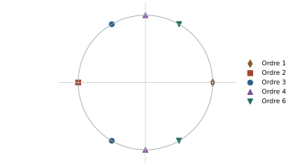
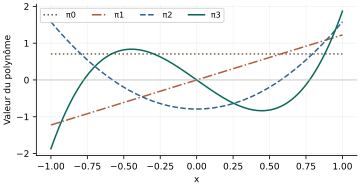

# Banque PT — Mathématiques A 2011 · Corrigé guidé

*Corrigé rédigé par IA, non officiel. Signalez toute erreur.*

**Rédaction** · GPT-6.2 Astra Ultra · vitesse non renseignée

Les parties A et B étudient des matrices entières d’ordre deux. La partie C aborde, indépendamment, le produit scalaire intégral sur les polynômes de degré au plus trois. [Sujet officiel](https://www.banquept.fr/documents/2011/math_a_pt_2011.pdf) · [Rapport du jury](https://www.banquept.fr/documents/ecrit/rapport/2011/rapport_math_a_ecrit_2011.pdf) · [Grille des coefficients](https://www.banquept.fr/documents/livret/2011/Livret_PT_2011.pdf#page=13)

Le jury attire l’attention sur les valeurs propres doubles en partie B. On conserve l’ordre prescrit pour la partie C, en construisant la base orthonormale avant d’utiliser l’inégalité de Cauchy-Schwarz.

## Partie A

### A.1 · Inversion réelle et déterminant

> [!INDICATION]
> Appliquer la multiplicativité du déterminant à l’identité $AA^{-1}=I$.

Une matrice carrée réelle est inversible si et seulement si $\det A\ne0$. Dans ce cas $\det A\,\det(A^{-1})=\det I=1$, donc $\det(A^{-1})=1/\det A$.

### A.2 · Trois inverses

> [!INDICATION]
> Calculer séparément les déterminants en respectant leur signe.

Les déterminants des matrices $A_1,A_2,A_3$ valent respectivement $1,-1,2$. Par la formule de l’adjointe en dimension deux,
$$ A_1^{-1}=\begin{pmatrix}2&-3\\-1&2\end{pmatrix},\quad A_2^{-1}=\begin{pmatrix}-5&7\\3&-4\end{pmatrix},\quad A_3^{-1}=\frac12\begin{pmatrix}5&-6\\-3&4\end{pmatrix}. $$

### A.3 · Inversibilité sur les entiers

> [!INDICATION]
> Pour la nécessité, les déterminants de la matrice et de son inverse sont tous deux entiers.

Si $A^{-1}$ a ses coefficients dans $\mathbb Z$, les entiers $\det A$ et $\det A^{-1}$ ont pour produit $1$. D’où $\det A=\pm1$. Réciproquement, pour $A=\left(\begin{smallmatrix}a&c\\ b&d\end{smallmatrix}\right)$ de déterminant $\delta=ad-bc=\pm1$, l’inverse réel existe et vaut
$$A^{-1}=\frac1\delta\begin{pmatrix}d&-c\\-b&a\end{pmatrix}=\delta\begin{pmatrix}d&-c\\-b&a\end{pmatrix}.$$
Ses coefficients sont entiers, ce qui établit la réciproque.

### A.4 · Matrices de déterminant un

> [!INDICATION]
> Transformer le déterminant en une équation de divisibilité entière.

La condition est $5-bc=1$, soit $bc=4$. Les couples ordonnés sont $(1,4),(2,2),(4,1),(-1,-4),(-2,-2),(-4,-1)$. Les deux signes doivent coïncider.

## Partie B

### B.1 · Inverse d’une matrice d’ordre fini

> [!INDICATION]
> Isoler un facteur de $A^p=I$.

$A^{p-1}$ est à la fois un inverse à gauche et à droite de $A$. C’est une matrice entière, même si $p=1$ puisqu’alors $A^0=I$. D’après A.3, $\det A\in\{-1,1\}$.

### B.2 · Ordre de la matrice inverse

> [!INDICATION]
> Comparer, pour chaque entier positif, les deux conditions qui définissent l’ordre.

Pour tout $k\ge1$, $(A^{-1})^k=(A^k)^{-1}$. Cette puissance vaut $I$ exactement lorsque $A^k=I$. Les ensembles d’exposants convenables coïncident, sont non vides et ont le même minimum. Ainsi $A^{-1}\in C_2(\mathbb Z)$ et $h(A^{-1})=h(A)$.

### B.3 · Modules des valeurs propres

> [!INDICATION]
> Travailler dans $\mathbb C^2$, puis appliquer $A^p$ à un seul vecteur propre non nul.

Si $Av=\lambda v$ et $v\ne0$, alors $v=A^pv=\lambda^p v$. Ainsi $\lambda^p=1$, d’où $|\lambda|=1$. Le calcul s’applique à chacune des deux valeurs propres, avec leur multiplicité.

### B.4 · Trace et racines

> [!INDICATION]
> Comparer le coefficient du terme de degré un du polynôme caractéristique avec sa factorisation complexe.

Le polynôme $\det(XI-A)$ a pour coefficient de $X$ l’opposé de la trace. Sa factorisation $(X-\lambda_1)(X-\lambda_2)$ donne donc $\operatorname{Tr}(A)=\lambda_1+\lambda_2$, avec multiplicité.

### B.5 · Les cinq traces entières

> [!INDICATION]
> La trace est entière. Appliquer l’inégalité triangulaire aux deux racines.

Par B.3 et B.4, $|\operatorname{Tr}A|\le|\lambda_1|+|\lambda_2|=2$. Les coefficients diagonaux étant entiers, les seules valeurs possibles de la trace sont $-2,-1,0,1,2$.

### B.6 · Deux ordres finis et un produit d’ordre infini

> [!INDICATION]
> Calculer de petites puissances de $C$ et $D$. Pour le produit, examiner le module d’une valeur propre.

On obtient $C^2=I$ et $C\ne I$, donc $h(C)=2$. Pour $D$, on trouve $D^2=\left(\begin{smallmatrix}-1&1\\-1&0\end{smallmatrix}\right)$, puis $D^3=I$. Comme $D\ne I$, son ordre est $3$. Les matrices $C,D$ appartiennent à $C_2(\mathbb Z)$. En revanche $CD=\left(\begin{smallmatrix}-3&1\\-2&1\end{smallmatrix}\right)$ a pour valeurs propres $-1\pm\sqrt2$. L’une a un module supérieur à $1$. B.3 exclut donc $CD$ de $C_2(\mathbb Z)$.

### B.7 · Polynôme caractéristique

> [!INDICATION]
> Développer le déterminant avec l’ordre des coordonnées $a,c,b,d$ de l’énoncé.

On a $\chi_A(X)=(X-a)(X-d)-bc=X^2-(a+d)X+ad-bc$. En notant $t=\operatorname{Tr}A$ et $\delta=\det A$, il vient $\chi_A=X^2-tX+\delta$.

### B.8 · Dix polynômes candidats

> [!INDICATION]
> Traiter séparément chaque déterminant. Pour le déterminant négatif, les racines sont réelles et leur produit vaut $-1$.

Les cinq valeurs de $t$ et les deux valeurs de $\delta$ donnent dix polynômes formellement distincts. Le tableau donne leurs deux racines. On note $i^2=-1$.

| $t$ | $\delta=+1$ | $\delta=-1$ |
|---:|:---|:---|
| $-2$ | $-1,-1$ | $-1\pm\sqrt2$ |
| $-1$ | $(-1\pm i\sqrt3)/2$ | $(-1\pm\sqrt5)/2$ |
| $0$ | $i,-i$ | $1,-1$ |
| $1$ | $(1\pm i\sqrt3)/2$ | $(1\pm\sqrt5)/2$ |
| $2$ | $1,1$ | $1\pm\sqrt2$ |

Les quatre entrées de la colonne $\delta=-1$ avec $t\ne0$ ont une racine de module strictement supérieur à un. En effet, deux racines réelles de module un et de produit $-1$ seraient $1,-1$, de somme nulle. Les six autres cases satisfont la condition de B.3.

### B.9 · Diagonalisation et ordres des six cas

> [!INDICATION]
> Une racine double du polynôme caractéristique demande une justification particulière. Le polynôme annulateur $X^p-1$ a toutes ses racines simples.

Toute matrice considérée vérifie $A^p=I$. Le polynôme $X^p-1$ est scindé sur $\mathbb C$ et ses racines sont simples car il est premier avec $pX^{p-1}$. Une matrice annulée par un tel polynôme est diagonalisable. On peut aussi traiter une racine double $\lambda=\pm1$ directement. Cayley-Hamilton donne $(A-\lambda I)^2=0$, donc $A^p=\lambda^pI+p\lambda^{p-1}(A-\lambda I)$. Comme $\lambda^p=1$ et $p\lambda^{p-1}\ne0$, on obtient $A=\lambda I$.

Dans une base propre, l’ordre est le PPCM des ordres des deux valeurs propres. Pour $\delta=1$ et $t=-2,-1,0,1,2$, on trouve successivement **2, 3, 4, 6, 1**. En effet, les couples non réels ont pour arguments $\pm2\pi/3$, $\pm\pi/2$ et $\pm\pi/3$. Pour $\delta=-1,\ t=0$, la diagonale $1,-1$ donne l’ordre **2**.

### B.10 · Plus petit exposant universel

> [!INDICATION]
> Le PPCM fournit une borne. Pour la minimalité, exhiber deux matrices dont les ordres forcent les facteurs $3$ et $4$.

Tous les ordres possibles divisent $12$, donc $A^{12}=I$ pour toute matrice de $C_2(\mathbb Z)$. La matrice $D$ de B.6 a l’ordre $3$, et $J=\left(\begin{smallmatrix}0&-1\\1&0\end{smallmatrix}\right)$ a l’ordre $4$ car $J^2=-I$. Tout exposant commun est multiple de leurs ordres, par division euclidienne par l’ordre de chaque matrice. Il est donc multiple de $12$. Le minimum demandé est $p_2=12$.

## Partie C

### C.1 · Un produit scalaire intégral

> [!INDICATION]
> Pour la séparation, exploiter la continuité et la positivité du carré sur tout un intervalle.

La bilinéarité de $\varphi(P,Q)=\int_{-1}^1P(t)Q(t)\,dt$ vient de la linéarité de l’intégrale. Le produit des polynômes est commutatif, donc la forme est symétrique. L’intégrale de $P^2$ est positive ou nulle. Si elle vaut zéro, la fonction continue positive $P^2$ est nulle sur $[-1,1]$ car une valeur strictement positive fournirait un sous-intervalle d’intégrale positive. Un polynôme nul sur cet intervalle est identiquement nul. La forme est donc définie positive.

### C.2 · La base orthonormale orientée

> [!INDICATION]
> Orthogonaliser $1,X,X^2,X^3$ et profiter de la parité. La condition de signe impose un choix des quatre vecteurs unitaires.

Posons $V_i=\mathbb R_i[X]$, $V_{-1}=\{0\}$. Le supplémentaire orthogonal de $V_{i-1}$ dans $V_i$ a dimension un. La projection orthogonale $u_i$ de $X^i$ sur cette droite est non nulle puisque $X^i\notin V_{i-1}$ et $\varphi(u_i,X^i)=\|u_i\|^2>0$. Il existe exactement un vecteur unitaire avec ce signe, $u_i/\|u_i\|$. C’est l’existence et l’unicité, obtenues successivement à partir de $i=0$.

Les moments impairs de $X$ sont nuls et $\int_{-1}^1x^{2k}\,dx=2/(2k+1)$. Les projections successives donnent $1,\ X,\ X^2-1/3,\ X^3-3X/5$ de normes carrées $2,2/3,8/45,8/175$. Après normalisation,
$$\pi_0=1/\sqrt2,\quad\pi_1=\sqrt{3/2}\,X,\quad
\pi_2=\sqrt{5/8}(3X^2-1),\quad\pi_3=\sqrt{7/8}(5X^3-3X).$$

### C.3.a · Décomposition d’un polynôme unitaire

> [!INDICATION]
> Utiliser le fait que les quatre polynômes forment une base de tout l’espace.

Tout $P\in E$ s’écrit de façon unique $P=\sum_{i=0}^3\alpha_i\pi_i$ pour des coefficients réels. En prenant le produit scalaire avec $\pi_j$, on reconnaît $\alpha_j=\varphi(P,\pi_j)$.

### C.3.b · Somme des carrés des coordonnées

> [!INDICATION]
> Développer le produit scalaire de $P$ avec lui-même et éliminer les termes croisés.

L’orthonormalité donne $\varphi(P,P)=\sum_i\alpha_i^2$. L’intégrale du carré de $P$ vaut $1$ par hypothèse, donc $\sum_{i=0}^3\alpha_i^2=1$.

### C.3.c.i · Inégalité en dimension quatre

> [!INDICATION]
> Utiliser la positivité du carré de la distance au projeté sur une droite.

Soient $u=(a,b,c,d)$ et $v=(a',b',c',d')$. Si $v=0$, les deux membres sont nuls. Sinon, en prenant $s=(u\cdot v)/\|v\|^2$, on a $0\le\|u-sv\|^2=\|u\|^2-(u\cdot v)^2/\|v\|^2$. On obtient $|aa'+bb'+cc'+dd'|\le\sqrt{a^2+b^2+c^2+d^2}\sqrt{(a')^2+(b')^2+(c')^2+(d')^2}$.

### C.3.c.ii · Évaluation en un réel

> [!INDICATION]
> Pour chaque $x$ fixé, constituer un nouveau vecteur de quatre nombres réels.

Appliquons l’inégalité précédente à $u=(\alpha_i)_{0\le i\le3}$ et à $v=(\pi_i(x))_{0\le i\le3}$. Par C.3.a leur produit scalaire est $P(x)$ et par C.3.b la norme de $u$ vaut $1$. Ainsi $|P(x)|\le\sqrt{\sum_{i=0}^3\pi_i(x)^2}$ pour tout $x\in\mathbb R$.

### C.3.d · Majoration uniforme et valeur extrême

> [!INDICATION]
> Étudier les quatre polynômes sur $[-1,1]$. Pour le cubique, tester les deux points où la dérivée s’annule.

Écrivons $\pi_k=\sqrt{(2k+1)/2}\,L_k$. Les quatre polynômes $L_k$ sont $1$, $x$, $(3x^2-1)/2$ et $(5x^3-3x)/2$. Le premier vaut un partout et le deuxième parcourt $[-1,1]$. Le troisième prend $-1/2$ en zéro et $1$ aux bords. Le quatrième prend $\pm1$ aux bords et, aux deux points critiques $x=\pm1/\sqrt5$, les valeurs $\mp1/\sqrt5$. Ainsi pour chaque $k$ le supremum de $\pi_k$ et celui de $|\pi_k|$ valent $\sqrt{(2k+1)/2}$, atteints en $x=1$. Par C.3.c.ii,
$$\sup_{|x|\le1}|P(x)|\le\sqrt{(1+3+5+7)/2}=2\sqrt2.$$
Cette constante est atteinte par le polynôme de coordonnées $\alpha_k=\pi_k(1)/(2\sqrt2)$, qui est bien de norme un et vérifie $P(1)=2\sqrt2$.

