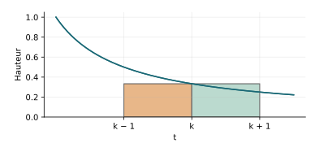
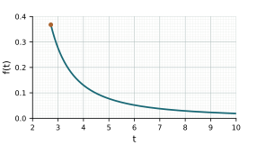
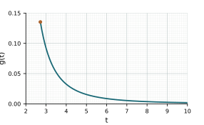

# Banque PT — Mathématiques C 2011 · Corrigé brut

*Corrigé rédigé par IA, non officiel. Signalez toute erreur.*

**Rédaction** · GPT-6.2 Astra Ultra · vitesse non renseignée · 26 novembre 2026

La Banque PT a programmé cet écrit le mardi 3 mai 2011, de 14 h à 18 h. La garde interdit la calculatrice. Le code imprimé est 11PT30. La garde demande deux feuilles de papier millimétré. Les questions figurent aux pages 1 à 4 du PDF de 4 pages. En admissibilité, le coefficient de Mathématiques C est de 3 pour l’ENS Cachan et de 6 pour l’École polytechnique. [Sujet](https://www.banquept.fr/documents/2011/math_c_pt_2011.pdf) · [Rapport du jury](https://www.banquept.fr/documents/ecrit/rapport/2011/rapport_math_c_ecrit_2011.pdf) · [Livret de la Banque PT, p. 9, 10 et 13](https://www.banquept.fr/documents/livret/2011/Livret_PT_2011.pdf)

## P. Préliminaire · Comparaison série-intégrale

### Question P.a

Pour $k\ge n_0+1$, sur $[k,k+1]$ on a $f(t)\le f(k)$ et sur $[k-1,k]$ on a $f(t)\ge f(k)$. Une fonction monotone est intégrable sur chaque segment. Les deux intervalles ont longueur un, donc $\int_k^{k+1}f(t)\,dt\le f(k)\le\int_{k-1}^k f(t)\,dt$.

### Question P.b

En sommant de $k=n_0+1$ à $n$, la relation de Chasles donne $\int_{n_0+1}^{n+1} f(t)\,dt\le\sum_{k=n_0+1}^n f(k)\le\int_{n_0}^{n} f(t)\,dt$. La borne basse commence une unité plus loin que la borne haute.

### Question P.c

La positivité rend croissantes les sommes partielles et les intégrales tronquées. Si l’intégrale converge, la borne haute majore les sommes. Si la série converge, la borne basse majore les intégrales à extrémité entière, puis toutes par croissance. Les premiers termes et intervalles sont finis. Les deux objets convergent ensemble ou divergent tous deux vers $+\infty$.

## I. Séries logarithmiques et constante d’Euler

### Question I.1.a

Sur $[e,\infty[$, les facteurs $t$ et $\ln t$ sont dérivables et strictement positifs. En dérivant $f(t)=t^{-1}(\ln t)^{-2}$ on obtient $f'(t)=-(\ln t+2)/(t^2(\ln t)^3)$.

### Question I.1.b

Le dénominateur et $\ln t+2$ sont positifs. Donc $f$ décroît strictement, de $f(e)=1/e$ vers zéro car $t(\ln t)^2$ tend vers l’infini.

### Question I.1.c

La courbe part de $(e,1/e)$ avec pente $-3/e^2$ et s’approche de l’axe horizontal par valeurs positives. Sa pente augmente vers zéro car $-f'(t)=t^{-2}((\ln t)^{-2}+2(\ln t)^{-3})$ décroît. Cela précise sa convexité.

### Question I.1.d

La dérivée de $-1/\ln t$ est $f(t)$. Ainsi $\int_e^R f(t)\,dt=1-1/\ln R$. La limite vaut un, donc l’intégrale converge et vaut $1$.

### Question I.1.e

Sur $[3,\infty[$ la fonction est positive et décroissante, et son intégrale y converge par I.1.d. Le critère du préliminaire et l’ajout du terme fini en $n=2$ donnent la convergence de $\sum_{n\ge2}1/(n(\ln n)^2)$.

### Question I.2.a

Comme $t,\ln t>0$ sur l’intervalle, $g(t)=t^{-2}(\ln t)^{-2}$ y est dérivable. On trouve $g'(t)=-2(\ln t+1)/(t^3(\ln t)^3)$.

### Question I.2.b

La dérivée est strictement négative, donc $g$ décroît strictement de $g(e)=e^{-2}$ vers zéro, limite obtenue en faisant tendre son dénominateur vers l’infini.

### Question I.2.c

La courbe part de $(e,e^{-2})$ avec pente $-4/e^3$ et reste au-dessus de son asymptote $y=0$. Elle est convexe car $-g'(t)=2t^{-3}((\ln t)^{-2}+(\ln t)^{-3})$ décroît.

### Question I.2.d

Pour $t\ge e$, $\ln t\ge1$ donne $0<g(t)\le t^{-2}$. Comme $\int_e^\infty t^{-2}\,dt=1/e$, l’intégrale positive de $g$ converge par comparaison.

### Question I.2.e

La fonction $g$ est positive, décroissante sur $[3,\infty[$ et d’intégrale finie. Le préliminaire donne la convergence de $\sum_{n\ge2}1/(n^2(\ln n)^2)$, le premier terme étant fini.

### Question I.3.a

Pour $n\ge1$, $\int_n^{n+1}(\ln t)/t\,dt=\tfrac12[(\ln(n+1))^2-(\ln n)^2]$.

### Question I.3.b

Posons $q(t)=(\ln t)/t$ et $u_n=\sum_{p=1}^n q(p)-(\ln n)^2/2$. Pour $n\ge3$, $u_{n+1}-u_n=q(n+1)-\int_n^{n+1}q(t)\,dt<0$, car $q$ est strictement décroissante pour $t>e$ comme le confirme $q'(t)=(1-\ln t)/t^2$.

### Question I.3.c

Pour $n\ge3$, $\sum_{p=3}^n q(p)\ge\int_3^{n+1}q(t)\,dt\ge\int_3^n q(t)\,dt$. Après soustraction de $(\ln n)^2/2$ il reste $u_n\ge[\ln2-(\ln3)^2]/2$. Ce minorant est négatif car $\ln2<1<\ln3$. Or $u_1=0$ et $u_2=(\ln2)(1-\ln2)/2>0$, ce qui couvre les rangs initiaux.

### Question I.3.d

La suite est décroissante à partir du troisième terme et minorée par une constante indépendante de $n$. Le théorème de convergence monotone donne une limite réelle, que les deux premiers termes ne modifient pas.

### Question I.3.e

Pour $1\le p\le n$, $\ln p\le\ln n$. Donc $u_n+\tfrac12(\ln n)^2\le(\ln n)\sum_{p=1}^n1/p$. Cette forme vaut aussi pour $n=1$. Le quotient imprimé $u_n/\ln n$ exige $n\ge2$. En divisant pour ces rangs, on obtient l’inégalité demandée. Puisque $u_n$ est bornée, son membre gauche $u_n/\ln n+(\ln n)/2$ tend vers $+\infty$, tout comme les sommes harmoniques.

### Question I.4.a

Sur $[k,k+1]$, $1/t\le1/k$, donc $\ln(n+1)\le H_n=\sum_{k=1}^n1/k$. Sur $[k-1,k]$, pour $k\ge2$, $1/t\ge1/k$. En sommant et en ajoutant $1$, on obtient $H_n\le1+\ln n$.

### Question I.4.b

La suite $\gamma_n=H_n-\ln n$ est positive par I.4.a. En outre $\gamma_{n+1}-\gamma_n=1/(n+1)-\int_n^{n+1}dt/t<0$. La décroissance et la minoration donnent une limite réelle $\ell$.

### Question I.4.c

Avec $z=1/n$, la différence vaut $z/(1+z)-\ln(1+z)=-z^2/2+O(z^3)$. Ainsi $\gamma_{n+1}-\gamma_n\sim-1/(2n^2)$. La série des accroissements converge absolument par comparaison. Ses sommes partielles valent $\gamma_{N+1}-\gamma_1$, d’où une autre preuve de convergence de $\gamma_n$.

### Question I.4.d

Pour $n\ge2$, $1/n-\ln(n/(n-1))=\gamma_n-\gamma_{n-1}$. La somme de $2$ à $N$ vaut $\gamma_N-\gamma_1$, et $\gamma_1=1$. Sa limite est donc $\ell-1$.

### Question I.4.e

Pour $N>n$, $\sum_{k=n+1}^N(\ln(k/(k-1))-1/k)=\gamma_n-\gamma_N$. Lorsque $N\to\infty$, on obtient la représentation de $\gamma_n-\ell$ annoncée.

### Question I.4.f

Avec $z=1/k$, $-\ln(1-z)-z=z^2/2+O(z^3)$ et $1/[2k(k-1)]=z^2/[2(1-z)]=z^2/2+O(z^3)$. La différence est $o(k^{-2})$. Pour chaque $\varepsilon>0$ il existe donc $n_0\ge2$ tel que sa valeur absolue soit au plus $\varepsilon/k^2$ dès $k\ge n_0$.

### Question I.4.g

Notons $r_k=\ln(k/(k-1))-1/k-1/[2k(k-1)]$. Pour $n\ge n_0$, $|\sum_{k=n+1}^N r_k|\le\sum_{k=n+1}^N|r_k|\le\varepsilon\sum_{k=n+1}^N k^{-2}$. La série de droite converge et assure la convergence absolue de la série de gauche. L’inégalité passe à la limite.

### Question I.4.h

Comme $1/[k(k-1)]=1/(k-1)-1/k$, la somme du modèle à partir de $n+1$ vaut $1/(2n)$. I.4.e–g donnent $|\gamma_n-\ell-1/(2n)|\le\varepsilon\sum_{k>n}k^{-2}\le\varepsilon/n$ pour $n$ assez grand, par comparaison à l’intégrale. Le terme est donc $o(1/n)$ et sa limite demandée vaut zéro.

## II. Séries de Bertrand

### Question II.1

Pour $h>0$, $\beta\in\mathbb R$ et $s=\ln t\to\infty$, $1/(t^h(\ln t)^\beta)=e^{-hs}s^{-\beta}\to0$ par domination de toute puissance par l’exponentielle.

### Question II.2

La fonction est positive pour $t>1$. Sa limite nulle implique qu’elle est strictement inférieure à un à partir d’un seuil $t_0>1$, ce qui donne le double encadrement.

### Question II.3

Pour $t\ge t_0$, $t^{-\alpha}(\ln t)^{-\beta}=t^{-(1+h)}[t^{-h}(\ln t)^{-\beta}]$. Le facteur entre crochets appartient à $]0,1[$. Le produit est donc strictement compris entre zéro et $t^{-(1+h)}$.

### Question II.4

Comme $h>0$, $\int_{t_0}^\infty t^{-1-h}\,dt=t_0^{-h}/h$ est finie. La comparaison positive en II.3 donne la convergence de $\int_{t_0}^\infty t^{-\alpha}(\ln t)^{-\beta}\,dt$.

### Question II.5

Pour les entiers $n\ge t_0$, le terme de la série positive est inférieur à $n^{-1-h}$, dont la série converge. Donc $\sum_{n\ge2}n^{-\alpha}(\ln n)^{-\beta}$ converge pour $\alpha=1+2h>1$ et tout réel $\beta$. Le critère intégral s’applique aussi puisque la dérivée logarithmique $-(\alpha+\beta/\ln t)/t$ est finalement négative.

## III. Produit de logarithmes voisins

### Question III.a

Pour $j=1,2$, $\ln(n+j)=\ln n+\ln(1+j/n)\sim\ln n$. Ainsi $v_n=1-(\ln(n+1))^2/(\ln n\,\ln(n+2))$ tend vers zéro.

### Question III.b

Notons $L=\ln n$, $A=\ln(1+1/n)$ et $B=\ln(1+2/n)$. Les deux logarithmes voisins valent $L+A$ et $L+B$. D’où $v_n=1-(1+A/L)^2/(1+B/L)$ pour $n\ge2$.

### Question III.c

Avec $z=1/n$, $A=z-z^2/2+O(z^3)$ et $B=2z-2z^2+O(z^3)$. On a donc $B-2A=-z^2+O(z^3)$ et $A^2=O(z^2)$. La forme exacte est $v_n=[(B-2A)/L-A^2/L^2]/(1+B/L)$. Puisque $zL\to0$, elle donne $v_n=-z^2/L+O(z^2/L^2)$. Ainsi $a=-1$ et le reste admet le majorant demandé pour un certain $b>0$. Enfin $|v_n|=O(1/(n^2\ln n))$ assure la convergence absolue par comparaison à $\sum n^{-2}$.
