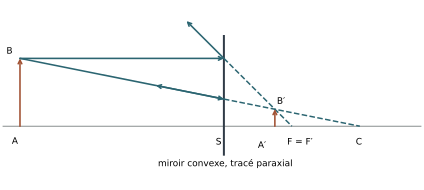
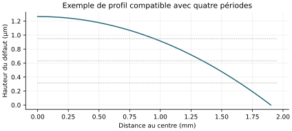
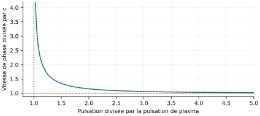

# Banque PT — Physique A 2011 · Corrigé guidé

*Corrigé rédigé par IA, non officiel. Signalez toute erreur.*

**Rédaction** · GPT-6.2 Astra Ultra · vitesse non renseignée · 27 novembre 2026

L’écrit dure quatre heures. La calculatrice est interdite. Le sujet comprend les deux méthodes d’observation de la Terre, les figures de mesures et les trois parties numérotées sur quatorze pages. Les coefficients d’admissibilité sont 6 à l’École polytechnique et 3 à l’ENS Cachan. [Sujet](https://www.banquept.fr/documents/2011/phys_a_pt_2011.pdf) · [Rapport du jury](https://www.banquept.fr/documents/ecrit/rapport/2011/rapport_phys_a_ecrit_2011.pdf) · [Grille de la Banque PT](https://www.banquept.fr/documents/livret/2011/Livret_PT_2011.pdf#page=13).

## I. Mécanique orbitale et orientation du satellite (35 %)

### Question I.A1

> [!INDICATION]
> Sur une sphère centrée en O, quel est le flux du champ produit par toute la Terre ?

#### Solution

Posons $\mu=GM_T$ et $r=R_T+h$. L’invariance sphérique impose $\vec G(P)=g(r)\vec u_r$. Le flux sur la sphère de rayon $r$ vaut $4\pi r^2 g(r)=-4\pi GM_T$ par le théorème de Gauss gravitationnel. Ainsi $\vec G(P)=-\mu\,\vec u_r/r^2$, dirigé vers le centre. La masse du satellite intervient lorsqu’on passe du champ à la force.

### Question I.A2

> [!INDICATION]
> Écrire l’accélération normale, puis vérifier la conversion des secondes en minutes.

#### Solution

Le seul effort est le poids orbital. Pour un cercle parcouru à vitesse constante, $v^2/r=\mu/r^2$ et $v=2\pi r/T$. On en tire $T=2\pi\sqrt{r^3/\mu}$. Avec $r=7{,}2\times10^6$ m et $\mu=4{,}02\times10^{14}$ en SI, on trouve environ $6{,}1\times10^3$ s, soit 1 h 41 min. Aucune des quatre propositions imprimées (3 min, 1 h 01, 1 h 21, 3 h 11) ne correspond.

### Question I.A3

> [!INDICATION]
> Calculer aussi la vitesse à partir de la circonférence et de la période.

#### Solution

La projection radiale précédente donne $v=\sqrt{\mu/(R_T+h)}$. La racine de $5{,}6\times10^7$ est voisine de $7{,}5\times10^3$ en mètres par seconde. La quatrième proposition convient.

### Question I.A4

> [!INDICATION]
> Fixer le zéro de potentiel à l’infini.

#### Solution

La dérivée radiale vérifie $-dE_p/dr=-m\mu/r^2$. L’intégration avec $E_p(+\infty)=0$ donne $E_p=-m\mu/(R_T+h)$.

### Question I.A5

> [!INDICATION]
> Éliminer la vitesse grâce à la dynamique radiale.

#### Solution

Comme $v^2=\mu/r$, le double de l’énergie cinétique vaut $2E_c=m\mu/r=-E_p$. Cette égalité instantanée utilise le mouvement circulaire.

### Question I.A6

> [!INDICATION]
> Comparer les dimensions d’une accélération et du carré d’une vitesse.

#### Solution

Dans $f=\alpha m v^2$, on a $[\alpha]=[f]/([m][v]^2)=L^{-1}$. L’unité SI est l’inverse du mètre.

### Question I.A7

> [!INDICATION]
> Associer chaque rayon à une orbite circulaire instantanée.

#### Solution

L’hypothèse de viriel donne $E_c=-E_p/2=m\mu/(2r)$. Ainsi $E=E_c+E_p=-m\mu/(2r)$ et $v=\sqrt{\mu/r}$, où $r=R_T+h$ varie lentement.

### Question I.A8

> [!INDICATION]
> Comparer la puissance dissipée à la dérivée de l’énergie mécanique.

#### Solution

La traînée a pour puissance $\vec f\cdot\vec v=-\alpha m v^3$. Or $dE/dt=m\mu\dot h/(2r^2)$. En remplaçant $v$ par sa valeur quasi circulaire, on obtient $\dot h=-2\alpha\sqrt{\mu(R_T+h)}$. Le signe décrit un abaissement de l’orbite.

### Question I.A9

> [!INDICATION]
> Comparer la quantité numérique fournie aux constantes figurant dans l’énoncé.

#### Solution

Une perte d’un mètre par révolution donne $|\dot h|\simeq1\ {\rm m}/T$. Ainsi $\alpha\simeq(1\ {\rm m})/(2T\sqrt{\mu r})$. La valeur intermédiaire imprimée, $3{,}2\times10^7$ en SI, conduirait à $2{,}6\times10^{-12}\ {\rm m}^{-1}$. Les constantes de la page 2 donnent en réalité $\sqrt{\mu r}=5{,}4\times10^{10}\ {\rm m^2\,s^{-1}}$, soit $\alpha\simeq1{,}5\times10^{-15}\ {\rm m}^{-1}$. Au rythme donné, dix ans comptent environ $5\times10^4$ révolutions, donc la perte est d’environ 50 km. La baisse d’énergie potentielle finance à la fois la dissipation et la hausse d’énergie cinétique, en accord avec le viriel.

### Question I.A10

> [!INDICATION]
> Examiner l’effet d’une variation d’altitude sur la durée d’utilisation et sur l’image.

#### Solution

Une orbite plus basse facilite la résolution d’un même détail au sol, mais rencontre davantage d’atmosphère et décroît plus rapidement. À plus grande distance, les mêmes pixels couvrent davantage de terrain et les détails fins se perdent. Une altitude voisine de 800 km ménage une longue durée d’observation tout en conservant une résolution convenable.

### Question I.B1

> [!INDICATION]
> Remplacer les deux positions par leur développement autour de S.

#### Solution

Posons $r_0=OS$, $\vec e_r=\vec u_{x'}$ et $\vec\rho_i=\overrightarrow{SM_i}$, avec $\vec\rho_1+\vec\rho_2=0$. Dans le bilan sur les deux masses, les termes gravitationnels linéaires en $\vec\rho_i$ se compensent. À l’ordre retenu, $-2mr_0\Omega^2\vec e_r=-2m\mu\vec e_r/r_0^2$. On trouve $\Omega^2=\mu/r_0^3$, troisième loi de Kepler.

### Question I.B2

> [!INDICATION]
> Distinguer les rayons des deux masses.

#### Solution

En posant $\vec r_i=\overrightarrow{OM_i}$ et $r_i=\|\vec r_i\|$, l’attraction sur chaque extrémité est $\vec F_i=-m\mu\,\vec r_i/r_i^3$ pour $i=1,2$. Les deux vecteurs pointent vers O.

### Question I.B3

> [!INDICATION]
> Le repère tourne uniformément autour de O ; seule la rotation de la tige subsiste dans la vitesse relative.

#### Solution

Avec $\vec\Omega=\Omega\vec u_z$, la force d’entraînement vaut $-m\vec\Omega\times(\vec\Omega\times\vec r_i)=m\Omega^2\vec r_i$ dans le plan orbital. La vitesse relative est $\dot\theta\vec u_z\times\vec\rho_i$. La force de Coriolis devient $-2m\vec\Omega\times\vec v'_i=2m\Omega\dot\theta\,\vec\rho_i$.

### Question I.B4

> [!INDICATION]
> Repérer la ligne d’action de chaque force.

#### Solution

Chaque force de Coriolis est portée par $SM_i$. Son moment $\vec\rho_i\times(2m\Omega\dot\theta\,\vec\rho_i)$ est nul. Leur somme en S est donc nulle quelle que soit la vitesse angulaire relative.

### Question I.B5

> [!INDICATION]
> Développer le facteur scalaire avant de le multiplier par le vecteur position.

#### Solution

On a $r_i^{-3}=r_0^{-3}(1-3\vec e_r\cdot\vec\rho_i/r_0)+O(\ell^2/r_0^5)$. Dans $\vec R_i=m(\Omega^2-\mu/r_i^3)(r_0\vec e_r+\vec\rho_i)$ le terme constant disparaît. Il reste au premier ordre $\vec R_i=3m\Omega^2(\vec e_r\cdot\vec\rho_i)\vec e_r$. Les deux déplacements étant opposés, $\vec R_2=-\vec R_1$ à cet ordre.

### Question I.B6

> [!INDICATION]
> Projeter le produit vectoriel sur l’axe normal au plan.

#### Solution

Choisissons $\vec\rho_1=\ell(\cos\theta\,\vec e_r+\sin\theta\,\vec e_t)$, puis $\vec\rho_2=-\vec\rho_1$. Les deux produits $\vec\rho_i\times\vec R_i$ s’ajoutent. Leur somme vaut $-6m\mu\ell^2\sin\theta\cos\theta\,\vec u_z/r_0^3$. L’amplitude est la valeur absolue de ce coefficient, et le moment pointe vers $-z$ lorsque $0<\theta<\pi/2$.

### Question I.B7

> [!INDICATION]
> Calculer l’inertie autour de S et chercher les zéros du couple.

#### Solution

Dans le repère tournant, le moment cinétique relatif est $2m\ell^2\dot\theta\,\vec u_z$. Son bilan avec les forces réelles et d’inertie donne $\ddot\theta=-3\Omega^2\sin\theta\cos\theta$. Les positions fixes sont $\theta=k\pi/2$ pour tout entier $k$.

### Question I.B8

> [!INDICATION]
> Comparer le signe du couple à celui d’un petit déplacement.

#### Solution

Au voisinage de zéro, $\sin\theta\cos\theta=\theta+O(\theta^3)$. L’équation linéarisée $\ddot\theta+3\Omega^2\theta=0$ a des solutions sinusoïdales bornées. L’orientation radiale est stable. Autour d’une orientation tangentielle, le signe linéaire s’inverse et l’équilibre est instable.

### Question I.B9

> [!INDICATION]
> Utiliser la pulsation des petites oscillations sans confondre les deux périodes.

#### Solution

La pulsation propre vaut $\sqrt3\Omega$. La période est $T_{\rm lib}=2\pi/(\sqrt3\Omega)=T/\sqrt3$, indépendamment du petit angle initial à cet ordre. On trouve environ $3{,}5\times10^3$ s, soit 58 min, plus courte que les 101 min de la révolution.

## II. Observation de la Terre (45 %)

### Question II.A1

> [!INDICATION]
> Traduire « paraxial » en conditions sur les hauteurs et les angles.

#### Solution

On limite les rayons à de faibles hauteurs par rapport aux rayons de courbure et à de petits angles par rapport à l’axe, pour remplacer sinus et tangentes par leurs angles. Au premier ordre, un point donne une image ponctuelle (stigmatisme approché) et un petit objet transverse plan donne une image plane transverse (aplanétisme approché). Les aberrations d’ordre supérieur sont ainsi limitées.

### Question II.A2

> [!INDICATION]
> Prolonger les rayons réfléchis derrière le miroir.

#### Solution

Les foyers objet et image coïncident au milieu de $SC$, derrière le miroir. Un rayon issu de B, parallèle à l’axe, repart comme s’il venait de F. Un rayon dirigé vers C revient sur son trajet. Leurs prolongements derrière le miroir se coupent en B′. La projection de B′ sur l’axe donne A′ entre S et F. L’image est virtuelle, droite et réduite.

### Question II.A3

> [!INDICATION]
> Fixer une orientation unique pour toutes les distances algébriques.

#### Solution

En distances orientées sur le même axe, $1/\overline{SA'}+1/\overline{SA}=2/\overline{SC}$. Les triangles construits avec le rayon passant par S donnent $\gamma=\overline{A'B'}/\overline{AB}=-\overline{SA'}/\overline{SA}$.

### Question II.A4

> [!INDICATION]
> Suivre le faisceau jusqu’au foyer que formerait le primaire seul.

#### Solution

Pour l’objet terrestre pratiquement à l’infini, A′B′ se situe dans le plan focal du primaire, A′ en $F_1$ et la hauteur en valeur absolue vaut $(R_1/2)|\alpha|$. L’image intermédiaire est renversée. Le secondaire intercepte le faisceau convergent avant F₁, si bien que cette image sert d’objet virtuel pour le secondaire.

### Question II.A5

> [!INDICATION]
> Écrire les trois positions relativement au sommet S₂.

#### Solution

Orientons l’axe vers la droite sur la figure 4. On a $\overline{S_2F_1}=d-R_1/2$, $\overline{S_2C_2}=-R_2$ et $\overline{S_2F'}=d+D$. La conjugaison du secondaire donne $1/(d+D)+1/(d-R_1/2)=-2/R_2$. En posant $a=R_1/2-d$, on trouve $D=R_2a/(R_2-2a)-d$. Le plan focal final est à droite du primaire pour les valeurs du sujet.

### Question II.A6

> [!INDICATION]
> Multiplier les deux grandissements en conservant leur signe.

#### Solution

Au primaire, $\gamma_1\simeq-R_1/(2h)$. Au secondaire, $\gamma_2=-(d+D)/(d-R_1/2)$. Leur produit donne $\gamma=R_1(d+D)/[2h(d-R_1/2)]$. Le signe négatif vient de la première réflexion imageante, car le secondaire conserve ici le sens de l’image intermédiaire.

### Question II.A7

> [!INDICATION]
> Passer toutes les longueurs en mètres.

#### Solution

Avec les valeurs imposées $D=0{,}20$ m, $d=0{,}41$ m et $R_1=2{,}0$ m, on obtient $\gamma=2{,}0(0{,}41+0{,}20)/[2(8{,}0\times10^5)(0{,}41-1{,}0)]=-1{,}3\times10^{-6}$ à deux chiffres significatifs. L’image finale est renversée.

### Question II.A8

> [!INDICATION]
> Relier hauteur dans le plan focal et angle de visée.

#### Solution

Pour une lentille convergente unique et un objet à distance $h\gg f'$, on aurait $|\gamma|\simeq f'/h$. Il faudrait $f'=h|\gamma|\simeq1$ m.

### Question II.A9

> [!INDICATION]
> Comparer la distance entre les miroirs à la focale obtenue.

#### Solution

Les deux réflexions replient le trajet dans un instrument dont les miroirs sont séparés de 41 cm, pour une focale équivalente voisine du mètre. La réflexion géométrique ne disperse pas les couleurs comme la réfraction d’une lentille simple. Ces propriétés favorisent l’encombrement réduit et l’imagerie sur plusieurs bandes.

### Question II.A10

> [!INDICATION]
> Rechercher le plan de netteté de la scène terrestre.

#### Solution

La barrette sensible est placée dans le plan focal image final, perpendiculaire à l’axe en F′, derrière l’ouverture du primaire. Les points éloignés du paysage y forment leurs images nettes simultanément dans la limite des conditions de Gauss.

### Question II.A11

> [!INDICATION]
> Ramener la largeur d’un pixel dans le plan objet.

#### Solution

Un détail de taille $L$ a une image de largeur $|\gamma|L$. L’égalité avec $\delta=13\ \mu{\rm m}$ donne $L=\delta/|\gamma|\simeq10$ m pour un pixel.

### Question II.A12

> [!INDICATION]
> Les 6 000 pixels couvrent des bandes contiguës.

#### Solution

Dans la direction de la barrette, le champ vaut $6000\,L\simeq6\times10^4$ m. La largeur au sol est donc d’environ 60 km par passage.

### Question II.A13

> [!INDICATION]
> Conserver le même grandissement dans le calcul inverse.

#### Solution

Pour $L=2{,}5$ m, $\delta_5=|\gamma|L\simeq3{,}2\,\mu{\rm m}$, soit environ trois micromètres et un quart de la largeur des pixels précédents.

### Question II.A14

> [!INDICATION]
> Passer de l’ouverture angulaire de la tache d’Airy à une longueur au sol.

#### Solution

Le rayon angulaire est $\theta_{\rm A}=1{,}22\lambda/a$. Pour une longueur d’onde visible représentative de $0{,}55\,\mu{\rm m}$ et $a\simeq1$ m, on obtient $h\theta_{\rm A}\simeq0{,}5$ m au sol. Le rayon de la tache au foyer est alors inférieur au micromètre. Dans les deux exemples, les pixels imposent une limite plus grossière que cette estimation de diffraction.

### Question II.B1

> [!INDICATION]
> Identifier le double passage dans la lame.

#### Solution

Pour une sortie brillante au contact, la différence de marche est $2e$ et le déphasage $4\pi e/\lambda$. Deux faisceaux de même intensité donnent $\mathcal E=\mathcal E_0[1+\cos(4\pi e/\lambda)]/2=\mathcal E_0\cos^2(2\pi e/\lambda)$. L’incidence est presque unique, donc on observe une teinte quasi uniforme dont l’intensité oscille lorsque $e$ varie, de période $\lambda/2$.

### Question II.B2

> [!INDICATION]
> Trouver une signature qui distingue le zéro des autres maxima monochromatiques.

#### Solution

Élargir les incidences, observer les anneaux à l’infini puis translater le miroir dans le sens où ils rentrent et disparaissent au centre. Près du contact, remplacer la source monochromatique par de la lumière blanche et ajuster lentement la translation. En coin d’air très faible, identifier la frange centrale achromatique encadrée d’irisations, puis annuler l’inclinaison en conservant cette frange au centre du champ. Le champ achromatique uniforme repère l’égalité des chemins optiques des deux bras.

### Question II.B3

> [!INDICATION]
> Calculer la variation d’épaisseur entre deux maxima voisins.

#### Solution

À l’abscisse $x$ mesurée normalement à l’arête, $e(x)\simeq\alpha x$ à une constante près. Les franges d’égale épaisseur vérifient $2e(x)=k\lambda$. Elles sont rectilignes, parallèles à l’arête et d’interfrange $I=\lambda/(2|\alpha|)$. On forme l’image du plan des miroirs sur l’écran pour observer nettement les franges localisées au voisinage du coin d’air.

### Question II.B4

> [!INDICATION]
> Écrire la flèche du cercle de rayon R.

#### Solution

La bosse réduit la lame au centre à $e_0-H_{\max}$. À la distance $r$, l’épaisseur est $z(r)=e_0-H_{\max}+R-\sqrt{R^2-r^2}$. Sous l’hypothèse $r\ll R$, on a $z(r)\simeq e_0-H_{\max}+r^2/(2R)$.

### Question II.B5

> [!INDICATION]
> La marche varie uniquement avec le rayon.

#### Solution

Le double passage donne $\delta(r)=2z(r)\simeq2(e_0-H_{\max})+r^2/R$. Les lieux de même phase sont des cercles centrés sur l’axe. Les franges d’égale épaisseur se forment, comme celles du coin d’air, au voisinage du miroir déformé.

### Question II.B6

> [!INDICATION]
> Soustraire les ordres aux rayons du premier et du kième anneau.

#### Solution

Au centre $p_0=2(e_0-H_{\max})/\lambda$ peut être non entier. Aux maxima les ordres sont entiers, et la différence entre les ordres aux rayons $\rho_k$ et $\rho_1$ vaut $k-1$. De $\delta(\rho_k)-\delta(\rho_1)=(k-1)\lambda$ on tire $\rho_k=\sqrt{\rho_1^2+(k-1)R\lambda}$.

### Question II.B7

> [!INDICATION]
> Compter les périodes entre la zone uniforme extérieure et le centre, puis déplacer un miroir dans un sens connu.

#### Solution

Le bord externe est proche de 2 mm du centre sur le quadrillage, soit un diamètre d’environ 4 mm. On distingue quatre minima sombres du bord au centre, avec un centre et un extérieur clairs. L’ordre varie d’environ quatre unités, d’où $H_{\max}\simeq4\lambda/2\simeq1{,}3\,\mu{\rm m}$. La seule intensité laisse le signe ambigu. Augmentons uniformément l’épaisseur de la lame en suivant un même anneau. Son épaisseur locale devant rester constante, l’anneau se déplace vers la zone initialement plus mince. S’il rentre vers le centre, le défaut fait saillie dans la lame. S’il sort, le défaut est en creux.

### Question II.B8

> [!INDICATION]
> Dessiner les trajets aller et retour avant et après soulèvement.

#### Solution

Avant déformation l’aller-retour vaut $2h$. Après une élévation locale $z(x)$ il vaut $2[h-z(x)]$. Ainsi, dans l’ordre seconde observation moins première, $\delta(x)=-2z(x)$ et le déphasage correspondant vaut $-4\pi z(x)/\lambda$. Un cycle de franges représente $\lambda/2$ de déplacement vertical dans la géométrie du problème.

### Question II.B9

> [!INDICATION]
> Étalonner le diamètre sur la barre de 20 km et compter les cycles, en tenant compte des irrégularités.

#### Solution

Dans la figure 9b, la zone annulaire s’étend sur environ une fois et demie à deux fois la barre de 20 km, soit une trentaine de kilomètres, avec des limites irrégulières. On lit environ deux à trois périodes de la périphérie au centre. Une période valant $5{,}66/2=2{,}83$ cm, le soulèvement maximal est de l’ordre de 6 à 8 cm. Sur quatre ans, la vitesse moyenne au point de soulèvement maximal est d’environ $2\ {\rm cm/an}$. Cette lecture mesure un mouvement de quelques centimètres réparti sur plusieurs dizaines de kilomètres. Deux acquisitions n’indiquent pas la vitesse instantanée maximale.

## III. Échanges de signaux avec le sol (20 %)

### Question III.1

> [!INDICATION]
> Comparer séparément la force magnétique et le poids à la force électrique.

#### Solution

Dans le modèle sans collision, $m_s\,d\vec v_s/dt=q_s(\vec E+\vec v_s\times\vec B)+m_s\vec g$, avec $q_e=-e$ et $q_i=e$. On peut négliger la force magnétique si $v_s B_0\ll E_0$, soit $v_s\ll|\omega/k|\simeq c$ par Faraday. Le poids est négligeable en amplitude si $m_sg\ll eE_0$. Pour satisfaire cette condition aux deux espèces, il suffit que $E_0\gg M_i g/e$.

### Question III.2

> [!INDICATION]
> Les deux espèces de signes opposés contribuent dans le même sens au courant.

#### Solution

Avec la convention temporelle $e^{i\omega t}$, l’équation linéarisée donne $\vec v_e=-e\vec E/(i\omega m_e)$ et $\vec v_i=e\vec E/(i\omega M_i)$. La densité de courant est $\vec j=ne(\vec v_i-\vec v_e)=[ne^2/(i\omega)](1/M_i+1/m_e)\vec E\simeq ne^2\vec E/(i\omega m_e)$ parce que $M_i\gg m_e$.

### Question III.3

> [!INDICATION]
> Introduire la neutralité dans Gauss, mais garder le courant dans Ampère-Maxwell.

#### Solution

La neutralité donne $\nabla\cdot\vec E=0$. Les trois autres équations sont $\nabla\cdot\vec B=0$, $\nabla\times\vec E=-\partial_t\vec B$ et $\nabla\times\vec B=\mu_0\vec j+\mu_0\varepsilon_0\partial_t\vec E$. Le courant de déplacement reste nécessaire pour décrire la propagation.

### Question III.4

> [!INDICATION]
> Prendre le rotationnel de Faraday.

#### Solution

Comme $\nabla\times(\nabla\times\vec E)=-\Delta\vec E$, Ampère-Maxwell donne $\Delta\vec E=c^{-2}\partial_t^2\vec E+\mu_0\partial_t\vec j$. En notation complexe cela devient $\Delta\vec E=c^{-2}\partial_t^2\vec E-i\mu_0ne^2\,\partial_t\vec E/(\omega m_e)$. Le signe vient de $1/i=-i$.

### Question III.5

> [!INDICATION]
> Substituer la dépendance harmonique aux dérivées.

#### Solution

Le facteur $e^{i(\omega t+kz)}$ transforme $\Delta$ en $-k^2$ et $\partial_t$ en $i\omega$. Ainsi $-k^2=-\omega^2/c^2+\mu_0ne^2/m_e$. En posant $\omega_p^2=ne^2/(\varepsilon_0m_e)$, on obtient $k^2=(\omega^2-\omega_p^2)/c^2$.

### Question III.6

> [!INDICATION]
> Examiner les signes de k au carré.

#### Solution

Pour $\omega>\omega_p$, $k$ est réel et l’onde se propage. Pour $0<\omega<\omega_p$, $k$ est imaginaire et on retient dans le plasma la solution évanescente qui décroît en s’éloignant de l’interface. Au seuil $k=0$. Ce plasma idéal se comporte en passe-haut de fréquence $f_c=\omega_p/(2\pi)$.

### Question III.7

> [!INDICATION]
> Comparer les limites au seuil et aux hautes fréquences.

#### Solution

Pour $\omega>\omega_p$, $\omega^2=\omega_p^2+c^2k^2$ et $|v_\varphi|=\omega/|k|=c/\sqrt{1-(\omega_p/\omega)^2}$. Le milieu est dispersif. La courbe décroît de l’infini vers $c$ quand la fréquence augmente. La phase de la forme imprimée se déplace suivant $-z$ pour $k>0$. La vitesse de groupe en valeur absolue, $c^2/|v_\varphi|$, reste inférieure à $c$.

### Question III.8

> [!INDICATION]
> Effectuer la division par deux pi pour passer des radians par seconde aux hertz.

#### Solution

Pour $n=2\times10^{10}\ {\rm m}^{-3}$, on trouve $\omega_p\simeq8{,}0\times10^6\ {\rm rad\,s^{-1}}$, puis $f_c\simeq1{,}3\times10^6$ Hz. Aucune des trois valeurs imprimées en hertz ne convient. La première, $8{,}0\times10^6$, correspond numériquement à la pulsation.

### Question III.9

> [!INDICATION]
> Exploiter la dépendance en racine carrée de la densité.

#### Solution

Le rapport de densité du jour à la nuit est 25, donc la coupure augmente d’un facteur 5. Elle passe de 1,3 MHz à environ 6,3 MHz. Des fréquences supérieures à la plus haute coupure, par exemple 10 à 30 MHz, permettent la propagation aux deux instants dans ce modèle. Cet exemple appartient aux ondes radio de haute fréquence (ondes décamétriques).
