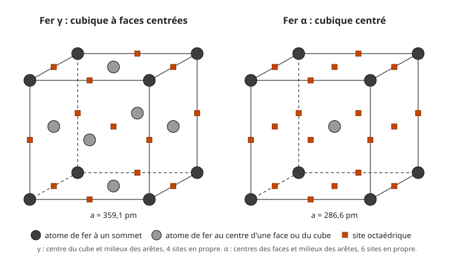
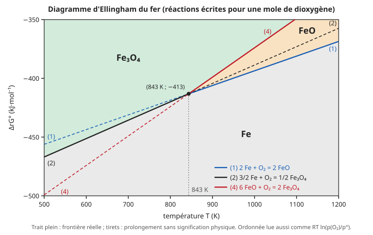
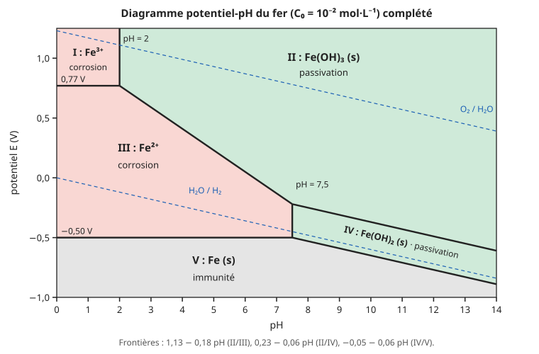

# Banque PT PT — Physique C - Chimie 2011 · Corrigé brut

*Corrigé rédigé par IA, non officiel. Signalez toute erreur.*

**Rédaction** · modèle exact non renseigné (famille Claude) · effort non renseigné · vitesse non renseignée

**Révision (tour 2)** · modèle exact non renseigné (famille Claude) · effort non renseigné · vitesse non renseignée · 28 novembre 2026

Épreuve de 2 heures, sans calculatrice, sur la chimie physique du fer : 42 questions, repérées comme dans l'énoncé de I.1.1 à IV.3.3, en quatre parties indépendantes (élément et cristallographie, oxydation en voie sèche, corrosion en voie aqueuse, complexes cyanés), avec un document-réponse à rendre (diagramme d'Ellingham à tracer, diagramme potentiel-pH à compléter). Les 42 questions sont traitées. Les valeurs lues sur le document-réponse sont signalées à l'endroit où elles servent et recoupées par le calcul. L'énoncé ne fournit pas la constante d'Avogadro, nécessaire à la question I.5.1 : la valeur retenue y est présentée comme un choix du corrigé. La question I.4 ne porte pas de sous-numéro, et l'énoncé nomme (4), sans réaction (3), l'oxydation de la wüstite en magnétite.

[Sujet officiel (archive)](https://www.banquept.fr/documents/2011/phys_c_pt_2011.zip) · [Rapport du jury](https://www.banquept.fr/documents/ecrit/rapport/2011/rapport_phys_c_ecrit_2011.pdf)

## Partie I — Élément et cristallographie

### Question I.1.1 — Signification de A et de Z

Dans l'écriture ${}^{56}_{26}\mathrm{Fe}$ :

- $Z = 26$ est le **numéro atomique** (nombre de charge) : le noyau contient 26 protons, ce qui définit l'élément fer ; l'atome neutre possède donc 26 électrons ;
- $A = 56$ est le **nombre de masse** : le noyau contient 56 nucléons (protons et neutrons).

Le nombre de neutrons de cet isotope s'en déduit :

$$N = A - Z = 56 - 26 = 30$$

$$\boxed{Z = 26 \text{ protons (et 26 électrons pour l'atome)},\quad A = 56 \text{ nucléons},\quad N = 30 \text{ neutrons}}$$

### Question I.1.2 — Configuration électronique du fer

Les règles suivies sont :

- la **règle de Klechkowski** : les sous-couches se remplissent par valeurs croissantes de $n + \ell$ et, à égalité, par $n$ croissant (1s, 2s, 2p, 3s, 3p, 4s, 3d…) ;
- le **principe d'exclusion de Pauli** : deux électrons d'un atome ne peuvent avoir leurs quatre nombres quantiques identiques, donc au plus deux électrons, de spins opposés, par orbitale (2 en s, 6 en p, 10 en d) ;
- la **règle de Hund** : dans une sous-couche incomplète, les électrons occupent le maximum d'orbitales avec des spins parallèles.

Avec 26 électrons :

$$\boxed{\mathrm{Fe} : 1s^2\,2s^2\,2p^6\,3s^2\,3p^6\,4s^2\,3d^6 = [\mathrm{Ar}]\,3d^6\,4s^2}$$

D'après la règle de Hund, la sous-couche 3d porte quatre électrons célibataires (cinq orbitales, six électrons).

### Question I.1.3 — Électrons de valence, ions ferreux et ferrique

Les électrons de valence sont ceux de la couche de nombre quantique principal le plus élevé et ceux de la sous-couche $(n-1)d$ incomplète :

$$\boxed{8 \text{ électrons de valence : 2 dans la sous-couche } 4s \text{ et 6 dans la sous-couche } 3d}$$

Les cations s'obtiennent en retirant d'abord les électrons 4s, puis un électron 3d :

$$\boxed{\mathrm{Fe^{2+}} \text{ (ion ferreux, 24 électrons)} : [\mathrm{Ar}]\,3d^6}$$

$$\boxed{\mathrm{Fe^{3+}} \text{ (ion ferrique, 23 électrons)} : [\mathrm{Ar}]\,3d^5}$$

La sous-couche $3d^5$ à demi remplie de l'ion ferrique lui confère une stabilité particulière.

### Question I.1.4 — Groupe du fer

La configuration de valence $4s^2\,3d^6$ place le fer dans la quatrième période ($n_{\max} = 4$) et dans le bloc d, à la sixième colonne de ce bloc. En comptant les deux colonnes du bloc s qui précèdent :

$$\boxed{\text{le fer appartient au groupe 8 (huitième colonne) : } 2 + 6 = 8 \text{ électrons de valence}}$$

Sa sous-couche d est incomplète dans l'atome comme dans ses ions usuels : le fer est un **métal de transition**.

### Question I.1.5 — Masse molaire de 55,847 g/mol

La masse molaire atomique d'un élément est la **moyenne des masses molaires de ses isotopes naturels, pondérée par leurs abondances** :

$$M = \sum_i x_i\,M_i$$

Le fer naturel est un mélange de quatre isotopes stables (abondances usuelles, non fournies par l'énoncé et non exigibles) : ${}^{56}\mathrm{Fe}$, de loin le plus abondant (environ 92 %), accompagné de ${}^{54}\mathrm{Fe}$ (environ 6 %), de ${}^{57}\mathrm{Fe}$ (environ 2 %) et de traces de ${}^{58}\mathrm{Fe}$. La valeur obtenue est donc proche de $56\ \mathrm{g\cdot mol^{-1}}$ sans être entière ; elle lui est légèrement inférieure parce que l'isotope minoritaire le plus abondant est plus léger.

Par ailleurs, la masse molaire d'un isotope n'est elle-même pas exactement égale à son nombre de masse : la masse d'un noyau est inférieure à la somme des masses de ses nucléons (défaut de masse, lié à l'énergie de liaison du noyau), et l'unité de masse atomique est définie à partir du carbone 12.

$$\boxed{M(\mathrm{Fe}) = 55{,}847\ \mathrm{g\cdot mol^{-1}} \text{ est une moyenne sur le mélange isotopique naturel}}$$

### Question I.2.1 — Maille de l'austénite

La maille conventionnelle de l'austénite est un cube d'arête $a$ portant un atome de fer à chacun de ses 8 sommets et un atome au centre de chacune de ses 6 faces (partie gauche de la figure 1).

Un atome situé à un sommet est partagé entre 8 mailles, un atome au centre d'une face entre 2 mailles :

$$Z_\gamma = 8 \times \frac18 + 6 \times \frac12 = 4$$

$$\boxed{\text{maille cubique à faces centrées : 4 atomes de fer par maille}}$$

### Question I.2.2 — Compacité de l'austénite

**Définition.** La compacité $C$ est la fraction du volume de la maille réellement occupée par les atomes, assimilés à des sphères dures :

$$C = \frac{Z \times \dfrac43\pi R^3}{a^3}$$

**Contact.** Dans la structure cubique à faces centrées, les atomes sont tangents le long de la diagonale d'une face, qui porte un rayon, un diamètre et un rayon :

$$4R = a\sqrt2$$

$$R = \frac{a\sqrt2}{4}$$

**Calcul.** Avec $Z = 4$ :

$$C_\gamma = \frac{4 \times \dfrac43\pi\left(\dfrac{a\sqrt2}{4}\right)^3}{a^3} = \frac{16\pi}{3} \times \frac{2\sqrt2}{64}$$

$$\boxed{C_\gamma = \frac{\pi\sqrt2}{6} \approx 0{,}74}$$

La compacité de l'austénite est bien égale à $\pi\sqrt2/6$ : c'est la valeur maximale pour un empilement de sphères identiques, ce qui justifie le qualificatif de structure compacte.

### Question I.2.3 — Sites tétraédriques de la maille cubique à faces centrées

Un site tétraédrique est une cavité entourée de quatre atomes placés aux sommets d'un tétraèdre régulier. Dans la maille cubique à faces centrées, chaque sommet du cube forme un tel tétraèdre avec les centres des trois faces qui s'y rejoignent : le site se trouve au centre de chacun des huit petits cubes d'arête $a/2$ (huitièmes de la maille), c'est-à-dire aux quarts des grandes diagonales, en $\left(\tfrac14, \tfrac14, \tfrac14\right)$ et aux positions analogues $\left(\tfrac14 \text{ ou } \tfrac34,\ \tfrac14 \text{ ou } \tfrac34,\ \tfrac14 \text{ ou } \tfrac34\right)$.

Ces sites sont tous intérieurs à la maille et lui appartiennent en propre :

$$\boxed{N_T = 8 \text{ sites tétraédriques, aux centres des huit petits cubes d'arête } a/2}$$

### Question I.2.4 — Sites octaédriques de la maille cubique à faces centrées

Un site octaédrique est une cavité entourée de six atomes placés aux sommets d'un octaèdre régulier. Dans la maille cubique à faces centrées, on en trouve (carrés de la figure 1, à gauche) :

- un au **centre du cube**, entouré des six atomes des centres des faces, qui appartient en propre à la maille ;
- un au **milieu de chacune des 12 arêtes**, entouré des deux sommets de l'arête et de quatre centres de faces, partagé entre 4 mailles.

$$N_O = 1 + 12 \times \frac14 = 4$$

$$\boxed{N_O = 4 \text{ sites octaédriques : le centre du cube et les milieux des 12 arêtes}}$$

### Question I.2.5 — Relation entre les nombres de sites

Avec $N_T = 8$ et $N_O = 4$ :

$$\boxed{N_T = 2\,N_O}$$

Il y a deux fois plus de sites tétraédriques que de sites octaédriques. On remarque aussi que $N_O = Z_\gamma = 4$ : la structure compte un site octaédrique et deux sites tétraédriques par atome.

### Question I.3.1 — Maille du fer alpha

La maille conventionnelle du fer $\alpha$ est un cube d'arête $a$ portant un atome de fer à chacun de ses 8 sommets et un atome au centre du cube (partie droite de la figure 1).

$$Z_\alpha = 8 \times \frac18 + 1 = 2$$

$$\boxed{\text{maille cubique centrée : 2 atomes de fer par maille}}$$

### Question I.3.2 — Compacité du fer alpha

Dans la structure cubique centrée, l'atome central est tangent aux huit atomes des sommets : le contact a lieu le long de la grande diagonale du cube, de longueur $a\sqrt3$, qui porte un rayon, un diamètre et un rayon :

$$4R = a\sqrt3$$

$$R = \frac{a\sqrt3}{4}$$

Avec $Z = 2$ :

$$C_\alpha = \frac{2 \times \dfrac43\pi\left(\dfrac{a\sqrt3}{4}\right)^3}{a^3} = \frac{8\pi}{3} \times \frac{3\sqrt3}{64}$$

$$\boxed{C_\alpha = \frac{\pi\sqrt3}{8} \approx 0{,}68}$$

Cette valeur est inférieure à celle de l'austénite : la structure cubique centrée n'est pas compacte.

### Question I.3.3 — Sites octaédriques de la maille cubique centrée

Dans la maille cubique centrée, les sites octaédriques sont (carrés de la figure 1, à droite) :

- les **centres des 6 faces** : chacun est entouré des quatre sommets de la face et des atomes centraux des deux mailles qui partagent cette face ;
- les **milieux des 12 arêtes** : chacun est entouré des deux sommets de l'arête et des atomes centraux des quatre mailles qui partagent cette arête.

$$N_O = 6 \times \frac12 + 12 \times \frac14 = 6$$

$$\boxed{N_O = 6 \text{ sites octaédriques : les centres des 6 faces et les milieux des 12 arêtes}}$$

Ces octaèdres ne sont pas réguliers : deux des six voisins sont à la distance $a/2$, les quatre autres à $a\sqrt2/2$. Le rayon $R_i$ de la plus grosse sphère insérable est fixé par les deux voisins les plus proches :

$$R_i = \frac a2 - R = a\left(\frac12 - \frac{\sqrt3}{4}\right) \approx 0{,}067\,a$$

On retrouve la valeur de l'énoncé. De même, pour la structure cubique à faces centrées, le site du milieu d'une arête donne :

$$R_i = \frac a2 - R = a\left(\frac12 - \frac{\sqrt2}{4}\right) \approx 0{,}146\,a$$

soit, à l'arrondi près, la valeur $0{,}147\,a$ de l'énoncé.

### Question I.4 — Pourquoi les aciers se forment à partir de l'austénite

Le rayon $R_i$ de la sphère que peut accueillir un site octaédrique vaut, avec les données de l'énoncé :

$$R_i(\gamma) = 0{,}147 \times 359{,}1 \approx 52{,}8\ \mathrm{pm}$$

$$R_i(\alpha) = 0{,}067 \times 286{,}6 \approx 19{,}2\ \mathrm{pm}$$

Les sites octaédriques de l'austénite sont près de trois fois plus grands que ceux du fer $\alpha$, alors même que l'austénite est la plus compacte des deux structures. L'atome de carbone, dont le rayon est de l'ordre de 70 à 80 pm (valeur usuelle, non fournie par l'énoncé), est trop gros pour l'un comme pour l'autre : son insertion déforme le réseau, mais beaucoup moins dans l'austénite, où la déformation reste modérée, que dans le fer $\alpha$, où elle est très coûteuse en énergie.

$$\boxed{\text{les sites octaédriques de l'austénite (53 pm) accueillent le carbone bien mieux que ceux du fer } \alpha \text{ (19 pm)}}$$

C'est ce qui explique l'écart de solubilité (2 % en masse contre 0,02 %). Pour élaborer un acier, alliage d'insertion de carbone dans le fer, on dissout donc le carbone dans la variété $\gamma$, à haute température, avant de refroidir.

### Question I.5.1 — Masses volumiques du fer alpha et de l'austénite

La masse volumique est le rapport de la masse des $Z$ atomes de la maille à son volume :

$$\boxed{\rho = \frac{Z\,M}{N_A\,a^3}}$$

L'énoncé ne fournit pas la constante d'Avogadro : le corrigé retient $N_A = 6{,}022\cdot10^{23}\ \mathrm{mol^{-1}}$, avec $M = 55{,}847\cdot10^{-3}\ \mathrm{kg\cdot mol^{-1}}$ (question I.1.5). La masse d'un atome vaut $M/N_A = 9{,}274\cdot10^{-26}\ \mathrm{kg}$, d'où, $a$ étant exprimé en mètres et $\rho$ en $\mathrm{kg\cdot m^{-3}}$ :

$$\rho_\alpha = \frac{2M}{N_A\,a_\alpha^3} = \frac{1{,}855\cdot10^{-25}}{a_\alpha^3}$$

$$\rho_\gamma = \frac{4M}{N_A\,a_\gamma^3} = \frac{3{,}710\cdot10^{-25}}{a_\gamma^3}$$

Avec $a_\alpha = 286{,}6\cdot10^{-12}\ \mathrm{m}$ et $a_\gamma = 359{,}1\cdot10^{-12}\ \mathrm{m}$ :

$$\rho_\alpha = \frac{2 \times 55{,}847\cdot10^{-3}}{6{,}022\cdot10^{23} \times \left(286{,}6\cdot10^{-12}\right)^3}$$

$$\rho_\gamma = \frac{4 \times 55{,}847\cdot10^{-3}}{6{,}022\cdot10^{23} \times \left(359{,}1\cdot10^{-12}\right)^3}$$

$$\boxed{\rho_\alpha \approx 7{,}88\cdot10^{3}\ \mathrm{kg\cdot m^{-3}} \qquad \rho_\gamma \approx 8{,}01\cdot10^{3}\ \mathrm{kg\cdot m^{-3}}}$$

La calculatrice n'étant pas autorisée, un calcul à la main suffit à situer ces valeurs : $a_\alpha^3 \approx 2{,}35\cdot10^{-29}\ \mathrm{m^3}$ et $a_\gamma^3 \approx 4{,}63\cdot10^{-29}\ \mathrm{m^3}$ donnent dans les deux cas environ $8\cdot10^{3}\ \mathrm{kg\cdot m^{-3}}$, ordre de grandeur attendu pour le fer (densité voisine de 7,9).

### Question I.5.2 — Commentaire sur l'égalité des densités

Les valeurs calculées à la question I.5.1 sont voisines sans être rigoureusement identiques : elles diffèrent de 1,7 %, et l'affirmation de l'énoncé est à prendre comme une égalité approchée.

Ce résultat peut surprendre. Dans le modèle des sphères dures de rayon $R$ fixé, la masse volumique est proportionnelle à la compacité : l'austénite devrait être plus dense que le fer $\alpha$ dans le rapport

$$\frac{C_\gamma}{C_\alpha} = \frac{0{,}74}{0{,}68} \approx 1{,}09$$

soit un écart de 9 %. L'écart observé étant bien plus faible, le rayon de l'atome de fer n'est pas le même dans les deux variétés. Les paramètres de maille le confirment :

$$R_\alpha = \frac{a_\alpha\sqrt3}{4} \approx 124\ \mathrm{pm}$$

$$R_\gamma = \frac{a_\gamma\sqrt2}{4} \approx 127\ \mathrm{pm}$$

L'effet principal est connu (hors énoncé) : le rayon métallique augmente avec la coordinence (8 dans la structure cubique centrée, 12 dans la structure cubique à faces centrées). L'énoncé ne précise pas à quelle température les paramètres de maille sont donnés ; s'ils l'étaient chacun dans le domaine de stabilité de la variété, la dilatation thermique s'y ajouterait. Le gain de compacité est ainsi presque exactement compensé, et le volume occupé par atome reste à peu près le même ($a_\alpha^3/2 \approx 11{,}8\cdot10^{-30}\ \mathrm{m^3}$ contre $a_\gamma^3/4 \approx 11{,}6\cdot10^{-30}\ \mathrm{m^3}$).

$$\boxed{\text{densités voisines : le modèle de sphères dures de rayon invariable n'est pas valable d'une variété à l'autre}}$$

Pour le fer $\delta$, l'énoncé indique seulement une maille cubique : l'égalité des densités ne permet pas à elle seule de trancher entre les deux empilements. Il s'agit en fait (donnée extérieure à l'énoncé) d'une structure cubique centrée, comme le fer $\alpha$, dont le paramètre de maille est un peu plus grand du fait de la dilatation thermique. Conséquence pratique : les transformations allotropiques du fer s'accompagnent de variations de volume faibles.

## Partie II — Oxydation en voie sèche

### Question II.1.1 — Approximation d'Ellingham, ordonnée à l'origine et pente

**Approximation d'Ellingham.** En dehors de tout changement d'état d'un réactif ou d'un produit, l'enthalpie standard de réaction $\Delta_r H^\circ$ et l'entropie standard de réaction $\Delta_r S^\circ$ sont considérées comme indépendantes de la température. L'enthalpie libre standard de réaction est alors une fonction affine de $T$ :

$$\Delta_r G^\circ(T) = \Delta_r H^\circ - T\,\Delta_r S^\circ$$

$$\boxed{\text{ordonnée à l'origine} = \Delta_r H^\circ \qquad \text{pente} = -\Delta_r S^\circ}$$

Ici, le fer et ses oxydes restent solides dans tout l'intervalle étudié : chaque réaction est représentée par un seul segment de droite. La formation d'un oxyde solide à partir d'un métal solide consomme une mole de gaz : $\Delta_r S^\circ < 0$ et la pente est positive ; la réaction étant exothermique, l'ordonnée à l'origine est négative. C'est bien ce que montrent les expressions fournies (par exemple $\Delta_r H^\circ_1 = -518{,}7\ \mathrm{kJ\cdot mol^{-1}}$ et $\Delta_r S^\circ_1 = -125{,}1\ \mathrm{J\cdot K^{-1}\cdot mol^{-1}}$).

### Question II.1.2 — Degrés d'oxydation du fer

L'oxygène étant au degré d'oxydation $-\mathrm{II}$ :

- dans le métal $\mathrm{Fe}$, corps simple, le fer est au degré $0$ ;
- dans la wüstite $\mathrm{FeO}$ : $x - 2 = 0$, le fer est au degré $+\mathrm{II}$ ;
- dans la magnétite $\mathrm{Fe_3O_4}$ : $3x - 8 = 0$, soit un degré moyen $x = +8/3$.

Un degré d'oxydation fractionnaire n'est qu'une moyenne : la magnétite est un oxyde mixte, $\mathrm{Fe_3O_4} = \mathrm{FeO \cdot Fe_2O_3}$, qui contient un ion $\mathrm{Fe^{2+}}$ pour deux ions $\mathrm{Fe^{3+}}$.

$$\boxed{\mathrm{Fe} : 0 \qquad \mathrm{FeO} : +\mathrm{II} \qquad \mathrm{Fe_3O_4} : \text{un fer } +\mathrm{II} \text{ et deux fers } +\mathrm{III} \text{ (moyenne } +8/3)}$$

### Question II.2.1 — Enthalpie libre standard de l'oxydation de FeO en magnétite

Les deux réactions de l'énoncé, écrites pour une mole de dioxygène, sont :

$$2\,\mathrm{Fe_{(s)}} + \mathrm{O_{2(g)}} = 2\,\mathrm{FeO_{(s)}} \qquad (1)$$

$$\tfrac32\,\mathrm{Fe_{(s)}} + \mathrm{O_{2(g)}} = \tfrac12\,\mathrm{Fe_3O_{4(s)}} \qquad (2)$$

L'oxydation de la wüstite en magnétite s'écrit, toujours pour une mole de dioxygène :

$$6\,\mathrm{FeO_{(s)}} + \mathrm{O_{2(g)}} = 2\,\mathrm{Fe_3O_{4(s)}} \qquad (4)$$

On vérifie que $(4) = 4 \times (2) - 3 \times (1)$ : le fer disparaît ($6 - 6$), il reste $4 - 3 = 1$ mole de dioxygène, 6 moles de $\mathrm{FeO}$ à gauche et 2 moles de $\mathrm{Fe_3O_4}$ à droite. Donc :

$$\Delta_4 G^\circ = 4\,\Delta_2 G^\circ - 3\,\Delta_1 G^\circ$$

$$\Delta_4 G^\circ = 4 \times (-545{,}1) - 3 \times (-518{,}7) + (4 \times 0{,}1564 - 3 \times 0{,}1251)\,T$$

$$\boxed{\Delta_4 G^\circ(T) = -624{,}3 + 0{,}2503\,T \quad (\mathrm{kJ\cdot mol^{-1}})}$$

### Question II.2.2 — Tracé du diagramme d'Ellingham

Valeurs utiles au tracé, en $\mathrm{kJ\cdot mol^{-1}}$ :

| $T$ (K) | $\Delta_1 G^\circ$ ($\mathrm{Fe \to FeO}$) | $\Delta_2 G^\circ$ ($\mathrm{Fe \to Fe_3O_4}$) | $\Delta_4 G^\circ$ ($\mathrm{FeO \to Fe_3O_4}$) |
|---|---|---|---|
| 500 | $-456{,}2$ | $-466{,}9$ | $-499{,}2$ |
| 1000 | $-393{,}6$ | $-388{,}7$ | $-374{,}0$ |
| 1200 | $-368{,}6$ | $-357{,}4$ | $-323{,}9$ |

Les droites (1) et (2), de pentes positives, se croisent : (2) est sous (1) à 500 K et au-dessus à 1000 K. L'intersection est donnée par $\Delta_1 G^\circ = \Delta_2 G^\circ$ :

$$-518{,}7 + 0{,}1251\,T_i = -545{,}1 + 0{,}1564\,T_i$$

$$T_i = \frac{26{,}4}{0{,}0313}$$

$$\boxed{T_i \approx 843\ \mathrm{K}, \quad \text{où } \Delta_1 G^\circ = \Delta_2 G^\circ \approx -413\ \mathrm{kJ\cdot mol^{-1}}}$$

La droite (4), combinaison des deux précédentes, passe par le même point. Le tracé sur le document-réponse (cadre de 500 à 1200 K et de $-500$ à $-350\ \mathrm{kJ\cdot mol^{-1}}$) est reproduit par la figure 2, qui porte aussi la droite (4) et les domaines établis aux questions II.3.1 et II.3.4.

### Question II.3.1 — Domaines de stabilité et instabilité de la wüstite

**Domaines.** Pour une réaction du type réducteur + $\mathrm{O_2}$ = oxydant, où réducteur et oxydant sont des solides purs (activités égales à 1) :

$$\Delta_r G = \Delta_r G^\circ + RT\ln\frac{p^\circ}{p_{\mathrm{O_2}}} = \Delta_r G^\circ - y \qquad \text{avec } y = RT\ln\frac{p_{\mathrm{O_2}}}{p^\circ}$$

On lit donc aussi $y$ sur l'axe des ordonnées. Pour un point situé **au-dessus** de la droite ($y > \Delta_r G^\circ$), $\Delta_r G < 0$ : l'oxydation est totale, seul l'oxydant existe. Pour un point **au-dessous**, seul le réducteur existe. Les deux solides ne coexistent que sur la droite, où la pression de dioxygène est la pression de corrosion. Chaque droite sépare ainsi deux domaines d'existence exclusifs : l'oxyde (forme oxydée) au-dessus, le métal (forme réduite) au-dessous.

**Cas de la wüstite.** $\mathrm{FeO}$ est la forme oxydée du couple $\mathrm{FeO/Fe}$ (droite 1) et la forme réduite du couple $\mathrm{Fe_3O_4/FeO}$ (droite 4). Il n'est stable que si son domaine, situé au-dessus de (1) et au-dessous de (4), existe, c'est-à-dire si $\Delta_4 G^\circ > \Delta_1 G^\circ$ :

$$-624{,}3 + 0{,}2503\,T > -518{,}7 + 0{,}1251\,T$$

$$T > \frac{105{,}6}{0{,}1252} \approx 843\ \mathrm{K}$$

On retrouve la température $T_i$ du point de concours des trois droites. Au-dessous de $T_i$, la droite (4) passe sous la droite (1) (à 500 K : $-499{,}2 < -456{,}2$) : les deux domaines de $\mathrm{FeO}$ sont disjoints.

$$\boxed{\text{au-dessous de } T_i \approx 843\ \mathrm{K} \text{ (environ } 570\ ^\circ\mathrm{C}), \text{ la wüstite n'est pas stable}}$$

### Question II.3.2 — Équation traduisant l'instabilité de la wüstite

La wüstite se transforme en fer et en magnétite :

$$\boxed{4\,\mathrm{FeO_{(s)}} = \mathrm{Fe_{(s)}} + \mathrm{Fe_3O_{4(s)}}}$$

Cette équation est la combinaison $2 \times (2) - 2 \times (1)$, d'où :

$$\Delta_r G^\circ = 2\left(\Delta_2 G^\circ - \Delta_1 G^\circ\right) = -52{,}8 + 0{,}0626\,T \quad (\mathrm{kJ\cdot mol^{-1}})$$

Les trois espèces étant des solides purs, $\Delta_r G = \Delta_r G^\circ$ : la réaction est totale dans le sens direct dès que $\Delta_r G^\circ < 0$, c'est-à-dire pour $T < 52{,}8/0{,}0626 \approx 843\ \mathrm{K}$, ce qui confirme le résultat précédent.

### Question II.3.3 — Nom et définition de ce type de réaction

C'est une **dismutation**.

$$\boxed{\text{Dismutation : réaction d'oxydoréduction dans laquelle une même espèce joue à la fois le rôle d'oxydant et celui de réducteur}}$$

L'élément, initialement à un degré d'oxydation intermédiaire, se retrouve dans deux espèces, l'une de degré d'oxydation plus élevé, l'autre de degré plus bas. Ici le fer au degré $+\mathrm{II}$ de $\mathrm{FeO}$ est en partie réduit en fer métallique (degré 0) et en partie oxydé au degré $+\mathrm{III}$ dans la magnétite. La réaction inverse est une médiamutation.

### Question II.3.4 — Nouveaux domaines de stabilité sur le diagramme

Les domaines définitifs (figure 2) se déduisent de la question II.3.1 :

- pour $T < 843\ \mathrm{K}$ : la wüstite n'existe pas, le seul couple à considérer est $\mathrm{Fe_3O_4/Fe}$ ; le **fer** est stable au-dessous de la droite (2), la **magnétite** au-dessus ; les droites (1) et (4) n'ont plus de signification ;
- pour $T > 843\ \mathrm{K}$ : le **fer** est stable au-dessous de la droite (1), la **wüstite** entre les droites (1) et (4), la **magnétite** au-dessus de la droite (4) ; c'est la droite (2) qui perd sa signification.

$$\boxed{\begin{aligned} T < 843\ \mathrm{K} &: \ \mathrm{Fe}\ \big|\ (2)\ \big|\ \mathrm{Fe_3O_4} \\ T > 843\ \mathrm{K} &: \ \mathrm{Fe}\ \big|\ (1)\ \big|\ \mathrm{FeO}\ \big|\ (4)\ \big|\ \mathrm{Fe_3O_4} \end{aligned}}$$

Les frontières réelles forment trois demi-droites issues du point $(843\ \mathrm{K}\ ;\ -413\ \mathrm{kJ\cdot mol^{-1}})$, où les trois solides coexistent. Le domaine de la wüstite est un coin qui s'ouvre vers les hautes températures.

## Partie III — Corrosion en voie aqueuse

### Question III.1.1 — Potentiel frontière du couple fer(III)/fer(II)

La demi-équation $\mathrm{Fe^{3+}} + \mathrm{e^-} = \mathrm{Fe^{2+}}$ donne, à 298 K :

$$E = E^\circ(\mathrm{Fe^{3+}/Fe^{2+}}) + 0{,}06\,\log\frac{[\mathrm{Fe^{3+}}]}{[\mathrm{Fe^{2+}}]}$$

Sur la frontière entre les domaines de prédominance de deux espèces dissoutes, leurs concentrations sont égales :

$$\boxed{E_{\text{frontière}} = E^\circ(\mathrm{Fe^{3+}/Fe^{2+}}) = 0{,}77\ \mathrm{V}}$$

Cette valeur **ne dépend pas de la concentration** : les deux espèces sont dissoutes et interviennent avec le même nombre stœchiométrique, seul leur rapport compte. Elle ne dépend pas non plus du pH, la demi-équation ne faisant intervenir ni $\mathrm{H^+}$ ni $\mathrm{HO^-}$ : la frontière est un segment horizontal.

### Question III.1.2 — Domaines de Fe, de l'ion ferreux et de l'ion ferrique, valeur −0,5 V

La solution contient 0,01 mol de fer(II) par litre : $C_0 = 10^{-2}\ \mathrm{mol\cdot L^{-1}}$. Pour le couple $\mathrm{Fe^{2+}} + 2\,\mathrm{e^-} = \mathrm{Fe_{(s)}}$ :

$$E = E^\circ(\mathrm{Fe^{2+}/Fe}) + \frac{0{,}06}{2}\,\log[\mathrm{Fe^{2+}}]$$

Sur la frontière entre le solide et l'ion, $[\mathrm{Fe^{2+}}] = C_0$ :

$$E = -0{,}44 + 0{,}03 \times \log 10^{-2} = -0{,}44 - 0{,}06$$

$$\boxed{E_{\text{frontière}}(\mathrm{Fe^{2+}/Fe}) = -0{,}50\ \mathrm{V}}$$

C'est bien l'ordonnée du segment horizontal inférieur du document-réponse. Les degrés d'oxydation croissant de bas en haut, les trois zones de la partie acide du diagramme sont :

$$\boxed{\text{V : } \mathrm{Fe_{(s)}} \ (E < -0{,}50\ \mathrm{V}) \qquad \text{III : } \mathrm{Fe^{2+}} \ (-0{,}50 < E < 0{,}77\ \mathrm{V}) \qquad \text{I : } \mathrm{Fe^{3+}} \ (E > 0{,}77\ \mathrm{V})}$$

La zone V est un domaine d'existence (solide), les zones III et I des domaines de prédominance (ions).

### Question III.2.1 — pH d'apparition de l'hydroxyde de fer(III)

L'équilibre de dissolution $\mathrm{Fe(OH)_{3(s)}} = \mathrm{Fe^{3+}} + 3\,\mathrm{HO^-}$ a pour constante $K_{s2} = 10^{-38}$. Le premier grain de solide apparaît quand le produit ionique atteint $K_{s2}$, la concentration en ion ferrique valant encore $C_0$ :

$$C_0\,[\mathrm{HO^-}]^3 = K_{s2}$$

$$[\mathrm{HO^-}] = \left(\frac{K_{s2}}{C_0}\right)^{1/3}$$

Avec $[\mathrm{HO^-}] = K_e/[\mathrm{H^+}]$ et $\mathrm{p}K_e = 14$ :

$$\boxed{\mathrm{pH} = \mathrm{p}K_e - \frac13\left(\mathrm{p}K_{s2} + \log C_0\right)}$$

$$\mathrm{pH} = 14 - \frac{38 - 2}{3} = 14 - 12$$

$$\boxed{\mathrm{pH} = 2{,}0}$$

C'est l'abscisse de la frontière verticale entre les zones I et II du document-réponse.

### Question III.2.2 — pH d'apparition de l'hydroxyde de fer(II)

Pour $\mathrm{Fe(OH)_{2(s)}} = \mathrm{Fe^{2+}} + 2\,\mathrm{HO^-}$, de constante $K_{s1} = 10^{-15}$, le solide apparaît quand :

$$C_0\,[\mathrm{HO^-}]^2 = K_{s1}$$

$$\boxed{\mathrm{pH} = \mathrm{p}K_e - \frac12\left(\mathrm{p}K_{s1} + \log C_0\right)}$$

$$\mathrm{pH} = 14 - \frac{15 - 2}{2} = 14 - 6{,}5$$

$$\boxed{\mathrm{pH} = 7{,}5}$$

C'est l'abscisse de la frontière verticale entre les zones III et IV.

### Question III.2.3 — Diagramme complété par les hydroxydes

À droite de la verticale $\mathrm{pH} = 2$, le fer(III) existe sous forme de $\mathrm{Fe(OH)_3}$ : c'est la zone II. À droite de la verticale $\mathrm{pH} = 7{,}5$, le fer(II) existe sous forme de $\mathrm{Fe(OH)_2}$ : c'est la zone IV, comprise entre le fer(III) au-dessus et le métal au-dessous.

$$\boxed{\text{I : } \mathrm{Fe^{3+}} \quad \text{II : } \mathrm{Fe(OH)_{3(s)}} \quad \text{III : } \mathrm{Fe^{2+}} \quad \text{IV : } \mathrm{Fe(OH)_{2(s)}} \quad \text{V : } \mathrm{Fe_{(s)}}}$$

Les frontières obliques confirment cette attribution.

*Frontière II/III* : $\mathrm{Fe(OH)_{3(s)}} + 3\,\mathrm{H^+} + \mathrm{e^-} = \mathrm{Fe^{2+}} + 3\,\mathrm{H_2O}$, de pente $-0{,}18\ \mathrm{V}$ par unité de pH. Avec $[\mathrm{Fe^{3+}}] = K_{s2}[\mathrm{H^+}]^3/K_e^3$ et $[\mathrm{Fe^{2+}}] = C_0$ :

$$E = 0{,}77 + 0{,}06\left(3\,\mathrm{p}K_e - \mathrm{p}K_{s2} - 3\,\mathrm{pH} - \log C_0\right)$$

$$E = 1{,}13 - 0{,}18\,\mathrm{pH}$$

Elle passe par $(2\ ;\ 0{,}77\ \mathrm{V})$ et par $(7{,}5\ ;\ -0{,}22\ \mathrm{V})$, comme sur le document.

*Frontière II/IV* : $\mathrm{Fe(OH)_{3(s)}} + \mathrm{H^+} + \mathrm{e^-} = \mathrm{Fe(OH)_{2(s)}} + \mathrm{H_2O}$, de pente $-0{,}06\ \mathrm{V}$ par unité de pH ; par continuité en $\mathrm{pH} = 7{,}5$ :

$$E = 0{,}23 - 0{,}06\,\mathrm{pH}$$

*Frontière IV/V* : $\mathrm{Fe(OH)_{2(s)}} + 2\,\mathrm{H^+} + 2\,\mathrm{e^-} = \mathrm{Fe_{(s)}} + 2\,\mathrm{H_2O}$, de pente $-0{,}06\ \mathrm{V}$ par unité de pH. Avec $[\mathrm{Fe^{2+}}] = K_{s1}[\mathrm{H^+}]^2/K_e^2$ :

$$E = -0{,}44 + 0{,}03\left(2\,\mathrm{p}K_e - \mathrm{p}K_{s1} - 2\,\mathrm{pH}\right)$$

$$E = -0{,}05 - 0{,}06\,\mathrm{pH}$$

Elle passe par $(7{,}5\ ;\ -0{,}50\ \mathrm{V})$ et atteint $-0{,}89\ \mathrm{V}$ à $\mathrm{pH} = 14$, ce que l'on lit sur le document-réponse.

### Question III.3.1 — Définitions : corrosion, immunité, passivation

Ces définitions valent pour un métal quelconque.

- **Corrosion** : oxydation du métal par son environnement (ici une solution aqueuse), qui le détruit progressivement. Le domaine de corrosion est la région du diagramme où le métal est oxydé en une **espèce soluble** (ion simple ou complexe) : l'attaque se poursuit car le produit quitte la surface.
- **Immunité** : situation où le métal est la forme thermodynamiquement stable ; son oxydation est impossible. Le domaine d'immunité est le domaine d'existence du métal.
- **Passivation** : situation où le métal est oxydé en une **espèce solide** (oxyde ou hydroxyde) qui se dépose à sa surface. Si cette couche est adhérente et imperméable, elle isole le métal du milieu et l'attaque devient extrêmement lente, bien qu'elle reste thermodynamiquement possible.

$$\boxed{\text{immunité : métal stable} \qquad \text{corrosion : oxydation en espèce dissoute} \qquad \text{passivation : oxydation en solide couvrant}}$$

### Question III.3.2 — Zones d'immunité, de corrosion et de passivation

D'après les définitions précédentes et l'attribution des zones (figure 3) :

$$\boxed{\begin{aligned} \text{immunité} &: \text{zone V } (\mathrm{Fe_{(s)}}) \\ \text{corrosion} &: \text{zones I et III } (\mathrm{Fe^{3+}} \text{ et } \mathrm{Fe^{2+}}) \\ \text{passivation} &: \text{zones II et IV } (\mathrm{Fe(OH)_{3(s)}} \text{ et } \mathrm{Fe(OH)_{2(s)}}) \end{aligned}}$$

Le domaine d'immunité est entièrement situé sous la droite du couple $\mathrm{H_2O/H_2}$ (pointillés inférieurs du document) : le fer et l'eau n'ont aucun domaine commun. Le fer est donc oxydé par l'eau à tout pH, en ion $\mathrm{Fe^{2+}}$ pour $\mathrm{pH} < 7{,}5$ (corrosion) et en $\mathrm{Fe(OH)_2}$ au-delà (passivation) ; le dioxygène dissous, de potentiel bien plus élevé, l'oxyde à plus forte raison, jusqu'au degré $+\mathrm{III}$.

### Question III.3.3 — Limiter l'oxydation du fer

Plusieurs méthodes sont possibles ; une seule est demandée.

- **Revêtement protecteur**, qui isole le fer du milieu oxydant : peinture, vernis, émail, dépôt d'un autre métal (galvanisation par le zinc, étamage, chromage, nickelage).
- **Protection par anode sacrificielle** : le fer est relié électriquement à un métal plus réducteur (zinc, magnésium) qui s'oxyde à sa place ; le fer, devenu cathode, voit son potentiel abaissé vers son domaine d'immunité. C'est le cas des coques de navires et des canalisations enterrées.
- **Protection cathodique par courant imposé** : un générateur porte le fer à un potentiel situé dans son domaine d'immunité.
- **Passivation** : emploi d'alliages (aciers inoxydables, contenant du chrome) qui se couvrent d'une couche d'oxyde adhérente, ou maintien d'un milieu basique (armatures du béton).

$$\boxed{\text{exemple : galvanisation ou anode sacrificielle de zinc, métal plus réducteur que le fer}}$$

### Question III.3.4 — La thermodynamique suffit-elle à décrire la corrosion ?

Non. Le diagramme potentiel-pH est un outil thermodynamique : il indique quelles réactions sont possibles et quelles espèces sont stables, mais il ne renseigne pas sur la **vitesse** des transformations.

$$\boxed{\text{l'étude thermodynamique doit être complétée par une étude cinétique}}$$

Deux illustrations : l'oxydation du fer par l'eau est possible à tout pH (question III.3.2) mais peut être très lente, les échanges d'électrons à la surface du métal étant ralentis (surtensions, étudiées à l'aide des courbes intensité-potentiel) ; à l'inverse, le domaine de passivation ne garantit aucune protection, celle-ci dépendant de la qualité de la couche formée. La rouille, poreuse et peu adhérente, ne protège pas le fer, alors que l'alumine protège efficacement l'aluminium.

## Partie IV — Stabilité des complexes cyanés du fer

### Question IV.1.1 — Complexe A et équation de sa formation

Le complexe aqueux $\mathrm{Fe(H_2O)_6^{2+}}$ est octaédrique : six ligands entourent l'ion $\mathrm{Fe^{2+}}$. Le complexe A, de même géométrie, s'obtient en remplaçant les six molécules d'eau par six ions cyanure $\mathrm{CN^-}$, le fer restant au degré $+\mathrm{II}$. Sa charge vaut $+2 - 6 = -4$ :

$$\boxed{\mathrm{A} = \mathrm{Fe(CN)_6^{4-}}, \text{ ion hexacyanoferrate(II)}}$$

$$\boxed{\mathrm{Fe(H_2O)_6^{2+}} + 6\,\mathrm{CN^-} = \mathrm{Fe(CN)_6^{4-}} + 6\,\mathrm{H_2O}}$$

Le composé formé est le sel de potassium $\mathrm{K_4Fe(CN)_6}$, jaune. L'énoncé le dit insoluble ; ce sel est en réalité assez soluble dans l'eau, ce qui ne change rien à l'identification de l'anion A.

### Question IV.1.2 — Complexe B

L'oxydation par le dioxygène de l'air fait passer le fer du degré $+\mathrm{II}$ au degré $+\mathrm{III}$, la géométrie octaédrique et les six ligands cyanure étant conservés. La charge vaut $+3 - 6 = -3$ :

$$\boxed{\mathrm{B} = \mathrm{Fe(CN)_6^{3-}}, \text{ ion hexacyanoferrate(III)}}$$

Son sel de potassium $\mathrm{K_3Fe(CN)_6}$ est rouge orangé et soluble.

### Question IV.2.1 — Demi-équations et potentiels

Pour le couple des complexes aqueux :

$$\mathrm{Fe(H_2O)_6^{3+}} + \mathrm{e^-} = \mathrm{Fe(H_2O)_6^{2+}}$$

$$\boxed{E_2 = E_2^\circ + 0{,}06\,\log\frac{[\mathrm{Fe(H_2O)_6^{3+}}]}{[\mathrm{Fe(H_2O)_6^{2+}}]} \qquad E_2^\circ = 0{,}77\ \mathrm{V}}$$

Pour le couple B/A :

$$\mathrm{Fe(CN)_6^{3-}} + \mathrm{e^-} = \mathrm{Fe(CN)_6^{4-}}$$

$$\boxed{E_1 = E_1^\circ + 0{,}06\,\log\frac{[\mathrm{Fe(CN)_6^{3-}}]}{[\mathrm{Fe(CN)_6^{4-}}]} \qquad E_1^\circ = 0{,}35\ \mathrm{V}}$$

### Question IV.2.2 — Équilibres de formation et constantes

Formation de A à partir du complexe aqueux du fer(II) :

$$\mathrm{Fe(H_2O)_6^{2+}} + 6\,\mathrm{CN^-} = \mathrm{Fe(CN)_6^{4-}} + 6\,\mathrm{H_2O}$$

$$\boxed{K_1 = \frac{[\mathrm{Fe(CN)_6^{4-}}]}{[\mathrm{Fe(H_2O)_6^{2+}}]\,[\mathrm{CN^-}]^6}}$$

Formation de B à partir du complexe aqueux du fer(III) :

$$\mathrm{Fe(H_2O)_6^{3+}} + 6\,\mathrm{CN^-} = \mathrm{Fe(CN)_6^{3-}} + 6\,\mathrm{H_2O}$$

$$\boxed{K_2 = \frac{[\mathrm{Fe(CN)_6^{3-}}]}{[\mathrm{Fe(H_2O)_6^{3+}}]\,[\mathrm{CN^-}]^6}}$$

Les concentrations sont celles de l'équilibre, rapportées à $c^\circ = 1\ \mathrm{mol\cdot L^{-1}}$.

### Question IV.2.3 — Relation entre les deux potentiels standard

Dans une solution à l'équilibre où coexistent les quatre complexes, le potentiel est unique : $E_1 = E_2$. Les constantes de formation donnent :

$$\frac{[\mathrm{Fe(CN)_6^{3-}}]}{[\mathrm{Fe(CN)_6^{4-}}]} = \frac{K_2}{K_1} \times \frac{[\mathrm{Fe(H_2O)_6^{3+}}]}{[\mathrm{Fe(H_2O)_6^{2+}}]}$$

En reportant dans $E_1$ :

$$E_1 = E_1^\circ + 0{,}06\,\log\frac{K_2}{K_1} + 0{,}06\,\log\frac{[\mathrm{Fe(H_2O)_6^{3+}}]}{[\mathrm{Fe(H_2O)_6^{2+}}]}$$

L'égalité avec $E_2$, vraie quel que soit le rapport des concentrations, impose :

$$\boxed{E_2^\circ = E_1^\circ + 0{,}06\,\log\frac{K_2}{K_1}}$$

Numériquement :

$$\log\frac{K_2}{K_1} = \frac{E_2^\circ - E_1^\circ}{0{,}06} = \frac{0{,}77 - 0{,}35}{0{,}06} = 7{,}0$$

### Question IV.2.4 — Stabilités comparées de A et de B

Comme $E_1^\circ < E_2^\circ$ :

$$\boxed{\frac{K_2}{K_1} = 10^{7} \quad \text{: le complexe B du fer(III) est beaucoup plus stable que le complexe A du fer(II)}}$$

La constante de formation de $\mathrm{Fe(CN)_6^{3-}}$ est dix millions de fois plus grande que celle de $\mathrm{Fe(CN)_6^{4-}}$. La complexation par les ions cyanure stabilise davantage le degré $+\mathrm{III}$ que le degré $+\mathrm{II}$ : elle abaisse le potentiel standard du couple fer(III)/fer(II) de 0,77 V à 0,35 V. Le fer(II) complexé est donc plus réducteur que l'ion ferreux hydraté, ce qui s'accorde avec l'oxydation de A en B à l'air ambiant (question IV.1.2).

### Question IV.3.1 — Les deux degrés d'oxydation du fer dans le bleu de Prusse

Le potassium est sous forme $\mathrm{K^+}$ et les six ligands sont des ions $\mathrm{CN^-}$. En notant $x$ et $y$ les degrés d'oxydation des deux atomes de fer, l'électroneutralité s'écrit :

$$1 + x + y - 6 = 0$$

$$x + y = 5$$

La moyenne $+2{,}5$ n'étant pas entière, les deux atomes de fer n'ont pas le même degré d'oxydation ; avec les deux seuls degrés connus du fer en solution, $+\mathrm{II}$ et $+\mathrm{III}$ :

$$\boxed{\mathrm{KFe_2(CN)_6} = \mathrm{K^+},\ \mathrm{Fe^{2+}},\ \mathrm{Fe^{3+}},\ 6\,\mathrm{CN^-} \text{ : un fer(II) et un fer(III)}}$$

On peut l'écrire $\mathrm{KFe^{III}[Fe^{II}(CN)_6]}$ : c'est un composé à valence mixte.

### Question IV.3.2 — Formule de Lewis de l'ion cyanure, méthode VSEPR, électrons disponibles

**Formule de Lewis.** L'ion $\mathrm{CN^-}$ possède $4 + 5 + 1 = 10$ électrons de valence, soit 5 doublets. La règle de l'octet est satisfaite pour les deux atomes avec une liaison triple et un doublet non liant sur chaque atome :

$$\boxed{{}^{\ominus}|\mathrm{C} \equiv \mathrm{N}|}$$

La charge formelle est portée par le carbone ($4 - 2 - 3 = -1$) ; celle de l'azote est nulle ($5 - 2 - 3 = 0$).

**Méthode VSEPR.** Elle prévoit la disposition des doublets autour d'un atome central lié à plusieurs voisins. L'ion cyanure ne comporte que deux atomes : deux points sont toujours alignés, il n'y a aucun angle de liaison à déterminer. La méthode est donc inutile ici ; la linéarité ne résulte pas d'une répulsion entre doublets. Tout au plus indique-t-elle que chaque atome, de type $\mathrm{AXE}$, porte son doublet non liant dans le prolongement de la liaison, à l'opposé de l'autre atome.

**Conséquence.** L'ion cyanure possède deux doublets non liants, l'un sur le carbone, l'autre sur l'azote, dirigés selon l'axe de l'ion, vers l'extérieur et dans des sens opposés. Ce sont eux qui peuvent être engagés dans des liaisons de coordination avec le fer :

$$\boxed{\text{ligand lié par le carbone, par l'azote, ou par les deux : il peut ponter deux atomes de fer en un enchaînement linéaire } \mathrm{Fe{-}C{\equiv}N{-}Fe}}$$

Le doublet du carbone, atome porteur de la charge négative, est le plus disponible : dans les hexacyanoferrates, le cyanure est lié au fer par le carbone.

### Question IV.3.3 — Justification de la formule du bleu de Prusse

On dénombre le contenu d'un cube élémentaire :

- fer aux 8 sommets, chacun partagé entre 8 cubes : $8 \times \tfrac18 = 1$ atome de fer ;
- ligands cyanure le long des 12 arêtes, chacune partagée entre 4 cubes : $12 \times \tfrac14 = 3$ ions cyanure ;
- potassium au centre d'une seule des 6 faces, partagée entre 2 cubes : $1 \times \tfrac12 = \tfrac12$ ion potassium.

Le contenu d'un cube est donc $\mathrm{K_{1/2}Fe(CN)_3}$, soit, en doublant :

$$\boxed{2 \times \mathrm{K_{1/2}Fe(CN)_3} = \mathrm{KFe_2(CN)_6}}$$

Chaque atome de fer est entouré de six ligands portés par les six arêtes qui se rejoignent en son sommet : la coordinence octaédrique des complexes précédents est conservée. Chaque cyanure, aligné sur une arête, ponte deux atomes de fer par ses deux doublets (question IV.3.2), le carbone du côté du fer(II), l'azote du côté du fer(III) (orientation connue par ailleurs, que l'énoncé ne demande pas). Les deux degrés d'oxydation alternent ainsi d'un sommet au suivant ; chaque type de fer occupe alors les nœuds d'un réseau cubique à faces centrées dont l'arête vaut le double de celle du petit cube, ce qui s'accorde avec le système cristallin indiqué par l'énoncé. Cette grande maille, formée de huit petits cubes, contient 4 motifs $\mathrm{KFe_2(CN)_6}$. On vérifie enfin l'électroneutralité : $+1 + 2 + 3 - 6 = 0$.
