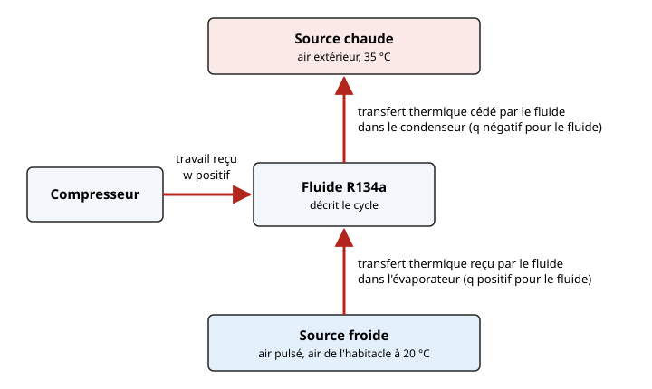
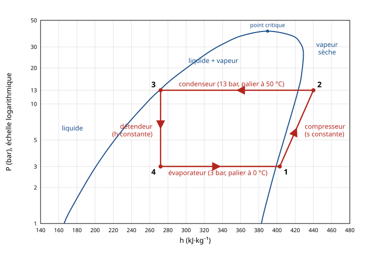
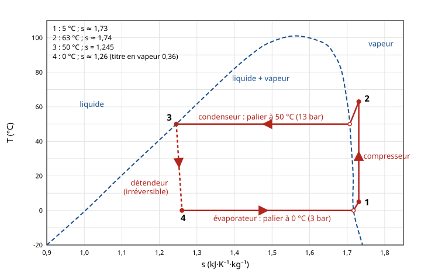

# Banque PT PT — Physique C - Thermodynamique 2011 · Corrigé guidé

*Corrigé rédigé par IA, non officiel. Signalez toute erreur.*

**Rédaction** · modèle exact non renseigné (famille Claude) · effort non renseigné · vitesse non renseignée

## Présentation du sujet

**Thème.** Étude de la climatisation d'une automobile : machine frigorifique à compression de vapeur (compresseur, condenseur, détendeur, évaporateur) dont le fluide est le R134a. L'épreuve dure 2 heures, **calculatrice autorisée**, et comporte 27 questions numérotées de 1 à 27, en cinq parties. L'annexe 1 (diagramme $(\log P, h)$ du fluide, sur lequel le cycle est déjà tracé) est un document réponse à rendre avec la copie ; l'annexe 2 est le schéma du bloc détendeur-sonde.

- *Partie I (questions 1 à 6)* : principe de la machine, rôle de chaque organe, modèles idéaux du compresseur et du détendeur.
- *Partie II (questions 7 à 16)* : lecture du diagramme $(\log P, h)$ de l'annexe 1 : états du fluide, sens du cycle, travail, transfert thermique, efficacité, surconsommation.
- *Partie III (questions 17 à 19)* : fonctionnement du bloc détendeur-sonde de l'annexe 2 (régulation du débit et de la basse pression).
- *Partie IV (questions 20 à 24)* : passage au diagramme entropique $(T, s)$, à construire à partir d'une table de quatre entropies.
- *Partie V (questions 25 à 27)* : circuit d'air pulsé, débit d'air et puissance du ventilateur.

**Notions mobilisées.** Machines dithermes réceptrices, efficacité, efficacité de Carnot ; premier principe pour un fluide en écoulement permanent ; changement d'état, titre en vapeur, théorème des moments ; lois de Joule et loi de Laplace du gaz parfait ; second principe, entropie créée ; lecture de diagrammes $(\log P, h)$ et $(T, s)$. Programme en vigueur avant la réforme de 2013-2014.

**Documents à lire.** Presque toutes les valeurs numériques viennent de l'annexe 1 : enthalpies massiques des quatre sommets du cycle, températures des paliers, température de fin de compression, titre en vapeur après détente. Le corrigé dit pour chacune où elle est lue. La table de la question 20 donne les entropies massiques du liquide saturant et de la vapeur saturante à 0 °C et à 50 °C.

**Difficulté.** Peu de calculs, mais beaucoup de questions qualitatives où l'on attend une justification précise et une cohérence d'ensemble : la partie II reprend, diagramme à l'appui, ce qui a été affirmé dans la partie I. La partie III demande de comprendre un mécanisme sur un schéma technique. Le piège le plus fréquent est de confondre le fluide frigorigène et l'air de l'habitacle.

**Gestion du temps.** Environ 25 minutes pour la partie I, 45 minutes pour la partie II, 20 minutes pour la partie III, 20 minutes pour la partie IV et 10 minutes pour la partie V. Les parties III et V peuvent être abordées sans avoir terminé les autres ; la partie V réutilise la valeur de la question 12.

> [!JURY]
> Le rapport 2011 souligne que la deuxième partie reprenait à dessein ce qui était demandé dans la première : c'était l'occasion de repérer ses erreurs et de les corriger. Beaucoup de candidats ne l'ont pas fait et ont donné des réponses en contradiction avec l'énoncé et avec leurs propres réponses précédentes, par exemple en qualifiant d'isenthalpique la transformation dans le compresseur, ou d'isobare celle du détendeur. Le rapport relève aussi, dans un grand nombre de copies, une confusion entre l'air de l'habitacle et le fluide thermodynamique, et l'emploi du mot « condensateur » pour le condenseur. Il conseille de se relire, de vérifier la cohérence de ses résultats d'un bout à l'autre du problème et à l'intérieur d'une même réponse, et rappelle qu'un résultat non justifié ne rapporte pas de points.

[Sujet officiel (archive réunissant les deux parties de Physique C)](https://www.banquept.fr/documents/2011/phys_c_pt_2011.zip) · [Rapport du jury](https://www.banquept.fr/documents/ecrit/rapport/2011/rapport_phys_c_ecrit_2011.pdf)

*Mode d'emploi* : chercher chaque question seul, lire la première indication en cas de blocage, réessayer, puis la seconde, et seulement ensuite la solution. Conventions : $w$ et $q$ désignent le travail massique utile et le transfert thermique massique **reçus par le fluide**, comptés algébriquement, avec les indices comp, d, e et cond de l'énoncé. Les états du fluide sont numérotés de 1 à 4 comme à la question 9.

## Partie I — Principe

### Question 1 — Schéma de principe et transferts énergétiques

> [!INDICATION]
> Le système qui décrit le cycle est le fluide R134a. Il échange de l'énergie avec trois éléments seulement : deux sources de chaleur et le compresseur.

> [!INDICATION]
> Une climatisation doit refroidir l'habitacle : dans quel sens va le transfert thermique entre l'air de l'habitacle et le fluide ? Où va ensuite cette énergie ?

#### Solution

La climatisation est une machine ditherme réceptrice. Le système qui décrit le cycle est le **fluide R134a**. Il échange de l'énergie avec trois éléments :

- la **source froide** : l'air de l'habitacle, que l'on veut maintenir à 20 °C. Le fluide lui **prend** de l'énergie par transfert thermique, dans l'évaporateur ;
- la **source chaude** : l'air extérieur, à 35 °C. Le fluide lui **cède** de l'énergie par transfert thermique, dans le condenseur ;
- le **compresseur**, entraîné par le moteur de la voiture, qui **fournit** du travail au fluide.

Les trois flèches du schéma donnent le sens réel des transferts : de la source froide vers le fluide, du compresseur vers le fluide, du fluide vers la source chaude. Le détendeur ne figure pas sur le schéma car il n'échange ni travail ni chaleur avec l'extérieur (question 5).

L'**air pulsé** par le ventilateur traverse l'évaporateur, s'y refroidit et est envoyé dans l'habitacle : il s'identifie à la **source froide**.

> [!PIEGE]
> Le fluide R134a circule en circuit fermé et ne se mélange jamais à l'air. Le fluide qui se condense et s'évapore dans les échangeurs n'est pas l'air.

> [!JURY]
> Le rapport insiste : une climatisation, comme une pompe à chaleur ou un réfrigérateur, refroidit ou réchauffe certes l'air d'un habitacle, mais le fluide qui subit les transformations dans le condenseur ou l'évaporateur n'est pas cet air, c'est le fluide thermodynamique.

### Question 2 — Rôle du condenseur

> [!INDICATION]
> Que devient le fluide dans un condenseur ? Ce changement d'état libère-t-il ou absorbe-t-il de l'énergie ?

#### Solution

Dans le condenseur, le fluide, qui arrive sous forme de vapeur à haute pression, **se liquéfie** à pression constante. La liquéfaction est exothermique : le fluide **cède un transfert thermique à la source chaude**. Le condenseur sert donc à évacuer vers l'extérieur l'énergie prise à l'habitacle, augmentée du travail reçu dans le compresseur.

C'est un échangeur thermique : le **fluide R134a** circule à l'intérieur, et sa paroi doit être au contact de la **source chaude** (l'air extérieur). Pour que le transfert se fasse spontanément du fluide vers l'air extérieur, le fluide doit y être plus chaud que 35 °C.

> [!JURY]
> Le rapport range « quel est le rôle du condenseur » parmi les questions qui auraient pu paraître triviales et qui révèlent pourtant des lacunes importantes.

### Question 3 — Rôle de l'évaporateur

> [!INDICATION]
> Raisonner comme à la question 2, en inversant le changement d'état et le sens du transfert thermique.

#### Solution

Dans l'évaporateur, le fluide, qui arrive à basse pression sous forme de mélange liquide-vapeur, **se vaporise** à pression constante. La vaporisation est endothermique : le fluide **reçoit un transfert thermique de la source froide**. C'est l'organe utile de la machine : c'est là que l'air destiné à l'habitacle est refroidi.

C'est un échangeur thermique : le **fluide R134a** circule à l'intérieur, et sa paroi doit être au contact de la **source froide** (l'air pulsé vers l'habitacle). Pour que le transfert se fasse spontanément de l'air vers le fluide, le fluide doit y être plus froid que 20 °C.

### Question 4 — Modèle idéal du compresseur

> [!INDICATION]
> Deux adjectifs sont attendus : l'un porte sur les échanges thermiques, l'autre sur les causes d'irréversibilité. Chacun demande son propre argument.

> [!INDICATION]
> La loi demandée relie $T$ et $P$ pour un gaz parfait dans une évolution isentropique : c'est une des formes de la loi de Laplace.

#### Solution

On assimile la compression à une transformation **adiabatique et réversible**, donc **isentropique**.

- *Adiabatique* : le fluide traverse le compresseur très rapidement. Les transferts thermiques avec les parois, qui sont lents, n'ont pas le temps de se faire : $q_{comp} \approx 0$.
- *Réversible* : on néglige les causes d'irréversibilité à l'intérieur du fluide, c'est-à-dire les frottements (viscosité du fluide, frottements mécaniques) et les inhomogénéités de pression et de température. C'est une idéalisation, qui donne le travail minimal à fournir pour un taux de compression donné.

La vapeur étant assimilée à un gaz parfait de coefficient $\gamma$ constant, la température suit la **loi de Laplace** :

$$\boxed{T^{\gamma}\,P^{1-\gamma} = \text{cste}}$$

soit

$$\frac{T_2}{T_1} = \left(\frac{P_2}{P_1}\right)^{\frac{\gamma-1}{\gamma}}$$

Comme $\gamma > 1$, la température augmente avec la pression : la vapeur sort du compresseur plus chaude qu'elle n'y est entrée.

> [!JURY]
> Le rapport précise qu'on ne peut pas invoquer le caractère quasi statique ou lent de la transformation pour justifier la réversibilité dans le compresseur. Il note aussi que beaucoup de candidats ont démontré, plus ou moins rigoureusement, qu'une transformation adiabatique réversible est isentropique, ce qui n'était pas le sujet de la question.

> [!PIEGE]
> L'argument de rapidité justifie le caractère adiabatique, pas la réversibilité. Les deux arguments ne doivent pas être échangés.

### Question 5 — Modèle idéal du détendeur

> [!INDICATION]
> Écrire le premier principe pour un fluide en écoulement permanent, puis chercher ce qui vaut zéro dans un détendeur : y a-t-il une pièce mobile qui échange du travail ? un échange thermique ?

#### Solution

On assimile la détente à une transformation **isenthalpique** (détente de Joule-Thomson, ou de Joule-Kelvin).

Justification. Pour un fluide en écoulement permanent, entre l'entrée et la sortie d'un organe, le premier principe s'écrit, par unité de masse et en négligeant les variations d'énergie cinétique et d'énergie potentielle de pesanteur (l'énoncé néglige les variations de vitesse) :

$$\Delta h = w + q$$

Dans le détendeur :

- il n'y a aucune pièce mobile qui fournisse ou reçoive du travail : $w_d = 0$ ;
- l'organe est petit, calorifugé, et le fluide le traverse rapidement : $q_d = 0$.

Donc

$$\boxed{\Delta h = 0 \quad\text{soit}\quad h_{\text{sortie}} = h_{\text{entrée}}}$$

Cette détente est adiabatique mais **irréversible** (le fluide est laminé à travers un orifice étroit) : elle n'est pas isentropique, son entropie augmente (question 20).

### Question 6 — Déshydratation de l'air

> [!INDICATION]
> La vapeur d'eau contenue dans l'air se condense sur une surface plus froide que la température de rosée de cet air. Quel organe de la machine présente une telle surface ?

#### Solution

La condensation de la vapeur d'eau se produit spontanément **sur l'évaporateur**.

Le fluide R134a s'y vaporise à une température basse (de l'ordre de 0 °C, voir question 9), très inférieure à celle de l'air qui le traverse. Au contact des parois froides de l'évaporateur, l'air humide est refroidi au-dessous de sa température de rosée : la pression partielle de la vapeur d'eau atteint la pression de vapeur saturante, et l'excédent d'eau se condense sur les ailettes, puis s'écoule hors du véhicule. L'air envoyé dans l'habitacle est ainsi à la fois plus frais et plus sec.

Le phénomène est spontané car il accompagne le transfert thermique naturel de l'air chaud vers la paroi froide. Il ne peut pas avoir lieu sur le condenseur, dont la paroi est plus chaude que l'air qui l'entoure.

> [!PIEGE]
> Le nom des organes désigne ce qui arrive au fluide R134a, pas à l'eau : la vapeur d'eau de l'air se condense sur l'évaporateur.

## Partie II — Étude du diagramme (log P, h) de l'annexe 1

*Remarque sur l'énoncé.* Le texte d'introduction de cette partie annonce « $h$, $w$ et $q$ les enthalpies, transferts thermiques massiques », puis parle des « transferts thermiques ($w$, $q$) ». Il manque le mot travail : $w$ est le travail massique et $q$ le transfert thermique massique, comme le confirment les questions 11 et 12.

### Question 7 — États du fluide et isothermes

> [!INDICATION]
> La courbe de saturation a deux branches qui se rejoignent au point critique. Que trouve-t-on à gauche de la branche de gauche, à droite de la branche de droite, et sous la courbe ?

> [!INDICATION]
> Pour un gaz parfait, de quelle seule variable dépend l'enthalpie ? En déduire ce que vaut $h$ le long d'une isotherme, puis regarder sur l'annexe 1 où les isothermes du R134a ont cette allure.

#### Solution

**États du fluide.** La courbe de saturation en forme de cloche délimite trois zones :

- à gauche de la branche de gauche (courbe d'ébullition, titre en vapeur $x = 0$) : **liquide** ;
- sous la cloche : **mélange liquide-vapeur** en équilibre, parcouru par les courbes de titre constant graduées de 0,10 à 0,90 ;
- à droite de la branche de droite (courbe de rosée, $x = 1$) : **vapeur sèche** (surchauffée).

Les deux branches se rejoignent au point critique, au sommet de la cloche (vers 40 bar sur l'annexe 1). Au-dessus, le fluide est supercritique et la distinction entre liquide et vapeur disparaît.

**Isothermes d'un gaz parfait.** L'enthalpie massique d'un gaz parfait ne dépend que de la température (seconde loi de Joule) : $\mathrm{d}h = c_p\,\mathrm{d}T$. Avec $c_p$ constant :

$$\boxed{h = h_0 + c_p\,(T - T_0)}$$

À $T$ fixée, $h$ garde la même valeur quelle que soit la pression. Dans le diagramme $(\log P, h)$, les isothermes d'un gaz parfait sont donc des **droites verticales**, d'équation $h = \text{cste}$, régulièrement espacées pour des températures régulièrement espacées. Avec la relation de Mayer $c_p - c_v = r$ et $\gamma = c_p/c_v$ :

$$c_p = \frac{\gamma\,r}{\gamma - 1} = \frac{1{,}12 \times 85}{0{,}12} \approx 7{,}9\times 10^{2}\ \mathrm{J\cdot K^{-1}\cdot kg^{-1}}$$

**Cas du R134a.** Sur l'annexe 1, les isothermes ont trois allures :

- dans le liquide, elles sont presque verticales (l'enthalpie d'un liquide dépend très peu de la pression) ;
- sous la cloche, ce sont des **paliers horizontaux**, car le changement d'état d'un corps pur à température fixée se fait à pression fixée ;
- dans la vapeur, elles partent de la courbe de rosée en s'incurvant, et ne deviennent verticales que loin de cette courbe.

Le fluide ne se comporte donc pas comme un gaz parfait dans tout le domaine de la vapeur.

**Domaine où le modèle du gaz parfait convient.** C'est le domaine de la **vapeur sèche à basse pression, loin de la courbe de saturation** (en bas à droite du diagramme) : les isothermes y sont verticales et régulièrement espacées. La raison est que la vapeur y est peu dense : les molécules sont éloignées les unes des autres et leurs interactions deviennent négligeables.

Vérification par lecture de l'annexe 1 : sur l'isobare 0,5 bar, les isothermes repérées 0 °C et 20 °C coupent l'axe vers $h \approx 405$ et $h \approx 421\ \mathrm{kJ\cdot kg^{-1}}$, soit environ $0{,}8\ \mathrm{kJ\cdot K^{-1}\cdot kg^{-1}}$, en accord avec la valeur de $c_p$ ci-dessus.

> [!JURY]
> Le rapport déplore des réponses plus que fantaisistes sur le domaine où le fluide peut être considéré comme un gaz parfait, question pourtant simple, et parle de candidats qui ne connaissent apparemment plus la définition d'un gaz parfait. Dans ses conseils, il juge que répondre « les isothermes sont des droites » est largement insuffisant si l'on ne précise pas « verticales » et si l'on ne le justifie pas.

### Question 8 — Sens de parcours du cycle

> [!INDICATION]
> Partir du compresseur : comment varient la pression et l'enthalpie du fluide qui le traverse ? Repérer le côté du cycle qui convient.

#### Solution

Le cycle tracé sur l'annexe 1 est un quadrilatère : deux côtés horizontaux (isobares à 3 bar et à 13 bar environ), un côté vertical à gauche et un côté incliné à droite.

- Dans le compresseur, la pression augmente et le fluide reçoit du travail sans échange thermique : $\Delta h = w_{comp} > 0$. Le fluide monte donc vers la droite : c'est le côté incliné de droite, parcouru **de bas en haut**.
- Dans le condenseur, à haute pression, le fluide cède de la chaleur : $h$ diminue. Le côté du haut est parcouru **de droite à gauche**.
- Dans le détendeur, la pression chute à enthalpie constante : le côté vertical de gauche est parcouru **de haut en bas**.
- Dans l'évaporateur, à basse pression, le fluide reçoit de la chaleur : $h$ augmente. Le côté du bas est parcouru **de gauche à droite**.

**Le cycle est parcouru dans le sens trigonométrique (antihoraire)** dans le diagramme $(\log P, h)$.

> [!JURY]
> Le rapport signale de nombreuses incohérences dans cette partie : des candidats se trompent sur le sens du cycle, font passer le fluide dans le compresseur de la haute à la basse pression, ou le font s'évaporer en diminuant son enthalpie. Il note aussi que quelques candidats ont su exploiter la nature d'une compression ou d'une détente pour trouver le sens de parcours sans se tromper sur les sources en contact avec les échangeurs.

### Question 9 — Numérotation des états et nature des transformations

> [!INDICATION]
> L'état 1 est le sommet en bas à droite. Suivre le sens trouvé à la question 8 pour numéroter les autres sommets, puis lire leurs coordonnées sur les axes.

> [!INDICATION]
> Regarder où se trouve chaque sommet par rapport à la courbe de saturation : sur la courbe, sous la cloche, ou dans la vapeur sèche. Les paliers de température se lisent là où les isobares du cycle coupent la courbe de saturation.

#### Solution

À partir de l'état 1 (sommet en bas à droite) et dans le sens antihoraire :

- **état 2** : sommet en haut à droite ;
- **état 3** : sommet en haut à gauche ;
- **état 4** : sommet en bas à gauche.

La figure 2 reprend, à l'échelle, les quatre sommets lus sur l'annexe 1 ; la courbe de saturation y est reproduite dans son allure.

**Lecture des quatre états sur l'annexe 1.** Les enthalpies se lisent sur l'axe horizontal (une graduation tous les 20 kJ·kg⁻¹), les pressions sur l'axe vertical logarithmique, les températures sur les graduations portées le long de la courbe de saturation et sur les isothermes de la vapeur.

| État | Position sur le diagramme | $P$ (bar) | $h$ (kJ·kg⁻¹) | $T$ (°C) | État physique |
|---|---|---|---|---|---|
| 1 | un peu à droite de la courbe de rosée | 3 | $\approx 403$ | $\approx 5$ | vapeur légèrement surchauffée |
| 2 | à droite de la courbe de rosée | 13 | $\approx 440$ | $\approx 60$ | vapeur surchauffée |
| 3 | sur la courbe d'ébullition | 13 | $\approx 272$ | 50 | liquide saturant |
| 4 | sous la cloche | 3 | $\approx 272$ | 0 | mélange liquide-vapeur |

Détail des lectures :

- côté gauche du cycle : verticale située aux six dixièmes de l'intervalle entre les graduations 260 et 280, d'où $h_3 = h_4 \approx 272\ \mathrm{kJ\cdot kg^{-1}}$ ; son sommet supérieur est sur la courbe d'ébullition, à la graduation 50 °C ;
- sommet 1 : un peu à droite de la graduation 400, d'où $h_1 \approx 403\ \mathrm{kJ\cdot kg^{-1}}$ ; il est entre l'isotherme 0 °C (qui part de la courbe de rosée à 3 bar) et l'isotherme 10 °C, d'où $T_1 \approx 5\ \text{°C}$ ;
- sommet 2 : sur la graduation 440, d'où $h_2 \approx 440\ \mathrm{kJ\cdot kg^{-1}}$ ; il est pratiquement sur l'isotherme 60 °C, d'où $T_2 \approx 60\ \text{°C}$ ;
- paliers : l'isobare du bas coupe la courbe de saturation à la graduation 0 °C, celle du haut à la graduation 50 °C.

Ces lectures sont faites à environ $2\ \mathrm{kJ\cdot kg^{-1}}$ près. Les traits horizontaux du cycle, épais, sont centrés un peu au-dessous de 3 bar et un peu au-dessus de 13 bar ; l'écart est de l'ordre de l'épaisseur du trait et l'on garde les valeurs de l'énoncé, 3 bar et 13 bar.

**Cases à compléter sur l'annexe 1.**

| Transformation | Côté du cycle | Nature | Organe traversé |
|---|---|---|---|
| $1 \to 2$ | côté incliné de droite | compression adiabatique réversible (isentropique) | compresseur |
| $2 \to 3$ | côté du haut | refroidissement isobare de la vapeur, puis liquéfaction totale isobare et isotherme (50 °C) | condenseur |
| $3 \to 4$ | côté vertical de gauche | détente isenthalpique, avec vaporisation partielle | détendeur |
| $4 \to 1$ | côté du bas | vaporisation isobare et isotherme (0 °C), puis légère surchauffe isobare de la vapeur | évaporateur |

> [!METHODE]
> Sur un diagramme $(\log P, h)$, chaque organe a une signature : horizontale pour un échangeur (isobare), verticale pour un détendeur (isenthalpique), courbe isentropique pour un compresseur idéal. Les longueurs horizontales donnent directement $w$ ou $q$.

> [!JURY]
> Parmi les questions d'apparence triviale qui révèlent des lacunes importantes, le rapport cite l'identification de l'état du fluide. Il s'étonne aussi que l'on puisse qualifier d'isenthalpique la transformation dans le compresseur, ou d'isobare celle du détendeur, en contradiction avec l'énoncé.

### Question 10 — Nature de la transformation dans le compresseur

> [!INDICATION]
> Comparer le côté $1 \to 2$ du cycle au réseau de courbes repérées $s = 1{,}70$, $s = 1{,}75$, $s = 1{,}80$ sur l'annexe 1.

#### Solution

Sur l'annexe 1, le côté $1 \to 2$ **longe la courbe d'entropie massique constante** repérée $s = 1{,}75\ \mathrm{kJ\cdot K^{-1}\cdot kg^{-1}}$ : il reste entre les courbes $s = 1{,}70$ et $s = 1{,}80$, sans les couper. La transformation dans le compresseur est donc **isentropique**.

Ce qui peut le justifier :

- *caractéristique de la transformation* : elle est **rapide**, de sorte que le fluide n'a pas le temps d'échanger de la chaleur avec les parois ; elle est adiabatique ;
- *caractéristiques du compresseur* : il est **calorifugé** (pas de fuite thermique) et supposé **idéal**, c'est-à-dire sans frottement ; la transformation y est réversible.

Une transformation adiabatique et réversible est isentropique : $\mathrm{d}s = \delta q/T + \delta s_{\text{créée}}$, avec $\delta q = 0$ et $\delta s_{\text{créée}} = 0$. Le diagramme confirme la réponse donnée à la question 4.

### Question 11 — Travail massique dans le compresseur

> [!INDICATION]
> Premier principe en écoulement permanent, avec $q_{comp} = 0$. Les deux enthalpies se lisent sur l'axe horizontal de l'annexe 1.

#### Solution

Premier principe pour le fluide en écoulement permanent dans le compresseur, adiabatique ($q_{comp} = 0$), les variations d'énergie cinétique étant négligées :

$$w_{comp} = h_2 - h_1$$

Avec $h_1 \approx 403\ \mathrm{kJ\cdot kg^{-1}}$ et $h_2 \approx 440\ \mathrm{kJ\cdot kg^{-1}}$, lus à la question 9 :

$$\boxed{w_{comp} \approx +37\ \mathrm{kJ\cdot kg^{-1}}}$$

Il est **positif**, et il doit l'être : le fluide reçoit du travail de la part du compresseur, puisque sa pression et son enthalpie augmentent. Une machine frigorifique est un récepteur : elle ne peut transférer de la chaleur d'une source froide vers une source chaude qu'en recevant du travail (second principe, énoncé de Clausius).

### Question 12 — Transfert thermique avec l'air de l'habitacle

> [!INDICATION]
> L'air de l'habitacle est la source froide : l'échange a lieu dans l'évaporateur, entre les états 4 et 1, où le fluide ne reçoit aucun travail.

#### Solution

L'échange avec l'air de l'habitacle se fait dans l'évaporateur ($4 \to 1$), qui ne comporte aucune pièce mobile ($w_e = 0$). Le premier principe donne :

$$q_e = h_1 - h_4$$

Avec $h_1 \approx 403\ \mathrm{kJ\cdot kg^{-1}}$ et $h_4 = h_3 \approx 272\ \mathrm{kJ\cdot kg^{-1}}$ :

$$\boxed{q_e \approx +131\ \mathrm{kJ\cdot kg^{-1}}}$$

Il est **positif**, et il doit l'être : le fluide reçoit de la chaleur de l'air de l'habitacle, ce qui refroidit cet air. Du point de vue de l'air, le transfert est négatif.

Pour la suite, on lit de même le transfert thermique dans le condenseur :

$$q_{cond} = h_3 - h_2 \approx -168\ \mathrm{kJ\cdot kg^{-1}}$$

On vérifie le bilan sur un cycle : $w_{comp} + q_e + q_{cond} = 37 + 131 - 168 = 0$.

> [!PIEGE]
> Le signe dépend du système choisi. L'énoncé demande les grandeurs échangées par le fluide : $q_e$ est positif, alors que l'air de l'habitacle, lui, perd de l'énergie.

### Question 13 — Efficacité de l'installation

> [!INDICATION]
> L'efficacité est le rapport de ce qui est utile à ce qui est coûteux. Pour une climatisation, qu'est-ce qui est utile ? Qu'est-ce qui se paie ?

#### Solution

L'efficacité (ou coefficient de performance) est le rapport de la grandeur utile à la grandeur coûteuse. Pour une climatisation, la grandeur utile est la chaleur prise à la source froide, la grandeur coûteuse est le travail fourni au compresseur :

$$\boxed{e = \frac{q_e}{w_{comp}} = \frac{h_1 - h_4}{h_2 - h_1}}$$

Application numérique :

$$e \approx \frac{131}{37} \approx 3{,}5$$

Ce résultat est raisonnable :

- une efficacité n'est pas un rendement et peut dépasser 1 : le travail ne sert pas à produire le froid, il sert à déplacer de la chaleur ;
- l'ordre de grandeur est celui des machines frigorifiques usuelles (entre 2 et 5) ;
- la valeur reste inférieure à l'efficacité de Carnot (question 14).

Compte tenu de la précision des lectures ($2\ \mathrm{kJ\cdot kg^{-1}}$ sur chaque enthalpie, ce qui pèse surtout sur la différence $h_2 - h_1$), l'efficacité est comprise entre 3,3 et 3,8 environ.

### Question 14 — Efficacité d'une machine idéale

> [!INDICATION]
> Pour une machine frigorifique ditherme réversible, écrire le premier principe et l'égalité de Clausius sur un cycle, puis éliminer la chaleur cédée à la source chaude.

> [!INDICATION]
> Les températures extrêmes du cycle sont celles des états le plus froid et le plus chaud du fluide, lues à la question 9. Elles s'expriment en kelvins.

#### Solution

Pour une machine ditherme idéale (cycle de Carnot, réversible) fonctionnant entre une source froide à $T_f$ et une source chaude à $T_c$, sur un cycle :

$$w + q_f + q_c = 0$$

$$\frac{q_f}{T_f} + \frac{q_c}{T_c} = 0$$

On en tire $q_c = -q_f\,T_c/T_f$, puis $w = q_f\,(T_c - T_f)/T_f$, d'où

$$\boxed{e_C = \frac{q_f}{w} = \frac{T_f}{T_c - T_f}}$$

Les températures extrêmes du cycle sont $T_f = T_4 = 0\ \text{°C} = 273\ \mathrm{K}$ (palier d'évaporation) et $T_c = T_2 \approx 60\ \text{°C} = 333\ \mathrm{K}$ (fin de compression) :

$$e_C \approx \frac{273}{333 - 273} \approx 4{,}6$$

L'efficacité réelle, $e \approx 3{,}5$, est **inférieure** à $e_C$, comme l'impose le second principe : elle en représente environ les trois quarts. L'écart vient des irréversibilités du cycle : la détente isenthalpique (question 20) et le refroidissement de la vapeur surchauffée dans le condenseur, au contact d'une source plus froide qu'elle.

Remarque. Avec les températures des deux paliers (0 °C et 50 °C), on trouverait $273/50 \approx 5{,}5$. Avec les températures des sources elles-mêmes (habitacle à 20 °C, extérieur à 35 °C), on trouverait $293/15 \approx 20$ : l'essentiel de la perte d'efficacité vient des écarts de température nécessaires entre le fluide et les sources pour que les échanges se fassent à un rythme suffisant.

> [!JURY]
> Le rapport dit devoir rappeler que le calcul d'une efficacité se fait à partir des températures exprimées en kelvins et non en degrés Celsius.

### Question 15 — Compresseur non idéal

> [!INDICATION]
> La compression reste adiabatique, mais elle n'est plus réversible. Que dit alors le second principe sur l'entropie du fluide en sortie ? Où se déplace le point 2 sur l'isobare 13 bar ?

#### Solution

Si la compression reste adiabatique mais devient irréversible (frottements), le second principe impose une création d'entropie :

$$s_{2'} - s_1 = s_{\text{créée}} > 0$$

La pression de sortie reste la haute pression, fixée par le condenseur. Sur l'isobare 13 bar, dans le domaine de la vapeur, les courbes d'entropie croissante se rencontrent en allant vers la droite : le point de sortie $2'$ est donc **à droite du point 2**, à une enthalpie et une température plus élevées.

Conséquences sur le cycle :

- le côté $1 \to 2'$ ne suit plus une isentropique, il est **plus incliné vers la droite** ;
- le travail $w_{comp} = h_{2'} - h_1$ **augmente** ;
- le palier du haut s'allonge vers la droite : le condenseur doit évacuer davantage de chaleur ;
- les états 3, 4 et 1 ne changent pas : $q_e$ est inchangé.

L'efficacité $e = q_e / w_{comp}$ **diminue**.

### Question 16 — Surconsommation due au compresseur

> [!INDICATION]
> Passer du travail massique à une puissance grâce au débit massique, puis comparer à la puissance motrice de 30 kW.

#### Solution

Puissance mécanique que le moteur doit fournir au compresseur :

$$\mathcal{P}_{comp} = D_m\,w_{comp}$$

$$\mathcal{P}_{comp} \approx 0{,}15 \times 37 \approx 5{,}55\ \mathrm{kW} \approx 5{,}6\ \mathrm{kW}$$

À 2400 tr/min, le moteur développe une puissance motrice $\mathcal{P}_m = 30\ \mathrm{kW}$. En admettant que la consommation de carburant est proportionnelle à la puissance fournie par le moteur, la surconsommation relative est :

$$\boxed{\frac{\mathcal{P}_{comp}}{\mathcal{P}_m} \approx \frac{5{,}55}{30} \approx 0{,}185 \approx 19\ \%}$$

La climatisation augmente donc la consommation de près d'un cinquième dans ces conditions, ce qui confirme la remarque de l'introduction du sujet.

## Partie III — Étude du bloc détendeur-sonde (annexe 2)

Lecture de l'annexe 2. Le bloc est traversé deux fois par le fluide. En bas, le liquide à haute pression entre en 1, franchit l'orifice de détente que la bille peut obstruer, et ressort en 2, à basse pression, vers l'évaporateur. En haut, le fluide qui revient de l'évaporateur entre en 4, passe au contact de la sonde thermostatique 3 et ressort en 5 vers le compresseur. Le diaphragme, la tige et la bille forment un ensemble rigide (repère 6) : quand il descend, la bille s'écarte de son siège, l'orifice s'ouvre et le ressort 7 se comprime ; quand il monte, le ressort se détend et la bille referme l'orifice.

Notations du corrigé pour cette partie : $T_5$ est la température du **fluide** à la sortie 5 ; $P_s$ la pression du fluide enfermé dans la sonde ; $P_{BP}$ la basse pression, celle du fluide entre l'orifice et le compresseur, donc dans l'évaporateur et sous le diaphragme.

### Question 17 — Température de sortie trop basse

> [!INDICATION]
> Dire d'abord ce que signifie, pour le fluide, une température de sortie trop basse : a-t-il reçu assez de chaleur dans l'évaporateur ? Raisonner sur la chaleur reçue par kilogramme de fluide quand le débit change.

> [!INDICATION]
> Le compresseur continue d'aspirer la vapeur. Si l'orifice laisse passer moins de fluide, comment évolue la pression entre l'orifice et le compresseur ?

#### Solution

**Débit.** Si $T_5$ est inférieure à la consigne, le fluide sort de l'évaporateur insuffisamment réchauffé : la vapeur est trop peu surchauffée, voire encore chargée de gouttelettes de liquide, ce qui est dangereux pour le compresseur. Chaque kilogramme de fluide n'a pas reçu assez de chaleur de la part de l'air.

Or la puissance thermique $\Phi$ que l'air peut céder à travers l'évaporateur est limitée par la surface d'échange. La chaleur reçue par kilogramme de fluide vaut $q_e = \Phi / D_m$ : elle est d'autant plus faible que le débit est grand, car le fluide séjourne moins longtemps dans l'échangeur. Pour que chaque kilogramme reçoive davantage de chaleur et sorte plus chaud, **le détendeur doit diminuer le débit**.

**Basse pression.** Le compresseur continue d'aspirer la vapeur. Si l'orifice laisse passer moins de fluide, la masse de fluide contenue entre l'orifice et le compresseur diminue : **la basse pression diminue**. C'est aussi ce qui est souhaitable : la température d'évaporation, liée à $P_{BP}$ par l'équilibre liquide-vapeur, baisse ; l'écart de température entre l'air et le fluide augmente, l'échange thermique est plus efficace et la surchauffe en sortie, c'est-à-dire l'écart entre $T_5$ et la température d'évaporation, augmente.

Le mécanisme de l'annexe 2 agit bien dans ce sens : le fluide qui passe de 4 à 5 est au contact de la sonde. S'il est trop froid, il refroidit le fluide de la sonde, dont la pression $P_s$ baisse ; le diaphragme remonte, le ressort se détend, la bille se rapproche de son siège et la section de passage diminue.

> [!JURY]
> Le rapport constate que beaucoup de candidats confondent ici la température du fluide et celle de l'air de l'habitacle, paraphrasent l'énoncé, ou bâtissent des raisonnements qui invoquent « la » pression ou « la » température sans les définir. Il rappelle que plus le débit du fluide est important, moins les échanges thermiques sont efficaces.

### Question 18 — Régulation du débit et de la pression

> [!INDICATION]
> Faire le bilan des forces qui s'exercent sur l'ensemble diaphragme-tige-bille : pression au-dessus du diaphragme, pression au-dessous, action du ressort. Dans quel sens se déplace l'ensemble si la pression de la sonde baisse ?

> [!INDICATION]
> Chercher ensuite la rétroaction : comment la basse pression réagit-elle au déplacement de la bille, et pourquoi ce déplacement finit-il par s'arrêter ?

#### Solution

**Équilibre de l'ensemble mobile.** Le diaphragme, de section $S$, est soumis :

- au-dessus, à la pression $P_s$ du fluide de la sonde, qui le pousse vers le bas (ouverture de l'orifice) ;
- au-dessous, à la pression $P_{BP}$ du fluide venant de l'évaporateur, qui le pousse vers le haut (fermeture) ;
- par l'intermédiaire de la tige et de la bille, à la force $F$ du ressort, dirigée vers le haut (fermeture), d'autant plus grande que le ressort est comprimé, donc que l'orifice est ouvert.

À l'équilibre, en ne gardant que ces trois actions :

$$P_s\,S = P_{BP}\,S + F$$

La position de la bille, donc la section de passage et le débit, est fixée par l'écart $P_s - P_{BP}$.

**Abaissement de la consigne.** Quand l'automobiliste demande un habitacle plus frais, la température de la sonde diminue, donc $P_s$ diminue. La force vers le bas ne compense plus les forces vers le haut : le diaphragme remonte, le ressort se détend et la bille réduit la section de l'orifice. **Le débit diminue.** Le compresseur aspirant toujours, **la basse pression diminue** à son tour. La force $P_{BP}\,S$ diminue alors, ce qui s'oppose au mouvement : l'ensemble se stabilise dans une nouvelle position d'équilibre, pour une basse pression plus faible.

À une basse pression plus faible correspond une température d'évaporation plus basse : l'évaporateur est plus froid, l'air pulsé aussi, et la température de l'habitacle baisse. Si la consigne est relevée, le raisonnement s'inverse : $P_s$ augmente, l'orifice s'ouvre, le débit et la basse pression augmentent.

**Régulation.** Le dispositif est une boucle de rétroaction négative, à deux titres.

- *Pression.* Une hausse accidentelle de $P_{BP}$ repousse le diaphragme vers le haut, referme l'orifice, réduit le débit et fait redescendre $P_{BP}$. La basse pression est ainsi asservie à la pression de la sonde, donc à la consigne.
- *Débit.* La sonde est aussi au contact du fluide qui sort de l'évaporateur. Si ce fluide sort trop chaud (débit trop faible, évaporateur mal alimenté), la sonde se réchauffe, $P_s$ augmente, l'orifice s'ouvre et le débit augmente. S'il sort trop froid, c'est l'inverse (question 17). Le débit s'ajuste ainsi à la puissance thermique que l'air peut réellement céder.

### Question 19 — Efficacité quand on abaisse la température de l'habitacle

> [!INDICATION]
> Que devient la basse pression d'après la question 18 ? La haute pression, elle, dépend de l'air extérieur. Raisonner sur la longueur des côtés du cycle dans le diagramme de l'annexe 1.

#### Solution

L'efficacité **diminue**.

Abaisser la température de l'habitacle demande une température d'évaporation plus basse, donc une basse pression plus faible (question 18). La haute pression ne change pas : elle est fixée par la température de condensation, elle-même imposée par l'air extérieur à 35 °C. Sur le diagramme de l'annexe 1 :

- le taux de compression augmente : le côté $1 \to 2$ s'allonge le long de l'isentropique, et $w_{comp} = h_2 - h_1$ **augmente** ;
- le point 1 descend le long de la courbe de rosée, où $h$ diminue quand la pression baisse, alors que $h_4 = h_3$ ne change pas : $q_e = h_1 - h_4$ **diminue légèrement**.

Le rapport $e = q_e / w_{comp}$ diminue donc. On retrouve la tendance de la machine idéale : $e_C = T_f/(T_c - T_f)$ diminue quand $T_f$ baisse à $T_c$ fixée. Physiquement, faire remonter de la chaleur sur un écart de température plus grand coûte plus de travail.

## Partie IV — Étude du diagramme entropique (T, s)

### Question 20 — Variation d'entropie dans le détendeur

> [!INDICATION]
> Avant la détente, le fluide est du liquide saturant à 50 °C : son entropie est dans la table. Après la détente, c'est un mélange liquide-vapeur à 0 °C : son entropie se calcule si l'on connaît le titre en vapeur.

> [!INDICATION]
> Le titre en vapeur de l'état 4 s'obtient avec la propriété de la détente ($h_4 = h_3$) et les enthalpies du liquide saturant et de la vapeur saturante à 3 bar, lues sur l'annexe 1. On peut aussi le lire directement entre deux courbes de titre constant.

#### Solution

**État 3.** Liquide saturant à 50 °C : d'après la table, $s_3 = s_\ell(50\ \text{°C}) = 1{,}245\ \mathrm{kJ\cdot K^{-1}\cdot kg^{-1}}$.

**État 4.** Mélange liquide-vapeur à 0 °C, de titre massique en vapeur $x_4$. La table ne donne que des entropies : le titre vient du diagramme de l'annexe 1. La détente étant isenthalpique, $h_4 = h_3 \approx 272\ \mathrm{kJ\cdot kg^{-1}}$. Sur l'isobare 3 bar, la courbe d'ébullition est sur la graduation $h_\ell \approx 200\ \mathrm{kJ\cdot kg^{-1}}$ et la courbe de rosée juste à gauche de la graduation 400, soit $h_v \approx 398\ \mathrm{kJ\cdot kg^{-1}}$. L'enthalpie étant extensive :

$$h_4 = (1 - x_4)\,h_\ell + x_4\,h_v$$

$$x_4 = \frac{h_4 - h_\ell}{h_v - h_\ell} \approx \frac{272 - 200}{398 - 200} \approx 0{,}36$$

Lecture directe de contrôle : sur l'annexe 1, le sommet 4 est entre les courbes de titre 0,30 et 0,40, aux six dixièmes de l'intervalle, ce qui donne aussi $x_4 \approx 0{,}36$.

L'entropie est extensive elle aussi :

$$s_4 = (1 - x_4)\,s_\ell(0\ \text{°C}) + x_4\,s_v(0\ \text{°C})$$

$$s_4 \approx 1{,}003 + 0{,}36 \times (1{,}717 - 1{,}003) \approx 1{,}260\ \mathrm{kJ\cdot K^{-1}\cdot kg^{-1}}$$

**Variation d'entropie.**

$$\boxed{\Delta s = s_4 - s_3 \approx +0{,}015\ \mathrm{kJ\cdot K^{-1}\cdot kg^{-1}} = +15\ \mathrm{J\cdot K^{-1}\cdot kg^{-1}}}$$

Elle est **positive**. C'est ce qu'impose le second principe : la détente est adiabatique (entropie échangée nulle), donc $\Delta s = s_{\text{créée}} \geqslant 0$, et elle est irréversible, donc $\Delta s > 0$.

Précision. Ce résultat est la petite différence de deux nombres voisins : il est très sensible au titre. Avec $x_4 = 0{,}35$ on trouve $+8\ \mathrm{J\cdot K^{-1}\cdot kg^{-1}}$, avec $x_4 = 0{,}37$, $+22\ \mathrm{J\cdot K^{-1}\cdot kg^{-1}}$. Seuls le signe et l'ordre de grandeur (une à deux dizaines de $\mathrm{J\cdot K^{-1}\cdot kg^{-1}}$) sont fiables. Une détente isentropique jusqu'à 0 °C donnerait le titre $(1{,}245 - 1{,}003)/(1{,}717 - 1{,}003) \approx 0{,}34$, inférieur au titre lu : la détente isenthalpique vaporise un peu plus de liquide.

> [!JURY]
> Le rapport s'étonne que beaucoup trop de candidats trouvent une variation d'entropie négative lors du passage dans le détendeur.

> [!PIEGE]
> Ne pas chercher à calculer cette variation avec une formule de gaz parfait : le fluide passe de l'état liquide à un mélange liquide-vapeur. Seule l'extensivité de $s$ dans le mélange convient.

### Question 21 — Placement du point de sortie du détendeur

> [!INDICATION]
> Sous la courbe de saturation, la température est constante le long d'un palier. Quelle est l'abscisse du point 4 sur ce palier ?

#### Solution

Dans le diagramme $(T, s)$, l'état 4 est sur le **palier horizontal** $T = 0\ \text{°C}$, qui relie le point L du liquide saturant (abscisse $s_\ell = 1{,}003$) au point V de la vapeur saturante (abscisse $s_v = 1{,}717$). Il suffit de connaître son titre en vapeur. L'extensivité de l'entropie donne le **théorème des moments** :

$$x_4 = \frac{s_4 - s_\ell}{s_v - s_\ell} = \frac{\mathrm{L4}}{\mathrm{LV}}$$

Le point 4 se place donc sur le palier, à 36 % de sa longueur à partir de L, c'est-à-dire à l'abscisse $s_4 \approx 1{,}26\ \mathrm{kJ\cdot K^{-1}\cdot kg^{-1}}$. Il est légèrement à droite de la verticale du point 3 ($s_3 = 1{,}245$), puisque l'entropie a augmenté dans le détendeur.

### Question 22 — Isobare d'un gaz parfait dans le diagramme (T, s)

> [!INDICATION]
> Partir de l'identité thermodynamique $\mathrm{d}h = T\,\mathrm{d}s + v\,\mathrm{d}P$ à pression constante, avec $\mathrm{d}h = c_p\,\mathrm{d}T$.

#### Solution

Identité thermodynamique, par unité de masse :

$$\mathrm{d}h = T\,\mathrm{d}s + v\,\mathrm{d}P$$

Le long d'une isobare, $\mathrm{d}P = 0$, et pour un gaz parfait $\mathrm{d}h = c_p\,\mathrm{d}T$ :

$$\mathrm{d}s = c_p\,\frac{\mathrm{d}T}{T}$$

Avec $c_p$ constant, en intégrant à partir d'un point $(s_0, T_0)$ de l'isobare :

$$s - s_0 = c_p\,\ln\frac{T}{T_0}$$

$$\boxed{T(s) = T_0\,\exp\!\left(\frac{s - s_0}{c_p}\right)}$$

avec $c_p = \gamma r/(\gamma - 1) \approx 7{,}9\times 10^{2}\ \mathrm{J\cdot K^{-1}\cdot kg^{-1}}$ et $T$ en kelvins. Une isobare de gaz parfait est une **exponentielle croissante**, de pente $T/c_p$ en chaque point.

### Question 23 — Cycle dans le diagramme (T, s)

> [!INDICATION]
> Placer d'abord les quatre points de la table (liquide saturant et vapeur saturante à 0 °C et à 50 °C) : ils donnent les deux paliers et l'allure de la courbe de saturation.

> [!INDICATION]
> Les points 1 et 2 sont dans la vapeur sèche, sur les isobares 3 bar et 13 bar. Utiliser la question 22 à partir de la vapeur saturante de chaque isobare pour calculer leur entropie.

#### Solution

**Points de la courbe de saturation (table de la question 20).** L(0 °C ; 1,003), V(0 °C ; 1,717), L'(50 °C ; 1,245), V'(50 °C ; 1,707), les entropies étant en $\mathrm{kJ\cdot K^{-1}\cdot kg^{-1}}$. La courbe d'ébullition passe par L et L', la courbe de rosée par V et V'.

**Points 3 et 4.** Le point 3 est en L' : $T_3 = 50\ \text{°C}$, $s_3 = 1{,}245$. Le point 4 est sur le palier à 0 °C : $s_4 \approx 1{,}26$ (questions 20 et 21).

**Point 1.** Vapeur à 3 bar, à $T_1 \approx 5\ \text{°C} = 278\ \mathrm{K}$ (question 9), sur l'isobare qui part de V à $273\ \mathrm{K}$. D'après la question 22 :

$$s_1 = s_v(0\ \text{°C}) + c_p\,\ln\frac{T_1}{273} \approx 1{,}717 + 0{,}793 \times \ln\frac{278}{273} \approx 1{,}73\ \mathrm{kJ\cdot K^{-1}\cdot kg^{-1}}$$

**Point 2.** Vapeur à 13 bar, à $T_2 \approx 60\ \text{°C} = 333\ \mathrm{K}$ (question 9), sur l'isobare qui part de V' à $323\ \mathrm{K}$ :

$$s_2 = s_v(50\ \text{°C}) + c_p\,\ln\frac{T_2}{323} \approx 1{,}707 + 0{,}793 \times \ln\frac{333}{323} \approx 1{,}73\ \mathrm{kJ\cdot K^{-1}\cdot kg^{-1}}$$

Les deux calculs, indépendants, donnent la même entropie : $s_1 = s_2$, ce qui confirme que la compression est isentropique. La courbe que longe le côté $1 \to 2$ sur l'annexe 1 est repérée $s = 1{,}75$ ; l'écart de 0,02 avec la valeur calculée est de l'ordre de l'incertitude de lecture et de l'approximation du gaz parfait près de la saturation.

| Point | $T$ (°C) | $s$ (kJ·K⁻¹·kg⁻¹) | Origine de la valeur |
|---|---|---|---|
| 1 | $\approx 5$ | $\approx 1{,}73$ | lecture de $T_1$ sur l'annexe 1, calcul de $s_1$ |
| 2 | $\approx 60$ | $\approx 1{,}73$ | lecture de $T_2$ sur l'annexe 1, calcul de $s_2$ |
| 3 | 50 | 1,245 | table |
| 4 | 0 | $\approx 1{,}26$ | titre lu sur l'annexe 1, table |

**Allure du cycle (figure 3).**

- $1 \to 2$ : segment **vertical**, parcouru vers le haut (isentropique) ;
- $2 \to 3$ : court arc d'isobare décroissant de 2 jusqu'à V' (refroidissement de la vapeur), puis **palier horizontal** à 50 °C parcouru vers la gauche jusqu'en L' ;
- $3 \to 4$ : courbe descendante légèrement inclinée vers la droite, tracée en pointillés car la détente est irréversible : seuls ses états extrêmes sont des états d'équilibre connus ;
- $4 \to 1$ : **palier horizontal** à 0 °C parcouru vers la droite jusqu'en V, puis court arc d'isobare croissant jusqu'au point 1 (surchauffe de 5 °C environ).

Sur la figure 3, la courbe de saturation est tracée dans son allure ; elle passe par les quatre points de la table.

> [!JURY]
> Le rapport note qu'un tout petit nombre de candidats tient compte du réchauffement du fluide en sortie d'évaporateur.

### Question 24 — Sens de parcours et signe du travail total

> [!INDICATION]
> Suivre les points 1, 2, 3, 4 sur le diagramme $(T, s)$. Puis appliquer le premier principe au fluide sur un cycle complet : que vaut $w + q$ ?

> [!INDICATION]
> Comparer les chaleurs échangées sur les deux paliers à partir des aires sous les courbes : $q = \int T\,\mathrm{d}s$ pour une évolution réversible.

#### Solution

**Sens de parcours.** Le fluide monte de 1 à 2 sur la droite du diagramme, va de droite à gauche sur le palier du haut, redescend de 3 à 4 sur la gauche, puis va de gauche à droite sur le palier du bas : le cycle est parcouru dans le **sens trigonométrique (antihoraire)**. La justification est physique : l'entropie du fluide diminue quand il cède de la chaleur, donc dans le condenseur, à haute température ; elle augmente quand il en reçoit, donc dans l'évaporateur, à basse température.

**Signe du travail total.** Sur un cycle, l'enthalpie reprend sa valeur :

$$w_{total} + q_e + q_{cond} = 0$$

Dans les deux échangeurs, les évolutions du fluide sont réversibles et $q = \int T\,\mathrm{d}s$ : $q_{cond} < 0$ est, en valeur absolue, l'aire sous le chemin $2 \to 3$ (parcouru vers les entropies décroissantes), et $q_e > 0$ est l'aire sous le chemin $4 \to 1$. Le chemin $2 \to 3$ est plus haut et plus long que le chemin $4 \to 1$ : $|q_{cond}| > q_e$. Donc

$$\boxed{w_{total} = -\left(q_e + q_{cond}\right) = |q_{cond}| - q_e > 0}$$

Le fluide **reçoit** un travail total positif, égal à $w_{comp} \approx +37\ \mathrm{kJ\cdot kg^{-1}}$ puisque seul le compresseur échange du travail.

**Cohérence.** C'est cohérent avec la nature du cycle : un cycle parcouru dans le sens antihoraire dans le diagramme $(T, s)$ est un **cycle récepteur**. Une machine frigorifique doit recevoir du travail pour faire passer de la chaleur de la source froide vers la source chaude.

Remarque. La détente $3 \to 4$ étant irréversible, l'aire du cycle n'est pas exactement égale à $w_{total}$ : l'aire sous le chemin $3 \to 4$ ne représente pas un transfert thermique, qui est nul.

> [!JURY]
> D'après le rapport, la majorité des candidats affirme que le cycle est parcouru dans le sens antihoraire parce qu'il est récepteur, mais en déduit un travail négatif : elle associe dans la même phrase « cycle récepteur » et $W < 0$, en contradiction avec le second principe et, pour bon nombre, avec ses propres réponses précédentes.

## Partie V — Étude du circuit d'air pulsé

### Question 25 — Puissance transférée à l'air de l'habitacle

> [!INDICATION]
> La chaleur prise à l'air par kilogramme de fluide est connue depuis la question 12. Il reste à multiplier par le débit massique du fluide.

#### Solution

Chaque kilogramme de fluide prend à l'air la chaleur $q_e$ (question 12). Avec le débit massique $D_m$, la puissance thermique reçue par le fluide est :

$$\mathcal{P}_e = D_m\,q_e = D_m\,(h_1 - h_4)$$

$$\boxed{\mathcal{P}_e \approx 0{,}15 \times 131 \approx 20\ \mathrm{kW}}$$

Algébriquement, la puissance reçue par l'air est $-\mathcal{P}_e \approx -20\ \mathrm{kW}$ : c'est une puissance frigorifique, l'air **cède** cette puissance au fluide.

Ce transfert s'opère dans l'**évaporateur**, à travers la paroi qui sépare l'air pulsé du fluide en cours de vaporisation.

### Question 26 — Débit massique d'air pulsé

> [!INDICATION]
> Faire un bilan d'enthalpie sur l'air qui traverse l'évaporateur en régime permanent : il entre à la température extérieure et doit ressortir à la température de l'habitacle.

#### Solution

L'air est aspiré à l'extérieur, à $\theta_{ext} = 35\ \text{°C}$, et doit être envoyé dans l'habitacle à $\theta_{hab} = 20\ \text{°C}$. En régime permanent, le premier principe appliqué à l'air qui traverse l'évaporateur, assimilé à un gaz parfait de capacité thermique massique $c_{P\,air}$ et qui ne reçoit aucun travail dans l'échangeur, donne :

$$D_{air}\,c_{P\,air}\,(\theta_{hab} - \theta_{ext}) = -\mathcal{P}_e$$

$$\boxed{D_{air} = \frac{D_m\,(h_1 - h_4)}{c_{P\,air}\,(\theta_{ext} - \theta_{hab})}}$$

Application numérique :

$$D_{air} \approx \frac{0{,}15 \times 131\times 10^{3}}{1005 \times 15} \approx 1{,}3\ \mathrm{kg\cdot s^{-1}}$$

Hypothèses de ce calcul : l'air sort de l'évaporateur exactement à 20 °C (l'énoncé ne donne que la température à maintenir dans l'habitacle), et la chaleur libérée par la condensation de la vapeur d'eau de l'air (question 6) est négligée.

Commentaire. Ce débit correspond à environ un mètre cube d'air par seconde, ce qui est élevé pour un habitacle : il est la conséquence directe de la puissance de 20 kW obtenue avec le débit de fluide de l'énoncé.

### Question 27 — Surconsommation due au ventilateur

> [!INDICATION]
> Même comparaison qu'à la question 16, avec la puissance du ventilateur.

#### Solution

La puissance du ventilateur, $\mathcal{P}_v = 600\ \mathrm{W}$, est prélevée elle aussi sur le moteur, qui développe $\mathcal{P}_m = 30\ \mathrm{kW}$ à 2400 tr/min :

$$\boxed{\frac{\mathcal{P}_v}{\mathcal{P}_m} = \frac{0{,}60}{30} = 2\ \%}$$

Cette surconsommation est environ dix fois plus faible que celle du compresseur (question 16). Au total, la climatisation coûte

$$\frac{\mathcal{P}_{comp} + \mathcal{P}_v}{\mathcal{P}_m} \approx \frac{5{,}6 + 0{,}6}{30} \approx 0{,}2$$

soit environ un cinquième de la puissance motrice dans ces conditions.

## Bilan

**Résultats à retenir.**

| Grandeur | Résultat |
|---|---|
| Enthalpies lues sur l'annexe 1 (question 9) | $h_1 \approx 403$, $h_2 \approx 440$, $h_3 = h_4 \approx 272\ \mathrm{kJ\cdot kg^{-1}}$ |
| Travail du compresseur (question 11) | $w_{comp} = h_2 - h_1 \approx +37\ \mathrm{kJ\cdot kg^{-1}}$ |
| Chaleur reçue dans l'évaporateur (question 12) | $q_e = h_1 - h_4 \approx +131\ \mathrm{kJ\cdot kg^{-1}}$ |
| Efficacité (question 13) | $e = q_e / w_{comp} \approx 3{,}5$ |
| Efficacité de Carnot entre 273 K et 333 K (question 14) | $e_C = T_f/(T_c - T_f) \approx 4{,}6$ |
| Surconsommation due au compresseur (question 16) | $\approx 19\ \%$ |
| Détente (question 20) | $x_4 \approx 0{,}36$, $\Delta s \approx +15\ \mathrm{J\cdot K^{-1}\cdot kg^{-1}}$ |
| Isobare de gaz parfait (question 22) | $T = T_0 \exp\left((s - s_0)/c_p\right)$ |
| Puissance frigorifique (question 25) | $\approx 20\ \mathrm{kW}$ |
| Débit d'air (question 26) | $\approx 1{,}3\ \mathrm{kg\cdot s^{-1}}$ |
| Surconsommation due au ventilateur (question 27) | $2\ \%$ |

**Méthodes à retenir.**

- Machine à fluide en écoulement permanent : écrire $\Delta h = w + q$ organe par organe, en annulant $w$ (pas de pièce mobile) ou $q$ (évolution adiabatique) avec un argument explicite.
- Diagramme $(\log P, h)$ : échangeurs sur des horizontales, détendeur sur une verticale, compresseur idéal le long d'une isentropique ; $w$ et $q$ se lisent comme des différences d'abscisses.
- Mélange liquide-vapeur : toute grandeur massique extensive s'écrit $(1 - x)$ fois celle du liquide saturant plus $x$ fois celle de la vapeur saturante ; c'est le théorème des moments.
- Efficacité : grandeur utile sur grandeur coûteuse ; la comparer à l'efficacité de Carnot calculée avec des températures en kelvins.
- Régulation : faire le bilan des forces sur la pièce mobile, puis chercher la rétroaction qui ramène à l'équilibre.

**Points de vigilance.**

- Le système est le fluide frigorigène, pas l'air : tous les signes en dépendent.
- Cycle récepteur : sens antihoraire dans les deux diagrammes, et travail **reçu** positif.
- La détente dans le détendeur est isenthalpique, pas isentropique : son entropie augmente.
- Dire d'où vient chaque valeur lue et avec quelle précision ; une différence de deux lectures voisines est peu précise.
- Vérifier la cohérence entre les réponses qualitatives de la partie I et les lectures de la partie II.
