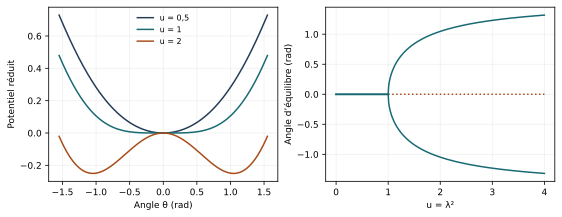
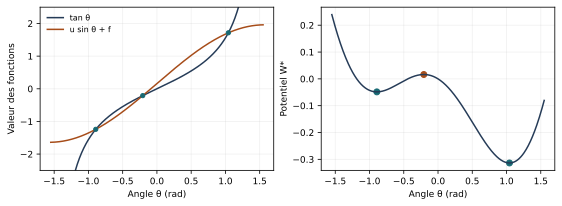
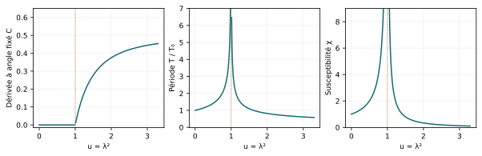
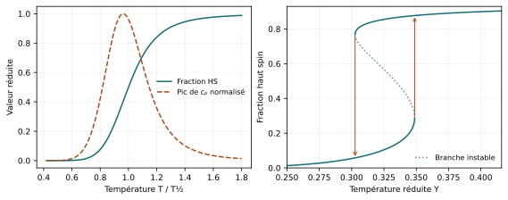
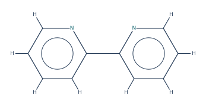
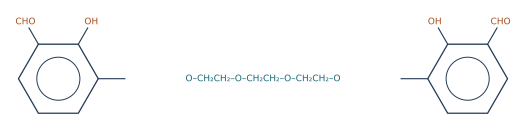
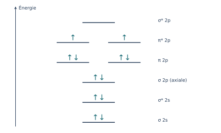
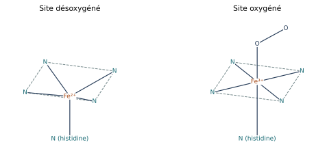

# ENS de Lyon PC 2011 — Physique-chimie (L) · Corrigé guidé

*Corrigé rédigé par IA, non officiel. Signalez toute erreur.*

**Lecture du rapport du jury** · GPT-6.2 Astra Ultra · vitesse non renseignée

**Rédaction** · GPT-6.2 Astra Ultra · vitesse non renseignée

## Étude du phénomène de transition de spin

## I.A · Mobile glissant dans un cerceau tournant

### Question I.A.1 — Quasi-ponctualité du mobile

**Indication.** Comparer les deux termes du théorème de König en distinguant la rotation propre de la révolution autour de $A$.

À $\Omega=0$, le centre a la vitesse $a|\dot\theta|$. Pour une sphère de moment propre $2mb^2/5$ et de vitesse angulaire propre $\omega_s$, le rapport des énergies vaut $(2/5)[b\omega_s/(a\dot\theta)]^2$. Il doit être très petit. Si le mobile suit l’orientation du cerceau avec $|\omega_s|\sim|\dot\theta|$, cela revient à $b\ll a$. Le glissement libre sans rotation initiale peut également rendre la rotation propre nulle. Un roulement imposé sans glissement donnerait un autre modèle.

### Question I.A.2 — Dissipation négligeable

**Indication.** Comparer le temps d’observation à celui de décroissance des oscillations.

La durée caractéristique d’amortissement doit être très supérieure à une période et à la durée sur laquelle on assimile l’amplitude à une constante. La perte d’énergie par oscillation est alors faible devant l’énergie stockée.

### Question I.A.3 — Vitesse de rotation libre

**Indication.** L’inertie autour de la verticale dépend de la latitude du mobile.

Sans couple extérieur autour de $Oz$, $J(\theta)\Omega$ se conserve. Or $J=I+ma^2\sin^2\theta$ varie si le mobile change de distance à l’axe. La vitesse $\Omega$ varie donc en général.

### Question I.A.4 — Imposer la vitesse angulaire

**Indication.** Identifier la grandeur à comparer à la consigne.

Un entraînement asservi mesure la vitesse, la compare à une consigne et adapte le couple moteur pour réduire l’écart, en compensant le changement d’inertie du système.

## I.B · Premier potentiel mécanique

### Question I.B.1 — Énergie dans le laboratoire

**Indication.** Les vitesses selon le méridien et selon l’azimut sont orthogonales.

Avec l’origine de pesanteur au bas du cerceau, $v_M^2=a^2\dot\theta^2+a^2\Omega^2\sin^2\theta$. Ainsi $E=ma^2\dot\theta^2/2+J(\theta)\Omega^2/2+mga(1-\cos\theta)$. La hauteur du centre de masse du cerceau est constante.

### Question I.B.2 — Réaction du guidage

**Indication.** Le glissement relatif est selon la tangente méridienne $\mathbf u_\theta$.

Une liaison parfaite n’exerce aucune force le long de ce glissement. Sa réaction est dans le plan des directions $\mathbf u_r$ et $\mathbf u_\varphi$. Sa composante azimutale peut transmettre un moment autour de l’axe vertical.

### Question I.B.3 — Bilans de puissance et de moment

**Indication.** Prendre comme système l’ensemble cerceau et mobile, dans le référentiel galiléen du laboratoire.

a) La pesanteur est déjà prise en compte dans $E$. Le pivot idéal ne travaille pas et les réactions intérieures ont une puissance mutuelle nulle puisque la vitesse relative est tangentielle. Le couple moteur fournit $\dot E=\mathcal C\Omega$. b) La pesanteur et la liaison idéale n’ont aucun moment axial résultant autour de $Oz$. Le théorème du moment cinétique donne $d(J\Omega)/dt=\mathcal C$.

### Question I.B.4 — Intégrale du mouvement

**Indication.** Dans le bilan de puissance, remplacer le couple grâce au bilan de moment, avec $\Omega$ imposée.

$\dot E=\Omega\,d(J\Omega)/dt=\Omega^2\dot J$. Il en résulte $d(E-J\Omega^2)/dt=0$. Le moteur peut échanger de l’énergie avec le système même lorsque cette combinaison $\Phi^0$ se conserve.

### Question I.B.5 — Décomposition en termes cinétique et potentiel

**Indication.** Retrancher $J\Omega^2$ à l’énergie totale.

Le terme qui contient $\dot\theta$ vaut $E_c=ma^2\dot\theta^2/2$. Le reste vaut $U=mga(1-\cos\theta)-J(\theta)\Omega^2/2$, à une constante indépendante de $\theta$ près.

### Question I.B.6 — Origine du potentiel

**Indication.** Choisir une valeur nulle au point le plus bas.

En ajoutant $I\Omega^2/2$, constant, le potentiel devient $U(\theta)=mga(1-\cos\theta)-ma^2\Omega^2\sin^2\theta/2$, avec $U(0)=0$.

### Question I.B.7 — Forme réduite

**Indication.** Utiliser $ma^2/(mga)=1/\omega_0^2$.

a) Pour $\omega_0=\sqrt{g/a}$ et $\lambda=\Omega/\omega_0$, $\Phi^*=\dot\theta^2/(2\omega_0^2)+1-\cos\theta-(\lambda^2/2)\sin^2\theta$. b) Une énergie réduite et un temps mesuré en $1/\omega_0$ ramènent toute la famille de cerceaux à un seul paramètre $u=\lambda^2$, ce qui facilite la comparaison des équilibres.

## I.C · Bifurcation de l’équilibre

### Question I.C.1 — Points fixes et stabilité

**Indication.** Factoriser la dérivée du potentiel et contrôler sa courbure sur chaque branche.

Avec $u=\lambda^2$, $U^{*\prime}=\sin\theta(1-u\cos\theta)$. La solution $\theta=0$ a pour courbure $1-u$. Elle est stable pour $u<1$, instable pour $u>1$. Pour $u>1$, deux solutions $\theta_\pm=\pm\arccos(1/u)$ ont une courbure $u-1/u>0$ et sont stables. À $u=1$, $U^*=(1-\cos\theta)^2/2\simeq\theta^4/8$ a encore un minimum plat. La bifurcation apparaît à $\lambda_c=1$.

### Question I.C.2 — Profils du potentiel

**Indication.** Calculer le potentiel avec $\cos\theta=1/u$ sur les branches latérales.

Le centre vaut $U^*(0)=0$. Le profil est un puits simple pour $u<1$, quartique au seuil, puis un double puits symétrique à maximum central pour $u>1$. Les deux minima ont $U^*(\theta_\pm)=1-(u+1/u)/2=-(u-1)^2/(2u)$.

### Question I.C.3 — Branches stables

**Indication.** Reporter seulement les minima du potentiel en fonction du paramètre de contrôle.

La branche $\theta=0$ se prolonge jusqu’à $u=1$, puis les branches $\pm\arccos(1/u)$ s’écartent continûment et tendent vers $\pm\pi/2$. L’état stable choisit un côté malgré la symétrie du dispositif. Il s’agit d’une bifurcation en fourche supercritique.

### Question I.C.4 — Ouverture de la fourche

**Indication.** Développer à la fois $1/u$ et $\cos\theta$ près de un.

Pour $u=1+\delta$, $1/u=1-\delta+O(\delta^2)$ et $\cos\theta=1-\theta^2/2+O(\theta^4)$. Ainsi $\theta_\pm\sim\pm\sqrt{2(u-1)}$ du côté $u>1$.

### Question I.C.5 — Réponse énergétique

**Indication.** Lire le sous-indice sur la dérivée et distinguer une variation à angle fixé d’un parcours sur la branche d’équilibre.

À $\dot\theta=0$, $E_1/(mga)=1-\cos\theta+(u/2)\sin^2\theta$. La dérivée partielle écrite à angle fixé, évaluée ensuite en $\theta_{eq}$, vaut $C=\sin^2\theta_{eq}/2$, donc zéro jusqu’à $u=1$, puis $(1-u^{-2})/2$. Elle croît continûment jusqu’à $1/2$ avec une rupture de pente au seuil. Si l’on mesure la dérivée de l’énergie après rééquilibration pour chaque $u$, la fonction dérivée est $E_{1,eq}/(mga)=1+u/2-3/(2u)$ pour $u>1$. Cette réponse totale vaut $1/2+3/(2u^2)$ et présente un saut de $0$ à $2$. Les deux prescriptions diffèrent parce que $E_1$ n’est pas le potentiel minimisé.

## I.D · Période des petites oscillations

### Question I.D.1 — Oscillations sous le seuil

**Indication.** Le coefficient du terme quadratique est la courbure en zéro divisée par deux.

a) Pour $u<1$, $\Phi^*=\dot\varepsilon^2/(2\omega_0^2)+(1-u)\varepsilon^2/2+O(\varepsilon^4)$. b) La conservation de l’énergie donne $\ddot\varepsilon+\omega_0^2(1-u)\varepsilon=0$. Donc $T/T_0=(1-u)^{-1/2}\sim[2(1-\lambda)]^{-1/2}$ à l’approche de $\lambda_c$ par en dessous.

### Question I.D.2 — Oscillations au-dessus du seuil

**Indication.** Recentrer le développement sur l’un des deux minima non nuls.

a) Au voisinage de $\theta_\pm$, $\Phi^*=U^*(\theta_\pm)+\dot\varepsilon^2/(2\omega_0^2)+(u-1/u)\varepsilon^2/2+O(\varepsilon^3)$. b) On trouve $T/T_0=(u-1/u)^{-1/2}\sim[2(u-1)]^{-1/2}\sim[4(\lambda-1)]^{-1/2}$.

### Question I.D.3 — Ralentissement critique

**Indication.** Comparer les limites des deux périodes au point de bifurcation.

La période part de $T_0$ pour $u=0$, diverge à gauche et à droite de $u=1$, puis décroît comme $T_0/\sqrt u$. La courbure du puits s’annule au seuil. L’oscillateur exactement au seuil est anharmonique et sa période dépend de l’amplitude.

## I.E · Force horizontale et susceptibilité

### Question I.E.a.1 — Potentiel avec force imposée

**Indication.** Projeter la vitesse du mobile sur $\mathbf x_1$ et vérifier le moment axial de la force.

$\mathbf F=F\mathbf x_1$ fournit la puissance $Fa\cos\theta\dot\theta=d(Fa\sin\theta)/dt$, sans moment autour de $Oz$. Les deux bilans de I.B donnent donc $\Psi^0=E-J\Omega^2-Fa\sin\theta=E_c+W$ avec $W=U-Fa\sin\theta$ à une constante près.

### Question I.E.a.2 — Force réduite

**Indication.** Diviser chaque énergie par $mga$.

En notant $f=F/(mg)$, $\Psi^*=\dot\theta^2/(2\omega_0^2)+1-\cos\theta-(u/2)\sin^2\theta-f\sin\theta$. Le terme impair en $\theta$ brise la symétrie des deux puits.

### Question I.E.b.1 — Équation d’équilibre

**Indication.** Annuler $dW/d\theta$ à vitesse relative nulle.

Les positions vérifient $\sin\theta(1-u\cos\theta)-f\cos\theta=0$. Les extrémités $\pm\pi/2$ ne sont pas solutions puisque la dérivée y vaut $\pm1$.

### Question I.E.b.2 — Forme graphique

**Indication.** Diviser par $\cos\theta$ dans l’intervalle ouvert des équilibres.

On obtient $\tan\theta=g(\theta)$ avec $g(\theta)=u\sin\theta+f$. Le nombre de solutions est le nombre de croisements de ces deux graphes.

### Question I.E.b.3 — Équilibres à force positive

**Indication.** Aux trois zéros, suivre le signe de $W^{*\prime}$ de gauche à droite.

Pour $u>1$ et un petit $f>0$, il y a trois intersections $\theta_1<\theta_2<0<\theta_3$. Les deux zéros extrêmes sont des minima, le zéro central un maximum. Le terme $-f\sin\theta$ rend le puits positif plus profond. À gauche subsiste un équilibre local métastable séparé du minimum absolu par une barrière.

### Question I.E.c.1 — Réponse différentielle

**Indication.** Exprimer $f$ en fonction de l’angle d’équilibre $\alpha$ puis inverser la dérivée.

L’équation $f=\tan\alpha-u\sin\alpha$ donne $K=(\partial\alpha/\partial f)_u=1/[\sec^2\alpha-u\cos\alpha]$, tant que le dénominateur est non nul.

### Question I.E.c.2 — Sens de la susceptibilité

**Indication.** Étudier une faible variation de force autour de la valeur nulle.

Sur une branche donnée, $\delta\alpha\simeq\chi\,\delta f$ donne la réponse angulaire linéaire à une petite force horizontale. Une grande susceptibilité traduit une faible raideur de rappel.

### Question I.E.c.3 — Valeur sur les branches stables

**Indication.** Remplacer d’abord $\alpha$ par zéro, puis $\cos\alpha$ par $1/u$ selon la branche.

On obtient $\chi=1/(1-u)$ pour $u<1$ et $\chi=1/(u^2-1)$ pour $u>1$. À $u=1$, $f=\tan\alpha-\sin\alpha\simeq\alpha^3/2$, donc la réponse linéaire est singulière.

### Question I.E.c.4 — Profil de la susceptibilité

**Indication.** Comparer les différences $1-u$ et $u^2-1$ tout près de un.

$\chi$ part de un à $u=0$, monte vers l’infini par la gauche et décroît depuis l’infini par la droite, comme $1/[2(u-1)]$ juste après le seuil et $u^{-2}$ à grande vitesse. La divergence traduit la disparition de la raideur harmonique à la bifurcation.

## II.A–B · États de spin et potentiel thermodynamique

### Question II.A.1 — Écart énergétique des deux configurations

**Indication.** Compter le nombre de promotions et le nombre de paires par rapport à la référence bas spin.

Pour six électrons, le bas spin (BS) a $t_{2g}^6$ et trois paires. Le haut spin (HS) a $t_{2g}^4e_g^2$ et une paire. Donc $E_{HS}-E_{BS}=2\Delta-2D$. Le bas spin est le plus bas si le coût de promotion $\Delta$ dépasse l’économie d’appariement $D$.

### Question II.A.2 — Accessibilité thermique

**Indication.** Comparer le coût d’énergie à l’échelle d’agitation et tenir compte de la multiplicité.

Pour que des états HS se peuplent appréciablement, leur surcoût doit pouvoir être compensé par l’agitation et la multiplicité des états. Un critère d’ordre de grandeur est $\Delta E$ comparable à quelques $k_BT$, ou, thermodynamiquement, $T\Delta S$ comparable à $\Delta H$.

### Question II.A.3 — Remplissages concernés

**Indication.** Remplir les trois cases basses puis comparer appariement et promotion.

La compétition change le nombre d’électrons célibataires pour les configurations $d^4$, $d^5$, $d^6$ et $d^7$. Pour $d^1$ à $d^3$, les trois orbitales basses suffisent à les séparer. Pour $d^8$ à $d^{10}$, le remplissage octaédrique fondamental ne fournit plus deux possibilités concurrentes haut et bas spin dans ce modèle.

### Question II.A.4 — Moment magnétique moyen

**Indication.** Additionner les composantes des spins représentés, puis pondérer par les fractions d’espèces.

Les contributions des électrons appariés se compensent. Un BS donne zéro, un HS a quatre contributions non compensées $+m$ selon le schéma. La projection moyenne par composé, avec les orientations du sujet, vaut $\langle m_z\rangle=4mx$.

### Question II.A.5 — Mesure de population

**Indication.** Utiliser une grandeur qui distingue expérimentalement le bas spin et le haut spin.

Une mesure d’aimantation à champ connu, ou de susceptibilité magnétique calibrée pour les phases pures, donne la contribution relative des centres paramagnétiques haut spin et donc $x$. La réponse thermique des orientations doit être incluse dans la calibration.

### Question II.A.6 — Potentiel d’équilibre avec réservoir

**Indication.** Combiner premier principe et croissance de l’entropie totale avec les paramètres imposés $T_0,P_0$.

Le potentiel adapté est $\Phi^0=U+P_0V-T_0S$. Pour un réservoir imposant $T_0,P_0$ avec le seul travail de pression, $d\Phi^0=-T_0dS_{\rm univers}\le0$. À l’équilibre thermique et mécanique il coïncide avec $G$ et se minimise par rapport à la composition.

### Question II.B.1 — Dénombrement et entropie de mélange

**Indication.** Choisir les sites HS puis appliquer Stirling aux trois factorielles.

a) $W=\binom{N}{N_2}=N!/(N_1!N_2!)$. b) Avec $N_2=Nx$, $N_1=N(1-x)$, $S_m=k_B\ln W\simeq-Nk_B[x\ln x+(1-x)\ln(1-x)]$. Cette contribution est positive et s’annule aux deux limites pures.

### Question II.B.2 — Entropie totale

**Indication.** Distinguer les multiplicités internes des espèces et le choix des sites.

Les multiplicités se multiplient et leurs logarithmes s’ajoutent, d’où $S(x)=N[(1-x)s_1+xs_2]+S_m(x)$.

### Question II.B.3 — Additivité de l’énergie

**Indication.** Examiner le coût éventuel du remplacement d’une paire de voisins de même type par une paire mixte.

Une énergie affine $U=(1-x)U_1+xU_2$ convient si les interactions entre espèces sont négligeables, ou si leur contribution est déjà affine en $x$ et n’ajoute aucune énergie d’excès de mélange.

## II.C · Transition de spin sans interaction d’excès

### Question II.C.1 — Enthalpie libre par composé

**Indication.** Insérer enthalpie additive et entropie de mélange dans $G=H-TS$.

À pression fixée, pour des volumes additifs, $g=(1-x)h_1+xh_2-T[(1-x)s_1+xs_2]+k_BT[(1-x)\ln(1-x)+x\ln x]$. Les limites pures donnent respectivement $g_1$ et $g_2$.

### Question II.C.2 — Équilibre de composition

**Indication.** Une interconversion HS–BS conserve le nombre total de sites.

À $P,T$ fixés, $g'(x)=h-Ts+k_BT\ln[x/(1-x)]=0$, avec $h=h_2-h_1$ et $s=s_2-s_1$. Les états majoritaires résultent de la compétition entre coût enthalpique et gain entropique.

### Question II.C.3 — Stabilité de la solution

**Indication.** Étudier le signe de la seconde dérivée sur tout l’intervalle physique.

$g''(x)=k_BT[1/x+1/(1-x)]=k_BT/[x(1-x)]>0$ pour $0<x<1$ et $T>0$. Comme la pente passe de moins à plus l’infini aux bords, l’équilibre est unique et globalement stable.

### Question II.C.4 — Fraction haut spin

**Indication.** Isoler le rapport $x/(1-x)$ et expliciter les deux températures caractéristiques.

Posons $T_h=h/k_B$ et $T_{1/2}=h/s$. L’équilibre impose $x/(1-x)=\exp[-h/(k_BT)+s/k_B]$, d’où $x=1/(1+e^\varphi)$ avec $\varphi=T_h(1/T-1/T_{1/2})$.

### Question II.C.5 — Température médiane

**Indication.** Évaluer la fraction quand l’exposant s’annule.

À $T_{1/2}$, $x=1/2$ et les états BS et HS sont équiprobables. Les contributions pures satisfont alors $h-T_{1/2}s=0$.

### Question II.C.6 — Évolution de la fraction

**Indication.** Repérer zéro, demi-population et asymptote à très haute température.

$x$ croît de zéro à $x_\infty=[1+e^{-s/k_B}]^{-1}$. Pour $s/k_B\ge10$ cette dernière valeur est au moins $0{,}99995$. Le passage rapide près de $T_{1/2}$ a une allure sigmoïde et sa pente locale vaut $T_h/(4T_{1/2}^2)$.

### Question II.C.7 — Largeur de transition

**Indication.** Préciser la convention de largeur avant de donner un coefficient numérique.

Une variation d’exposant d’ordre un demande une largeur caractéristique $T_{1/2}^2/T_h$. Si l’on définit la largeur par l’extrapolation de la tangente médiane entre $x=0$ et $x=1$, on obtient $\Delta T\simeq4T_{1/2}^2/T_h$. Les seuils $10$ et $90\,\%$ donnent plutôt $2\ln9\,T_{1/2}^2/T_h$ lorsque la transition est étroite. La dépendance en température est la même.

### Question II.C.8 — Échelles énergétiques expérimentales

**Indication.** Tester après le calcul l’hypothèse de transition étroite utilisée pour estimer la largeur.

a) À $300\ \mathrm K>150\ \mathrm K$ le haut spin est majoritaire. b) Avec la largeur de tangente de II.C.7, $T_h\simeq4(150)^2/200=450\ \mathrm K$, $h\simeq0{,}039\ \mathrm{eV}$ et $s/k_B\simeq3$. Ce sont des ordres de grandeur car la transition est large. c) $13{,}6\ \mathrm{eV}$ pour ioniser H est environ 350 fois plus grand. d) À haute température $s/k_B=\ln[x_\infty/(1-x_\infty)]$ donne $1{,}39\le s/k_B\le2{,}20$ pour $0{,}80\le x_\infty\le0{,}90$. Cette estimation directe confirme un gain entropique de quelques $k_B$ et invalide l’hypothèse $s/k_B\ge10$ pour ces données.

### Question II.C.9 — Capacité calorifique à pression constante

**Indication.** Différencier l’enthalpie par composé en faisant varier la population d’équilibre.

a) $c_P=(1-x)c_{P1}+xc_{P2}+h\,dx/dT$. Comme $dx/dT=(T_h/T^2)e^\varphi/(1+e^\varphi)^2$, le terme de conversion est $k_B(T_h/T)^2 e^\varphi/(1+e^\varphi)^2$. b) Il fournit un pic positif étroit près de la transition. À basse température le fond tend vers $c_{P1}$ et après une transition presque complète il s’approche de $c_{P2}>c_{P1}$. La différence de fonds est retenue ici comme correction locale lorsque $h$ est traité quasi constant sur la transition.

### Question II.C.10 — Pression appliquée

**Indication.** Utiliser $h=\Delta u+P\Delta v$ pour une conversion élémentaire.

a) Avec $v=v_2-v_1>0$, $h=2(\Delta-D)+Pv$ dans le modèle donné. b) Si $s$ varie peu, $dT_{1/2}/dP=v/s>0$. À température fixée, la pression favorise le BS dont le volume est plus petit, conformément au principe de modération.

## II.D · Coopérativité entre voisins

### Question II.D.1 — Comptage des interactions sur le réseau

**Indication.** Pour six voisins, compter trois liaisons par site, puis comparer l’énergie de la solution aux deux solides purs.

a) Dans le modèle de sites indépendants, $U_J=3N[J_{11}(1-x)^2+2J_{12}x(1-x)+J_{22}x^2]$. b) Les valeurs pures sont $3NJ_{11}$ et $3NJ_{22}$. Retrancher leur interpolation donne $N\gamma=NJx(1-x)$ avec $J=3(2J_{12}-J_{11}-J_{22})$. c) Les interactions dépendent notamment de la distance aux voisins, donc de la densité et de la structure du matériau. Elles sont faibles entre molécules dissoutes très diluées et peuvent être importantes pour les sites contigus d’un solide.

### Question II.D.2 — Enthalpie libre non idéale

**Indication.** Ajouter au modèle précédent l’énergie d’excès par site.

$g=(1-x)g_1+xg_2+k_BT[(1-x)\ln(1-x)+x\ln x]+Jx(1-x)$. Pour $J>0$, les voisinages mixtes coûtent plus cher que l’interpolation entre phases pures.

### Question II.D.3 — Relation entre composition et température

**Indication.** Dériver le nouveau terme, puis regrouper le terme d’entropie propre dans le logarithme.

$0=h-Ts+k_BT\ln[x/(1-x)]+J(1-2x)$. Avec $A=e^{s/k_B}$, $Y=k_BT/h$ et $\varepsilon=2J/h$, il vient $Y\ln[x/(A(1-x))]=\varepsilon x-(1+\varepsilon/2)$.

### Question II.D.4 — Stabilité locale

**Indication.** Examiner la courbure du potentiel au point stationnaire considéré.

Un minimum local strict exige $g''=k_BT/[x(1-x)]-2J>0$. Sous forme réduite, $Y>\varepsilon x(1-x)$. Une courbure négative signale une composition instable. L’égalité marque une limite de stabilité à examiner aux ordres supérieurs.

### Question II.D.5 — Boucle d’hystérésis

**Indication.** Suivre un minimum local jusqu’à sa disparition et distinguer ce suivi du minimum global à l’équilibre parfait.

a) Au chauffage, on suit la branche pauvre en HS jusqu’à $Y\simeq0{,}35$, puis on saute vers la branche riche. Au refroidissement le saut inverse se produit vers $0{,}30$. b) Une barrière de potentiel permet la persistance d’un minimum métastable. c) Sous $0{,}30$, $g(x)$ n’a qu’un minimum à faible $x$. Entre environ $0{,}31$ et $0{,}34$ il a deux minima séparés par un maximum. Au-dessus de $0{,}35$ le minimum est à grand $x$. Les profondeurs des puits s’échangent près de $Y=1/\ln20\simeq0{,}334$. d) Entre les deux limites, approximativement $0{,}30<Y<0{,}35$, deux compositions sont localement stables. La persistance de l’état préparé permet d’envisager un bit de mémoire à température fixée.

### Question II.D.6 — Couplage critique

**Indication.** Tester la courbure au centre là où les phases ont même énergie libre.

À $x=1/2$, la dérivée s’annule pour $T=h/s$ quelle que soit $J$. La courbure vaut alors $4k_Bh/s-2J$. Elle devient négative pour $\varepsilon=2J/h>4k_B/s=4/\ln A$. La symétrie du potentiel à cette température produit alors deux minima. Pour $A=20$ le seuil est $\varepsilon_c\simeq1{,}34$, ce qui explique la bistabilité trouvée pour $1{,}7$.

## III.A · Bipyridine

### Question III.A.1 — Hydrogènes du ligand

**Indication.** Repérer sur chaque cycle la position substituée et l’azote pyridinique.

La 2,2′-bipyridine est formée de deux cycles de pyridine joints par C2–C2′. Chacun porte un H en C3, C4, C5 et C6. Ni l’azote ni le carbone C2 de liaison entre les cycles ne portent d’hydrogène. La formule est $\mathrm{C_{10}H_8N_2}$.

### Question III.A.2 — Effet chélate

**Indication.** Examiner combien de liaisons métal–azote une molécule peut former.

La conformation apte à la coordination présente deux doublets pyridiniques au même métal et ferme un cycle de chélation à cinq chaînons. Une molécule bidentate peut remplacer deux ligands monodentates comme la pyridine et stabiliser thermodynamiquement le complexe par effet chélate.

## III.B · Constitution et identification du ligand macrocyclique

### Question III.B.1.a — Groupes partants sur le pont polyéther

**Indication.** Examinez quel atome de l’alcool est conservé dans un ester sulfonique.

Notons $P=\mathrm{CH_2CH_2OCH_2CH_2OCH_2CH_2}$ le squelette divalent et $\mathrm{Ts}=p$-tolylsulfonyle. 1. Le produit 3 est $\mathrm{TsO{-}P{-}OTs}$. Chaque oxygène terminal de l’alcool donne son doublet au soufre électrophile du sulfonyle, avec départ de chlorure et perte du proton de l’oxygène. 2. La triéthylamine accepte le proton et forme un sel d’ammonium. 3. Le groupe hydroxyle aurait un mauvais caractère partant. Le tosylate libéré ultérieurement est stabilisé par délocalisation sur le sulfonate.

### Question III.B.1.b — Réactivité du dihydroxybenzaldéhyde

**Indication.** Comparer l’aromaticité des tautomères et dessiner les formes mésomères des bases conjuguées.

1. Le composé 4 est le 2,3-dihydroxybenzaldéhyde, le carbone portant le formyle étant C1. 2. Un tautomère cétonique formel remplace C2–OH par C2=O et transfère le H sur un carbone ortho ou para, par exemple C1 qui devient tétraédrique. 3. Le cycle perd son sextet aromatique, d’où la faible population de cette forme. 4. L’acétylacétone possède l’énol conjugué $\mathrm{CH_3C(OH){=}CHC(O)CH_3}$, favorisé en solvant peu polaire par conjugaison et liaison H interne. 5. Le phénolate délocalise sa charge dans le cycle, contrairement au cyclohexanolate, d’où un acide plus fort. 6. Le OH en C2, ortho du formyle, peut en outre délocaliser la charge de sa base conjuguée jusque sur l’oxygène du carbonyle. L’autre OH, méta, ne bénéficie pas de cette stabilisation mésomère.

### Question III.B.1.c — Écriture acide–base de l’intermédiaire

**Indication.** Comparer les sites susceptibles de perdre un proton et vérifier le bilan de charge.

Le composé 5 est le monoanion du phénol en C2, sous forme de sel sodique, C3 conservant OH. Le bilan formel du transfert correspond à $\mathrm{ArOH+H^-\to ArO^-+H_2}$. Dans l’interprétation demandée aux points 2 à 4, l’anion intermédiaire A est le carbanion adjacent au sulfoxyde, $\mathrm{CH_3S(O)CH_2^-}$. Son doublet peut fixer le proton phénolique. Le doublet de la liaison O–H reste sur O, ce qui régénère le sulfoxyde neutre et donne 5.

### Question III.B.1.d — Éther allylique

**Indication.** Repérer le carbone primaire allylique qui porte le groupe partant.

Dans le schéma, l’oxygène en C2 de 5 remplace le bromure au carbone $\mathrm{CH_2}$ de l’allyle par substitution nucléophile bimoléculaire. Le composé 6 est le 2-(prop-2-én-1-yloxy)-3-hydroxybenzaldéhyde. L’aldéhyde et le OH en C3 sont conservés.

### Question III.B.1.e — Connectivité du composé 7

**Indication.** Le dérivé 3 porte deux extrémités équivalentes, et 6 un seul phénol libre.

Deux oxygènes en C3 de deux unités 6 se lient aux deux carbones terminaux du pont $P$. Le bilan formel avec le carbonate est $3+2\,(6)+\mathrm{K_2CO_3}\to7+2\,\mathrm{KOTs}+\mathrm{CO_2}+\mathrm{H_2O}$. Les deux groupes O–allyle en C2 et les deux aldéhydes restent présents.

### Question III.B.1.f — Deux aldéhydes, deux phénols

**Indication.** Comparer le nombre de protons phénoliques visibles en RMN avant et après suppression des protecteurs.

Le composé 8 est $\mathrm{Ar{-}O{-}P{-}O{-}Ar}$ avec les attaches en C3, chaque noyau portant CHO en C1 et OH en C2. Le palladium supporté catalyse la déprotection des éthers allyliques de 7. L’identification de 8 confirme la conservation des deux formyles.

### Question III.B.1.g — Attribution du spectre RMN

**Indication.** Commencer par les signaux échangeables et exploiter la symétrie des deux moitiés.

1. Le singulet à $10{,}81$ ppm (2 H) est celui des deux OH phénoliques associés au carbonyle par liaison H. L’échange avec D supprime leur signal protonique. 2. À $9{,}94$ ppm se trouvent les deux CHO (singulet), de $7{,}3$ à $6{,}8$ les six H aromatiques. Les triplets de 4 H à $4{,}2$ et $3{,}9$ ppm correspondent aux deux paires symétriques de groupes $\mathrm{ArOCH_2}$ puis $\mathrm{ArOCH_2CH_2O}$. Chaque groupe couple avec les deux protons voisins. Les deux $\mathrm{CH_2}$ centraux, équivalents, donnent le signal à $3{,}77$ ppm (4 H).

### Question III.B.1.h — Bandes infrarouges

**Indication.** Une conjugaison et une liaison hydrogène peuvent toutes deux diminuer la raideur effective d’une liaison carbonyle.

1. La bande voisine de $3300\ \mathrm{cm^{-1}}$ est un étirement OH, celle à $1650\ \mathrm{cm^{-1}}$ un étirement C=O. 2. Le formyle conjugué au noyau aromatique et accepteur de la liaison H de l’ortho-phénol présente une liaison C=O affaiblie. Sa fréquence est abaissée par rapport à un aldéhyde aliphatique non associé.

### Question III.B.1.i — Régiosélectivité des pontages

**Indication.** Dessiner les trois manières non équivalentes de relier deux noyaux possédant les sites 2 et 3.

1. Le pontage direct résulte de deux substitutions aux extrémités du pont par des oxygènes phénolates. La liaison 3–3′ donne 8. 2. Les autres connectivités sont 2–3′ et 2–2′, avec les OH résiduels aux sites complémentaires et les CHO conservés. 3. La protection de O2 et la déprotection ultérieure imposent la connectivité 3–3′. 4. En synthèse directe, O2 est proche du formyle, plus encombré et son anion est stabilisé par conjugaison et coordination éventuelle avec le carbonyle. L’oxygène en C3 est généralement plus disponible et nucléophile. Cette différence cinétique explique qu’il puisse dominer malgré l’acidité supérieure de OH en C2.

### Question III.B.1.j — Fermeture du macrocycle et effet de gabarit

**Indication.** Relier une extrémité aminée à chacun des aldéhydes et comparer cette fermeture à la propagation intermoléculaire.

1. Au bilan, le dialdéhyde 8 et l’éthylènediamine forment deux imines et deux eaux. En présence du cation gabarit, 9 est ce macrocycle complexé au baryum, les contre-ions assurant l’électroneutralité. 2. Pour chaque liaison, addition nucléophile réversible de N au carbonyle, transferts de proton vers une carbinolamine, protonation de OH, déshydratation en iminium et déprotonation conduisent à $\mathrm{ArCH{=}N}$. La seconde condensation ferme le cycle. 3. Sans préorganisation se forment des oligomères, des polymères à imines et éventuellement des cycles de plus grande taille. 4i. Les oxygènes du polyéther, des phénols et des carbonyles portent des doublets donneurs. 4ii. $\mathrm{Ba^{2+}}$ attire et coordonne plusieurs oxygènes, replie la chaîne et rapproche les fonctions réactives. C’est l’effet de gabarit, ou effet template.

### Question III.B.1.k — Précipité du décomplexage

**Indication.** Identifier le couple anion–cation qui forme un sel très peu soluble.

Le sulfate capte $\mathrm{Ba^{2+}}$ en $\mathrm{BaSO_4(s)}$, précipité blanc. Le retrait du cation gabarit libère le ligand macrocyclique 2.

### Question III.B.2 — Sphère de coordination du complexe 1

**Indication.** Dénombrer les atomes donneurs sur la figure 6 et écrire le bilan des charges de l’ion complexe.

a) Deux azotes d’imines et deux oxygènes phénolates forment le plan donneur du macrocycle. Deux azotes de pyridines occupent les sites axiaux, soit un octaèdre déformé. b) Le ligand porte $-2$, les pyridines sont neutres et le complexe porte $+1$, contrebalancé par un perchlorate. Le fer est donc Fe(III). c) Deux pyridines sont ligands axiaux et deux autres peuvent accepter les deux protons phénoliques. d) La coordination de N modifie la distribution électronique de la liaison C=N et en abaisse la constante de force effective, d’où le déplacement de $1625$ à $1605\ \mathrm{cm^{-1}}$. e) Les éthers-couronnes et cryptands captent sélectivement des cations selon la taille de la cavité. Les travaux de Pedersen, Cram et Lehn sur la reconnaissance moléculaire ont reçu le prix Nobel de chimie en 1987.

## III.C · Complexe de fer à deux bipyridines

### Question III.C.1 — Fer et solubilité

**Indication.** Dénombrer les charges des ligands avant de discuter solvatation et oxydation.

a) Les deux bipy sont neutres et les deux $\mathrm{NCS^-}$ portent au total $-2$. Le fer du complexe neutre est Fe(II). b) La substitution produit une espèce moléculaire neutre ayant une surface aromatique importante. Si l’énergie de réseau du cristal l’emporte sur sa solvatation dans le méthanol, le complexe précipite, comme observé. c) Fe(II) est susceptible d’être oxydé en Fe(III) par le dioxygène. La chélation et le réseau solide peuvent stabiliser sa forme Fe(II). La durée de stabilité à l’air dépend du potentiel du couple complexé, du milieu et de la cinétique.

### Question III.C.2 — Thiocyanate et stéréoisomères

**Indication.** Représenter les six positions octaédriques et joindre les deux extrémités voisines de chaque bipyridine.

a) Le thiocyanate a 16 électrons de valence et les contributeurs $\mathrm{^-S{-}C{\equiv}N\leftrightarrow S{=}C{=}N^-}$. b) Il y a deux directions de liaison autour de C, sans doublet libre, d’où S–C–N linéaire. c) La fixation du doublet terminal N préserve la géométrie interne quasi linéaire de N–C–S. d) En IR, l’élongation CN dans la région de $2100\ \mathrm{cm^{-1}}$ et la bande CS donnent des indices sur le mode de coordination. e) Le fer a six donneurs N, en octaèdre déformé. f) Dans le trans, NCS occupe $+z,-z$, les bipy joignant $(+x,+y)$ et $(-x,-y)$. Dans le cis, placer NCS en $+z,+x$. Les appariements bipy $(-z,+y),(-x,-y)$ et $(-z,-y),(-x,+y)$ sont les deux images chirales $\Delta,\Lambda$. g) Les formes cis et trans ont des énergies de réseau et de solvatation différentes. Un solide peut précipiter sélectivement dès que sa solubilité est dépassée. Dans un milieu achiral les deux énantiomères du cis ont la même solubilité intrinsèque. La seule précipitation ne détermine pas la configuration absolue.

### Question III.C.3 — Configuration électronique du centre

**Indication.** En ionisant le fer, retirer les électrons 4s avant les 3d.

a) Le fer neutre, $Z=26$, est $[\mathrm{Ar}]3d^64s^2$ et Fe(II) est $[\mathrm{Ar}]3d^6$. b) L’ion a donc six électrons dans les orbitales d. c) Dans le modèle octaédrique, $t_{2g}^6 e_g^0$ (trois paires) est favorisé pour $\Delta>D$, $t_{2g}^4 e_g^2$ (une paire) pour $\Delta<D$, puisque la différence d’énergie est $2(\Delta-D)$. À l’égalité le modèle simplifié donne aussi un remplissage intermédiaire dégénéré avec ces deux configurations. d) Les spins sont respectivement $S=0$ et $S=2$ (quatre électrons non appariés).

## III.D · Hème et dioxygène

### Question III.D.1 — Aromaticité et coordination de la porphyrine

**Indication.** Suivre un circuit de conjugaison continu à travers les quatre unités pyrroliques.

a) La porphyrine plane porte un circuit aromatique de 18 électrons $\pi$, qui vérifie $4n+2$ avec $n=4$. b) La vaste conjugaison abaisse les écarts électroniques et engendre des absorptions intenses, dont des bandes dans le visible. c) La perte de deux protons N–H donne un ligand dianionique tétradentate aux quatre donneurs azotés équatoriaux. d) Le macrocycle préorganisé maintient les quatre liaisons autour du même métal. La perte d’une liaison n’éloigne pas le ligand et le coût entropique de réunion de quatre particules indépendantes est épargné. Cela explique l’effet macrocyclique.

### Question III.D.2 — Dioxygène libre

**Indication.** Remplir les deux orbitales antiliantes dégénérées selon la règle de Hund.

a) La formule de Lewis classique $\mathrm{O{=}O}$ donne deux doublets libres sur chaque O. b) Les électrons de cœur sont ceux des couches internes pleines (1s ici). Les électrons de valence de O sont les 2s et 2p, six par atome. c) Les OM de cœur $\sigma_{1s}^2\sigma_{1s}^{*2}$ se compensent. La configuration de valence est $\sigma_{2s}^2\sigma_{2s}^{*2}\sigma_{2p_z}^2(\pi_{2p_x},\pi_{2p_y})^4(\pi_{2p_x}^*,\pi_{2p_y}^*)^2$, avec un électron de même spin dans chacune des deux dernières OM. d) Huit électrons liants et quatre antiliants donnent $(8-4)/2=2$. Avec deux électrons célibataires, $S=1$, état triplet paramagnétique.

### Question III.D.3 — Ions issus de la réduction

**Indication.** Pour le superoxyde et le peroxyde, remplir les mêmes orbitales $\pi^*$ que celles de la question précédente.

a) Le superoxyde $\mathrm{O_2^{\bullet-}}$ contient trois électrons dans les $\pi^*$ et un électron célibataire. Ses contributeurs de Lewis sont $\mathrm{^{\bullet}O{-}O^-}$ et $\mathrm{^-O{-}O^{\bullet}}$. Le peroxyde $\mathrm{O_2^{2-}}$ en contient quatre, tous appariés, avec $\mathrm{^-O{-}O^-}$, trois doublets sur chaque O. L’oxyde monoatomique $\mathrm{O^{2-}}$ a $1s^22s^22p^6$ et quatre doublets. b) Les indices O–O deviennent $1{,}5$ et $1$. c) Le superoxyde radicalaire peut transférer un électron ou se dismuter. Le peroxyde présente une liaison O–O affaiblie susceptible de se rompre et peut intervenir dans des réactions redox. L’oxyde est une base forte qui se protone en présence d’eau. Leur réactivité relative dépend donc de la réaction envisagée.

### Question III.D.4 — Sites ferreux et oxygénés

**Indication.** Suivre le transfert formel d’un électron en conservant la charge totale.

a) Dans le site désoxygéné, le fer(II) HS est lié aux quatre N équatoriaux de la porphyrine et à l’histidine axiale, avec déplacement du grand ion hors du plan. Dans le modèle de l’énoncé, l’oxygénation complète le site opposé à l’histidine par un groupement Fe–O–O coudé, ramenant le fer(III) BS vers le plan. b) Le passage Fe(II) vers Fe(III) transfère un électron au dioxygène. La formule formelle est $\mathrm{Fe^{III}{-}O_2^{\bullet-}}$ (superoxyde). Le spin du superoxyde peut se coupler antiparallèlement à celui du Fe(III) BS.

## IV · Entropie vibrationnelle

### Question IV.1 — Principe de l’absorption infrarouge

**Indication.** Préciser la condition d’énergie et la condition de variation de moment dipolaire.

Une molécule absorbe un photon IR si $h\nu$ correspond à la différence entre deux niveaux vibrationnels et si le mode modifie le moment dipolaire. En approximation harmonique, les transitions fondamentales satisfont $\Delta n=1$. L’identification des bandes renseigne sur les liaisons et leur environnement.

### Question IV.2 — Échelle des nombres d’onde

**Indication.** Distinguer la zone infrarouge courante des modes de la sphère métallique.

De nombreux étirements moléculaires sont d’ordre $10^3\ \mathrm{cm^{-1}}$, dans le moyen IR. Une respiration métal–ligands plus souple est typiquement de l’ordre de quelques $10^2\ \mathrm{cm^{-1}}$ ou moins.

### Question IV.3 — Mode harmonique et bilan de transition

**Indication.** Sommer d’abord la série géométrique, puis développer la fonction de partition à petite énergie $h\nu/(k_BT)$.

a) $p_n=e^{-\epsilon_n/(k_BT)}/Z$ avec $\sum_n p_n=1$. b) $\nu=c\widetilde\nu$. Ainsi $10^3\ \mathrm{cm^{-1}}$ donne $3\times10^{13}\ \mathrm{Hz}$ et $10^2\ \mathrm{cm^{-1}}$ donne $3\times10^{12}\ \mathrm{Hz}$. c) Avec $u=h\nu/(k_BT)$, $Z=e^{-u/2}\sum_{n\ge0}e^{-nu}=e^{-u/2}/(1-e^{-u})=[2\sinh(u/2)]^{-1}$. d) Si $u\ll1$, $Z\simeq1/u=k_BT/(h\nu)$. e) En HS les orbitales $e_g$ antiliantes sont davantage occupées. Les liaisons métal–ligands s’allongent et s’assouplissent, donc $\nu_{HS}<\nu_{BS}$ et $Z_{HS}>Z_{BS}$. f) Pour une baisse de fréquence de 10 %, la formule d’entropie admise donne $\Delta S=R\ln(\nu_{BS}/\nu_{HS})=R\ln(1/0{,}90)\simeq0{,}88\ \mathrm{J\,mol^{-1}\,K^{-1}}$, ou $0{,}83$ au premier ordre. g) Pour ce mode seul, $\Delta G=0$ à la transition donne $\Delta H=T\Delta S\simeq298\times0{,}88=2{,}6\times10^2\ \mathrm{J\,mol^{-1}}$. Une enthalpie globale réelle doit inclure les autres contributions entropiques.
