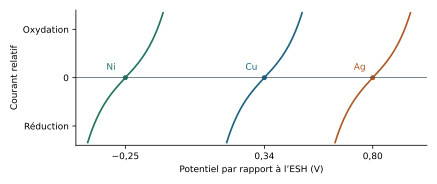
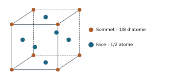
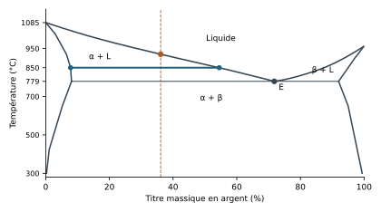
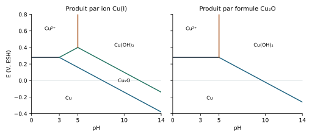
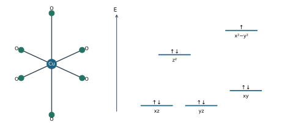
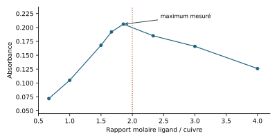
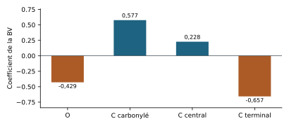

# ENS de Lyon — Second concours, Chimie 2011 · Corrigé guidé

*Corrigé rédigé par IA, non officiel.*

**Rédaction (tour 1)** · GPT-6.2 Astra Ultra · vitesse non renseignée

Les deux éditions couvrent 56 des 70 rubriques numérotées du PDF officiel. C.3.13 introduit une série de mesures et C.3.14 à C.3.16 en donnent l’exploitation. Les quatorze rubriques hors couverture concernent des étapes du convertissage, de la lixiviation et de la conduite de l’électrolyse, puis des applications des organométalliques. Elles sont indiquées à leur place. Les deux lectures possibles de la constante de l’oxyde cuivreux sont calculées et illustrées en C.3.1 à C.3.5. Aucun rapport de jury propre à cette épreuve ne figure dans les sources disponibles.

## A. Structure atomique du cuivre

### Question A.0.1 — Configuration fondamentale

> [!INDICATION]
> Compter les électrons au-delà du cœur d’argon et comparer à l’atome neutre de nickel.

#### Solution

Pour $Z=29$, le cuivre isolé a pour configuration fondamentale **$[\mathrm{Ar}]\,3d^{10}4s^1$**. Les sous-couches externes contiennent onze électrons. L’écriture simplifiée qui donnerait $3d^94s^2$ manque l’inversion observée pour cet atome.

### Question A.0.2 — Famille du cuivre

> [!INDICATION]
> Dans le tableau à dix-huit colonnes, repérer la colonne de l’argent et de l’or.

#### Solution

Le cuivre appartient au **groupe 11**, à la quatrième période et au bloc d. On le classe dans les métaux de transition, car son ion cuivre(II) possède une sous-couche d incomplète.

### Question A.0.3 — Masse atomique moyenne

> [!INDICATION]
> Distinguer le nombre de nucléons d’un isotope et la masse molaire d’un échantillon naturel.

#### Solution

La masse molaire $63{,}55\ \mathrm{g\,mol^{-1}}$ est une moyenne des masses isotopiques pondérée par leurs abondances. Le cuivre naturel contient principalement les isotopes 63 et 65. Chaque nombre de masse est entier, mais même la masse isotopique exprimée en unités de masse atomique diffère légèrement de ce nombre à cause de l’énergie de liaison.

### Question A.0.4 — Écran des électrons 3d et 4s

> [!INDICATION]
> Pour 4s, séparer les dix électrons de cœur, les huit électrons 3s et 3p et les dix électrons 3d.

#### Solution

Pour $4s$, l’écran vaut $10+8(0{,}85)+10(1)=26{,}8$, donc **$Z^*_{4s}=2{,}20$**. Pour $3d$, on adopte la convention usuelle des groupes de Slater, $[1s][2s,2p][3s,3p][3d][4s]$. Les dix-huit électrons des groupes précédents écrantent chacun d’une unité et les neuf autres électrons d du groupe de $0{,}40$ chacun, coefficient du sujet. Ainsi $S_{3d}=21{,}6$ et **$Z^*_{3d}=7{,}40$**. L’énoncé explicite surtout la règle des électrons s et p. La convention sur les groupes antérieurs à 3d intervient dans ce second résultat.

### Question A.0.5 — Ordre des niveaux occupés

> [!INDICATION]
> Comparer les rapports $Z^*/n$ qui déterminent l’énergie dans ce modèle.

#### Solution

On trouve $7{,}4/3>2{,}2/4$. Le niveau 3d occupé est plus lié que 4s. L’ordre est cohérent avec une sous-couche $3d^{10}$ pleine et la perte préférentielle de l’électron 4s à la première ionisation. Une démonstration quantitative de l’ordre des **configurations à plusieurs électrons** demanderait leurs énergies totales, avec quasi-dégénérescence et interactions entre électrons.

### Question A.0.6 — Énergie du niveau externe

> [!INDICATION]
> Dans la formule fournie, utiliser le nombre quantique de l’électron le plus externe.

#### Solution

Pour l’électron $4s$, $E=-13{,}62(2{,}20/4)^2=\mathbf{-4{,}12\ eV}$. À titre de repère, le même modèle donne $-82{,}9\ \mathrm{eV}$ pour un électron $3d$. Une énergie d’orbitale de Slater est une estimation de modèle.

## B.1. Concentration du minerai

### Question B.1.1 — Séparation par flottation

> [!INDICATION]
> Deux grains ayant des propriétés de surface différentes s’attachent-ils aussi facilement à une bulle ?

#### Solution

Des particules rendues préférentiellement hydrophobes s’attachent aux bulles et se concentrent dans la mousse. Les particules plus hydrophiles restent dans la pulpe. La séparation enrichit le concentré en minéraux porteurs de cuivre avant le traitement métallurgique. Elle repose sur les propriétés de surface.

## B.2. Métallurgie et thermodynamique

### Question B.2.1 — Répartition des métaux

> [!INDICATION]
> Lire les espèces indiquées dans chacune des phases du bilan industriel.

#### Solution

La matte est riche en **cuivre et fer** sous forme de sulfures. Le laitier est riche en **fer**, associé aux oxydes et aux silicates. Le silicium est un constituant du silicate du laitier.

### Question B.2.2 — Phase enrichie

> [!INDICATION]
> Suivre les atomes de cuivre entre les deux phases du schéma de l’énoncé.

#### Solution

La **matte** est la phase qui concentre le cuivre. Dans le bilan proposé, une partie du fer est passée dans le laitier alors que le cuivre demeure dans la phase sulfurée.

*Question B.2.3 hors couverture.*

*Question B.2.4 hors couverture.*

### Question B.2.5 — Bilan thermodynamique à 298 K

> [!INDICATION]
> Faire deux sommes stœchiométriques indépendantes avec les enthalpies de formation et les entropies standard de l’annexe.

#### Solution

Pour le bilan molaire étudié, la loi de Hess donne $\Delta_rH^\circ=-296{,}8+79{,}5=-217{,}3\ \mathrm{kJ\,mol^{-1}}$. La différence des entropies vaut $2(33{,}2)+248{,}2-120{,}9-205{,}2=-11{,}5\ \mathrm{J\,K^{-1}\,mol^{-1}}$. Ainsi $\Delta_rG^\circ(298)=-217{,}3+0{,}0115(298)=\mathbf{-213{,}9\ kJ\,mol^{-1}}$. Avec $\ln K^\circ=-\Delta_rG^\circ/(RT)$, **$K^\circ\simeq3{,}1\times10^{37}$**, sans unité. Le calcul porte sur les états standard effectivement tabulés à 298 K.

*Question B.2.6 hors couverture.*

*Question B.2.7 hors couverture.*

## B.3. Électrochimie et bilan énergétique

*Question B.3.1 hors couverture.*

### Question B.3.2 — Couples aux électrodes

> [!INDICATION]
> Distinguer ce qui peut s’oxyder dans l’anode et ce qui peut se réduire à partir des ions présents.

#### Solution

Pour un métal M d’état d’oxydation $z$, l’anode réalise $\mathrm{M\to M^{z+}+ze^-}$ et la cathode la réaction inverse si l’ion est disponible. Dans l’anode impure, Cu et Ni peuvent se dissoudre, alors que Ag, plus noble, tend à rester dans les boues. Dans le domaine du dépôt de cuivre, $\mathrm{Cu^{2+}+2e^-\to Cu}$ prédomine. Le nickel dissous demeure dans le bain à ce potentiel. L’argent dissous, s’il était présent, serait aussi susceptible de se déposer. En milieu aqueux, les couples de l’eau constituent des limites supplémentaires du domaine de potentiel accessible.

### Question B.3.3 — Lecture des courbes intensité–potentiel

> [!INDICATION]
> Placer le signe du courant de réduction sous l’axe et celui d’oxydation au-dessus.

#### Solution

Sur l’échelle des potentiels standard, on rencontre successivement Ni(II)/Ni à $-0{,}25$ V, Cu(II)/Cu à $+0{,}34$ V et Ag(I)/Ag à $+0{,}80$ V. Chaque branche anodique quitte l’axe vers les courants positifs lorsque le potentiel dépasse son potentiel d’équilibre. La branche cathodique du couple part vers les courants négatifs du côté opposé. Le graphe donne l’ordre qualitatif. Les activités déplacent ces repères par la loi de Nernst et les cinétiques fixent la pente des branches.

*Question B.3.4 hors couverture.*

*Question B.3.5 hors couverture.*

### Question B.3.6 — Énergie électrique massique

> [!INDICATION]
> Relier une mole de cuivre à deux moles d’électrons et convertir les joules en wattheures.

#### Solution

Pour transférer le cuivre entre électrodes identiques, la différence réversible des potentiels de cuivre est approximativement nulle. Les pertes donnent $U=0{,}05-(-0{,}10)+0{,}10=0{,}25$ V. La charge consommée par kilogramme est $Q=2F/(0{,}95M_{\rm Cu})$, avec $M_{\rm Cu}=0{,}06355\ \mathrm{kg\,mol^{-1}}$. Alors $W=UQ/3600=\mathbf{222\ Wh\,kg^{-1}}$ environ. La densité de courant servirait à déterminer la durée pour une surface donnée.

### Question B.3.7 — Quantité minimale de minerai

> [!INDICATION]
> Utiliser les deux teneurs massiques de cuivre données sur la première page de texte.

#### Solution

Un kilogramme à 99,9 % contient environ $0{,}999$ kg de cuivre. Avec une récupération théorique totale, il faut $0{,}999/0{,}020\simeq50$ kg pour le minerai le plus riche et $0{,}999/0{,}005\simeq200$ kg pour le plus pauvre. La plage théorique est **50 à 200 kg de minerai**. Les pertes de traitement accroissent la masse requise.

## C.1. Cristallographie

### Question C.1.1 — Maille du cuivre

> [!INDICATION]
> Distinguer la part d’un sommet et celle d’un centre de face dans une maille périodique.

#### Solution

Le cube porte un atome à chacun des huit sommets et au milieu de chacune des six faces. Cela représente $8/8+6/2=\mathbf{4}$ atomes par maille cubique à faces centrées (CFC). Deux voisins se touchent suivant la diagonale d’une face.

### Question C.1.2 — Rayon métallique

> [!INDICATION]
> Déduire d’abord l’arête de la masse d’une maille et de sa masse volumique.

#### Solution

La masse d’une maille est $4M_{\rm Cu}/N_A$. Donc $a=(4M_{\rm Cu}/(\rho N_A))^{1/3}=361{,}7$ pm. Sur une diagonale de face, $a\sqrt2=4r_{\rm Cu}$, d’où **$r_{\rm Cu}=127{,}9$ pm** environ.

### Question C.1.3 — Arête de la maille ordonnée

> [!INDICATION]
> Dans ce modèle, suivre la diagonale qui passe par un atome d’argent, un de cuivre et un autre d’argent.

#### Solution

Le demi-segment diagonal vaut $r_{\rm Ag}+r_{\rm Cu}$. L’arête est donc $a'=\sqrt2(144+127{,}9)=\mathbf{384{,}5\ pm}$. Le calcul suppose le contact géométrique indiqué et des rayons transférables.

### Question C.1.4 — Composition et masse volumique

> [!INDICATION]
> Compter séparément les atomes d’argent et de cuivre qui appartiennent en propre à la maille.

#### Solution

Les huit sommets apportent un Ag, les six faces trois Cu. Pour $\mathrm{Cu_3Ag}$, $w_{\rm Ag}=107{,}9/[107{,}9+3(63{,}55)]=\mathbf{36{,}1\ \%}$. Avec les masses en kg par mole, $\rho'=(M_{\rm Ag}+3M_{\rm Cu})/(N_Aa'^3)\simeq\mathbf{8{,}72\times10^3\ kg\,m^{-3}}$. Ce modèle géométrique de l’énoncé sera distingué de l’alliage biphasé à l’équilibre.

### Question C.1.5 — Usage du billon

> [!INDICATION]
> Relier apparence, valeur en métal précieux et emploi historique.

#### Solution

Le billon a servi notamment à la frappe des monnaies. Le cuivre diminue la proportion d’argent et le coût par rapport au métal précieux pur. La composition permet aussi d’ajuster l’aspect et les propriétés mécaniques des pièces.

## C.2. Alliages cuivre–argent

### Question C.2.1 — Origine du diagramme binaire

> [!INDICATION]
> Suivre plusieurs courbes température–temps et relier entre compositions les débuts et fins de transformation.

#### Solution

L’analyse thermique relève des courbes de refroidissement ou de chauffage pour des compositions globales connues, à pression fixe. À la cristallisation, la chaleur latente provoque une rupture de pente ou un palier eutectique. En reportant les températures de début et de fin en fonction du titre en argent, on obtient le liquidus et le solidus. Des analyses de phases à l’état solide précisent les limites de solubilité. Les valeurs d’équilibre supposent un écart de surfusion maîtrisé.

### Question C.2.2 — Points remarquables

> [!INDICATION]
> Lire les corps purs aux deux extrémités et l’intersection des deux branches de liquidus.

#### Solution

A représente la fusion du cuivre pur vers **1 085 °C** et F la fusion de l’argent pur vers **962 °C**. E est l’**eutectique**, vers 779 °C et 71 à 72 % d’argent en masse. À pression fixée, liquide et deux solutions solides y sont en équilibre.

### Question C.2.3 — De la masse aux moles à l’eutectique

> [!INDICATION]
> Pour une masse totale de 100 g, convertir séparément les deux masses métalliques en quantités de matière.

#### Solution

En prenant 71,8 g Ag et 28,2 g Cu, $x_{\rm Ag}=(71{,}8/107{,}9)/(71{,}8/107{,}9+28{,}2/63{,}55)\simeq\mathbf{0{,}60}$. On trouve environ **60 % molaires d’Ag et 40 % molaires de Cu**. L’axe imprimé est massique.

### Question C.2.4 — Phases à température ambiante

> [!INDICATION]
> Examiner les limites de solubilité sur les bords du diagramme lorsque la température baisse.

#### Solution

À température ambiante, les solubilités solides réciproques sont très faibles. Sauf très près des compositions pures, l’alliage équilibré contient deux solutions solides, $\alpha$ riche en Cu et $\beta$ riche en Ag. La composition globale $\mathrm{Cu_3Ag}$ ne prouve donc pas la présence d’un composé ordonné stable.

### Question C.2.5 — État initial à 1 200 °C

> [!INDICATION]
> Placer une verticale à 36,1 % massiques Ag et comparer le point au liquidus.

#### Solution

À $1\,200\ ^\circ\mathrm C$, le système est **entièrement liquide**. Sa composition massique est la composition globale, soit **36,1 % Ag et 63,9 % Cu**.

### Question C.2.6 — Premiers cristaux

> [!INDICATION]
> À l’intersection du trajet de refroidissement avec le liquidus, prolonger l’isotherme jusqu’au solidus de gauche.

#### Solution

La verticale à 36,1 % Ag entre dans $\alpha+L$ vers **920 °C** sur le dessin. Le premier solide est $\alpha$, riche en cuivre, avec environ **6 à 7 % Ag en masse**. Le liquide juste avant l’apparition du premier cristal garde le titre global. Ces lectures sont approximatives.

### Question C.2.7 — Isotherme à 850 °C

> [!INDICATION]
> Les deux extrémités d’une même horizontale donnent les compositions des phases, même quand leurs quantités sont différentes.

#### Solution

L’horizontale à 850 °C coupe le solidus vers **7 à 8 % Ag** pour $\alpha$ et le liquidus vers **54 à 55 % Ag** pour le liquide, en masse. Le complément dans chaque phase est le cuivre. La règle du levier donnerait environ $(36{,}1-7{,}8)/(54{,}5-7{,}8)\simeq0{,}61$ de liquide en masse.

### Question C.2.8 — Passage de l’eutectique

> [!INDICATION]
> Distinguer le solide primaire déjà présent du liquide qui subsiste au palier.

#### Solution

À 779 °C, le liquide résiduel de composition E se solidifie suivant $L_E\to\alpha_B+\beta_G$ à température constante, à pression fixée. Les extrémités de la ligne eutectique se lisent vers 8 % et 92 % Ag en masse. Sous le palier, on trouve les cristaux primaires de $\alpha$ et le mélange eutectique $\alpha+\beta$.

## C.3. Équilibres en solution

### Question C.3.1 — Stabilité du cuivre(I) et convention sur l’oxyde

> [!INDICATION]
> Comparer les deux potentiels qui encadrent Cu(I), puis examiner le sens et la stœchiométrie du produit de solubilité imprimé.

#### Solution

En solution, $2\mathrm{Cu^+}\rightleftharpoons \mathrm{Cu^{2+}}+\mathrm{Cu}$ a $\log K=(0{,}52-0{,}16)/0{,}06=6$ à 25 °C. À $a(\mathrm{Cu^{2+}})=10^{-2}$, les trois degrés seraient à l’équilibre pour $a(\mathrm{Cu^+})=10^{-4}$. La stabilisation du degré I exige alors une phase solide. **L’annexe est ambiguë.** Elle écrit les équations dans le sens de précipitation, avec deux très petites constantes notées $K_S$. On lit celles-ci dans le sens de dissolution. Pour retrouver la succession de domaines que demandent C.3.1 à C.3.5, il faut en outre interpréter $10^{-15}$ comme le produit **par cuivre(I)**, $a(\mathrm{Cu^+})a(\mathrm{OH^-})=10^{-15}$. On obtient $a(\mathrm{OH^-})=10^{-11}$, donc **pH 3**. En dessous, le degré I n’a pas de domaine stable. Si $10^{-15}$ est, au contraire, le produit de dissolution de la formule entière $\mathrm{Cu_2O}$, le produit par cuivre vaut $10^{-7{,}5}$. Le croisement formel avec le cuivre dissous serait à pH 10,5, après la précipitation de l’hydroxyde. Dans cette seconde lecture il n’existe aucun domaine stable de $\mathrm{Cu_2O}$ dans le diagramme final.

### Question C.3.2 — Frontière acide Cu(II)/Cu

> [!INDICATION]
> Utiliser les deux électrons du couple direct et l’activité conventionnelle.

#### Solution

Pour $\mathrm{Cu^{2+}+2e^-\rightleftharpoons Cu}$, $E=0{,}34+0{,}030\log a(\mathrm{Cu^{2+}})=\mathbf{0{,}28\ V}$ par rapport à l’ESH. La droite est horizontale tant que l’ion divalent reste l’espèce oxydée à la frontière. Le cuivre métallique est stable en dessous.

### Question C.3.3 — Frontière de l’oxyde cuivreux avec le métal

> [!INDICATION]
> Dans l’équation de Nernst de Cu(I)/Cu, remplacer l’activité de Cu(I) par sa valeur imposée par l’oxyde.

#### Solution

Avec la convention par cuivre de C.3.1, $\log a(\mathrm{Cu^+})=-15-(\mathrm{pH}-14)=-1-\mathrm{pH}$. D’où **$E=0{,}46-0{,}060\,\mathrm{pH}$** pour $\mathrm{Cu_2O/Cu}$, après pH 3. La baisse de 60 mV par unité de pH correspond à un proton par électron dans le bilan de réduction de l’oxyde. Pour le produit intégral littéral, la droite formelle serait $0{,}91-0{,}060\,\mathrm{pH}$, sans domaine de stabilité associé.

### Question C.3.4 — Début de précipitation de l’hydroxyde

> [!INDICATION]
> Résoudre le produit de solubilité de l’hydroxyde pour une activité fixée de cuivre(II).

#### Solution

À l’apparition de $\mathrm{Cu(OH)_2}$, $10^{-2}a(\mathrm{OH^-})^2=10^{-20}$. Ainsi $a(\mathrm{OH^-})=10^{-9}$ et **pH 5**. La frontière entre l’ion divalent et son hydroxyde est verticale.

### Question C.3.5 — Construction des droites de Pourbaix

> [!INDICATION]
> De part et d’autre de pH 5, choisir l’activité du cuivre(II) imposée soit par la convention, soit par l’hydroxyde.

#### Solution

Avec le produit par cuivre de C.3.1, pour $3<\mathrm{pH}<5$, $E_{\rm II/I}=0{,}16+0{,}060[-2-(-1-\mathrm{pH})]=\mathbf{0{,}10+0{,}060\,\mathrm{pH}}$. Après pH 5, $\log a(\mathrm{Cu^{2+}})=8-2\,\mathrm{pH}$ d’où **$E_{\rm II/I}=0{,}70-0{,}060\,\mathrm{pH}$**. La limite inférieure de l’oxyde demeure $0{,}46-0{,}060\,\mathrm{pH}$. Les raccords sont $(3\,;\,0{,}28)$ et $(5\,;\,0{,}40)$. Le couple direct hydroxyde/métal donnerait $0{,}58-0{,}060\,\mathrm{pH}$ dans le domaine de l’oxyde. Avec le produit **intégral** $10^{-15}$, les limites formelles de ce dernier seraient $0{,}91-0{,}060\,\mathrm{pH}$ vers le métal et $0{,}25-0{,}060\,\mathrm{pH}$ vers l’hydroxyde. Elles sont inversées. Le seul domaine stable sous celui de Cu(II) est alors celui du métal, borné par 0,28 V jusqu’à pH 5, puis par la droite directe de pente $-0{,}060$ V.

### Question C.3.6 — Cuivre au contact de l’eau

> [!INDICATION]
> Comparer la frontière du cuivre aux deux couples limites de l’eau et distinguer eau désaérée et eau aérée.

#### Solution

La droite $\mathrm{H^+/H_2}$ est voisine de $-0{,}060\,\mathrm{pH}$ V pour un gaz à pression standard. Elle est sous la frontière d’oxydation du métal. Dans l’eau désaérée, la réduction des protons ne suffit donc pas à corroder le cuivre dans ce modèle. Le dioxygène dissous, dont la droite est voisine de $1{,}23-0{,}060\,\mathrm{pH}$, peut en revanche oxyder le cuivre. Les canalisations en cuivre illustrent sa tenue pratique, liée aussi aux couches superficielles protectrices et à la cinétique de corrosion.

### Question C.3.7 — Origine d’une patine verte

> [!INDICATION]
> Quels constituants de l’air et de l’humidité fournissent oxydant, carbonate ou autres anions ?

#### Solution

L’eau et le dioxygène de l’air permettent l’oxydation superficielle du métal. En présence de dioxyde de carbone et, selon l’atmosphère, d’ions sulfate ou chlorure, les ions de cuivre donnent une patine de sels basiques colorés. Les carbonates basiques sont fréquents. Le terme « vert-de-gris » ne fixe pas une formule unique pour toute statue.

## C.3. Hydratation et coordination

### Question C.3.8 — Hydratation du cuivre(II)

> [!INDICATION]
> Par quel atome la molécule d’eau donne-t-elle son doublet au cation ?

#### Solution

En solution aqueuse diluée et suffisamment acide, la première sphère du cuivre(II) se décrit par **$[\mathrm{Cu(H_2O)_6}]^{2+}$**. Chaque molécule d’eau donne un doublet de son oxygène. Les six liaisons présentent généralement une distorsion tétragonale et les molécules d’eau peuvent s’échanger avec le solvant.

### Question C.3.9 — Champ octaédrique du cuivre(II)

> [!INDICATION]
> Enlever d’abord l’électron 4s, puis un électron 3d au cuivre neutre.

#### Solution

Cu(II) est $3d^9$. Les orbitales entre les axes, $d_{xy},d_{xz},d_{yz}$, forment le triplet $t_{2g}$ inférieur. Les orbitales $d_{z^2}$ et $d_{x^2-y^2}$, dirigées vers les ligands, forment le doublet $e_g$ supérieur. On place six électrons dans $t_{2g}$ et trois dans $e_g$, soit **$t_{2g}^{6}e_g^{3}$**, avec un électron célibataire.

### Question C.3.10 — Élongation axiale de Jahn–Teller

> [!INDICATION]
> Lesquelles des orbitales supérieures subissent moins de répulsion quand les ligands de l’axe z s’éloignent ?

#### Solution

Quatre molécules d’eau équatoriales restent proches, les deux molécules axiales sont plus éloignées. Dans $e_g$, $d_{z^2}$ descend et se remplit de deux électrons, alors que $d_{x^2-y^2}$ reste plus haut et porte l’électron célibataire. Dans $t_{2g}$, $d_{xz},d_{yz}$ descendent ensemble par rapport à $d_{xy}$. Le diagramme représente une distorsion modérée. L’ordre entre sous-niveaux d’origines différentes dépend de son amplitude.

### Question C.3.11 — Origine électronique de la distorsion

> [!INDICATION]
> Comparer le gain et le coût dans un doublet partagé entre une orbitale remplie et une à demi remplie.

#### Solution

La configuration $e_g^3$ laisse une dégénérescence orbitale dans l’octaèdre idéal. La déformation lève cette dégénérescence. Deux électrons profitent de l’abaissement d’un niveau, un seul subit la hausse de l’autre. La baisse d’énergie électronique peut donc compenser le coût de déformation des liaisons. C’est l’effet Jahn–Teller.

### Question C.3.12 — Hypothèse de coordination de la diamine

> [!INDICATION]
> Une diamine bidentate occupe combien des quatre positions équatoriales courtes ?

#### Solution

Deux molécules en bidentates peuvent occuper les quatre positions équatoriales. Deux eaux complètent alors les positions axiales, soit **$n=2$** pour le modèle proposé. La géométrie seule suggère cette composition. La stœchiométrie effectivement dominante est à éprouver par la série de mesures.

### Question C.3.13 — Principe du maximum d’absorbance

> [!INDICATION]
> Dans la série de mélanges, quelle grandeur analytique est constante grâce aux volumes complémentaires ?

#### Solution

Ce numéro introduit le tableau utilisé aux trois questions suivantes. Les solutions mères sont équimolaires et $V_{\rm en}+V_{\rm Cu}=20{,}0$ mL à chaque mesure. La somme des concentrations analytiques est constante. Si un seul complexe domine et si le signal corrigé lui est proportionnel, la quantité de complexe passe par un maximum au voisinage des proportions stœchiométriques. Un changement de variable monotone permet de représenter les résultats par le rapport ligand/métal.

### Question C.3.14 — Équation de complexation

> [!INDICATION]
> Partir de l’ion hexaaquacuivre(II) et compter les eaux libérées par un ligand bidentate.

#### Solution

L’équation de substitution est $[\mathrm{Cu(H_2O)_6}]^{2+}+n\,\mathrm{en}\rightleftharpoons[\mathrm{Cu(en)}_n(\mathrm{H_2O})_{6-2n}]^{2+}+2n\,\mathrm{H_2O}$. Pour $n=2$, quatre eaux sont libérées et le complexe conserve deux eaux. La diamine est neutre et la charge demeure $+2$.

### Question C.3.15 — Rapports molaires et courbe d’absorbance

> [!INDICATION]
> Puisque les deux concentrations initiales sont égales, calculer le rapport des volumes dans le sens ligand sur cuivre.

#### Solution

Dans l’ordre des solutions 1 à 9, $X=V_{\rm en}/V_{\rm Cu}$ vaut **non défini, 4, 3, 2,333, 1,857, 1,667, 1,50, 1,00, 0,667**. La solution 1 est sans cuivre. Elle représente la limite $X\to+\infty$, avec absorbance nulle. Pour les huit rapports finis, les absorbances respectives sont $0{,}126$, $0{,}166$, $0{,}185$, $0{,}206$, $0{,}192$, $0{,}168$, $0{,}105$, $0{,}072$. Le tracé place les rapports en ordre croissant.

### Question C.3.16 — Stœchiométrie observée

> [!INDICATION]
> Le mélange donnant la plus grande mesure a-t-il exactement un rapport entier ?

#### Solution

Le plus grand signal mesuré est **0,206 à $X=13/7\simeq1{,}86$**. Le voisinage du sommet, encadré notamment par 1,67 et 2,33, désigne l’entier **$n=2$**, en accord avec le complexe bis(éthylènediamine). Aucun mélange mesuré n’a exactement $X=2$. Les données ne permettent pas de conclure à une valeur continue de $n=1{,}86$.

## D.1. Couplage et nomenclature

*Question D.1.1 hors couverture.*

*Question D.1.2 hors couverture.*

### Question D.1.3 — Nomenclature de l’alcène

> [!INDICATION]
> Compter les trois carbones du groupe vinylique et les huit de la chaîne linéaire pour choisir le parent.

#### Solution

La chaîne principale porte onze carbones. La double liaison reçoit le plus petit indice, 2, et les groupes carbonés de priorité supérieure sont de part et d’autre de cette liaison. Le nom est **(E)-undéc-2-ène**.

### Question D.1.4 — Nom du type de liaison formée

> [!INDICATION]
> Que signifie un couplage entre deux fragments carbonés ?

#### Solution

Il s’agit d’un **couplage carbone–carbone**, classiquement appelé couplage de Corey–House dans cet exemple. Le terme indique la création d’une liaison entre les deux fragments organiques.

*Question D.1.5 hors couverture.*

## D.2. Spectroscopies

### Question D.2.1 — Principe de la RMN du proton

> [!INDICATION]
> Qu’est-ce qui distingue fréquence de résonance, aire et multiplicité dans le spectre ?

#### Solution

Dans un champ magnétique, les états de spin des protons se séparent en énergie. Une excitation radiofréquence permet de mesurer leurs résonances. Le blindage électronique donne le déplacement chimique en ppm. L’aire intégrée renseigne sur le nombre relatif de protons, tandis que les couplages spin–spin produisent des multiplets.

### Question D.2.2 — Principe de la spectroscopie infrarouge

> [!INDICATION]
> Quelle grandeur moléculaire doit varier pour que la vibration absorbe le rayonnement infrarouge ?

#### Solution

L’absorption infrarouge excite des vibrations moléculaires dont le moment dipolaire varie. Les fréquences dépendent notamment des masses atomiques et des constantes de force. On repère sur le spectre des bandes caractéristiques par leur nombre d’onde, leur intensité et leur largeur. Une bande seule identifie rarement toute la molécule.

### Question D.2.3 — Identification par les déplacements chimiques

> [!INDICATION]
> Chercher d’abord le proton le plus déblindé et le groupe qui explique le triplet de trois protons.

#### Solution

Le signal à 9,8 ppm correspond à $\mathrm{-CHO}$. Le multiplet à 2,4 ppm convient au $\mathrm{CH_2}$ voisin du carbonyle, celui à 1,6 ppm au $\mathrm{CH_2}$ suivant, et le triplet à 0,9 ppm au $\mathrm{CH_3}$ terminal. L’ensemble indique **le butanal**, $\mathrm{CH_3CH_2CH_2CHO}$. Le petit couplage de l’aldéhyde avec les protons adjacents peut rester non résolu dans le singulet décrit.

### Question D.2.4 — Confirmation infrarouge

> [!INDICATION]
> Comparer la bande intense à l’intervalle des aldéhydes de l’annexe.

#### Solution

La bande intense à **1 740 cm$^{-1}$** appartient à l’élongation $\mathrm{C=O}$ d’un aldéhyde aliphatique saturé. Elle appuie l’identification du butanal en combinaison avec le proton aldéhydique. Une bande carbonyle seule serait insuffisante pour attribuer le groupe avec certitude.

### Question D.2.5 — Comparaison de deux spectres

> [!INDICATION]
> Faire correspondre chaque fonction perdue ou gagnée à une modification visible du spectre.

#### Solution

Dans le but-3-én-2-ol, la RMN montre trois protons vinyliques vers 5–6 ppm, un proton du groupe $\mathrm{CHOH}$ déblindé et un méthyle généralement en doublet. Le signal aldéhydique vers 9,8 ppm disparaît. En IR apparaissent notamment une bande O–H large en milieu associé et des signatures d’alcène, tandis que la bande C=O disparaît. En solvant achiral, les deux énantiomères de l’alcool ont le même spectre RMN usuel.

*Question D.2.6 hors couverture.*

## D.3. Modèle de Hückel

### Question D.3.1 — Déterminant séculaire

> [!INDICATION]
> Numéroter le système conjugué O, carbone carbonylé, carbone central et carbone terminal, puis appliquer les paramètres de l’annexe.

#### Solution

L’oxygène carbonylé engage un électron dans le système $\pi$, donc $H_{OO}=\alpha+\beta$ et $H_{OC}=\beta$. Pour $x=(\alpha-E)/\beta$, le déterminant est celui de la matrice tridiagonale de diagonale $(x+1,x,x,x)$, avec 1 sur les deux diagonales immédiatement voisines. Son développement par récurrence donne **$x^4+x^3-3x^2-2x+1=0$**.

### Question D.3.2 — Énergies du système conjugué

> [!INDICATION]
> Pour chaque racine $x$, former $E=\alpha-x\beta$ et tenir compte du signe négatif de $\beta$.

#### Solution

Les racines $x$ sont approximativement $-1{,}8794$, $-1$, $0{,}3473$, $1{,}5321$. Dans l’ordre énergétique croissant, les énergies sont **$\alpha+1{,}8794\beta$, $\alpha+\beta$, $\alpha-0{,}3473\beta$, $\alpha-1{,}5321\beta$**, avec $\beta<0$. Les quatre électrons $\pi$ occupent les deux niveaux du bas.

### Question D.3.3 — Orbitales frontières

> [!INDICATION]
> Après le remplissage, identifier les niveaux occupé et vacant qui sont voisins en énergie.

#### Solution

La plus haute orbitale occupée, HO, a pour énergie **$\alpha+\beta$**. La plus basse vacante, BV, a pour énergie **$\alpha-0{,}3473\beta$**. Chacune résulte ici de la combinaison de quatre orbitales atomiques p.

### Question D.3.4 — Orbitale accepteur

> [!INDICATION]
> Dans une interaction donneur–accepteur, quel partenaire fournit le doublet ?

#### Solution

Un nucléophile apporte son doublet depuis une orbitale occupée. Son interaction avec le système conjugué concerne donc en premier lieu la **BV du substrat**, d’énergie $\alpha-0{,}3473\beta$ dans ce modèle.

### Question D.3.5 — Vecteur propre normalisé de la BV

> [!INDICATION]
> Insérer $x=0{,}3473$ dans les équations de la chaîne et fixer la norme du vecteur.

#### Solution

À un signe global près, dans l’ordre O, C carbonylé, C central, C terminal, les coefficients de la BV sont **$(-0{,}429\,;\,+0{,}577\,;\,+0{,}228\,;\,-0{,}657)$**. Leur somme de carrés vaut 1 aux arrondis près. Par exemple, la première ligne vérifie $(x+1)c_{\mathrm O}+c_{\mathrm{C1}}\simeq0$. Le signe distingue les phases des lobes orbitaux.

*Question D.3.6 hors couverture.*

### Question D.3.7 — Population électronique et charge π

> [!INDICATION]
> Une orbitale vacante contribue-t-elle à la charge dans l’état fondamental ?

#### Solution

La BV est vide. Ses poids atomiques $c_i^2$ sont environ $(0{,}184\,;\,0{,}333\,;\,0{,}052\,;\,0{,}431)$, mais **ils ne sont pas des charges atomiques**. Pour obtenir les charges nettes $\pi$ dans l’état fondamental, chaque atome fournit un électron et $q_i/e=1-2\sum_{k\ {\rm occupées}}c_{ik}^2$. Dans le même ordre O, C carbonylé, C central, C terminal, on trouve **$(-0{,}529\,;\,+0{,}333\,;\,-0{,}034\,;\,+0{,}229)$**. Leur somme est nulle. Le calcul porte seulement sur la population $\pi$ du modèle.

*Question D.3.8 hors couverture.*

*Question D.3.9 hors couverture.*
