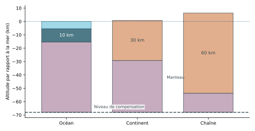
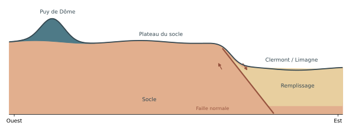
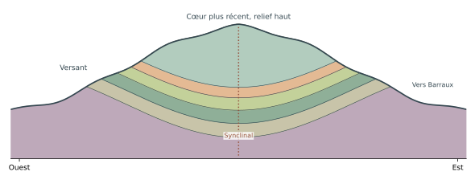
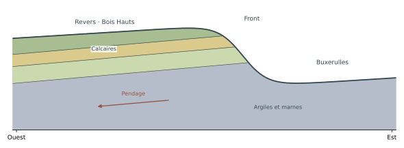
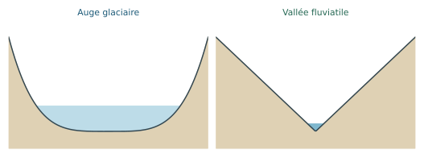

# ENS de Lyon — Second concours, Géosciences 2011 · Corrigé guidé

*Corrigé rédigé par IA, non officiel.*

**Rédaction (tour 1)** · GPT-6.2 Astra Ultra · vitesse non renseignée

Les deux parties A et B sont traitées. Les sous-titres décomposent les deux consignes du sujet. La synthèse s’appuie sur les documents 2 à 7, avec les trois coupes interprétatives demandées. Le rapport joint contient un volet écrit et un volet oral, seul le volet écrit sert ici de référence.

## A. Origine des reliefs régionaux

### Lire la courbe hypsométrique

> [!INDICATION]
> L’abscisse est un pourcentage de surface cumulé. Une faible pente indique qu’une grande surface appartient à une petite gamme d’altitudes.

#### Solution

La courbe cumule les surfaces depuis les hauts sommets jusqu’aux plus grandes profondeurs. Deux familles dominent. Du côté continental, plaines et plateaux de faible altitude occupent une grande surface, tandis que les hautes chaînes n’en représentent qu’une petite fraction. Après les plates-formes continentales peu profondes, le talus fait la transition rapide vers le domaine océanique. Les dorsales sont des reliefs sous-marins élevés, les plaines abyssales portent une vaste part des fonds, et les fosses de subduction forment l’extrémité profonde de faible surface. La moyenne des continents vaut +0,8 km et celle des fonds −3,7 km. Le dénivelé observé est donc de 4,5 km. Entre continent moyen et sommet à 8,85 km, il est de 8,05 km. La fosse à −11,04 km constitue un extrême, pas une seconde moyenne.

### Comparer trois colonnes à l’équilibre

> [!INDICATION]
> Placez la base des colonnes à une même profondeur dans le manteau. Conservez le niveau marin comme origine, et décidez si vous tenez compte de l’eau.

#### Solution

Dans le modèle d’Airy, l’égalité des pressions lithostatiques à un niveau commun de compensation se traduit par l’égalité des masses par unité d’aire au-dessus de ce niveau. La croûte continentale est plus légère et plus épaisse que la croûte océanique. Un épaississement par collision forme à la fois une racine crustale et un relief. Le refroidissement de la lithosphère océanique loin des dorsales contribue aussi à l’approfondissement des fonds. La flexure d’une plaque plongeante donne localement une fosse.

Prenons les épaisseurs de croûte indiquées par le rapport écrit, 30 km pour le continent, 10 km pour l’océan et 60 km pour la chaîne. Les densités sont respectivement 2,7, 3,0 et 2,7 pour ces croûtes, et 3,3 pour le manteau. Sans charge d’eau, la différence d’altitude solide liée aux deux croûtes est $[(3,3-2,7)30-(3,3-3,0)10]/3,3=4,55$ km. Cette valeur du modèle sec est du même ordre que les 4,5 km lus.

Pour expliciter la charge d’eau, notons D la profondeur de compensation sous la mer, h l’altitude continentale, d la profondeur océanique positive et $\rho_e=1$ la densité de l’eau. Les deux colonnes vérifient $\rho_c t_c+\rho_m(D+h-t_c)=\rho_e d+\rho_o t_o+\rho_m(D-d-t_o)$. On en déduit $3,3h+2,3d=0,6\times30-0,3\times10=15$ en unités cohérentes. À $h=0,8$ km, $d\simeq5,4$ km et $h+d\simeq6,2$ km. Le calcul garde le bon ordre de grandeur. Les épaisseurs réelles, les sédiments et l’état thermique varient.

Entre deux colonnes continentales, l’eau n’intervient pas. L’élévation de surface d’une croûte passant de 30 à 60 km est $\Delta h=(1-2,7/3,3)(60-30)\simeq5,5$ km. Le reste de l’épaississement, environ 24,5 km, est porté par l’enfoncement du Moho. À partir du continent moyen à 0,8 km, on prédit environ 6,3 km pour une surface de chaîne représentée par une colonne moyenne. Un sommet individuel peut atteindre 8,85 km. Le modèle rend les contrastes kilométriques, sans identifier un sommet au niveau moyen d’une chaîne.

## B. Origines des reliefs locaux

### Construire le relief par tectonique et volcanisme

> [!INDICATION]
> Sur la carte de Clermont-Ferrand, comparez les courbes fermées aux faisceaux de courbes serrées alignés. Sur la carte de Montmélian, cherchez la succession d’âges de part et d’autre d’un axe.

#### Solution

À l’échelle locale, un relief combine la construction d’une structure, la résistance des matériaux et leur redistribution en surface. Une même altitude peut couronner un édifice volcanique, une couche résistante ou un pli que l’érosion a mis en saillie. On peut départager ces interprétations en croisant topographie, géométrie des affleurements et milieux de transport.

**Construire et déniveler.** À l’ouest de Clermont-Ferrand, les courbes fermées entourent des édifices individualisés. La chaîne des Puys juxtapose des cônes, dont certains ont une dépression sommitale, et des dômes. Le puy de Dôme, à environ 1 465 m, est un dôme. Plus à l’est, des courbes serrées forment une rupture presque nord–sud séparant le plateau de la plaine de Limagne. Une faille normale de bordure, de direction approximativement nord–sud et d’abaissement vers l’est, rend compte de ce contraste régional. Le profil ouest–est du document 3 franchit un édifice, le plateau du socle, le rebord et le bassin rempli de sédiments. La hauteur du rebord topographique ne donne pas à elle seule le rejet total de la faille.

Dans le secteur de Montmélian, les bandes allongées de terrains jurassiques et crétacés, les répétitions de séries et les pendages documentent le plissement alpin. Dans la traverse retenue près du synclinal de l’Alpe, des couches plus récentes sont conservées dans le cœur du pli, avec des pendages vers son axe. Ce creux structural se trouve aujourd’hui en hauteur, au-dessus des dépressions adjacentes : c’est un synclinal perché. Une couverture résistante conservée dans le synclinal et le démantèlement des voûtes voisines expliquent l’inversion du relief. La coupe du document 7 distingue la géométrie concave des couches de l’enveloppe topographique.

### Sculpter par altération et érosion

> [!INDICATION]
> Comparez les deux paysages de granite. Pour la cuesta, vérifiez de quel côté figurent les roches anciennes tendres et de quel côté s’étend le plateau calcaire.

#### Solution

**Inciser et sélectionner.** En Colombie-Britannique, le glacier occupe une large auge à fond relativement étalé et aux versants raides. L’abrasion et l’arrachement glaciaires agissent sur toute la largeur occupée par la glace et peuvent surcreuser le fond. Dans les secteurs fluviatiles, l’incision concentrée dans le lit et le recul des versants tendent à produire une vallée en V. La présence actuelle d’un cours d’eau au fond d’une auge n’efface pas la forme héritée de l’occupation glaciaire.

Sur le même type de substratum granitique, le sud-ouest tunisien présente des dunes. La désagrégation physique, dont la thermoclastie, fournit des grains ; le vent les transporte, les trie et en accumule une partie. Le granit seul ne suffit donc pas à expliquer la dune. À Perros-Guirec, l’eau s’infiltre le long des diaclases, l’hydrolyse des feldspaths et l’altération des micas produisent une arène autour des noyaux rocheux. Le dégagement de cette arène laisse un chaos de boules et de blocs. L’exposition littorale contribue au déblaiement. L’altération peut précéder le climat actuel.

À Saint-Mihiel, la disposition dissymétrique du relief suit les affleurements sédimentaires. Les calcaires massifs et oolithiques résistants forment la corniche et le revers, les niveaux marno-calcaires puis argilo-marneux occupent le talus et la dépression du côté de Buxerulles. Dans le Bassin parisien oriental, les couches plongent doucement vers l’ouest. Une coupe ouest–est des Bois Hauts vers Buxerulles traverse donc le revers à faible pente, le front regardant l’est puis la dépression. Ce relief monoclinal est une cuesta. Le rapprochement des courbes de niveau sur le front et le contraste lithologique l’étayent.

### Transférer et déposer les produits d’érosion

> [!INDICATION]
> Les contours du document 5 sont des isopaques. Leur valeur indique une épaisseur accumulée, pas une altitude du fond marin.

#### Solution

**Transférer et déposer.** Les fleuves exportent une partie des débris de l’Himalaya jusqu’à l’océan. À l’ouest, l’Indus alimente le cône détritique de la mer d’Arabie. À l’est, le Gange et le Brahmapoutre alimentent le cône du Bengale. La disposition en éventail et la diminution générale d’épaisseur vers le large traduisent une accumulation dispersée au-delà des débouchés, notamment par des écoulements gravitaires sous-marins. L’accommodation du bassin et les variations de flux interviennent aussi. Les isopaques ne mesurent ni l’altitude du relief construit ni le taux actuel d’érosion.

**Bilan.** La tectonique fournit des dénivelés, le volcanisme des édifices, et les contrastes de résistance guident le creusement. Glace, cours d’eau et vent enlèvent, acheminent et accumulent les matériaux dans des lieux différents. Les trois coupes discriminent ainsi un relief construit et faillé à Clermont, un front d’érosion lithologique à Saint-Mihiel et une inversion du relief plissé à Montmélian.
