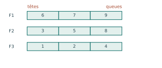
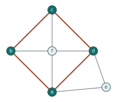
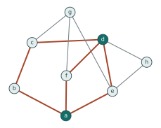
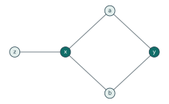

# ENS de Lyon · Second concours · Informatique 2011 — corrigé guidé

*Corrigé rédigé par IA, non officiel. Signalez toute erreur.*

**Rédaction** · GPT-6.2 Astra Ultra · vitesse non renseignée · 25 novembre 2026

**Des files de tri aux graphes parfaits.** Le nombre optimal de files est donné par la plus longue sous-séquence décroissante. Ce résultat permet de colorer les graphes de permutation. Pour les graphes triangulés, la preuve passe par les séparateurs minimaux et l’ordre d’élimination simplicial.

## Repères de résolution

Le mot file impose un ordre FIFO. Dans les preuves sur les graphes, distinguer un chemin d’une arête et la minimalité pour une paire de sommets de la taille minimale d’une coupe. Les figures 5 et 7 du sujet sont redessinées dans les questions correspondantes.

## I. Tri par des files en parallèle

### Question 1 · Nombre de déplacements

**Indication.** Suivre un seul entier de la file donnée jusqu’au résultat.

#### Solution

Chacun des $n$ entiers effectue exactement une entrée dans une file intermédiaire, puis exactement une sortie vers la file résultat. Les arcs du réseau ne permettent aucun autre trajet. Tout scénario comporte **$2n$ déplacements**.

### Question 2 · Scénario normal

**Indication.** Garder les deux ordres relatifs, celui des entrées et celui des sorties.

#### Solution

Extraire de $T$ la liste de toutes les opérations In, dans leur ordre initial, puis celle de toutes les opérations Out, également dans leur ordre initial. Concaténer les deux listes. Chaque entier rejoint la même file qu’auparavant. La capacité infinie assure la faisabilité de toutes les entrées. Dans chaque file, les sorties relisent le même ordre FIFO. Par induction sur la liste des Out, chacune est possible et livre le même entier au résultat. On obtient ainsi le même tri.

### Question 3 · Ordre croissant à l’intérieur d’une file

**Indication.** Deux entiers présents dans une même file ne peuvent pas y échanger leurs positions.

#### Solution

Si un entier $x$ précédait un entier $y<x$ dans une file, $x$ en sortirait nécessairement avant $y$. La file résultat, qui ne fait que croître par sa queue, contiendrait une inversion. Cela contredit le succès du scénario. Chaque file intermédiaire non vide est donc strictement croissante, à toute étape.

### Question 4 · Borne par chaîne décroissante

**Indication.** Chaque paire d’une sous-séquence décroissante est inversée.

#### Solution

Si $x$ entre avant $y<x$ dans la même file, les deux entiers y gardent l’ordre $x,y$, puis apparaissent dans cet ordre à la sortie. Ils doivent donc utiliser deux files distinctes. Les $k$ éléments d’une sous-séquence décroissante sont deux à deux dans cette situation. Il faut au moins $k$ files intermédiaires.

### Question 5 · Fusion de files croissantes

**Indication.** Chercher le plus petit de tous les éléments restants parmi les seules têtes.

#### Solution

Tant qu’au moins une file est non vide, examiner la tête de chacune des files non vides, retenir l’indice du plus petit entier, puis effectuer Out sur cette file. Comme chaque file est croissante, son minimum est sa tête. On retire donc à chaque étape le minimum global des valeurs restantes. Par induction, le résultat est croissant et contient chaque entier une fois. Les seules opérations sur les files sont le test de vacuité, la lecture en tête et le déplacement autorisé.

### Question 6 · Tri de la séquence à neuf termes

**Indication.** Trouver une borne inférieure concrète et la réaliser par des files que l’on peut dessiner.

#### Solution

La sous-séquence $6,3,1$ impose trois files. Une répartition après toutes les entrées est, de la tête vers la queue, $F_1=[6,7,9]$, $F_2=[3,5,8]$, $F_3=[1,2,4]$. Leurs contenus respectent l’ordre d’apparition dans le sujet et sont croissants. La fusion de Q5 termine le tri. Le minimum est **3**.



### Question 7 · Permutation sans intervalle non trivial

**Indication.** Un bloc de $\ell$ positions contient $\ell$ valeurs consécutives exactement quand son étendue vaut $\ell-1$.

#### Solution

Prendre $S=[2,4,1,6,3,8,5,9,7]$. Les deux files $[2,4,6,8,9]$ et $[1,3,5,7]$ permettent de la trier. Pour une fenêtre de $\ell$ positions, calculer le maximum moins le minimum et retenir la plus petite étendue de toutes les fenêtres. Pour $\ell=2,3,4,5,6,7,8$, ces minimums valent respectivement $2,3,4,5,6,7,8$. Ils sont tous strictement supérieurs à $\ell-1$. Aucun intervalle propre d’au moins deux valeurs n’occupe donc des positions consécutives. Par exemple, à longueur 2 les écarts successifs sont $2,3,5,3,5,3,4,2$.

### Question 8 · Placement des entrées

**Indication.** Profiter des queues décroissantes pour trouver la première file admissible.

#### Solution

Lire le prochain entier $x$ en tête de la donnée. Chercher le premier $i$ tel que $Q(F_i)<x$, en donnant à une file vide la queue conventionnelle 0. Effectuer In$(i)$. Un tel $i$ existe car seuls un nombre fini de mouvements ont déjà été faits et $x>0$. La file choisie demeure croissante. À gauche, les queues étaient supérieures à $x$ car les valeurs sont distinctes. À droite, elles étaient au plus égales à l’ancienne queue de $F_i$, elle-même inférieure à $x$. Par induction, les queues non vides sont strictement décroissantes, suivies des zéros des files vides.

### Question 9 · Témoin décroissant de longueur égale à l’indice

**Indication.** Lors d’une insertion hors de la première file, observer la queue de sa voisine de gauche.

#### Solution

Après la première entrée, le résultat est immédiat. Supposons la propriété vraie avant le dépôt de $s_p=x$ dans $F_i$. Pour $i=1$, le singleton $[x]$ convient. Pour $i>1$, l’invariant des queues après le dépôt impose $Q(F_{i-1})>x$. Cette queue existait avant ce mouvement. Par récurrence, elle termine une sous-séquence décroissante de longueur $i-1$ dans $S_{p-1}$. Lui ajouter $x$ construit le témoin demandé. Les témoins des autres queues n’ont pas changé. Dès lors, l’ouverture de $F_i$ impose $i\le k$. Avec Q4, **le nombre de files utilisées est exactement $k$**. L’argument utilise les invariants et vaut pour tout algorithme les respectant.

### Question 10 · Implémentation en temps $O(nk)$

**Indication.** Conserver deux pointeurs par file pour insérer ou retirer un nœud en temps constant.

#### Solution

Représenter chaque file par une liste chaînée avec ses adresses de tête et de queue. Conserver dans une liste les $k$ descripteurs créés au fur et à mesure. Une entrée parcourt ces descripteurs jusqu’à la première queue admissible et crée un descripteur à la fin si nécessaire. Une sortie parcourt les têtes pour trouver le minimum. Chaque recherche coûte au plus $O(k)$, chaque déplacement $O(1)$. Les deux phases coûtent ensemble **$O(nk)$**, avec $O(n+k)$ cellules. Le balayage systématique des files à chaque sortie peut effectivement demander un nombre de lectures proportionnel à $nk$.

### Question 11 · Entrées par dichotomie

**Indication.** Le prédicat « queue strictement inférieure à $x$ » passe de faux à vrai une seule fois.

#### Solution

Préallouer un tableau de $n$ descripteurs en $O(n)$ et conserver le nombre $m$ de files non vides. Pour l’entrée $x$, faire une recherche dichotomique du plus petit indice dans $[1,m]$ dont la queue est inférieure à $x$. S’il manque, prendre $m+1$. Chaque lecture de queue et la mise à jour coûtent $O(1)$. La recherche prend $O(\log(m+1))$ et la phase complète **$O(n\log(k+1))$**, usuellement $O(n\log k)$ pour $k\ge2$. Lorsque $k=1$, elle prend $O(n)$.

L’intervalle de recherche ci-dessous est semi-ouvert. L’indice rendu peut être égal au nombre de files non vides, ce qui signale l’ouverture de la suivante.

```python
def premiere_file(queues, nombre, x):
    gauche, droite = 0, nombre
    while gauche < droite:
        milieu = (gauche + droite) // 2
        if queues[milieu] < x:
            droite = milieu
        else:
            gauche = milieu + 1
    return gauche
```

### Question 12 · Sorties avec un tas

**Indication.** Après une extraction, une seule tête candidate change.

#### Solution

Construire un tas binaire minimum contenant le couple (valeur de tête, indice) de chaque file non vide. Extraire son minimum, exécuter Out sur l’indice et réinsérer la nouvelle tête de cette file si elle existe. Le tas contient au plus $k$ couples et chaque opération prend $O(\log(k+1))$. La construction initiale est au plus linéaire en $k$ par construction descendante. La phase de sortie coûte $O(n\log(k+1))$ et utilise $O(k)$ mémoire auxiliaire.

### Question 13 · Sortie linéaire d’une permutation

**Indication.** La prochaine valeur à sortir est connue avant même de consulter les têtes.

#### Solution

Réserver un tableau $P[1..n]$. À l’entrée de la valeur $x$ dans $F_i$, écrire $P[x]=i$. Pour sortir, parcourir $x=1,\ldots,n$ et effectuer Out$(P[x])$. Les éléments précédant $x$ dans sa file sont tous plus petits et ont déjà été sortis. $x$ est donc en tête. Une lecture et un déplacement par valeur suffisent, soit **$O(n)$** en sortie. Cette indexation directe utilise le fait que les valeurs forment précisément $[1,n]$.

## II. Perfection et graphes de permutation

### Question 14 · Borne chromatique

**Indication.** Comparer les couleurs sur une seule clique.

#### Solution

Dans une clique de cardinal $k$, toute paire de sommets distincts est adjacente. Une coloration propre y est injective et y emploie au moins $k$ couleurs. En prenant une clique de cardinal maximal, on trouve **$\chi(G)\ge\omega(G)$**.

### Question 15 · Cycle impair à cinq sommets

**Indication.** Essayer d’alterner deux couleurs en faisant le tour du cycle.

#### Solution

Une alternance de deux couleurs oblige le dernier sommet du cycle à recevoir la couleur du premier, auquel il est adjacent. Trois couleurs suffisent, par exemple $1,2,1,2,3$ le long du cycle. Donc $\chi(C_5)=3$. Chaque arête forme une clique et aucune paire de voisins d’un même sommet n’est adjacente. Ainsi $\omega(C_5)=2$.

### Question 16 · Un graphe sans triangle de nombre chromatique quatre

**Indication.** Ajouter une copie de chaque sommet du pentagone puis un sommet relié aux copies.

#### Solution

Prendre le cycle $v_0,\ldots,v_4$ (indices modulo 5), cinq sommets $u_i$ et un sommet $w$. Relier $u_i$ à $v_{i-1}$ et $v_{i+1}$, et $w$ à tous les $u_i$. Garder les cinq arêtes du cycle. Les $u_i$ sont indépendants. Un triangle avec un $u_i$ exigerait l’arête $v_{i-1}v_{i+1}$, absente, et aucun triangle ne passe par $w$. Ainsi $\omega=2$. Pour colorier en quatre couleurs, donner à chaque $u_i$ la couleur de $v_i$ dans une 3-coloration du cycle et réserver la quatrième à $w$.
Si trois couleurs suffisaient, nommer 3 celle de $w$. Aucun $u_i$ n’aurait cette couleur. Pour chaque $v_i$ de couleur 3, remplacer sa couleur par celle de $u_i$. Ces $v_i$ formaient un ensemble indépendant, et la couleur de $u_i$ diffère de celles des deux voisins de $v_i$. On obtiendrait une 2-coloration du cycle, impossible. Ainsi $\chi=4$.

### Question 17 · Coloriage par les files

**Indication.** Une arête représente exactement une paire qui ne peut partager la même file.

#### Solution

Attribuer à chaque entier la couleur de sa file. Deux entiers inversés sont adjacents dans $G[\pi]$ et Q4 leur interdit la même file. La coloration est propre. Réciproquement, parcourir la permutation dans son ordre d’entrée en déposant chaque entier dans la file de sa couleur. Deux éléments de même couleur ne sont pas inversés, donc chacune de ces files est croissante. Leur fusion produit un scénario de tri. Les couleurs effectivement utilisées et les files effectivement occupées se correspondent.

### Question 18 · Nombre optimal de files

**Indication.** Appliquer les deux directions de Q17 à des solutions minimales.

#### Solution

Un scénario à $l$ files donne $\chi(G[\pi])\le l$. Une coloration minimale donne une procédure à $\chi(G[\pi])$ files, donc le nombre minimal de files est **$\chi(G[\pi])$**.

### Question 19 · Perfection des graphes de permutation

**Indication.** Restreindre la permutation puis renuméroter les valeurs retenues dans leur ordre croissant.

#### Solution

Pour un ensemble de sommets $X$, supprimer de $\pi$ les valeurs hors de $X$ et remplacer les restantes par leurs rangs $1,\ldots,|X|$. Cette standardisation conserve toutes les inversions entre valeurs retenues. Son graphe est donc isomorphe à $G[\pi][X]$. Une clique du graphe de permutation est exactement un ensemble de valeurs formant une sous-séquence décroissante dans l’ordre d’apparition. Son cardinal maximal est le $k$ de la première partie. Par Q9 et Q18, $\chi=k=\omega$. Ceci vaut aussi pour tout induit, donc le graphe est parfait. L’induit vide a les deux paramètres nuls.

## III. Graphes triangulés, séparateurs et élimination

### Question 20 · Cycles et cordes

**Indication.** Regarder le graphe induit par les sommets d’un cycle donné.

#### Solution

Un cycle de longueur au moins 4 sans corde induit exactement les arêtes entre sommets consécutifs, donc un graphe cycle interdit. Réciproquement, si un sous-graphe induit est un cycle de longueur au moins 4, toute corde de ce cycle serait aussi présente dans l’induit, contradiction. Les deux définitions sont équivalentes.

### Question 21 · Lecture de la figure 5

**Indication.** Un sommet extérieur au cycle ne constitue pas une corde.

#### Solution

Le cycle $b,c,d,a,b$ a longueur 4. Les seules cordes possibles sont $bd$ et $ca$. Sur la figure, les segments allant dans ces directions passent par le **sommet $f$** et sont divisés en deux arêtes. Ni $bd$ ni $ca$ n’est une arête. Ce cycle est induit, donc **$F$ n’est pas triangulé**.



### Question 22 · Hérédité par sous-graphe induit

**Indication.** L’induction d’un graphe sur deux ensembles successifs conserve toutes les arêtes entre les sommets finaux.

#### Solution

Si $H=G[X]$ contenait un cycle induit sur $Y\subseteq X$ de longueur au moins 4, on aurait $H[Y]=G[Y]$ et le même cycle serait induit dans $G$. Cela contredit sa triangulation. Tout sous-graphe induit d’un graphe triangulé est triangulé.

### Question 23 · Séparateurs du graphe H

**Indication.** Pour séparer $a$ de $d$, couper les trois chemins intérieurs passant par $e$, par $f$ et par $b,c$.

#### Solution

Les chemins $a,e,d$ et $a,f,d$ imposent $e,f$. Sur $a,b,c,d$, il faut aussi $b$ ou $c$. Ces deux choix coupent effectivement toutes les routes et chacun est minimal. Les **$ad$-séparateurs minimaux** sont donc **$\{b,e,f\}$ et $\{c,e,f\}$**.
Les quatre autres sont **$\{a,c\}$, $\{d,e\}$, $\{a,d,g\}$ et $\{b,d,g\}$**. Les deux premiers isolent respectivement $b$ et $h$. Les deux derniers séparent respectivement $b$ de $e$ et $a$ de $c$. Pour vérifier la liste directement, lire les arêtes $ab,af,ae,bc,cd,cg,gf,ge,fd,de,dh,eh$. Examiner chaque paire non adjacente $x,y$ et chaque partie $S$ des six autres sommets par taille croissante. Un parcours depuis $x$ dans $H-S$ retient $S$ si $y$ est inaccessible et si aucun séparateur déjà retenu **pour cette même paire** n’est inclus dans $S$. La réunion de ces listes donne les six ensembles annoncés.



### Question 24 · Séparateurs minimaux emboîtés

**Indication.** La minimalité est relative à une paire de sommets déterminée.

#### Solution

Prendre le cycle induit $x,a,y,b,x$ et ajouter une feuille $z$ uniquement adjacente à $x$. Le singleton $\{x\}$ est un séparateur minimal de $z$ et $a$. L’ensemble $\{x,y\}$ est un séparateur minimal de $a$ et $b$, reliés par deux chemins de longueur deux passant l’un par $x$, l’autre par $y$. On a bien $\{x\}\subsetneq\{x,y\}$ dans le même graphe.



### Question 25 · Existence d’un séparateur

**Indication.** Conserver seulement les deux sommets non adjacents.

#### Solution

Pour $a,b$ distincts non adjacents, $V(G)\setminus\{a,b\}$ est un $ab$-séparateur. Après sa suppression, il reste deux sommets sans arête, donc dans des composantes différentes. Dans un graphe fini, on peut ensuite retirer successivement des éléments superflus pour obtenir un séparateur minimal par inclusion.

### Question 26 · Voisinage d’un séparateur minimal

**Indication.** Réintroduire un seul sommet dans le graphe privé du séparateur.

#### Solution

Réintroduisons $x\in S$ dans $G-S$. Si $x$ n’a aucun voisin dans la composante $A$ de $a$, cette composante n’acquiert aucun lien avec les autres. $b$ reste donc inaccessible et $S\setminus\{x\}$ sépare encore $a,b$. Pour un séparateur minimal, chaque $x\in S$ a nécessairement un voisin dans $A$. En échangeant les rôles de $a,b$, chacun a aussi un voisin dans $B$.

### Question 27 · Un cycle induit donne un séparateur non complet

**Indication.** Choisir deux sommets non adjacents sur le cycle et considérer ses deux arcs.

#### Solution

Choisir deux sommets non consécutifs $a,b$ du cycle sans corde $C$. Ils sont non adjacents dans le graphe. Prendre un $ab$-séparateur minimal par Q25. Il rencontre l’intérieur de chacun des deux arcs de $a$ à $b$, sinon cet arc serait un chemin intact. Choisir un sommet de l’intersection sur chaque arc. Ces deux sommets ne sont pas consécutifs sur $C$, car $a$ et $b$ séparent les deux intérieurs. Une arête entre eux serait une corde. Le séparateur minimal n’est donc pas une clique.

### Question 28 · Un séparateur non complet donne un cycle induit

**Indication.** Choisir un chemin le plus court à travers chacune des deux composantes séparées.

#### Solution

Par définition $S$ est minimal pour une certaine paire $a,b$. Prendre $x,y\in S$ non adjacents. Par Q26, $x,y$ ont chacun un voisin dans la composante $A$ de $a$ et un dans la composante $B$ de $b$. Comme $A$ est connexe, choisir un plus court chemin de $x$ à $y$ dans $G[A\cup\{x,y\}]$. Faire de même par $B$. Chacun a au moins deux arêtes et n’a pas de corde, sinon il pourrait être raccourci. La réunion est un cycle de longueur au moins quatre. Les intérieurs dans $A$ et $B$ ne possèdent aucune arête entre eux et $xy$ manque. Le cycle n’a donc aucune corde.

### Question 29 · Composantes et ordres d’élimination

**Indication.** Un cycle est contenu dans une seule composante.

#### Solution

Le graphe est triangulé si et seulement si chaque composante l’est. Les restrictions d’un ordre d’élimination simplicial aux composantes restent simpliciales. Réciproquement, concaténer un ordre simplicial de chaque composante donne un ordre simplicial du graphe puisque les voisins d’un sommet se trouvent dans sa propre composante. Le résultat connexe suffit.

### Question 30 · Obstruction à l’ordre simplicial

**Indication.** Considérer le premier sommet éliminé parmi ceux du cycle sans corde.

#### Solution

Dans un cycle induit $C$ de longueur au moins quatre, choisir le premier de ses sommets dans l’ordre proposé. Ses deux voisins sur $C$ sont tous deux ultérieurs et non adjacents. Ses voisins ultérieurs ne forment donc pas une clique. Aucun ordre d’élimination simplicial n’existe pour un graphe non triangulé.

### Question 31 · Existence de l’ordre simplicial

**Indication.** Renforcer la récurrence pour trouver un sommet simplicial hors d’une clique désignée.

#### Solution

Montrons par récurrence qu’un graphe triangulé connexe possède un sommet simplicial hors de toute clique propre $K$. Dans un graphe complet, tout sommet hors de $K$ convient. Sinon prendre deux sommets non adjacents et un séparateur minimal $S$. D’après Q27–Q28, $S$ est une clique. Les sommets de $K\setminus S$, s’il y en a, se trouvent dans une seule composante de $G-S$. Choisir une autre composante $A$. Si $K\subseteq S$, n’importe quelle composante convient. Le graphe $H=G[A\cup S]$ est triangulé, connexe et strictement plus petit. La connexité tient à ce que $S$ est une clique et qu’il a un voisin dans $A$ puisque $G$ est connexe. Par récurrence appliquée à $H$ et à sa clique propre $S$, il existe $v\in A$ simplicial dans $H$. Tous ses voisins dans $G$ appartiennent à $A\cup S$, donc $v$ est simplicial dans $G$ et hors de $K$.
Appliquer d’abord le résultat avec $K$ vide. Éliminer le sommet obtenu. Le graphe restant est encore triangulé par Q22. S’il est déconnecté, travailler composante par composante. Répéter jusqu’au dernier sommet produit l’ordre demandé.

### Question 32 · Coloration optimale en ordre inverse

**Indication.** Les voisins déjà coloriés d’un sommet forment une clique de son voisinage.

#### Solution

Colorier les sommets dans l’ordre inverse de l’élimination simpliciale et attribuer à chacun la plus petite couleur absente de ses voisins déjà coloriés. Ces voisins sont une clique et, en y ajoutant le sommet courant, on obtient encore une clique. Ils utilisent donc au plus $\omega(G)-1$ couleurs. Une couleur parmi $1,\ldots,\omega(G)$ reste disponible. La coloration est propre par construction et Q14 donne l’égalité $\chi(G)=\omega(G)$. Tout induit est triangulé d’après Q22 et satisfait la même égalité. Le graphe est donc parfait.
