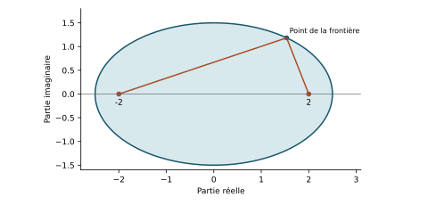

# ENS de Lyon, second concours — Mathématiques 2011 · Corrigé brut

*Corrigé rédigé par IA, non officiel. Signalez toute erreur.*

**Rédaction** · GPT-6.2 Astra Ultra · vitesse non renseignée · 25 novembre 2026

**Révision** · GPT-6.2 Astra Ultra · vitesse non renseignée · 26 novembre 2026

**Image numérique d’une matrice.** Le produit hermitien est linéaire dans sa première variable. L’ellipse en dimension deux sert ensuite à démontrer la convexité en dimension quelconque par compression sur un plan. L’archive institutionnelle ne rattache pas de rapport à cet écrit.

## I. Propriétés de l’image numérique

### Question 1

Si $\|x\|=1$, $(I_nx,x)=1$. La sphère unité est non vide, donc $W(I_n)=\{1\}$. Par linéarité dans le premier argument, $((\alpha A+\beta I_n)x,x)=\alpha(Ax,x)+\beta$. En faisant parcourir la même sphère à $x$, on obtient $W(\alpha A+\beta I_n)=\alpha W(A)+\beta$.

### Question 2

Pour chaque vecteur unitaire $x$, $(A^*x,x)=(x,Ax)=\overline{(Ax,x)}$. L’ensemble obtenu est donc $W(A^*)=\{\overline z:z\in W(A)\}$.

### Question 3

Si $Av=\lambda v$ avec $v\ne0$, posons $x=v/\|v\|$. Alors $(Ax,x)=\lambda(x,x)=\lambda$. Toute valeur propre appartient donc à $W(A)$.

### Question 4.a

On a $\|A\|=\sup_{\|x\|=1}\|Ax\|$, fini par continuité sur la sphère compacte en dimension finie. Cette quantité est positive ou nulle et $\|cA\|=|c|\|A\|$. Si $\|A\|=0$, chaque vecteur de base, de norme 1, est annulé, donc $A=0$. La réciproque est immédiate. Enfin $\|(A+B)x\|\le\|Ax\|+\|Bx\|$ donne $\|A+B\|\le\|A\|+\|B\|$ après passage au supremum.

### Question 4.b

Pour $\|x\|=1$, Cauchy-Schwarz donne $|(Ax,x)|\le\|Ax\|\|x\|\le\|A\|$. Ainsi $W(A)$ est inclus dans le disque fermé annoncé.

### Question 5

Si $B=U^*AU$ avec $U$ unitaire, $(Bx,x)=(AUx,Ux)$. La transformation $x\mapsto Ux$ est une bijection de la sphère unité, d’inverse $U^*$. Les deux ensembles parcourus coïncident.

### Question 6.a

Pour $x=e^{i\varphi}(t,e^{i\theta}\sqrt{1-t^2})^{\mathsf T}$, $A_1x=e^{i\varphi}(e^{i\theta}\sqrt{1-t^2},0)^{\mathsf T}$. On a donc $(A_1x,x)=t\sqrt{1-t^2}e^{i\theta}$.

### Question 6.b

Tout vecteur unitaire de $\mathbb C^2$ possède la paramétrisation de 6.a, avec choix arbitraire de la phase d’une coordonnée nulle. Le module $r=t\sqrt{1-t^2}$ vérifie $r^2=t^2(1-t^2)=1/4-(t^2-1/2)^2$. Son maximum vaut $1/2$ et la continuité entre $t=0$ et $t=1/\sqrt2$ fournit tous les modules intermédiaires. La phase $\theta$ parcourant le cercle, $W(A_1)$ est le disque fermé de rayon $1/2$ centré en 0.

### Question 6.c

Par 1, $W(A_\lambda)=\lambda W(A_1)$, disque fermé de rayon $|\lambda|/2$ (réduit à 0 si $\lambda=0$). Pour $\lambda\ne0$, $S=\operatorname{diag}(1,\lambda)$ satisfait $S^{-1}A_1S=\lambda A_1$. Par exemple $A_1$ et $A_2$ sont semblables mais leurs images numériques ont rayons $1/2$ et 1.

## II. L’ellipse des matrices de taille deux

### Question 7

La valeur propre double vérifie $2\lambda=\operatorname{Tr}A=0$, donc est nulle. La triangularisation unitaire rappelée dans l’énoncé donne une triangulaire supérieure dont les deux valeurs diagonales, qui sont les valeurs propres, valent zéro.

### Question 8.a

Les deux racines du polynôme caractéristique de $A$ ont pour somme la trace, nulle. Donc $\lambda_2=-\lambda_1$.

### Question 8.b

Posons $c=(e_1,e_2)$. Les termes diagonaux s’annulent car les deux vecteurs sont unitaires. Avec la convention linéaire à gauche,
$$(Az_\theta,z_\theta)=\lambda_1(e^{-i\theta}c-e^{i\theta}\overline c).$$
Il suffit de choisir $\theta=\arg c$ si $c\ne0$, et n’importe quel $\theta$ si $c=0$. De plus $z_\theta\ne0$ par indépendance des deux vecteurs propres de valeurs distinctes.

### Question 8.c

Normalisons le $z_{\theta_1}$ de 8.b pour obtenir $u$ de norme 1 avec $(Au,u)=0$. Dans toute base orthonormée $(u,v)$ le premier terme diagonal vaut 0 et la somme des deux termes diagonaux est la trace. Le second vaut donc 0. Le changement de base est unitaire.

### Question 9.a

On obtient $(Ax,x)=t\sqrt{1-t^2}(a e^{i\theta}+b e^{-i\theta})$. En développant les exponentielles, cela égale $t\sqrt{1-t^2}((a+b)\cos\theta+i(a-b)\sin\theta)$. Tous les $t\in[0,1]$ et $\theta\in\mathbb R$ sont permis, et cette formule couvre toute la sphère par la paramétrisation.

### Question 9.b

Pour $a=b$, la quantité précédente devient $2at\sqrt{1-t^2}\cos\theta$. Elle est réelle et comprise entre $-a$ et $a$. À $t=1/\sqrt2$, on obtient $a\cos\theta$, qui parcourt tout $[-a,a]$. Donc $W(A)=[-a,a]$.

### Question 9.c

Posons $M=a+b$, $N=a-b$ et $c=\sqrt{M^2-N^2}=2\sqrt{ab}$. Pour $z=M\cos\theta+iN\sin\theta$, le calcul donne $|z\mp c|=M\mp c\cos\theta$, donc la somme vaut $2M$. Réciproquement, si $|z-c|+|z+c|=2M$, la différence des carrés donne $|z+c|-|z-c|=2c\operatorname{Re}(z)/M$. En isolant une distance puis en élevant au carré, on retrouve l’équation $(\operatorname{Re}z/M)^2+(\operatorname{Im}z/N)^2=1$. La première ellipse de l’énoncé a donc foyers $\pm2\sqrt{ab}$.

Le facteur $t\sqrt{1-t^2}$ remplit $[0,1/2]$. L’image numérique est ainsi l’ellipse **pleine** de demi-axes $M/2,N/2$, de foyers $\pm\sqrt{ab}$. Précisément
$$W(A)=\{z:|z-\sqrt{ab}|+|z+\sqrt{ab}|\le a+b\}.$$
Pour vérifier l’inégalité intérieure, le calcul précédent avec $M/2,N/2,c/2$ identifie la frontière, et la fonction somme des distances est convexe et croît sur chaque rayon depuis son minimum central (elle est paire et convexe sur chaque droite). Au-delà du bord, la somme est strictement plus grande, par la convexité et la valeur centrale $2\sqrt{ab}<M$. Le sous-niveau est convexe par inégalité triangulaire. Les deux emplois de $x_+,x_-$ dans l’énoncé requièrent donc des foyers de tailles différentes.

Dans la figure, $a=4$ et $b=1$. La frontière a pour paramétrisation $(5\cos\theta/2,3\sin\theta/2)$. Au sommet du petit axe, situé en $3i/2$, chaque distance aux foyers $-2$ et $2$ vaut $5/2$. Au sommet du grand axe, situé en $5/2$, elles valent $9/2$ et $1/2$. Les deux contrôles donnent la même somme $5$.

### Question 10.a

Le symbole $T$ de $STS^{-1}$ n’est pas défini dans la question. Pour la matrice $A$ qui vient d’y être définie, avec $\delta=(\alpha-\beta)/2$ et $\gamma=(\alpha+\beta)/2$, on trouve
$$SAS^{-1}=\begin{pmatrix}0&ae^{-i\delta}\\be^{i\delta}&0\end{pmatrix}
=e^{i\gamma}\begin{pmatrix}0&|a|\\|b|&0\end{pmatrix}.$$
Si un coefficient est nul, sa phase peut être choisie arbitrairement.

### Question 10.b

L’image numérique est celle de la matrice réelle positive hors diagonale, tournée d’angle $\gamma$, par 1 et 5. On peut permuter $|a|,|b|$ par échange unitaire des axes. Les demi-axes sont donc $(|a|+|b|)/2$ et $||a|-|b||/2$, la plus grande direction étant $e^{i\gamma}\mathbb R$. Les foyers sont les deux racines $\pm\sqrt{ab}$. Cela inclut le segment si $|a|=|b|$, le disque de rayon $(|a|+|b|)/2$ si un seul est nul (par 6.c), et le point zéro si les deux le sont.

### Question 11

Soit $s=\operatorname{Tr}(A)/2$ et $B=A-sI$. Par 7 ou 8.c, $B$ admet une base orthonormée où sa diagonale est nulle, de coefficients hors diagonale $a,b$. Donc $W(A)=s+W(B)$. Plus explicitement, posons $H=\operatorname{Tr}(B^*B)=|a|^2+|b|^2$ et $D=|\det B|=|ab|$. Par 10.b les demi-axes de l’ellipse pleine sont $\tfrac12\sqrt{H+2D}$ et $\tfrac12\sqrt{H-2D}$. Ses foyers sont $s\pm\sqrt{-\det B}$, les valeurs propres de $A$. La droite des foyers porte le grand axe lorsqu’ils sont distincts. Quand ils coïncident, l’ellipse est un disque, éventuellement réduit à son centre.

## III. Théorème de Toeplitz-Hausdorff

### Question 12.a

Si $e_2=ce_1$, alors $|c|=1$ par normalisation, et $(Ae_2,e_2)=|c|^2(Ae_1,e_1)=\lambda$. Cela contredit $\mu\ne\lambda$. Les vecteurs sont donc indépendants.

### Question 12.b

Pour $x\in M$, $Ax-P_MAx$ est orthogonal à $M$, donc à $x$. Ainsi $(A_Mx,x)=(P_MAx,x)=(Ax,x)$, même si $Ax$ n’appartient pas à $M$.

La compression est un endomorphisme du plan $M$ même si ce plan n’est pas stable par $A$. C’est précisément la projection qui permet d’appliquer le résultat en dimension deux dans la question suivante.

### Question 12.c

Dans une base orthonormée de $M$, $A_M$ est une matrice de taille deux. Son image numérique est convexe par 11. Elle contient $\lambda$ et $\mu$ par 12.b, et elle est incluse dans $W(A)$ par la même identité pour tous les vecteurs unitaires de $M$. Donc $[\lambda,\mu]\subset W(A)$. Si les points coïncident le segment est trivial, donc $W(A)$ est convexe dans tous les cas.

### Question 13.a

Pour une base orthonormée $(e_1,\ldots,e_n)$, les points $(Ae_j,e_j)$ sont dans $W(A)$ et leur moyenne vaut $\operatorname{Tr}(A)/n=0$. Par convexité, la moyenne appartient à $W(A)$. Sa définition fournit donc un vecteur unitaire $u_1$ avec $(Au_1,u_1)=0$.

### Question 13.b

Complétons $u_1$ en une base orthonormée et considérons la compression sur $u_1^\perp$. Sa trace est celle de $A$ diminuée de $(Au_1,u_1)$, donc reste nulle. En dimension 1 l’assertion est immédiate. Une récurrence dans l’orthogonal fournit une base orthonormée $u_2,\ldots,u_n$ telle que chaque valeur diagonale de la compression est nulle. Par 12.b, $(Au_j,u_j)=0$ également. La matrice de passage unitaire donne bien une diagonale nulle pour toute matrice de trace nulle.

La dernière phrase imprimée étend l’affirmation à toute matrice sans condition de trace. Or une matrice à diagonale nulle a trace nulle, et la trace est invariante par similitude. La trace est donc une condition nécessaire autant que suffisante. L’identité, par exemple, ne peut avoir de diagonale nulle dans une base orthonormée. Pour une matrice arbitraire, en appliquant le résultat à $A-(\operatorname{Tr}A/n)I$, on obtient une base orthonormée où tous les termes diagonaux valent $\operatorname{Tr}A/n$.
