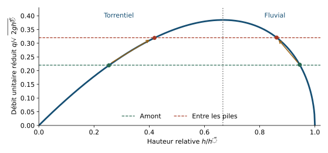
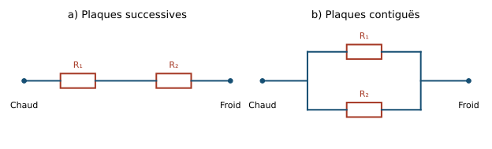
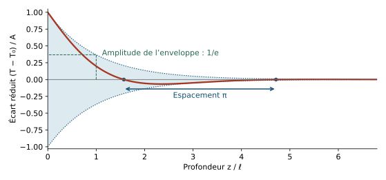

# ENS de Lyon, second concours 2011 — Physique · Corrigé guidé

*Corrigé rédigé par IA, non officiel. Signalez toute erreur.*

**Rédaction** · GPT-6.2 Astra Ultra · vitesse non renseignée

## I — Écoulements fluvial et torrentiel

### Question I.1 — Fluide parfait

**Indication.** Une force tangentielle de frottement ferait intervenir un coefficient de viscosité. Quelle force reste sur une face du petit volume ?

La viscosité est nulle dans ce modèle. La force de contact sur une petite surface de normale extérieure $\mathbf n$ se réduit à $-p\mathbf n\,dS$. L’incompressibilité est une autre hypothèse du sujet. Elle permet ici de garder la masse volumique $\rho$ constante.

### Question I.2 — Charge de Bernoulli

**Indication.** Projeter l’équation d’Euler le long de la vitesse donne $dp+\rho g\,dz+\rho v\,dv=0$. L’intégration concerne la ligne de courant choisie.

Dans le référentiel du lit, supposé galiléen, l’écoulement est stationnaire, parfait et incompressible. La pesanteur est la seule force volumique et on ne fournit aucun travail mécanique entre les deux sections. Le long d’une ligne de courant, $p+\rho gz+\tfrac12\rho v^2$ est constant. Les trois termes sont des énergies par unité de volume. Une constante commune à toutes les lignes demanderait une hypothèse supplémentaire, par exemple un écoulement irrotationnel.

### Question I.3 — Vitesse à la surface libre

**Indication.** Choisir deux points où la pression est connue évite d’avoir à calculer le champ de pression au fond.

La surface libre stationnaire est une surface de courant. Aux deux points choisis elle est soumise à la même pression atmosphérique $p_0$. En prenant le fond à la même cote de référence, les altitudes y valent $h_0$ et $h$. La vitesse étant uniforme sur chaque section, Bernoulli donne $gh_0+v_0^2/2=gh+v^2/2$. Dans le sens de l’écoulement, $v=\sqrt{v_0^2+2g(h_0-h)}$.

### Question I.4 — Énergie mécanique rapportée au volume

**Indication.** Comparer $\rho gh_0$ à une pression hydrostatique puis vérifier que $\rho v_0^2$ a la même dimension.

$\rho g\widetilde h=\rho gh_0+\rho v_0^2/2$ est l’énergie mécanique par unité de volume à la surface, avec le fond pour zéro d’altitude et l’atmosphère comme référence de pression. En ajoutant $p_0$ on retrouve la constante de Bernoulli dans la convention de pression absolue. La hauteur de charge $\widetilde h$ s’exprime en mètres et $\rho g\widetilde h$ en pascals.

### Question I.5 — Débit et domaine admissible

**Indication.** Le débit traverse une section perpendiculaire à l’écoulement. Son unité est le mètre cube par seconde.

L’aire mouillée est $Lh$. Comme $v=\sqrt{2g(\widetilde h-h)}$, le débit volumique est $Q=Lh\sqrt{2g(\widetilde h-h)}$ pour $0\le h\le\widetilde h$. Il s’annule aux deux extrémités, une fois par annulation de la section, l’autre par annulation de la vitesse.

### Question I.6 — Les deux branches du diagramme de débit

**Indication.** À débit fixé, $v=Q/(Lh)$. Comparer les vitesses correspondant aux deux intersections puis repérer le sommet.

À largeur et charge fixées, une horizontale $0<Q<Q_{\max}$ coupe la courbe en deux points. Pour $h$ petit, la vitesse est élevée et l’écoulement est **torrentiel**. Pour $h$ grand, il est lent et **fluvial**. L’annulation de $dQ/dh=L\sqrt{2g}(\widetilde h-3h/2)/\sqrt{\widetilde h-h}$ donne $h_c=2\widetilde h/3$ et $Q_{\max}=L\sqrt g\,h_c^{3/2}$. À cette hauteur $v=\sqrt{gh_c}$. Le nombre de Froude $v/\sqrt{gh}$ dépasse un à gauche et reste inférieur à un à droite. Les deux solutions se confondent au sommet.

### Question I.7 — Rétrécissement entre les piles

**Indication.** Tracer $q(h)$ une seule fois puis déplacer vers le haut la droite horizontale $q=Q/L$. Suivre l’intersection sur la branche d’origine.

La continuité impose le même $Q$ avant et entre les piles. À charge $\widetilde h$ conservée, le débit par unité de largeur $q=Q/L$ augmente quand $L$ diminue. Sur la branche torrentielle, la hauteur augmente. Sur la branche fluviale, elle diminue. Les deux évolutions conduisent vers la hauteur critique. Si la nouvelle valeur de $Q/L$ dépasse le maximum possible pour la charge initiale, l’hypothèse d’une charge amont inchangée ne fournit plus d’état stationnaire.

## II — Diffusion thermique

### Question II.1 — Diffusivité

**Indication.** Écrire le watt comme un joule par seconde. Le temps caractéristique de diffusion sur une distance $d$ s’exprime alors comme $d^2/D$.

$[\lambda]=\mathrm{W\,m^{-1}\,K^{-1}}$ et $[\rho c]=\mathrm{J\,m^{-3}\,K^{-1}}$. Leur quotient $D$ a pour dimension une longueur au carré divisée par un temps. Le tableau donne, en $\mathrm{m^2\,s^{-1}}$, $2.0\times10^{-5}$ dans l’air, $1.0\times10^{-6}$ dans la glace et $1.5\times10^{-7}$ dans l’eau liquide.

### Question II.2 — Loi de Fourier

**Indication.** Tracer deux isothermes voisines et orienter la normale vers les températures croissantes. Le courant thermique va dans l’autre sens.

La densité de courant thermique est $\mathbf j=-\lambda\nabla T$, en $\mathrm{W\,m^{-2}}$. Pour $\lambda>0$, elle pointe vers les températures décroissantes. La puissance transférée à travers une surface orientée vaut $\int\mathbf j\cdot\mathbf n\,dS$.

### Question II.3 — Bilan sur une tranche

**Indication.** Inscrire séparément la puissance entrante à gauche et la puissance sortante à droite. C’est leur différence qui modifie l’énergie stockée.

Dans une tranche immobile de section $S$ et d’épaisseur $dx$, sans source ni échange latéral, la puissance nette reçue est $S[j_x(x)-j_x(x+dx)]$. Elle vaut $\rho c S\,dx\,\partial_tT$. À la limite $dx\to0$, $\rho c\,\partial_tT=-\partial_xj_x$. En utilisant Fourier avec $\lambda$ uniforme, on obtient $\partial_tT=D\,\partial_x^2T$.

### Question II.4 — Plaque plane en régime permanent

**Indication.** La solution de l’équation stationnaire est affine. Fixer son ordonnée à l’origine, puis sa pente.

En régime permanent, $d^2T/dz^2=0$. Avec $T(0)=T_0$ et $T(e)=T_e$, $T(z)=T_0+(T_e-T_0)z/e$. Le flux surfacique orienté dans le sens des $z$ croissants vaut $\Phi=j_z=\lambda(T_0-T_e)/e$, identique en tout point de la plaque.

### Question II.5 — Résistance d’une paroi

**Indication.** Une surface deux fois plus grande conduit deux fois plus de puissance sous la même chute de température. Utiliser cette expérience pour placer $S$ dans la formule.

La tension correspond à la chute de température $\Delta T=T_0-T_e$, le courant à la puissance thermique $P=S\Phi$, et la résistance électrique à $R_{\rm th}=e/(\lambda S)$. L’analogue de la loi d’Ohm est $\Delta T=R_{\rm th}P$. Cette résistance est en $\mathrm{K\,W^{-1}}$. Si l’on travaille directement avec la densité $\Phi$ du sujet, la relation s’écrit $\Delta T=(e/\lambda)\Phi$. La résistance par unité de flux surfacique $e/\lambda$ s’exprime en $\mathrm{m^2\,K\,W^{-1}}$.

### Question II.6 — Parois en série et en parallèle

**Indication.** Repérer ce qui se conserve à la jonction. La puissance est additive. Pour passer à une densité, rapporter chaque puissance à la surface correspondante.

**a) Plaques successives.** En régime permanent sans perte latérale, les deux plaques de même section $S$ transportent la même puissance et $\Phi_1=\Phi_2$. Les chutes de température s’ajoutent, donc $R_{\rm eq}=R_1+R_2$.

**b) Plaques contiguës.** La même chute $\Delta T$ s’applique à chaque branche. Les puissances vérifient $P=P_1+P_2$. Chacune des plaques occupe $S/2$ sur le dessin, d’où $P=(S/2)\Phi_1+(S/2)\Phi_2$. La densité moyenne traversant le mur est $\Phi_{\rm moy}=P/S=(\Phi_1+\Phi_2)/2$. Comme $P_i=\Delta T/R_i$, on obtient $1/R_{\rm eq}=1/R_1+1/R_2$. Chaque $R_i$ est calculée avec la surface effective de sa branche.

**c) Schémas équivalents.** Dans le premier circuit les résistances partagent un nœud intermédiaire. Dans le second leurs deux bornes sont communes, comme les deux températures imposées. Les montages sont représentés ci-dessous.

### Question II.7 — Sens du transfert dans la glace

**Indication.** Évaluer d’abord le signe de $dT/dz$. Le signe moins de Fourier inverse celui de la pente.

L’axe $z$ descend de l’air vers l’eau. En approximation quasi stationnaire, la température croît linéairement de $T_{\rm air}<0\,^\circ\mathrm C$ à $T_{\rm eau}=0\,^\circ\mathrm C$. Le flux que le sujet compte positivement de l’air vers l’eau vaut $\Phi=-\lambda(T_{\rm eau}-T_{\rm air})/e<0$. La glace évacue donc de la chaleur de l’interface vers l’air.

### Question II.8 — Enthalpie de solidification

**Indication.** Les deux changements d’état inverses relient les mêmes états à la même température. Leurs variations d’enthalpie ont des signes opposés.

Former de la glace à la température de fusion libère de l’énergie. Le changement d’état est exothermique et sa variation d’enthalpie massique est $\Delta h_{\rm sol}=-L_f$. Ici $L_f=3.2\times10^5\,\mathrm{J\,kg^{-1}}$ désigne la chaleur latente de fusion, positive.

### Question II.9 — Bilan à l’interface mobile

**Indication.** Choisir l’interface comme lieu du bilan et compter l’énergie libérée positivement. L’aire commune doit disparaître.

Sur une surface $S$, une avancée $de$ produit une masse $\rho S\,de$ de glace et libère $\rho L_f S\,de$. La conduction en évacue $-\Phi S\,dt$. L’égalité donne $e\,de/dt=\beta$ avec $\beta=\lambda(T_{\rm eau}-T_{\rm air})/(\rho L_f)>0$. Cette constante a les unités d’une diffusivité.

### Question II.10 — Croissance de l’épaisseur

**Indication.** Intégrer la dérivée de $e^2/2$. La racine positive correspond à une épaisseur.

Avec $e(0)=0$, intégrer $e\,de=\beta\,dt$ donne $e^2/2=\beta t$, donc $e(t)=\sqrt{2\beta t}$. Doubler l’épaisseur demande de quadrupler le temps écoulé. La pente initiale infinie rappelle la limite du modèle quasi stationnaire au tout début de la prise.

### Question II.11 — Temps caractéristique du modèle

**Indication.** Convertir les centimètres en mètres avant de prendre le carré. Distinguer le temps de croissance de la résistance mécanique d’une couche réelle.

Le temps mathématique pour atteindre une épaisseur imposée $e_c$ est $t_c=\rho L_f e_c^2/[2\lambda(T_{\rm eau}-T_{\rm air})]$. Avec $e_c=0.10$ m et un écart de $10$ K, $\beta=6.25\times10^{-8}\,\mathrm{m^2\,s^{-1}}$, d’où $t_c=8.0\times10^4$ s, soit $0.93$ jour ou environ $22$ h. Il s’agit d’un ordre de grandeur pour une couche uniforme dont la surface serait maintenue à la température de l’air et dont l’eau serait déjà à la température de fusion. La neige, le transfert à l’interface air-glace, les courants et l’épaisseur locale changent le résultat. Un délai ainsi calculé ne permet pas de juger si la glace d’un lac est praticable.

### Question II.12 — Perturbation autour de la température moyenne

**Indication.** La couche est supposée semi-infinie. Replacer les deux conditions, l’une à la surface et l’autre en profondeur.

Soustraire la constante $T_0$ laisse inchangées les dérivées. Dans le demi-espace $z>0$, $\partial_t\Theta=D\,\partial_z^2\Theta$, avec $\Theta(0,t)=A\cos(\omega t)$. Dans le régime périodique recherché, la perturbation s’annule loin de la surface.

### Question II.13 — Amplitude et phase à l’origine

**Indication.** Identifier les coefficients du cosinus et du sinus, ou les deux amplitudes complexes au bord.

À $z=0$, la partie réelle de $\Theta_0e^{i\varphi}e^{i\omega t}$ doit être $A\cos(\omega t)$ à tout instant. En prenant l’amplitude positive, $\Theta_0=A$ et $\varphi=0$ modulo $2\pi$.

### Question II.14 — Relation de dispersion

**Indication.** Garder le signe de $(-ik)^2$ et les conventions exponentielles du sujet tout au long du calcul.

Dans l’expression $e^{i(\omega t-kz)}$, la dérivée temporelle donne $i\omega$ et la dérivée spatiale seconde $-k^2$. L’équation de diffusion impose $i\omega=-Dk^2$, soit $k^2=-i\omega/D$.

### Question II.15 — Choix de la racine

**Indication.** Écrire $k=k_r+ik_i$ et développer l’exposant avant de choisir la racine.

Pour $\omega>0$, les racines sont $k_\pm=\pm(1-i)\sqrt{\omega/(2D)}$. Dans la convention choisie, $|e^{-ikz}|=e^{\operatorname{Im}(k) z}$. La racine de partie imaginaire négative donne l’atténuation recherchée. L’autre ferait diverger l’oscillation dans la glace alors que seule la surface est excitée.

### Question II.16 — Température en profondeur

**Indication.** Les parties réelle et imaginaire de $k$ ont le même module. Elles déterminent respectivement le retard de phase et l’atténuation.

Posons $\ell=\sqrt{2D/\omega}$. La partie réelle du mode retenu donne $\Theta(z,t)=A e^{-z/\ell}\cos(\omega t-z/\ell)$. L’oscillation est amortie et déphasée. On parle d’onde thermique, ou d’onde de diffusion. Sa vitesse de phase $\omega\ell=\sqrt{2D\omega}$ dépend de la fréquence. La profondeur de pénétration diminue lorsque la fréquence augmente.

### Question II.17 — Lecture d’un profil instantané

**Indication.** À un instant fixé, une ordonnée combine phase et amortissement. Pour lire une longueur sans construire l’enveloppe, chercher deux zéros de l’écart à la moyenne.

À $t=0$, par exemple, $T(z,0)=T_0+A e^{-z/\ell}\cos(z/\ell)$. La courbe oscille autour de $T_0$ entre les enveloppes $T_0\pm A e^{-z/\ell}$. Sur l’enveloppe, l’amplitude tombe à $A/e$ à la profondeur $\ell$. Sur une seule courbe instantanée, on peut aussi repérer deux traversées successives de $T_0$. Leur espacement vaut $\pi\ell$, quelle que soit la phase temporelle. La figure montre les deux constructions.

### Question II.18 — Deux analogies

**Indication.** Rechercher un champ soumis à une dérivée première en temps, une dérivée seconde en espace et une excitation périodique sur un bord.

Dans un conducteur ohmique homogène, lorsque le courant de déplacement est négligeable, le champ magnétique obéit à une équation de diffusion de coefficient $1/(\mu\sigma)$. Un champ sinusoïdal décroît sur l’épaisseur de peau $\sqrt{2/(\mu\sigma\omega)}$. Autre exemple, une plaque plane oscillant tangentiellement dans un fluide visqueux entraîne une vitesse qui satisfait $\partial_t v=\nu\,\partial_z^2v$. Son amplitude décroît sur $\sqrt{2\nu/\omega}$ et sa phase retarde avec la profondeur.
