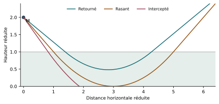
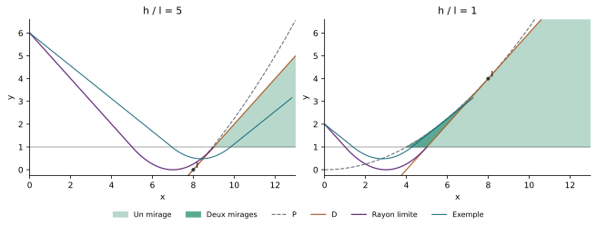
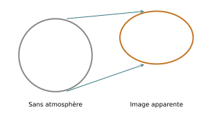
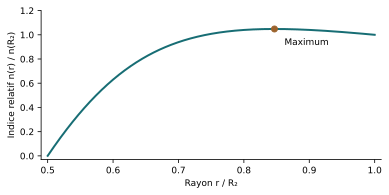

# ENS de Paris (Ulm) PC 2011 — Physique C · Corrigé guidé

*Corrigé rédigé par IA, non officiel. Signalez toute erreur.*

**Lecture du rapport du jury** · GPT-6.2 Astra Ultra · vitesse non renseignée

**Rédaction** · GPT-6.2 Astra Ultra · vitesse non renseignée

## Propagation de la lumière dans les milieux inhomogènes

## I. Polarisabilité et indice des milieux dilués

### Question 1 — Indices usuels

**Indication.** Comparer l’écart à l’unité.

Dans le visible, $n_{\rm air}\simeq1{,}0003$, $n_{\rm eau}\simeq1{,}33$, $n_{\rm verre}\sim1{,}5$ selon le verre. Seul l’air est ici un milieu dilué, dont la polarisation modifie peu le champ local.

### Question 2 — Dimensions des coefficients

**Indication.** Comparer chaque terme à une accélération.

$\omega_0^2s$ et $\gamma\dot s$ ont la dimension de $\ddot s$. Ainsi $[\omega_0]=[\gamma]=\mathrm{s^{-1}}$. La première est une pulsation, la seconde un taux d’amortissement.

### Question 3 — Rappel et dissipation

**Indication.** L’atome est isolé. Quel mécanisme emporte de l’énergie sans collision ?

Le terme $-m\omega_0^2\mathbf s$ modélise à l’ordre linéaire le rappel électrostatique de la distribution de charges. L’électron accéléré rayonne ; le terme dissipatif effectif $-m\gamma\dot{\mathbf s}$ rend compte de la perte d’énergie mécanique associée.

### Question 4 — Dynamique de l’électron

**Indication.** Évaluer la force de Lorentz à la position de la charge.

Avec $\mathbf r=\mathbf r_0+\mathbf s$, la deuxième loi de Newton donne $m\ddot{\mathbf s}+m\gamma\dot{\mathbf s}+m\omega_0^2\mathbf s=-e[\mathbf E(\mathbf r,t)+\dot{\mathbf s}\times\mathbf B(\mathbf r,t)]$. Le signe de droite est celui de la charge électronique.

### Question 5 — Champ local uniforme

**Indication.** Comparer la dimension d’un atome à la longueur d’onde visible.

La phase varie sensiblement sur $1/k\sim10^{-7}\,\mathrm m$ ; les excursions atomiques sont de l’ordre de $10^{-10}\,\mathrm m$ ou plus petites. Le produit $k|\mathbf s|$ est très inférieur à un et $\mathbf E(\mathbf r_0+\mathbf s)\simeq\mathbf E(\mathbf r_0)$.

### Question 6 — Force magnétique

**Indication.** Pour une onde, relier l’ordre de grandeur de $B$ à celui de $E$.

Dans ce milieu dilué $B\sim E/c$. Ainsi $|\dot{\mathbf s}\times\mathbf B|/E\lesssim|\dot{\mathbf s}|/c\ll1$ pour l’électron non relativiste. Le champ magnétique intervient en outre à l’ordre quadratique dans la réponse au champ incident.

### Question 7 — Amplitude du déplacement

**Indication.** La dérivation temporelle multiplie le signal par $-i\omega$.

Posons $A(\omega)=\omega_0^2-\omega^2-i\gamma\omega$. Le régime forcé satisfait $mA\mathbf s_0=-e\mathbf E_0$, donc $\mathbf s_0=-e\mathbf E_0/(mA)$.

### Question 8 — Moment dipolaire

**Indication.** Le moment va de la charge négative vers la positive.

Le noyau et l’électron donnent $\mathbf p=-e\mathbf s$. Il vient $\mathbf p_0=e^2\mathbf E_0/(mA)$. À basse fréquence le dipôle est orienté dans le sens du champ.

### Question 9 — Susceptibilité d’un gaz

**Indication.** Sommer les moments dipolaires par unité de volume.

Pour des atomes indépendants $\mathbf P=n_{\rm at}\mathbf p_0=\epsilon_0\chi\mathbf E$. La susceptibilité électrique $\chi=n_{\rm at}e^2/[m\epsilon_0 A(\omega)]$ est sans dimension.

### Question 10 — Maxwell en amplitudes complexes

**Indication.** Les amplitudes dépendent de la position. La dépendance temporelle est déjà factorisée.

Les équations sont $\nabla\cdot\mathbf E=\rho/\epsilon_0$, $\nabla\cdot\mathbf B=0$, $\nabla\times\mathbf E=i\omega\mathbf B$ et $\nabla\times\mathbf B=\mu_0\mathbf j-i\omega\mathbf E/c^2$. Les densités incluent les charges et courants liés.

### Question 11 — Équation vectorielle d’onde

**Indication.** Exploiter d’abord la loi de Gauss pour le matériau homogène.

Avec $\rho=-\nabla\cdot\mathbf P$ et $\mathbf j=-i\omega\mathbf P$, Gauss donne $(1+\chi)\nabla\cdot\mathbf E=0$, donc $\nabla\cdot\mathbf E=0$ dans le régime considéré. En prenant le rotationnel de Faraday puis en utilisant Ampère, on trouve $\Delta\mathbf E+(\omega^2/c^2)(1+\chi)\mathbf E=0$.

### Question 12 — Dispersion de l’onde plane

**Indication.** Essayer un facteur spatial exponentiel.

Pour $\mathbf E=\mathbf E_m e^{i\mathbf k\cdot\mathbf r}$, on a $\mathbf k\cdot\mathbf E_m=0$ et $\mathbf k\cdot\mathbf k=(1+\chi)\omega^2/c^2$. En propagation selon un axe réel, le nombre d’onde scalaire peut être complexe.

### Question 13 — Transparence loin de la résonance

**Indication.** Comparer les modules des parties imaginaire et réelle de la réponse.

Le rapport $|\chi''/\chi'|=\gamma\omega/|\omega_0^2-\omega^2|$ doit être petit. Au voisinage d’une résonance étroite, cela revient à $|\omega-\omega_0|\gg\gamma/2$. On garde $\chi\simeq n_{\rm at}e^2/[m\epsilon_0(\omega_0^2-\omega^2)]$ réel. Pour $1+\chi>0$, $k$ est alors réel à cet ordre et aucune atténuation n’apparaît dans la propagation approchée.

### Question 14 — Vitesse de phase

**Indication.** Relier la pulsation à la partie réelle du nombre d’onde.

Dans cette approximation, $v_\varphi=\omega/k=c/\sqrt{1+\chi}$ et $n=c/v_\varphi=\sqrt{1+\chi}$. Comme $\chi$ dépend de $\omega$, le milieu reste dispersif, même lorsque l’absorption est petite.

### Question 15 — Domaine de validité

**Indication.** Distinguer le champ agissant sur un atome du champ moyen.

À la question 9 le dipôle répondait au champ macroscopique ; l’interaction avec les autres dipôles et la correction de champ local étaient négligées. Pour $|\chi|\ll1$, $n\simeq1+\chi/2$.

### Question 16 — Plusieurs transitions

**Indication.** Additionner les réponses linéaires des oscillateurs.

Avec des poids d’oscillateur $f_j$, des pulsations propres $\omega_j$ et un amortissement négligeable, $\chi=(n_{\rm at}e^2/m\epsilon_0)\sum_j f_j/(\omega_j^2-\omega^2)$. Un mélange de constituants ajoute une somme pondérée par leurs densités respectives.

### Question 17 — Loi de Cauchy

**Indication.** Développer chaque dénominateur pour des transitions dominantes dans l’ultraviolet.

Pour $\omega^2\ll\omega_j^2$, $1/(\omega_j^2-\omega^2)\simeq\omega_j^{-2}+\omega^2\omega_j^{-4}$. Avec $\omega=2\pi c/\lambda$ et la question 15, $n\simeq A+B/\lambda^2$. Si $K=n_{\rm at}e^2/(2m\epsilon_0)$, $A=1+K\sum f_j/\omega_j^2$, $B=K(2\pi c)^2\sum f_j/\omega_j^4$. Ici $\lambda$ est la longueur d’onde dans le vide.

### Question 18 — Pression et température

**Indication.** Dans le gaz parfait, compter les atomes par unité de volume.

À composition fixée, chaque densité moléculaire est proportionnelle à $P/(k_BT)$. La susceptibilité et $n-1$ obéissent donc à $n-1=C(\lambda)P/T$, avec $T$ en kelvins.

### Question 19 — Variation thermique de l’indice

**Indication.** Mettre les trois températures en kelvins avant de comparer.

Sous la même pression, $n(T)-1=2{,}92\,10^{-4}\times273{,}15/T$. On trouve $n(20\,{}^\circ\mathrm C)=1{,}0002721$ et $n(30\,{}^\circ\mathrm C)=1{,}0002631$.

### Question 20 — Mesure interférométrique

**Indication.** Transformer une variation de chemin optique en un nombre de franges.

Placer une cellule de longueur $L$ dans un bras d’un Michelson et passer du vide à l’air à pression et température mesurées. Le double passage change le chemin optique de $2L(n-1)$. En comptant $N$ franges avec une source de longueur d’onde $\lambda$, on obtient $n=1+N\lambda/(2L)$.

## II. Le mirage au-dessus de la route

### Question 21 — Pente apparente

**Indication.** L’angle est mesuré depuis la verticale.

Au départ de $M$ vers les $x$ croissants, la tangente descendante fait l’angle $\pi/2-\theta$ avec l’horizontale. Ainsi $\beta=-y'(0)=\cot\theta$.

### Question 22 — Segment en air homogène

**Indication.** Trouver l’intersection de la droite avec le haut de la couche.

Au-dessus de la couche $y=l+h-\beta x$. Elle rencontre $y=l$ au point $A=(h/\beta,l)$.

### Question 23 — Invariant du milieu stratifié

**Indication.** Appliquer Snell–Descartes à des strates horizontales de plus en plus fines.

La composante tangentielle du vecteur d’onde se conserve à chaque traversée. La limite continue donne $n(y)\sin i(y)=n_0\sin\theta$, constant sur tout le rayon.

### Question 24 — Gradient thermique

**Indication.** Observer l’angle de la tangente au voisinage du point le plus bas.

En descendant vers le point de rebroussement le rayon devient horizontal et $\sin i$ augmente. Dès lors $n$ diminue en descendant, donc $n_s<n_0$. Comme $n-1\propto1/T$ à pression fixée, $T_s>T_0$ : le sol ensoleillé chauffe les couches basses.

### Question 25 — Rayon rasant le sol

**Indication.** Au retournement la tangente est horizontale.

$i_B=\pi/2$ donne $n_m=n_0\sin\theta$. Le rayon limite vérifie $n_m=n_s$ : $\theta_l=\arcsin(n_s/n_0)$ et $\beta_l=\sqrt{n_0^2-n_s^2}/n_s$.

### Question 26 — Rayon intercepté

**Indication.** Comparer l’invariant du rayon à l’indice minimal de la couche.

Si $\theta<\theta_l$, $n_0\sin\theta<n_s$. L’angle $i$ reste strictement inférieur à $\pi/2$ jusque sur la route. Le rayon atteint donc le sol avec une pente descendante finie. La figure compare ce cas à celui d’une trajectoire retournée.

### Question 27 — Distance apparente minimale

**Indication.** Prolonger la tangente observée jusqu’au plan de la route.

Le prolongement rectiligne de $M$ coupe le sol à $OH=(h+l)/\beta$. Les rayons issus du ciel vérifient $\beta\le\beta_l$. La limite inférieure est donc $(h+l)n_s/\sqrt{n_0^2-n_s^2}$.

### Question 28 — Ordre de grandeur routier

**Indication.** Le contraste concerne la petite différence entre deux indices presque égaux à un.

Pour une hauteur d’œil de 1,70 m et les indices des questions 19 et 24, $\beta_l\simeq\sqrt{2(9{,}0\,10^{-6})}=4{,}24\,10^{-3}$. La distance minimale est proche de $400\,\mathrm m$. Il faut un tronçon dégagé, suffisamment long, une visée rasante et un gradient thermique persistant.

### Question 29 — Équation de pente

**Indication.** Projeter le vecteur unitaire tangent sur l’horizontale.

$\sin i=1/\sqrt{1+(y')^2}$, d’où $n(y)/\sqrt{1+(y')^2}=n_m=n_0\sin\theta$.

### Question 30 — Courbure dans la couche

**Indication.** Dériver la relation au carré le long du rayon, puis prolonger au sommet par continuité.

La relation $(y')^2=(n_s^2+ay)/n_m^2-1$ donne $2y'y''=ay'/n_m^2$, puis $y''=a/(2n_0^2\sin^2\theta)$. La trajectoire est un arc de parabole convexe.

### Question 31 — Approximation numérique

**Indication.** Le contraste d’indice doit rester dans le gradient, même si le facteur du dénominateur est arrondi.

$y''=a/(2n_m^2)\simeq a/2$ car $n_m-1\sim3\,10^{-4}$. Cette approximation ne change la courbure que d’environ six dix-millièmes. Le contraste reste intégralement dans $a=(n_0^2-n_s^2)/l$.

### Question 32 — Équation du rayon

**Indication.** Raccorder position et pente à celles du segment supérieur.

Pour $X=x-h/\beta$ et $x_A\le x\le x_C$, l’intégration de $y''=a/2$ avec $y(A)=l$, $y'(A)=-\beta$ donne $y=l-\beta X+aX^2/4$.

### Question 33 — Coordonnées du sommet

**Indication.** Annuler la pente de la parabole.

$y'=-\beta+aX/2$ s’annule pour $X=2\beta/a$. Donc $B=(h/\beta+2\beta/a,\ l-\beta^2/a)$.

### Question 34 — Nouvelle expression de la pente limite

**Indication.** Imposer que la parabole touche la route.

La condition $y_B=0$ donne $\beta_l=\sqrt{al}$. Elle s’accorde avec la question 25 à un facteur $n_s\simeq1$ près.

### Question 35 — Retour dans le milieu homogène

**Indication.** Trouver la seconde intersection avec le bord supérieur.

L’équation $-\beta X+aX^2/4=0$ fournit $x_C=h/\beta+4\beta/a$, $y_C=l$. La pente en $C$ vaut $+\beta$, de sorte que la suite rectiligne est $y=\beta x+l-h-4\beta^2/a$.

### Question 36 — Équation d’un rayon issu de l’objet

**Indication.** Imposer le passage par $F$ sur la dernière branche rectiligne.

$y_0=l-h+\beta x_0-4\beta^2/a$. Pour $\beta>0$, $y_0\ge l$ assure aussi $x_0\ge h/\beta+4\beta/a=x_C$.

### Question 37 — Enveloppe des objets accessibles

**Indication.** Compléter le carré en $\beta$.

À $x=x_0$ fixé, la hauteur maximale algébrique est $P(x)=l-h+ax^2/16$, atteinte pour $b_*(x)=ax/8$. Les solutions réelles existent dans $S=\{x\ge0,\ l\le y\le P(x)\}$ et valent $\beta_\pm=ax/8\pm\tfrac12\sqrt{a[P(x)-y]}$.

### Question 38 — Admissibilité du rayon

**Indication.** Contrôler la direction du rayon et la hauteur de son sommet.

Le segment de $M$ vers $A$ doit descendre, d’où $\beta\ge0$ ; la parabole doit rester au-dessus du sol, d’où $\beta\le b=\sqrt{al}$. Pour $h>0$ et un objet à distance finie, $\beta=0$ est seulement une limite.

### Question 39 — Région de la racine supérieure

**Indication.** Sur la branche descendante de la parabole en $\beta$, comparer la hauteur obtenue à $\beta=b$.

La racine haute est admissible si $b_*\le b$ et $y\ge D(x)$, où $D(x)=l-h+bx-4b^2/a=bx-h-3l$. Ainsi $S_+=S\cap\{x\le8b/a,\ y\ge D(x)\}$. La droite $D$ est précisément la branche rectiligne incidente de la trajectoire limite prolongée.

### Question 40 — Région de la racine inférieure

**Indication.** Distinguer la position du sommet en $\beta$ par rapport à $b$.

Dans $S$, $y\ge l>l-h$ assure $\beta_->0$. Si $b_*\le b$, elle est toujours acceptable. Si $b_*>b$, la branche basse atteint $b$ à $y=D(x)$ et est acceptable pour $y\le D(x)$. Ainsi $S_-=S\cap(\{x\le8b/a\}\cup\{y\le D(x)\})$.

### Question 41 — Tangence de la droite limite

**Indication.** Calculer la différence entre le lieu discriminant et la droite.

$P(x)-D(x)=(a/16)(x-8b/a)^2$. Les courbes sont tangentes en $I=(8\sqrt{l/a},5l-h)$, et leur pente commune vaut $b$.

### Question 42 — Intersection sous le toit de la couche

**Indication.** Comparer la hauteur de $I$ à $l$.

$y_I\le l$ équivaut à $h\ge4l$.

### Question 43 — Mirage unique pour une couche mince

**Indication.** Faire apparaître la région commune au-dessus de la couche et sous la droite limite.

Si $h\ge4l$, $P(x)\le l$ pour $0\le x\le x_I$, sauf l’éventuelle égalité au bord. Les objets donnant une image mirage ont donc $x\ge(h+4l)/b$ et $l\le y\le D(x)$. Ils ne fournissent que la branche $\beta_-$, l’autre traverserait le sol. La figure montre le rayon limite et un rayon admissible pour chaque rapport de hauteurs.

### Question 44 — Sens de l’image simple

**Indication.** Si le point objet s’élève, la ligne de visée se rapproche-t-elle de la route ?

À $x_0$ fixé, $d\beta/dy_0=1/(x_0-8\beta/a)$ est positif sur la branche basse. Le regard est dirigé sous l’horizontale avec l’angle $-\arctan\beta$. Le haut de l’objet apparaît donc plus bas : l’image du mirage est renversée.

### Question 45 — Double image pour une couche épaisse

**Indication.** Compter les racines acceptables de part et d’autre du point de tangence.

Pour $h<4l$, la limite supérieure de l’union accessible est $P(x)$ si $x\le x_I$, puis $D(x)$ si $x\ge x_I$, toujours sous la condition $y\ge l$. Dans la partie $x<x_I$, $D(x)<y<P(x)$, les deux racines existent : $\beta_-$ donne une image renversée et $\beta_+$ une image droite car son dérivé en $y$ est négatif. À $y=P(x)$ elles se confondent. Sous $D(x)$, ainsi que pour $x>x_I$ dans la région autorisée, seule subsiste l’image renversée. Sur la portion $x<x_I$, $y=D(x)$, la seconde racine correspond au rayon rasant le sol. La figure représente aussi la dégénérescence des deux rayons en $I$.

## III. De Maxwell aux rayons, puis à la mécanique

### Question 46 — Échelle de diffraction

**Indication.** Repérer le premier minimum d’une fente.

Pour une fente de largeur $L$, $\sin\theta_1=\lambda/L$. La demi-ouverture est de l’ordre de $\lambda/L$. L’optique géométrique requiert que les dimensions et les échelles de variation du milieu soient grandes devant la longueur d’onde.

### Question 47 — Milieu inhomogène

**Indication.** Garder le terme de divergence du champ électrique.

Avec $\epsilon_r=1+\chi$, Gauss donne $\nabla\cdot(\epsilon_r\mathbf E)=0$, donc $\nabla\cdot\mathbf E=-\mathbf E\cdot\nabla\ln\epsilon_r$. Les deux équations rotationnelles donnent $\nabla\times\nabla\times\mathbf E=k_0^2\epsilon_r\mathbf E$, où $k_0=\omega/c$. L’identité du double rotationnel conduit à $\Delta\mathbf E+k_0^2\epsilon_r\mathbf E+\nabla(\mathbf E\cdot\nabla\ln\epsilon_r)=0$.

### Question 48 — Réduction à Helmholtz

**Indication.** Comparer les deux longueurs de variation dans le dernier terme.

Si $k\sim2\pi/\lambda$ et si $n$ varie sur $L$, le dernier terme est d’ordre $kE/L+E/L^2$ au plus pour un indice d’ordre un. Les deux premiers sont d’ordre $k^2E$. Comme $kL\gg1$, il reste $\Delta\mathbf E+k_0^2n^2\mathbf E\simeq0$.

### Question 49 — Dimension du chemin optique

**Indication.** Tester l’onde plane dans un milieu homogène.

$k_0 S$ est une phase sans dimension, donc $[S]=\mathrm m$. Pour une direction $\mathbf u$, $S=n\mathbf u\cdot\mathbf r+\text{constante}$. Le gradient est sans dimension et sa norme est de l’ordre de $n$, donc de l’unité ici.

### Question 50 — Laplacien de la phase

**Indication.** Dériver deux fois la composée exponentielle.

$\nabla e^{ik_0 S}=ik_0 e^{ik_0S}\nabla S$, d’où $\Delta e^{ik_0 S}=e^{ik_0S}(ik_0\Delta S-k_0^2|\nabla S|^2)$, sans approximation.

### Question 51 — Équation eikonale

**Indication.** Dans le Laplacien de l’onde, repérer les termes d’ordre $k_0^2$.

Pour $\mathbf E=\mathbf e_0e^{ik_0 S}$, les termes contenant $\nabla\mathbf e_0$ ou $\Delta S$ sont d’ordre $k_0/L$ et ceux contenant $\Delta\mathbf e_0$ d’ordre $1/L^2$. Il reste $k_0^2(n^2-|\nabla S|^2)\mathbf e_0=0$. Une amplitude non nulle impose $|\nabla S|^2=n^2$.

### Question 52 — Transversalité électrique

**Indication.** Dans la loi de Gauss, ne conserver que la dérivée rapide.

Le terme dominant de $\nabla\cdot(n^2\mathbf e_0e^{ik_0S})$ est $ik_0n^2\mathbf e_0\cdot\nabla S$ fois l’exponentielle. Ainsi $\mathbf e_0\cdot\nabla S=0$.

### Question 53 — Champ magnétique local

**Indication.** Appliquer Faraday en dérivant la phase.

$i\omega\mathbf B=\nabla\times\mathbf E\simeq ik_0 e^{ik_0S}\nabla S\times\mathbf e_0$, soit $\mathbf B\simeq(\nabla S\times\mathbf E)/c$.

### Question 54 — Structure d’onde

**Indication.** Identifier la direction du vecteur d’onde local.

Les champs sont localement ceux d’une onde plane progressive de vecteur $\mathbf k=k_0\nabla S$, transverse à $\mathbf E$ et à $\mathbf B$. Le champ magnétique vaut $n\mathbf u\times\mathbf E/c$ avec $\mathbf u=\nabla S/n$. Les surfaces $S$ constante sont les fronts d’onde.

### Question 55 — Flux moyen

**Indication.** Utiliser le conjugué complexe pour la moyenne d’un produit harmonique.

$\langle\vec{\Pi}\rangle=\Re(\mathbf E\times\mathbf B^*)/(2\mu_0)$. Avec la transversalité et $S$ réel, le double produit vectoriel donne $\langle\vec{\Pi}\rangle=(\mathbf e_0\cdot\mathbf e_0^*)\nabla S/(2\mu_0c)$.

### Question 56 — Direction des rayons

**Indication.** Repérer la direction de transport de l’énergie.

Par définition le rayon suit le flux moyen d’énergie. La question 55 donne un flux parallèle à $\nabla S$, orienté vers les phases croissantes : les rayons sont ses lignes de champ.

### Question 57 — Quantité tangentielle optique

**Indication.** Normaliser le gradient de phase en utilisant l’eikonale.

Comme $|\nabla S|=n$ et que $\mathbf u=d\mathbf r/ds$ est la tangente unitaire orientée, $n\mathbf u=\nabla S$.

### Question 58 — Équation du rayon

**Indication.** Dériver un gradient le long de sa propre ligne de champ.

Pour toute composante $j$, $\sum_i(\partial_i S)\partial_i\partial_j S=\tfrac12\partial_j\sum_i(\partial_i S)^2$. Dès lors $d(n\mathbf u)/ds=(\nabla S\cdot\nabla)\nabla S/n=\nabla(n^2)/(2n)=\nabla n$.

### Question 59 — Paramètre mécanique

**Indication.** $n$ est sans dimension.

La relation $dt=ds/(vn)$ attribue à $v$ la dimension d’une vitesse, $\mathrm{m\,s^{-1}}$. La variable $t$ est un paramètre fictif.

### Question 60 — Potentiel mécanique équivalent

**Indication.** Réécrire d’abord la vitesse fictive, puis dériver une seconde fois.

$d\mathbf r/dt=vn\mathbf u$, et $d^2\mathbf r/dt^2=v^2n\,d(n\mathbf u)/ds=v^2n\nabla n$. Ainsi $m\ddot{\mathbf r}=-\nabla U$ avec $U=-mv^2 n^2/2+\text{constante}$.

### Question 61 — Parabole du mirage

**Indication.** Examiner la force fictive quand $n^2$ est affine.

Le gradient de $n^2=n_s^2+ay$ est constant et vertical. L’accélération fictive est $v^2a\mathbf e_y/2$. La composante horizontale du mouvement est uniforme et la verticale uniformément accélérée, ce qui produit les paraboles de la partie II.

### Question 62 — Sens de courbure

**Indication.** Projeter l’équation du rayon perpendiculairement à la tangente.

$d\mathbf u/ds=[\nabla n-(\mathbf u\cdot\nabla n)\mathbf u]/n$. Le centre de courbure se situe du côté où l’indice augmente. Dans la figure de la route, l’augmentation vers le haut ramène le rayon vers le ciel.

### Question 63 — Conditions initiales

**Indication.** Compter positions et vitesses indépendantes, puis imposer la contrainte optique.

Un point matériel à trois dimensions demande trois coordonnées et trois composantes de vitesse. Ici $|\dot{\mathbf r}|=vn(\mathbf r)$ est fixé dès que la position est donnée. Restent cinq paramètres, trois pour la position et deux pour la direction. Avec la constante du potentiel choisie nulle, l’énergie fictive vaut zéro.

### Question 64 — Propagation rectiligne

**Indication.** Quelle conservation fixe la direction aussi bien que la norme de la vitesse ?

Si $n$ est constant, la force fictive est nulle et la quantité de mouvement $m\dot{\mathbf r}$ se conserve vectoriellement. La trajectoire est une droite.

### Question 65 — Réfraction au dioptre

**Indication.** Le potentiel ne dépend que de la coordonnée normale.

La composante tangentielle $m\dot x=mv n\sin i$ est conservée à travers le dioptre. On obtient $n_1\sin i_1=n_2\sin i_2$, les angles étant mesurés à la normale.

### Question 66 — Milieu à symétrie sphérique

**Indication.** Calculer le moment du champ de force central.

Le moment de la force par rapport au centre est nul, donc $\mathbf L=m\mathbf r\times\dot{\mathbf r}$ est conservé. La trajectoire est dans le plan orthogonal à $\mathbf L$ pour $L\ne0$ et radiale si $L=0$. Sa norme divisée par $mv$ vaut $nr\sin i$. C’est aussi la conservation de la vitesse aréolaire, seconde loi de Kepler.

### Question 67 — Limite classique

**Indication.** Chercher l’analogue de l’approximation de courte longueur d’onde.

La mécanique quantique redonne la mécanique classique dans la limite semi-classique où la longueur d’onde de de Broglie est petite devant les dimensions de variation, ou l’action grande devant $\hbar$. La phase satisfait alors, à l’ordre dominant, l’équation de Hamilton–Jacobi.

## IV. Réfraction astronomique et limites d’un indice isotrope

### Question 68 — Géométrie polaire

**Indication.** Projeter un déplacement suivant le rayon sur les deux directions polaires.

Pour la remontée du rayon de l’observateur vers l’étoile, $dr=ds\cos i$ et $r\,d\varphi=ds\sin i$. Ainsi $dr/r=d\varphi/\tan i$.

### Question 69 — Déviation infinitésimale

**Indication.** Différentier le logarithme de l’invariant de Bouguer.

$d\ln(nr\sin i)=dn/n+dr/r+di/\tan i=0$. En substituant la question 68 et en regroupant, $dR=d\varphi+di=-\tan i\,dn/n$.

### Question 70 — Intégrale de déviation

**Indication.** Exprimer la tangente à l’aide de la valeur initiale de l’invariant.

Posons $J=R_T n(R_T)\sin\delta$. Comme $\sin i=J/(rn)$, $\tan i=[(rn/J)^2-1]^{-1/2}$. Entre le sol et la sortie de l’atmosphère, on trouve $D(\delta)=-\int_{R_T}^{R_T+h}[n'(r)/n(r)]\,[(rn/J)^2-1]^{-1/2}\,dr$. Le signe est positif lorsque $n$ décroît en altitude.

### Question 71 — Étoile près du zénith

**Indication.** Développer la tangente lorsque l’invariant est petit.

$\sin\delta=\delta+O(\delta^3)$ et $\tan i=J/(rn)+O(\delta^3)$. Ainsi $D(\delta)=-R_T n(R_T)\,\delta\int_{R_T}^{R_T+h}n'(r)/[r n(r)^2]\,dr+O(\delta^3)$.

### Question 72 — Approximation de couche mince

**Indication.** Comparer l’épaisseur atmosphérique au rayon terrestre.

$h/R_T=30/6400\simeq4{,}7\,10^{-3}$, donc $r\simeq R_T$. Comme $n(R_T+h)=1$, l’intégrale en $n'/n^2$ donne $1/n(R_T)-1$. D’où $D(\delta)\simeq\delta[n(R_T)-1]$ au premier ordre en angle.

### Question 73 — Limite à l’horizon

**Indication.** Examiner le dénominateur de l’intégrale au sol.

L’horizon correspond à $\delta\to\pi/2$. La tangente du rayon initial devient grande et le dénominateur de la question 70 tend vers zéro au sol. Le développement limité de la question 71 ne s’y applique plus.

### Question 74 — Disque solaire aplati

**Indication.** Comparer les réfractions du bord inférieur et du bord supérieur.

En augmentant $\delta$, $J$ croît, donc $\tan i$ et la déviation positive croissent. Le bord inférieur, plus près de l’horizon, est relevé davantage. La dimension verticale de l’image diminue, tandis que la symétrie atmosphérique conserve l’azimut de chaque point. Le grand axe de l’image est horizontal.

### Question 75 — Diamètre angulaire du Soleil

**Indication.** Le petit angle est le rapport du diamètre à la distance.

$d_{\rm app}=1{,}39\,10^6/(1{,}50\,10^8)=9{,}27\,10^{-3}\,\mathrm{rad}=0{,}531^\circ\simeq31{,}9'$.

### Question 76 — Disque sans atmosphère

**Indication.** Comparer le relèvement au diamètre entier du disque.

Quand le bord inférieur apparent touche l’horizon, son altitude vraie est environ $-34{,}5'$. Le bord supérieur vrai est à $-34{,}5'+31{,}9'=-2{,}6'$. À cet instant, même le bord supérieur serait déjà sous l’horizon sans atmosphère.

### Question 77 — Dispersion de l’air

**Indication.** Rapporter la variation à l’excès d’indice.

Prenons $0{,}40$ et $0{,}80\,\mu\mathrm m$ comme limites du visible. La formule donne $n_v-1=2{,}982\,10^{-4}$ et $n_r-1=2{,}905\,10^{-4}$. De rouge à violet, la variation relative rapportée à $n_r-1$ vaut environ $2{,}6\,\%$. Elle dépend un peu du choix des deux bornes.

### Question 78 — Ordre de disparition

**Indication.** Chercher la couleur qui bénéficie du plus petit relèvement.

L’indice et la déviation sont plus faibles dans le rouge. L’image rouge est plus basse, elle disparaît donc la première.

### Question 79 — Hauteur et durée du dernier liseré

**Indication.** Multiplier la réfraction à l’horizon par le contraste spectral relatif.

Lorsque le rouge disparaît, il reste une hauteur angulaire de l’ordre de $0{,}026\times34{,}5'\simeq0{,}9'$, soit environ $2{,}6\,10^{-4}\,\mathrm{rad}$. La rotation terrestre représente environ $15'$ par minute de temps ; pour une trajectoire presque perpendiculaire à l’horizon, le phénomène dure $0{,}9/15$ minute, soit 3 à 4 s. La composante verticale dépend du lieu, de la date et de la trajectoire apparente.

### Question 80 — Couleur du dernier liseré

**Indication.** Quelles radiations survivent au long trajet dans l’air et sont sensibles à l’œil ?

La dispersion seule laisserait le violet en dernier. La diffusion de Rayleigh, plus forte aux petites longueurs d’onde, atténue le bleu et le violet sur la longue traversée atmosphérique. Les absorptions spectrales et la faible sensibilité visuelle au violet modifient aussi la couleur perçue, qui peut être verte.

### Question 81 — Invariant en coordonnées polaires

**Indication.** Exprimer la composante transverse de la tangente à la courbe $r(\theta)$.

$ds=\sqrt{r'^2+r^2}\,|d\theta|$. En norme, $\sin i=r/\sqrt{r'^2+r^2}$ ; donc $nr\sin i=nr^2/\sqrt{r'^2+r^2}$ est constant.

### Question 82 — Condition nécessaire sur l’indice isotrope

**Indication.** Évaluer l’invariant à l’équateur du dessin et au bord externe pour le même rayon.

Posons $d=R_2-R_1$, $k=d/R_2$. Le rayon horizontal extérieur coupe le cercle à $\theta_l=\arcsin(a/R_2)$ du côté droit. Dans la couche, $r=R_1+ka/\sin\theta$, donc $r'=-(r-R_1)\cot\theta$. Pour $\theta=\pi/2$, $r_m=R_1+ka$, et l’invariant vaut $r_m n(r_m)$. Au bord interne de la surface externe il vaut $n(R_2^-)R_2^2/\sqrt{R_2^2+d^2\cot^2\theta_l}$. Comme $\sin\theta_l=(r_m-R_1)/d$, l’égalité conduit à la fonction affichée ci-dessous pour $r=r_m$.

$$
n(r)=\frac{n(R_2^-)R_2^2}{r\sqrt{R_2^2+d^2[d^2/(r-R_1)^2-1]}}.
$$

Elle constitue seulement une condition nécessaire à ces trajectoires.

### Question 83 — Maximum du profil nécessaire

**Indication.** Étudier le signe des pentes aux deux extrémités de la couche.

Près de $R_1$, $n(r)\sim n(R_2^-)R_2^2(r-R_1)/(R_1d^2)$ : il part de zéro en croissant. À $R_2^-$, $n'/n=-1/R_2+d/R_2^2=-R_1/R_2^2<0$. Par continuité, le maximum est intérieur. Plus précisément, en posant $u=r-R_1$, le signe de $n'$ est celui de $R_1d^4-(R_2^2-d^2)u^3$, d’où un unique maximum.

### Question 84 — Vitesse de phase

**Indication.** Distinguer transport d’information et déplacement d’une phase.

Quand $r\downarrow R_1$, $n\to0$ et $v_\varphi=c/n$ diverge formellement. Une vitesse de phase dépassant $c$ ne transporte pas à elle seule un signal. Un comportement extrême d’indice suppose généralement une forte dispersion, et près d’un zéro d’indice la description en rayons est elle-même fragile. Une telle loi pour une large bande de fréquences est donc physiquement peu plausible.

### Question 85 — Contradiction locale

**Indication.** Écrire la hauteur du rayon en fonction de $\theta$ près de $\pi/2$.

Dans le demi-plan supérieur, $y=r\sin\theta=R_1\sin\theta+ka$ est maximale sur l’axe $y$. À ce point la tangente est horizontale et la concavité tournée vers le centre. La question 62 impose alors $n'(r)<0$ pour chaque point de passage sur cet axe. Or la question 83 impose $n'(r)>0$ près de $R_1$. Un indice isotrope radial ne peut réaliser toutes les courbes prescrites.

### Question 86 — Réponse anisotrope

**Indication.** Dans un cristal anisotrope, polarisation et champ peuvent avoir des directions différentes.

La susceptibilité linéaire est un tenseur d’ordre deux : $P_i=\epsilon_0\sum_j\chi_{ij}E_j$. La biréfringence d’un cristal permet par exemple de réaliser une lame quart d’onde qui introduit un retard de phase entre deux composantes de la polarisation.

### Question 87 — Vision depuis la cape fictive

**Indication.** Suivre les photons qui permettraient à l’œil de voir.

Un dispositif passif parfait qui détournerait tous les rayons autour d’une cavité n’y laisserait entrer aucune lumière extérieure. Un œil placé dans cette cavité ne formerait donc aucune image de l’extérieur. Prélever de la lumière pour voir modifierait au moins partiellement le champ extérieur.
