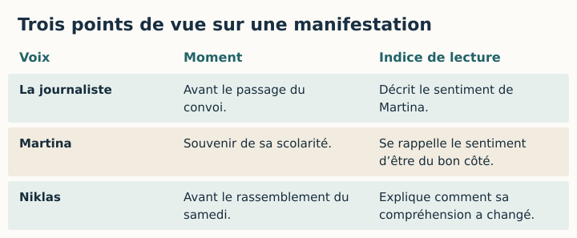

# ENS Rennes · D1 · Allemand 2011 — Corrigé guidé

*Corrigé rédigé par IA, non officiel. Signalez toute erreur.*

**Rédaction** · GPT-6.2 Astra Ultra · vitesse non renseignée

Le feuillet de l’École normale supérieure de Cachan est conservé dans les archives du concours D1 de Rennes. Mariam Lau · Die Zeit · 4 novembre 2010.

## Version française

Elle appelle cela la « sensation Gorleben ». Chez Martina Lammers, 44 ans, elle se fait sentir chaque fois que le convoi CASTOR quitte l’usine française de retraitement de La Hague en direction de Gorleben. On dirait une sorte de griserie mêlée de peur, le signal de départ de cette mobilisation intérieure que, dans le Wendland, on appelle « désobéissance civile ». La police vous soulèvera-t-elle pour vous emporter ? Ou vous arrêtera-t-elle ? Les militants dressent dans les champs et aux fenêtres des croix en bois jaunes qui leur permettent de se reconnaître entre eux. […]

Martina, mère de cinq enfants, institutrice et présidente de la section locale des Verts à Dannenberg, a elle aussi une croix de bois à sa fenêtre. Mais ici, de toute façon, tout le monde la connaît. Depuis sa plus tendre enfance, elle est dans la « résistance ». Elle était en classe de quatrième quand on a construit les premières installations à Gorleben. Avec quelques camarades, elle est allée s’asseoir sur la place du marché de Dannenberg pour manifester. Comment cette idée lui était venue à l’époque, elle ne s’en souvient plus très bien. Elle connaissait des gens qui ne mangeaient pas de viande, portaient des pulls tricotés à la main et avaient les cheveux longs. « On avait tout simplement le sentiment d’être du bon côté. »

[…] Niklas, le fils de Martina, qui a quatorze ans, sera lui aussi de la partie samedi. Quand on lui demande comment il se fait qu’en plein âge de la rébellion il manifeste aux côtés de ses parents au lieu de se dresser contre eux, on sent bien que c’est son honneur qui est en jeu. Après tout, dès son enfance, sa mère l’emmenait déjà aux manifestations. « Au début, je trouvais ça vraiment nul, de devoir rester là, des heures sous la pluie. Mais à onze, douze ans, ajoute-t-il bien vite, on comprend tout seul de quoi il s’agit. »

## Expression en allemand

Prendre position sur la participation d’un adolescent de quatorze ans à une manifestation politique · 100 mots.

Ein Vierzehnjähriger kann gute Gründe haben, an einer friedlichen Demonstration teilzunehmen. In der Schule lernt er, was politische Mitbestimmung bedeutet. Bei einer Kundgebung erlebt er, wie unterschiedliche Menschen ein gemeinsames Anliegen öffentlich vertreten. Entscheidend ist für mich, dass er selbst entscheiden darf. Eltern können ihm erklären, worum es geht, und mit ihm über mögliche Risiken sprechen. Sie sollten auch akzeptieren, wenn er zu Hause bleiben oder eine andere Meinung äußern möchte. Niklas hat seine Mutter zunächst einfach begleitet. Dass er heute ihre Auffassung teilt, schließt eigenes Nachdenken keineswegs aus. Die im Alltag erlebte Freiheit zum Widerspruch macht seine Zustimmung glaubwürdig.

*100 mots, comptés par espaces.*

## Comment construire la réponse

Le sujet impose « le convoi CASTOR ». Préservez la construction de *Angstlust*, qui associe l’appréhension et l’attrait. Le ton oscille entre le récit de Mariam Lau et les paroles de Martina puis de Niklas. La question sur la police adopte le point de vue de la personne susceptible d’être emportée. *Sie kennt hier ohnehin jeder* place le pronom complément en tête. La terminaison de *jeder* marque le sujet. Le rapport signale aussi la nécessité d’identifier *Grundschullehrerin* et la désobéissance civile.

Dans la dernière réplique, l’incise *fügt er schnell hinzu* vient au milieu de l’observation sur l’âge auquel on commence à comprendre. Le garçon défend sa capacité à prendre position. Pour la question, prenez au sérieux l’objection concernant un mineur, puis choisissez un critère de liberté personnelle. Un accord sincère entre deux générations suppose aussi que le désaccord soit possible.

[Feuillet original, p. 2](https://www.ens-rennes.fr/medias/fichier/se1a_11d1_lve_1304088323768.pdf#page=2) · [Rapport du jury, partie écrite](https://www.ens-rennes.fr/medias/fichier/re1a-11d1-allemand_1421751236158-pdf#page=1)
