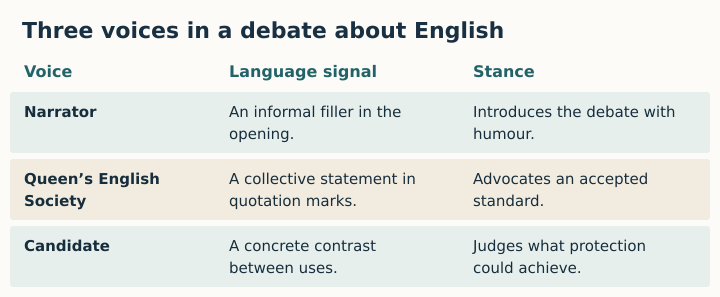

# ENS Rennes · D1 · Anglais 2011 — Corrigé brut

*Corrigé rédigé par IA, non officiel. Signalez toute erreur.*

**Rédaction** · GPT-6.2 Astra Ultra · vitesse non renseignée

Le feuillet de l’École normale supérieure de Cachan est conservé dans les archives du concours D1 de Rennes. Adapté de The Times · 7 juin 2010.

## Version française

Voilà de quoi réjouir les puristes et amener les écoliers à se demander, genre, pourquoi on en fait tout un plat. La Queen’s English Society est en train de créer une Académie de la langue anglaise pour protéger la langue des impuretés, des déformations et des horreurs introduites par la génération qui écrit en langage SMS.

D’autres pays ont de nobles institutions qui veillent aux règles de leur langue. L’anglais, en revanche, ne dispose d’aucun rempart de ce genre contre l’altération et se transforme continuellement. Des mots apparaissent ou tombent en désuétude, la grammaire change et les raffinements de la ponctuation passent de mode ou y reviennent.

La Queen’s English Society, qui réunit des professionnels, des universitaires et des gens qui se reconnaissent volontiers tatillons, a décidé que la création d’une académie anglaise se faisait attendre depuis bien trop longtemps.

Voici ce que déclare la société. « D’autres langues disposent d’instances suprêmes qui s’efforcent, tout en évoluant avec leur temps, de définir ce qui relève du bon usage, ce qui est acceptable et ce qui ne l’est pas. Elles imposent une certaine discipline linguistique et cherchent à conserver les termes nouveaux qui sont justifiés et utiles, tout en rejetant les engouements passagers. L’anglais n’a jamais eu d’académie de cette sorte. Le XXIᵉ siècle, c’est un peu tard pour en créer une… Mais précisément parce que notre langue est si répandue et aussi parce que, dans notre monde moderne, numérique et trépidant, l’éducation a terriblement perdu de son prestige et de sa qualité, nous avons véritablement besoin d’une forme d’instance régulatrice qui établisse une norme reconnue de bon anglais. »

## Expression en anglais

Évaluer jusqu’où une langue peut être protégée des changements technologiques · environ 100 mots.

Languages can be protected in some settings without being frozen everywhere. A teacher can explain why a formal application needs clear sentences and conventional spelling. An archive can preserve older vocabulary that might otherwise disappear. Neither institution, however, can decide what friends will write in a message. New technologies create situations for which speakers need new words and shortcuts. Some expressions vanish with the device that produced them, while others become useful beyond the screen. I would therefore protect people’s ability to switch registers. Someone who can write both a quick message and a precise report has gained a choice.

*100 mots, comptés par espaces.*

[Feuillet original, p. 3](https://www.ens-rennes.fr/medias/fichier/se1a_11d1_lve_1304088323768.pdf#page=3)
